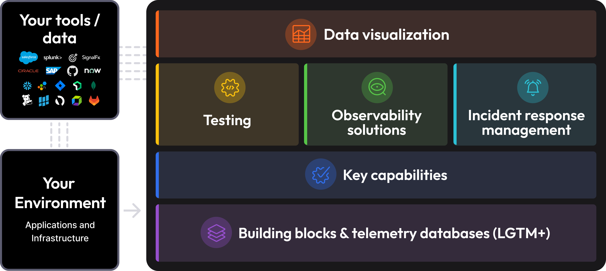

Grafana Cloud to kompleksowe rozwiązanie chmurowe oferowane przez Grafana Labs, które umożliwia monitorowanie, analizę i wizualizację danych w jednym środowisku. Usługa łączy funkcje klasycznej Grafany z zarządzanymi usługami do przechowywania metryk, logów, śladów (traces) i profili w modelu SaaS. Dzięki Grafana Cloud firmy mogą uprościć zarządzanie infrastrukturą monitorującą, eliminując potrzebę instalacji, konfiguracji i utrzymania własnych serwerów.

## Kluczowe funkcje Grafana Cloud

### 1. Metryki — Grafana Mimir

Grafana Cloud oferuje zarządzaną bazę danych szeregów czasowych opartą na **Grafana Mimir** (kompatybilną z Prometheusem). Metryki są przechowywane w chmurze — bez konieczności utrzymywania własnych instancji Prometheusa.

- **Prometheus-as-a-Service** — wysyłanie metryk (`remote_write`, OpenTelemetry) i odpytywanie ich w PromQL bez własnego Prometheusa.
- Obsługa popularnych formatów i źródeł: Prometheus, OpenTelemetry (OTLP), Graphite, InfluxDB (line protocol) i innych.

### 2. Logi — Grafana Loki

**Loki** to zarządzany system przechowywania logów wbudowany w Grafana Cloud. Umożliwia centralizację logów z różnych systemów i ich analizę w kontekście metryk. W przeciwieństwie do Elasticsearch, Loki nie indeksuje treści logów — tylko metadane (etykiety), co czyni go znacznie tańszym w eksploatacji.

### 3. Ślady — Grafana Tempo

**Tempo** to zarządzana usługa distributed tracing, umożliwiająca śledzenie żądań przez wiele mikrousług. Integruje się natywnie z Loki i Mimir, pozwalając na korelację logów, metryk i śladów w jednym widoku (stos LGTM: Loki, Grafana, Tempo, Mimir).

### 4. Profile — Grafana Pyroscope

**Pyroscope** to usługa ciągłego profilowania (continuous profiling) — pokazuje, które funkcje w kodzie zużywają CPU i pamięć. Jest czwartym filarem obserwowalności obok metryk, logów i śladów.

### 5. Zbieranie danych — Grafana Alloy

**Grafana Alloy** to oficjalny, lekki kolektor telemetrii (metryk, logów, śladów, profili) — dystrybucja OpenTelemetry Collectora z wbudowaną obsługą pipeline'ów Prometheusa. Zastąpił wycofane narzędzia **Grafana Agent** i **Promtail**. Dane może wysyłać zarówno do Grafana Cloud, jak i do własnych backendów (Prometheus, Loki, Tempo).

### 6. Plany

| Plan | Przeznaczenie | Rozliczenie |
|------|--------------|-------|
| **Free** | Testy i małe projekty — m.in. 10 tys. aktywnych serii metryk, 50 GB logów, 50 GB śladów i 50 GB profili miesięcznie, retencja 14 dni, 3 aktywnych użytkowników | Bezpłatny |
| **Pro** | Produkcja dla małych i średnich zespołów (dłuższa retencja: metryki 13 miesięcy, logi 30 dni) | Opłata platformowa + pay-as-you-go za wolumen danych |
| **Enterprise** | Duże organizacje, umowa roczna, rozszerzone SLA i wsparcie | Negocjowany |

> Limity i ceny planów zmieniają się — aktualne wartości sprawdzaj na stronie [grafana.com/pricing](https://grafana.com/pricing/) (stan z listopada 2026).

---

## Grafana vs Grafana Cloud: Porównanie

Podczas gdy **Grafana OSS** jest samodzielną aplikacją instalowaną lokalnie, **Grafana Cloud** to zarządzane środowisko SaaS z gotowymi usługami backendowymi.

### 1. Model wdrożenia

| **Grafana OSS** | **Grafana Cloud** |
|---|---|
| Instalowana lokalnie na serwerze, VM lub w kontenerze. | Oparta na chmurze (SaaS), bez instalacji. |
| Użytkownik odpowiada za konfigurację, aktualizacje i utrzymanie. | Grafana Labs zarządza infrastrukturą, aktualizacjami i utrzymaniem. |

---

### 2. Koszty

| **Grafana OSS** | **Grafana Cloud** |
|---|---|
| Open source, bezpłatna (koszty własnej infrastruktury). | Plan Free + płatne plany Pro i Enterprise. |
| Użytkownik ponosi koszty serwerów i ich utrzymania. | Koszty zależne od wolumenu danych, liczby użytkowników i wybranego planu. |

---

### 3. Skalowalność i wydajność

| **Grafana OSS** | **Grafana Cloud** |
|---|---|
| Skalowanie zależy od lokalnych zasobów serwerowych. | Automatyczne skalowanie dzięki infrastrukturze chmurowej. |
| Awaria lokalnej infrastruktury może zatrzymać monitorowanie. | Dane hostowane w wysokodostępnych centrach danych z SLA (plany płatne). |

---

### 4. Źródła danych i usługi backendowe

| **Grafana OSS** | **Grafana Cloud** |
|---|---|
| Prometheus, InfluxDB, Elasticsearch, bazy SQL i inne. | Te same źródła + zarządzane usługi wbudowane. |
| Wymaga osobnej instalacji i konfiguracji każdego backendu. | Mimir (metryki), Loki (logi), Tempo (traces), Pyroscope (profile) — gotowe do użycia. |

---

### 5. Alertowanie

| **Grafana OSS** | **Grafana Cloud** |
|---|---|
| Pełny system alertów (Grafana Alerting) dostępny lokalnie. | Ten sam system + Grafana IRM (dyżury on-call, eskalacje, obsługa incydentów). |
| Wymaga własnej konfiguracji serwera SMTP i kanałów powiadomień. | Wysyłka e-maili działa od razu; integracje Slack, PagerDuty, Opsgenie, webhook itd. |

---

### 6. Bezpieczeństwo i zgodność

| **Grafana OSS** | **Grafana Cloud** |
|---|---|
| Użytkownik odpowiada za konfigurację TLS, LDAP, OAuth. | Grafana Labs zarządza szyfrowaniem i certyfikacjami zgodności (np. SOC 2, ISO 27001). |
| Polityki bezpieczeństwa definiuje organizacja; SAML i niestandardowe role RBAC niedostępne. | SSO (także SAML), RBAC z rolami niestandardowymi, audyt dostępu. |

---

## Podsumowanie: Kiedy wybrać Grafanę OSS, a kiedy Grafana Cloud?

- **Grafana OSS** jest najlepszym wyborem dla użytkowników, którzy:
  - Chcą pełnej kontroli nad infrastrukturą i danymi (dane nie opuszczają własnej sieci).
  - Mają istniejące serwery lub zasoby do hostowania Grafany.
  - Preferują rozwiązania open source bez kosztów licencyjnych.

- **Grafana Cloud** jest idealnym rozwiązaniem dla użytkowników, którzy:
  - Chcą szybko uruchomić monitorowanie bez zarządzania infrastrukturą.
  - Potrzebują zintegrowanego stosu (metryki + logi + traces + profile) gotowego od razu.
  - Szukają skalowalności i wsparcia technicznego z gwarantowanym SLA.

Grafana Cloud jest szczególnie wartościowa, gdy czas wdrożenia i eliminacja operacyjnego narzutu są ważniejsze niż pełna kontrola nad infrastrukturą. Na szkoleniu pracujemy na **Grafanie OSS 13.3** zainstalowanej na własnej maszynie — interfejs Grafany jest w obu wariantach praktycznie taki sam.
