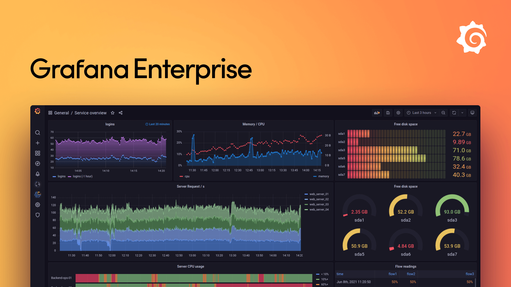

## Czym jest Grafana Enterprise?

Grafana Enterprise to komercyjna edycja Grafany instalowana we własnej infrastrukturze (self-managed), stworzona z myślą o firmach, które potrzebują zaawansowanych funkcji bezpieczeństwa, wsparcia technicznego oraz integracji z komercyjnymi źródłami danych. Bazuje na tym samym kodzie co Grafana OSS i rozszerza go o funkcje odblokowywane kluczem licencyjnym.

> **Edycja Enterprise bez licencji.** Grafana Labs publikuje osobny pakiet `grafana-enterprise` (obok `grafana` = OSS). Bez klucza licencyjnego działa on tak samo jak OSS, a po wgraniu licencji odblokowuje funkcje Enterprise bez reinstalacji. Na szkoleniu używamy pakietu `grafana` (OSS).

---

## Kluczowe różnice między Grafana OSS a Grafana Enterprise

### 1. **Dostęp do źródeł danych**

| **Grafana OSS** | **Grafana Enterprise** |
|---|---|
| Wbudowane źródła open source: Prometheus, Loki, InfluxDB, MySQL, PostgreSQL, MSSQL, Elasticsearch, OpenSearch (plugin), CloudWatch, Azure Monitor i inne. | Wszystkie źródła OSS + **premium data sources** (pluginy Enterprise). |
| Integracje z systemami komercyjnymi tylko przez pluginy społeczności (np. Zabbix, Infinity). | Gotowe pluginy m.in. do: Splunk, Datadog, Dynatrace, New Relic, Oracle Database, Snowflake, Databricks, ServiceNow, Jira, MongoDB, SAP HANA. |

> **Uwaga:** Premium data sources to **pluginy** objęte licencją Enterprise (lub dostępne w Grafana Cloud) — nie są częścią standardowego silnika Grafany. Instaluje się je jak inne pluginy, ale działają dopiero z aktywną licencją.

---

### 2. **Bezpieczeństwo i zarządzanie użytkownikami**

| **Grafana OSS**                              | **Grafana Enterprise**                  |
|------------------------------------------|-----------------------------------------|
| Logowanie lokalne, LDAP, OAuth/OIDC (GitHub, GitLab, Google, Entra ID, Okta, Generic OAuth). Role podstawowe: Viewer, Editor, Admin (+ Grafana Admin) oraz uprawnienia do folderów i dashboardów. | **RBAC z rolami niestandardowymi** (custom roles), **uprawnienia do źródeł danych** (kto może odpytywać dane źródło). |
| Brak SAML i synchronizacji zespołów z zewnętrznym katalogiem. | **SAML**, **Team sync** (zespoły z LDAP/OAuth/SAML), rozszerzona synchronizacja LDAP, integracja z Vault dla sekretów. |

---

### 3. **Wsparcie techniczne**

| **Grafana OSS**                              | **Grafana Enterprise**                  |
|------------------------------------------|-----------------------------------------|
| Społeczność open source, forum i dokumentacja online. | Dedykowane wsparcie techniczne od Grafana Labs z gwarantowanym SLA. |
| Brak wsparcia komercyjnego dla specyficznych problemów. | Pomoc w konfiguracji, optymalizacji, aktualizacjach i rozwiązywaniu problemów. |

---

### 4. **Funkcje korporacyjne**

| **Grafana OSS**                                    | **Grafana Enterprise**                                               |
| ---------------------------------------------- | -------------------------------------------------------------------- |
| Brak dodatkowych narzędzi dedykowanych firmom. | Funkcje dostępne tylko w Enterprise, m.in.:                                  |
|                                                | - **Reporting** — cykliczne raporty PDF z dashboardów wysyłane e-mailem, eksport dashboardu do PDF. |
|                                                | - **Auditing** — dziennik działań użytkowników (audit logs).                     |
|                                                | - **Usage insights** — statystyki użycia dashboardów i źródeł danych.  |
|                                                | - **Query caching** — cache zapytań do źródeł danych. |
|                                                | - **Recorded queries**, **white labeling** (własne logo i stopka). |

> W Grafanie 13 na stronie źródła danych (**Connections > Data sources > [źródło]**) widać zakładki **Permissions**, **Insights** i **Cache** oznaczone ikonką chmurki — to właśnie funkcje Enterprise/Cloud. W wersji OSS można je obejrzeć, ale nie da się ich włączyć.

---

### 5. **Wydajność i skalowalność**

| **Grafana OSS**                              | **Grafana Enterprise**                  |
|------------------------------------------|-----------------------------------------|
| Skalowanie poziome (HA) możliwe, ale samodzielnie: zewnętrzna baza MySQL/PostgreSQL, load balancer, konfiguracja. | Te same mechanizmy + cache zapytań i wsparcie Grafana Labs przy projektowaniu dużych wdrożeń. |
| Brak narzędzi do odciążenia źródeł danych. | Query caching ogranicza liczbę zapytań do backendów przy wielu użytkownikach. |

---

### 6. **Licencja i koszty**

| **Grafana OSS**                              | **Grafana Enterprise**                  |
|------------------------------------------|-----------------------------------------|
| Open source (AGPL-3.0), darmowa. | Licencjonowana komercyjnie; koszt ustalany indywidualnie z Grafana Labs. |
| Możliwość korzystania bez dodatkowych opłat w środowiskach dowolnej wielkości. | Przeznaczona dla firm z wymaganiami korporacyjnymi (SSO SAML, audyt, wsparcie). |

---

## Jak uzyskać Grafana Enterprise?

1. **Licencja próbna** — uzyskiwana przez kontakt z działem sprzedaży Grafana Labs; pozwala przetestować funkcje Enterprise przed zakupem.
2. **Licencja komercyjna** — kupowana bezpośrednio od Grafana Labs. Cena zależy m.in. od liczby użytkowników i zakresu funkcji/pluginów.

### Aktywacja klucza licencyjnego

Po uzyskaniu klucza licencyjnego (plik `license.jwt`) aktywację przeprowadza się w panelu administracyjnym Grafany:

```
Administration > General > Stats and license
```

Lub przez plik konfiguracyjny:

```ini
[enterprise]
license_path = /etc/grafana/license.jwt
```

Licencja działa tylko z pakietem `grafana-enterprise` — w pakiecie OSS (`grafana`) nie da się jej aktywować. Po restarcie Grafany funkcje Enterprise stają się dostępne automatycznie.

---

## Podsumowanie

| **Funkcjonalność**  | **Grafana OSS**     | **Grafana Enterprise**       |
| ------------------- | --------------- | ---------------------------- |
| Źródła danych       | Open source + pluginy społeczności | + premium data sources (Splunk, Oracle, Datadog…) |
| Bezpieczeństwo      | LDAP, OAuth, role podstawowe | + SAML, Team sync, RBAC custom roles, uprawnienia do źródeł |
| Funkcje firmowe     | —               | Reporting, audyt, usage insights, query caching |
| Wsparcie techniczne | Społeczność     | Dedykowane wsparcie z SLA          |
| Koszty              | Darmowa         | Licencjonowana               |

Wybór między Grafaną OSS a Grafaną Enterprise zależy od potrzeb i skali organizacji. Małe i średnie zespoły zwykle w pełni korzystają z darmowej wersji open source, a duże firmy z wymaganiami w zakresie SSO, audytu i wsparcia powinny rozważyć wersję Enterprise (we własnej infrastrukturze) albo Grafana Cloud.
