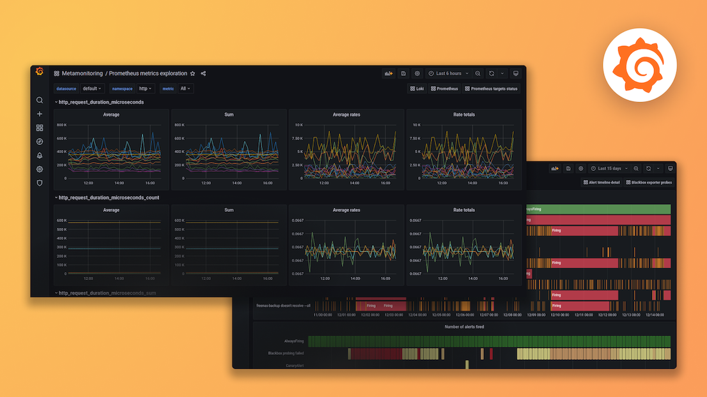

## Czym jest Grafana OSS?

**Grafana OSS** (Open Source Software) to darmowa, open-source'owa platforma do wizualizacji danych i monitorowania systemów, rozwijana przez Grafana Labs i społeczność na licencji AGPL-3.0. Jest to oprogramowanie, które instalujesz i utrzymujesz we własnym środowisku — na serwerze, maszynie wirtualnej lub w kontenerze Docker.

Grafana OSS jest fundamentem całego ekosystemu Grafana Labs: zarówno Grafana Cloud, jak i Grafana Enterprise bazują na jej kodzie źródłowym, rozszerzając go o dodatkowe funkcje.

Na szkoleniu pracujemy na **Grafanie OSS 13.3.0** zainstalowanej z repozytorium `apt.grafana.com` na Ubuntu 26.04 (maszyna `vmzabbixsrv16`).

---

## Architektura

Grafana OSS składa się z dwóch głównych warstw:

- **Backend** — napisany w języku **Go**. Odpowiada za komunikację ze źródłami danych, obsługę alertów, uwierzytelnianie użytkowników i API REST. Pluginy źródeł danych z częścią backendową działają jako osobne procesy uruchamiane przez Grafanę.
- **Frontend** — aplikacja **React** uruchamiana w przeglądarce. Renderuje dashboardy, panele i interfejs konfiguracyjny.

W aktualnych wersjach (dawniej osobne `grafana-server` i `grafana-cli`) jest to jeden plik binarny `grafana` z podpoleceniami: `grafana server` (serwer) i `grafana cli` (narzędzie administracyjne). Stare nazwy nadal działają, ale wypisują ostrzeżenie *Deprecation warning*. Usługa systemd w pakietach deb/rpm nadal nazywa się `grafana-server`.

### Baza danych konfiguracji

Grafana przechowuje własną konfigurację (użytkownicy, dashboardy, alerty, ustawienia źródeł danych) w wewnętrznej bazie danych. Wybór silnika zależy od środowiska:

| Baza | Zastosowanie |
|------|-------------|
| **SQLite** (domyślna, plik `/var/lib/grafana/grafana.db`) | Środowiska testowe, pojedyncze instancje |
| **MySQL / MariaDB** | Środowiska produkcyjne, wysoka dostępność |
| **PostgreSQL** | Środowiska produkcyjne, wysoka dostępność |

> Do produkcji zaleca się MySQL lub PostgreSQL — SQLite to plik lokalny jednej instancji, więc nie da się go współdzielić między kilkoma serwerami Grafany, co wyklucza konfigurację wysokiej dostępności (HA).

---

## Kluczowe funkcje

### Dashboardy i wizualizacja

Podstawowym elementem Grafany jest **dashboard** — zestaw paneli wizualizujących dane w czasie rzeczywistym lub historycznym. Dostępne typy paneli obejmują Time series, Bar chart, Stat, Gauge, Bar gauge, Table, Pie chart, State timeline, Status history, Heatmap, Histogram, Text, Geomap i wiele innych (szczegółowo opisanych w dziale IV).

### Źródła danych

Grafana OSS ma kilkadziesiąt wbudowanych źródeł danych, m.in.:

- **Metryki**: Prometheus, InfluxDB, Graphite, OpenTSDB
- **Logi**: Loki, Elasticsearch
- **Bazy SQL**: MySQL (także MariaDB), PostgreSQL, Microsoft SQL Server
- **Traces i profile**: Tempo, Jaeger, Zipkin, Pyroscope
- **Chmury**: Amazon CloudWatch, Azure Monitor, Google Cloud Monitoring
- **Testowe**: TestData (generator danych przykładowych)

Kolejne (np. Zabbix, OpenSearch, Infinity dla REST API/JSON/CSV) doinstalowuje się jako pluginy. Źródła danych konfiguruje się w **Connections > Data sources**.

### System alertów — Grafana Alerting

Od wersji 8 Grafana posiada ujednolicony system alertów (**Grafana Alerting**), a od wersji 11 stare alerty per-panel zostały całkowicie usunięte. Grafana Alerting umożliwia:
- tworzenie reguł alertów niezależnych od dashboardów (na danych z dowolnego źródła obsługującego alerty),
- grupowanie alertów i routing powiadomień (Notification policies),
- wyciszanie alertów (Silences) i okna czasowe (Time intervals),
- obsługę wielu kanałów powiadomień (Contact points): e-mail, Slack, Microsoft Teams, PagerDuty, Webhook i inne.

### Pluginy

Jedną z najważniejszych cech Grafany OSS jest **architektura pluginowa**. Pluginy rozszerzają Grafanę o nowe możliwości:

- **Data source plugins** — nowe źródła danych (np. Zabbix, Infinity, OpenSearch),
- **Panel plugins** — nowe typy wizualizacji (np. Clock, Business Charts),
- **App plugins** — kompleksowe aplikacje łączące źródła, panele i strony (np. Zabbix app, aplikacje Drilldown wbudowane w Grafanę).

Pluginy instaluje się przez CLI (`sudo grafana cli plugins install <id>` + restart usługi) lub przez UI (**Administration > Plugins and data > Plugins**). Grafana 13 przy pierwszym starcie sama doinstalowuje w tle wymagane pluginy wbudowane (w logach widać `plugin.backgroundinstaller`).

### Uwierzytelnianie i zarządzanie użytkownikami

Grafana OSS obsługuje następujące metody uwierzytelniania (**Administration > Authentication**):
- logowanie lokalne (użytkownik/hasło),
- **LDAP** — integracja z Active Directory / OpenLDAP,
- **OAuth 2.0 / OIDC** — GitHub, GitLab, Google, Entra ID (Azure AD), Okta, Generic OAuth,
- **SAML** i **SCIM** — tylko w Grafana Enterprise i Cloud (nie w OSS).

---

## Wersjonowanie i cykl wydań

Grafana nie ma osobnego kanału „LTS”. Obowiązuje stały cykl wydań:

| Typ wydania | Częstotliwość | Wsparcie |
|-------|------|-----------|
| **Major** (np. 12 → 13) | raz w roku (kwiecień/maj) | — |
| **Minor** (np. 13.2 → 13.3) | co ok. 2 miesiące | poprawki i łatki bezpieczeństwa przez 9 miesięcy |
| **Ostatnia minor danej major** (np. 12.4) | — | rozszerzone wsparcie przez 15 miesięcy |
| **Patch** (np. 13.3.0 → 13.3.1) | co najmniej raz w miesiącu | poprawki błędów i bezpieczeństwa |

Wydania z poprawkami bezpieczeństwa mają w nazwie dopisek `+security-01`. Na produkcji zwykle trzyma się wspieraną wersję minor i regularnie instaluje patche; aktualną politykę opisuje dokumentacja Grafany (*Upgrade guide > When to upgrade*).

---

## Ograniczenia Grafana OSS

W porównaniu do Grafana Enterprise i Grafana Cloud, wersja OSS nie posiada:

- premium pluginów do komercyjnych źródeł danych (Splunk, Oracle Database, Datadog, Dynatrace, Snowflake, ServiceNow…),
- RBAC z rolami niestandardowymi i uprawnień do źródeł danych (OSS ma role Viewer/Editor/Admin oraz uprawnienia do folderów i dashboardów),
- SAML SSO, SCIM i Team sync,
- audit logów, raportów PDF, usage insights i query cachingu,
- wsparcia technicznego z gwarantowanym SLA (tylko społeczność i dokumentacja).

---

## Podsumowanie

Grafana OSS to w pełni funkcjonalna platforma monitoringu i wizualizacji danych — bez kosztów licencyjnych, z pełną kontrolą nad infrastrukturą. Dzięki szerokiej bazie pluginów i wsparciu dla dziesiątek źródeł danych nadaje się do większości zastosowań produkcyjnych.

Dla organizacji potrzebujących premium pluginów, SAML, audytu lub zarządzanego SaaS — naturalnym krokiem naprzód jest **Grafana Enterprise** lub **Grafana Cloud**.
