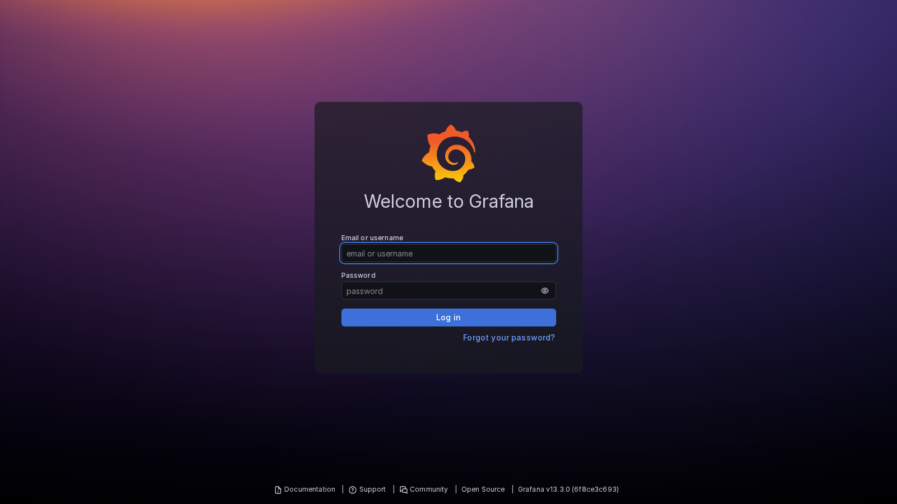
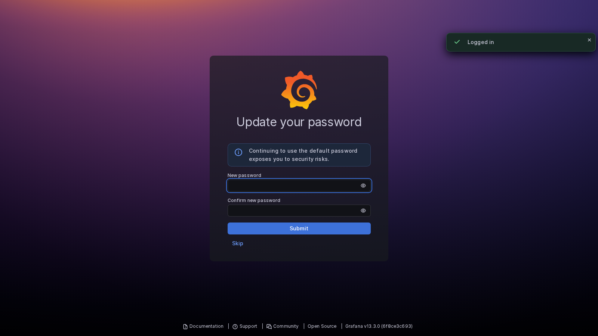
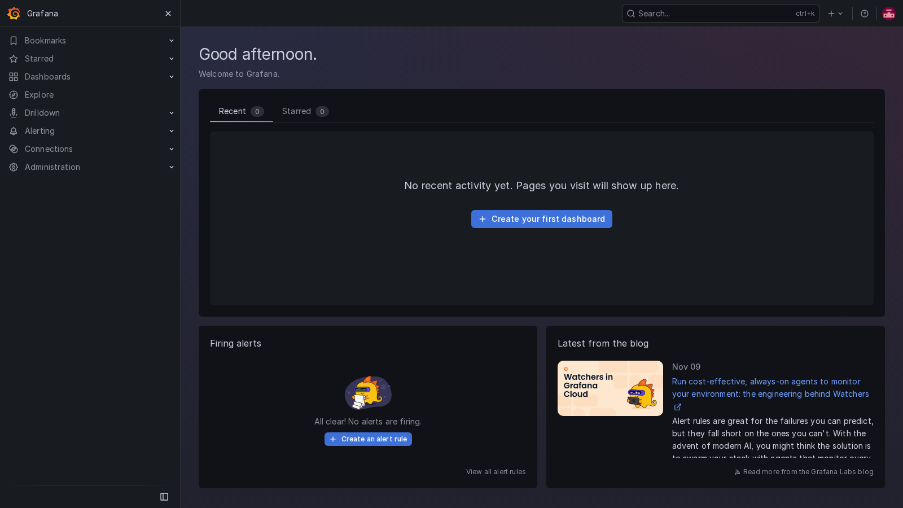
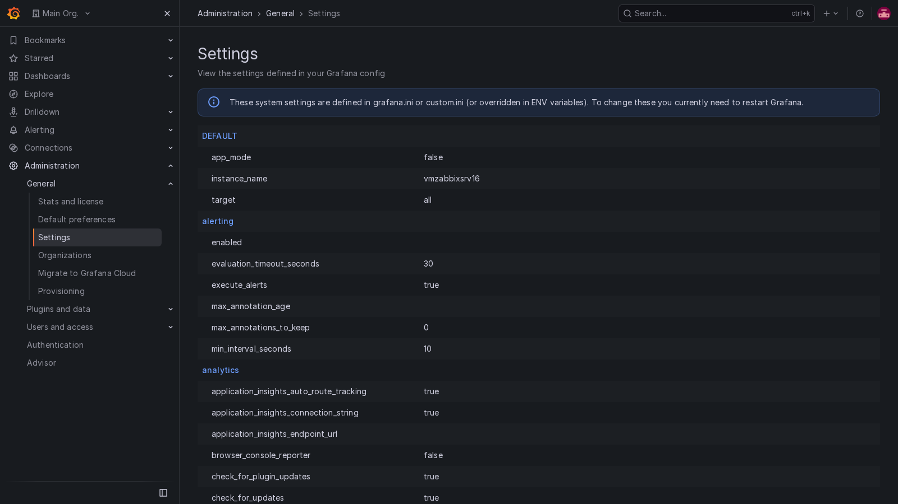

## Wymagania wstępne

1. **System operacyjny**: Grafana OSS działa na większości dystrybucji Linux (Ubuntu, Debian, RHEL i pochodne, Fedora, SUSE), a także na Windows, macOS i w Dockerze. Na szkoleniu używamy **Ubuntu 26.04 LTS**.
2. **Zasoby**: sama Grafana potrzebuje niewiele (min. 512 MB RAM i 1 CPU); w labie po załadowaniu pluginów proces `grafana` zajmuje ok. 700 MB RAM.
3. **Prawa administratora**: wymagane do instalacji i konfiguracji pakietów (`sudo`).
4. **Źródła danych**: Grafana nie przechowuje metryk — potrzebuje dostępu do źródeł danych, takich jak Prometheus, InfluxDB, MySQL, PostgreSQL lub Elasticsearch (ich instalację omawia dział II).

---

## Krok 1: Instalacja Grafana OSS

### 1.1 Dodanie repozytorium pakietów Grafana

Najpierw dodaj oficjalne repozytorium Grafany i zainstaluj pakiet `grafana` (edycja OSS).

#### Na Ubuntu/Debian (tak zainstalowano Grafanę w labie):

```bash
sudo apt-get install -y apt-transport-https software-properties-common wget
sudo mkdir -p /etc/apt/keyrings/
wget -q -O - https://apt.grafana.com/gpg.key | gpg --dearmor | sudo tee /etc/apt/keyrings/grafana.gpg > /dev/null
echo "deb [signed-by=/etc/apt/keyrings/grafana.gpg] https://apt.grafana.com stable main" | sudo tee /etc/apt/sources.list.d/grafana.list

# Aktualizacja listy pakietów
sudo apt-get update

# Instalacja najnowszej wersji OSS
sudo apt-get install -y grafana
```

> **Wskazówka:** Repozytorium `stable` zawiera zarówno `grafana` (OSS), jak i `grafana-enterprise`. Na szkoleniu instalujemy `grafana`. Używaj `tee` bez `-a` — dopisywanie (`tee -a`) przy ponownym uruchomieniu polecenia zdubluje wpis w pliku `.list`.

#### Na RHEL / Rocky / Alma (dnf):

Utwórz plik `/etc/yum.repos.d/grafana.repo`:

```ini
[grafana]
name=grafana
baseurl=https://rpm.grafana.com
repo_gpgcheck=1
enabled=1
gpgcheck=1
gpgkey=https://rpm.grafana.com/gpg.key
sslverify=1
sslcacert=/etc/pki/tls/certs/ca-bundle.crt
```

Następnie zainstaluj pakiet:

```bash
sudo dnf install -y grafana
```

---

### 1.2 Weryfikacja instalacji

Sprawdź, czy pakiet został zainstalowany poprawnie i jaka jest wersja:

#### Ubuntu/Debian:

```bash
dpkg -l grafana
grafana server -v
```

#### RHEL i pochodne:

```bash
rpm -q grafana
grafana server -v
```

Wynik w labie:

```
$ grafana server -v
Version 13.3.0 (commit: 6f8ce3c693b493043ebcd4787566d2b6b118b0f0, branch: release-13.3.0#patched)
```

> **Uwaga:** Starsze polecenia `grafana-server -v` i `grafana-cli` nadal działają, ale wypisują *Deprecation warning: 'grafana-server' is deprecated and will be removed in a future release*. Nowa forma to `grafana server` i `grafana cli` (np. `sudo grafana cli plugins ls`). Sama usługa systemd nadal nazywa się `grafana-server`.

---

## Krok 2: Uruchomienie i konfiguracja

### 2.1 Start usługi Grafana

Uruchom usługę Grafana i skonfiguruj ją, aby uruchamiała się automatycznie przy starcie systemu:

```bash
sudo systemctl daemon-reload
sudo systemctl enable --now grafana-server
```

### 2.2 Sprawdzenie statusu usługi

Upewnij się, że Grafana działa poprawnie:

```bash
sudo systemctl status grafana-server
curl -s localhost:3000/api/health
```

Prawidłowa odpowiedź API:

```json
{
  "database": "ok",
  "version": "13.3.0",
  "commit": "6f8ce3c693b493043ebcd4787566d2b6b118b0f0"
}
```

> **Wskazówka:** Przy pierwszym starcie Grafana 13 sama doinstalowuje i aktualizuje w tle pluginy wbudowane (w logach: `logger=plugin.backgroundinstaller`). Port 3000 zaczyna odpowiadać dopiero po kilkunastu sekundach — jeśli `curl` od razu zwraca błąd połączenia, odczekaj chwilę. Logi: `sudo journalctl -u grafana-server -f` lub `/var/log/grafana/grafana.log`.

### 2.3 Konfiguracja firewalla

Domyślnie Grafana nasłuchuje na porcie **3000** na wszystkich interfejsach. Jeśli serwer posiada aktywny firewall, odblokuj ten port.

> **Uwaga:** Obraz Ubuntu 26.04 użyty w labie nie ma zainstalowanego `ufw` — firewall nie blokuje portu 3000 i ten krok można pominąć. Na serwerach z włączonym firewallem użyj poleceń poniżej.

#### Ubuntu/Debian (ufw):

```bash
sudo ufw allow 3000/tcp
sudo ufw reload
```

#### RHEL i pochodne (firewalld):

```bash
sudo firewall-cmd --permanent --add-port=3000/tcp
sudo firewall-cmd --reload
```

---

## Krok 3: Pierwsze logowanie

1. Otwórz przeglądarkę i przejdź pod adres:

```
http://<IP-Serwera>:3000
```

Domyślny port Grafany to **3000**. W stopce ekranu logowania widać wersję Grafany.



2. Zaloguj się, używając domyślnych danych uwierzytelniających:
   - **Email or username**: `admin`
   - **Password**: `admin`

3. Po pierwszym logowaniu pojawi się ekran **Update your password**. Wpisz nowe hasło w polach **New password** i **Confirm new password** i kliknij **Submit** — albo kliknij **Skip**, aby na razie zostać przy domyślnym haśle (Grafana będzie o to pytać przy kolejnych logowaniach).



4. Po zalogowaniu zobaczysz stronę startową z menu bocznym: **Bookmarks**, **Starred**, **Dashboards**, **Explore**, **Drilldown**, **Alerting**, **Connections**, **Administration**. Na środku są zakładki **Recent / Starred**, przycisk **Create your first dashboard**, a poniżej panele **Firing alerts** i **Latest from the blog**.



> **Zapomniane hasło admina:** hasło można zresetować z konsoli serwera:
> ```bash
> sudo grafana cli admin reset-admin-password 'NoweHaslo123!'
> ```

---

## Krok 4: Podstawowa konfiguracja

### 4.1 Dodanie źródła danych

1. W menu bocznym kliknij **Connections > Data sources** (albo **Connections > Add new connection**).
2. Kliknij **Add new data source** i wybierz typ źródła danych (np. Prometheus, MySQL).
3. Wprowadź szczegóły połączenia, takie jak URL, port i uwierzytelnianie, jeśli wymagane.
4. Kliknij **Save & test**, aby sprawdzić połączenie.

Szczegółowa konfiguracja każdego źródła opisana jest w dziale **II. Data Source**.

### 4.2 Tworzenie dashboardu

1. Przejdź do **Dashboards > New > New dashboard** (albo kliknij **Create your first dashboard** na stronie startowej).
2. Kliknij **Add visualization** i wybierz źródło danych.
3. Skonfiguruj zapytanie (zakładka **Queries** pod podglądem) i typ wizualizacji (po prawej, przycisk **Change** przy nazwie wizualizacji).
4. Zapisz dashboard przyciskiem **Save**.

---

## Krok 5: Zaawansowana konfiguracja

### 5.1 Plik konfiguracyjny

Plik główny konfiguracji Grafany (pakiety deb/rpm):

```bash
/etc/grafana/grafana.ini
```

Komentarze w tym pliku zaczynają się od `;` lub `#` — aby zmienić ustawienie, usuń `;` na początku linii. Najczęściej używane sekcje:
- **[server]**: port (`http_port`), adres nasłuchu (`http_addr`), publiczny adres (`root_url`) — w labie ustawiono `root_url = http://10.123.2.206:3000/`.
- **[security]**: hasło admina przy pierwszym starcie, ustawienia ciasteczek, osadzanie w iframe.
- **[database]**: wybór backendu bazy danych (domyślnie SQLite w `/var/lib/grafana/grafana.db`).
- **[smtp]**: serwer pocztowy do powiadomień i zaproszeń — w labie Grafana wysyła maile do testowej skrzynki Mailpit:
  ```ini
  [smtp]
  enabled = true
  host = 127.0.0.1:1025
  skip_verify = true
  from_address = grafana@vmzabbixsrv16.lab
  from_name = Grafana szkolenie
  ```

Aktualnie obowiązujące wartości (z `grafana.ini` i zmiennych środowiskowych) można obejrzeć w interfejsie: **Administration > General > Settings**. Zmiana ustawień wymaga restartu Grafany.



> **SQLite vs zewnętrzna baza danych:** Domyślna baza SQLite wystarcza do celów testowych i małych wdrożeń. W środowisku produkcyjnym, szczególnie przy wielu użytkownikach lub konfiguracji wysokiej dostępności (HA), należy przełączyć się na **MySQL/MariaDB** lub **PostgreSQL**. Konfiguracja w sekcji `[database]`:
> ```ini
> [database]
> type = mysql
> host = 127.0.0.1:3306
> name = grafana
> user = grafana
> password = haslo
> ```

### 5.2 Ustawienie TLS

Aby włączyć HTTPS, skonfiguruj sekcję `[server]`:

```ini
[server]
protocol = https
cert_file = /etc/grafana/grafana.crt
cert_key = /etc/grafana/grafana.key
```

Pliki certyfikatu i klucza muszą być czytelne dla użytkownika `grafana`. Zrestartuj usługę po zmianach:

```bash
sudo systemctl restart grafana-server
```

W praktyce często zostawia się Grafanę na HTTP i stawia przed nią reverse proxy (nginx, Nginx Proxy Manager, Traefik), które obsługuje certyfikaty.

---

## Krok 6: Alertowanie

Grafana OSS posiada wbudowany system alertów (**Grafana Alerting**) dostępny w menu bocznym. Szczegółowa konfiguracja alertów — reguły, wyrażenia, kanały powiadomień, polityki routingu i wyciszenia — opisana jest w **dziale VI. Alerting**.

Szybki start (menu Grafany 13):
1. **Alerting > Alert rules** — tworzenie reguł alertów.
2. **Alerting > Notification configuration** — zakładki **Contact points** (kanały powiadomień: e-mail, Slack, Teams, PagerDuty, webhook…), **Notification policies** (które alerty trafiają do których kanałów), **Templates** i **Time intervals**.
3. **Alerting > Silences** — wyciszenia.

> Powiadomienia e-mail wymagają skonfigurowanej sekcji `[smtp]` w `grafana.ini` (patrz 5.1).

---

## Krok 7: Aktualizacja Grafany

Aby zaktualizować Grafanę do najnowszej wersji z repozytorium:

```bash
sudo apt-get update && sudo apt-get install --only-upgrade grafana   # Ubuntu/Debian
sudo dnf upgrade grafana                                              # RHEL i pochodne
sudo systemctl restart grafana-server
```

Przed aktualizacją o wersję major (np. 12 → 13) przeczytaj *What's new* i *Upgrade guide* w dokumentacji oraz zrób kopię `/var/lib/grafana/grafana.db` i `/etc/grafana/`.

---

## Podsumowanie

Grafana OSS to solidna podstawa do budowy środowiska monitoringu. Po instalacji i konfiguracji wstępnych źródeł danych możesz tworzyć dashboardy i alerty. Kolejne kroki to zaawansowana konfiguracja TLS, integracja z systemami uwierzytelniania (LDAP, OAuth) oraz instalacja pluginów rozszerzających funkcjonalność.

---

## Ćwiczenie w labie

Maszyna szkoleniowa: **vmzabbixsrv16**, adres **10.123.2.206**, Ubuntu 26.04. Grafana jest już zainstalowana — sprawdź jej stan i zaloguj się.

1. Zaloguj się na maszynę przez SSH (login `szkolenie`, hasło `szkolenie`):
   ```bash
   ssh szkolenie@10.123.2.206
   ```
2. Sprawdź wersję, źródło pakietu i stan usługi:
   ```bash
   grafana server -v
   cat /etc/apt/sources.list.d/grafana.list
   systemctl status grafana-server --no-pager | head -5
   curl -s localhost:3000/api/health
   ```
   Oczekiwane: wersja **13.3.0**, repozytorium `https://apt.grafana.com stable main`, usługa `active (running)`, `"database": "ok"`.
3. Uruchom stare polecenie `grafana-server -v` i zwróć uwagę na *Deprecation warning*.
4. Wyświetl zainstalowane pluginy (m.in. `alexanderzobnin-zabbix-app`, `grafana-clock-panel`, `yesoreyeram-infinity-datasource`):
   ```bash
   sudo grafana cli plugins ls
   ```
5. Sprawdź, na jakich portach nasłuchuje Grafana i jakie ustawienia zmieniono w `grafana.ini`:
   ```bash
   sudo ss -ltnp | grep grafana
   sudo grep -vE '^\s*[;#]|^\s*$|^\[' /etc/grafana/grafana.ini
   ```
   Grafana nasłuchuje na `*:3000`. Zmienione w labie są `root_url` oraz wpisy SMTP (`enabled`, `host`, `skip_verify`, `from_address`, `from_name`); pozostałe niezakomentowane linie (np. `rule_query_offset`, `timeout`) pochodzą z domyślnego pliku pakietu.
6. Otwórz w przeglądarce **http://10.123.2.206:3000** i zaloguj się jako `admin` / `admin`. Na ekranie **Update your password** kliknij **Skip** (w labie hasło admina zostaje `admin`, bo korzystają z niego materiały).
7. Przejdź do **Administration > General > Settings** i odszukaj sekcje `[server]` (`root_url`) i `[smtp]` (`host = 127.0.0.1:1025`) — porównaj z wynikiem kroku 5.
8. Przejdź do **Connections > Data sources** — w labie skonfigurowano już źródła Elasticsearch, InfluxDB, MySQL, PostgreSQL, Prometheus (domyślne), TestData i Zabbix. Będziemy z nich korzystać w dziale II.
