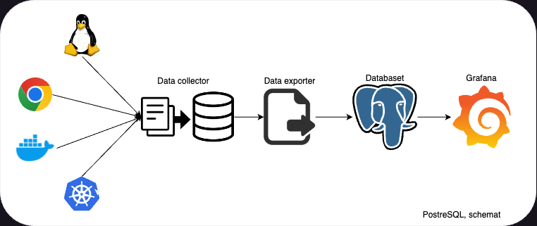
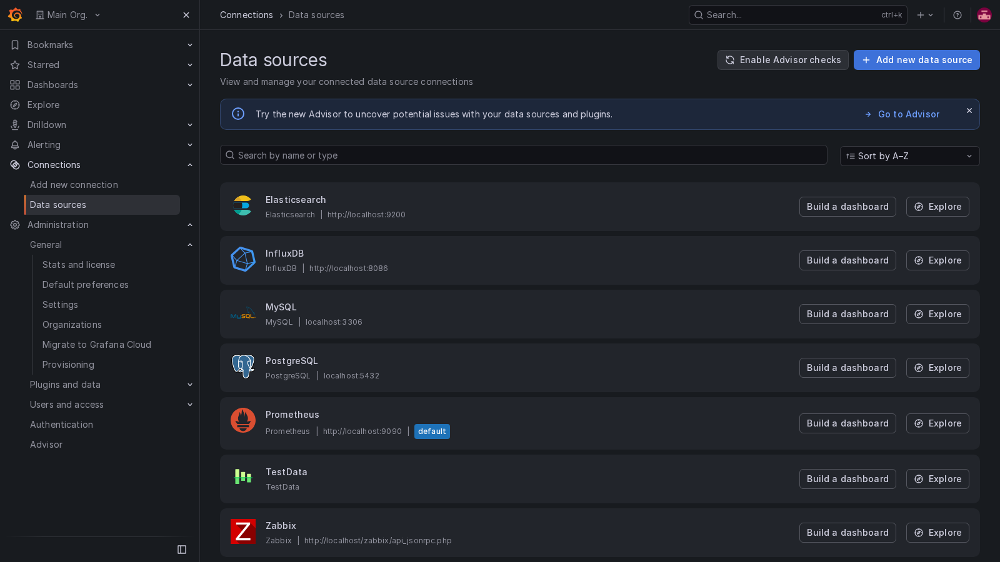
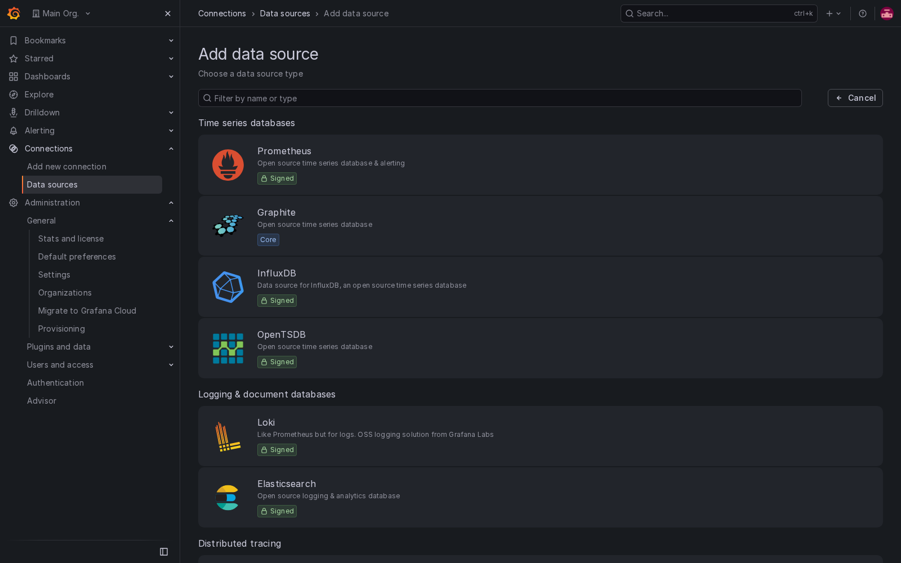
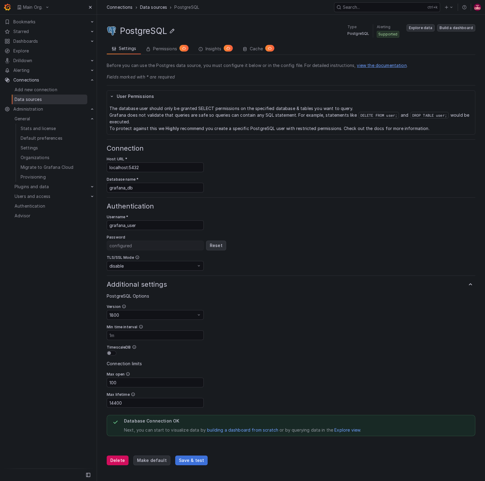
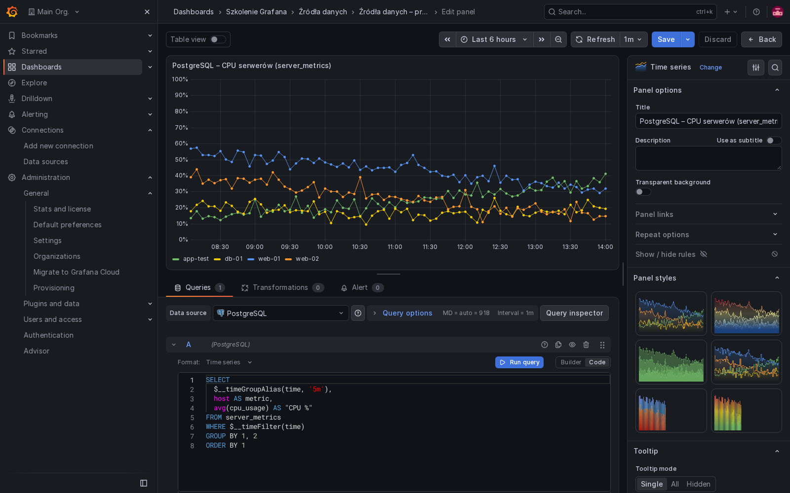
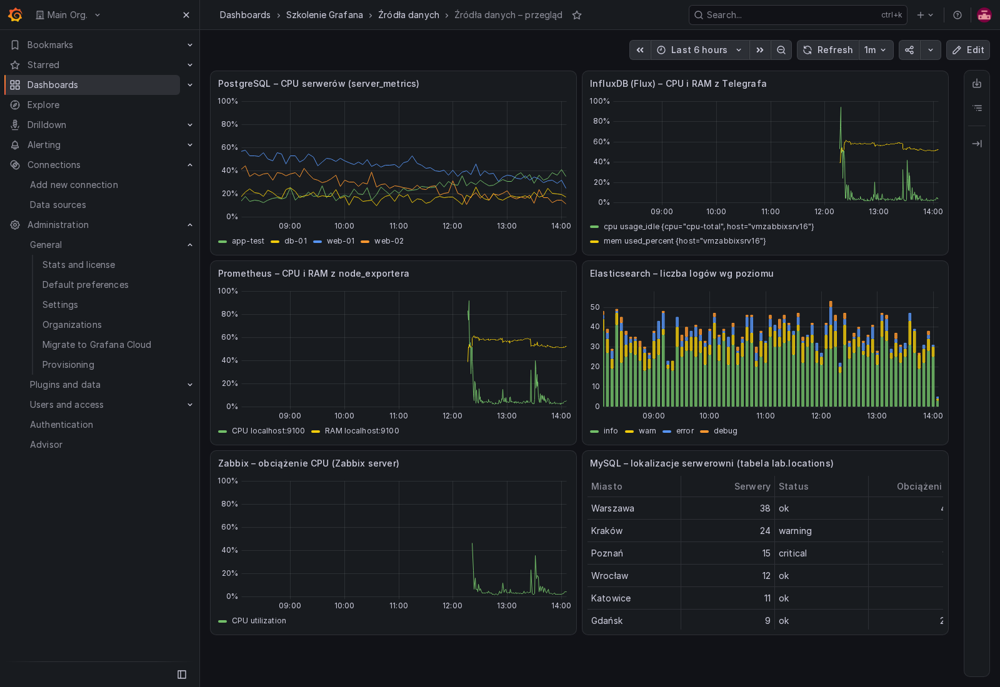

# PostgreSQL


## Wprowadzenie do PostgreSQL

**PostgreSQL** to zaawansowany system zarządzania relacyjnymi bazami danych (RDBMS), który jest open source. Został zaprojektowany z myślą o wydajności, niezawodności i skalowalności, oferując jednocześnie bogaty zestaw funkcji, takich jak:

- Wsparcie dla zaawansowanych zapytań SQL (funkcje okna, CTE, `DISTINCT ON`).
- Rozszerzalność (własne funkcje, typy i rozszerzenia, np. TimescaleDB, PostGIS).
- Obsługa danych JSON, XML, geograficznych (PostGIS) i innych.
- Silne mechanizmy bezpieczeństwa (role, uprawnienia na poziomie tabel i wierszy).

PostgreSQL jest powszechnie wykorzystywany w środowiskach produkcyjnych do przechowywania danych aplikacji, analizy danych i wielu innych zastosowań. W labie działa **PostgreSQL 18** z pakietu Ubuntu 26.04.

## Infrastruktura



```
┌───────────────────────────────────────────────────┐
│              Aplikacja / System                   │
│                                                   │
│  ┌──────────────┐      ┌────────────────────────┐ │
│  │   Tabele     │      │   pg_stat_activity     │ │
│  │   (dane)     │      │   pg_stat_database     │ │
│  └──────────────┘      │   pg_stat_io           │ │
│                        └────────────────────────┘ │
└───────────────────────────────────────────────────┘
                          │
                          │  SQL / port 5432
                          ▼
               ┌──────────────────────┐
               │       Grafana        │
               │  (Data Source:       │
               │   PostgreSQL)        │
               └──────────────────────┘
```

## Grafana i PostgreSQL

Integracja Grafany z PostgreSQL pozwala na:

- Tworzenie interaktywnych dashboardów opartych na danych z bazy PostgreSQL.
- Analizę historycznych danych.
- Śledzenie metryk i wskaźników zapisanych w bazie danych.
- Budowanie zmiennych dashboardu i reguł alertów na podstawie zapytań SQL.

### Kiedy używać PostgreSQL w Grafanie?

- Gdy dane są przechowywane w PostgreSQL i wymagają wizualizacji.
- Gdy PostgreSQL pełni funkcję hurtowni danych.
- Gdy chcesz analizować dane metryczne, logi lub dane biznesowe (sprzedaż, zamówienia) przechowywane w bazie.

## Instalacja i konfiguracja PostgreSQL

### Instalacja PostgreSQL (na przykładzie Ubuntu 26.04)

1. Zainstaluj PostgreSQL za pomocą apt (na Ubuntu 26.04 pakiet `postgresql` instaluje wersję 18):
   ```bash
   sudo apt update
   sudo apt install -y postgresql postgresql-contrib
   ```
2. Uruchom usługę PostgreSQL i włącz autostart:
   ```bash
   sudo systemctl enable --now postgresql
   ```
3. Sprawdź wersję i zaloguj się jako administrator bazy (`postgres`):
   ```bash
   psql --version
   sudo -u postgres psql
   ```

> **Wskazówka:** Domyślnie PostgreSQL nasłuchuje tylko na `127.0.0.1:5432`. W labie Grafana działa na tym samym serwerze, więc to wystarcza. Jeśli Grafana stoi na innej maszynie, zmień `listen_addresses` w `/etc/postgresql/18/main/postgresql.conf` i dodaj wpis dla adresu Grafany w `pg_hba.conf`.

### Tworzenie bazy danych i użytkownika

1. Utwórz nową bazę danych i użytkownika dla Grafany (w `psql` jako `postgres`):
   ```sql
   CREATE DATABASE grafana_db;
   CREATE USER grafana_user WITH PASSWORD 'secure_password';
   GRANT CONNECT ON DATABASE grafana_db TO grafana_user;
   ```
2. Przełącz się do nowej bazy (`\c grafana_db`) i nadaj uprawnienia **tylko do odczytu**:
   ```sql
   \c grafana_db
   GRANT USAGE ON SCHEMA public TO grafana_user;
   GRANT SELECT ON ALL TABLES IN SCHEMA public TO grafana_user;
   ALTER DEFAULT PRIVILEGES IN SCHEMA public GRANT SELECT ON TABLES TO grafana_user;
   ```
   > **Uwaga:** Polecenia `GRANT ... ON SCHEMA` i `ALTER DEFAULT PRIVILEGES` trzeba wykonać **w bazie `grafana_db`**, a nie w domyślnej `postgres` — inaczej dotyczą niewłaściwej bazy i Grafana zgłosi `permission denied for table ...`. `ALTER DEFAULT PRIVILEGES` obejmuje tabele tworzone w przyszłości przez użytkownika, który wykonał to polecenie (tu: `postgres`).

   > **Bezpieczeństwo:** Grafana potrzebuje jedynie uprawnień do odczytu (`SELECT`). Grafana nie sprawdza, czy zapytanie jest bezpieczne — z kontem z prawami zapisu użytkownik dashboardu mógłby wykonać `DELETE` czy `DROP TABLE` (ostrzega o tym ramka **User Permissions** w konfiguracji źródła). Dlatego w labie dane zapisuje osobny użytkownik `lab_writer`, a Grafana łączy się jako `grafana_user`.

## Konfiguracja Grafany z PostgreSQL

1. Zaloguj się do interfejsu webowego Grafany.
2. Przejdź do sekcji **Connections > Data sources** — zobaczysz listę skonfigurowanych źródeł.

   

3. Kliknij **Add new data source**. Pojawi się katalog typów źródeł pogrupowany na kategorie (Time series databases, Logging & document databases, Distributed tracing itd.). Wpisz `PostgreSQL` w polu **Filter by name or type** i wybierz go z listy.

   

4. Wypełnij pola:
   - **Connection > Host URL**: `localhost:5432`
   - **Connection > Database name**: `grafana_db`
   - **Authentication > Username**: `grafana_user`
   - **Authentication > Password**: `secure_password`
   - **TLS/SSL Mode**: `disable` (połączenie lokalne bez TLS; w produkcji z TLS wybierz `require` lub `verify-full`)
   - **Additional settings > Version**: wersja serwera PostgreSQL (w labie 18 — na liście widoczna jako `1800`)
   - **TimescaleDB**: włącz tylko wtedy, gdy baza używa rozszerzenia TimescaleDB
5. Kliknij **Save & test** — powinien pojawić się komunikat **Database Connection OK**.



> W Grafanie 13 źródło PostgreSQL ma identyfikator typu `grafana-postgresql-datasource` (to nazwa używana m.in. w provisioningu i API). Zakładki **Permissions**, **Insights** i **Cache** z ikonką chmurki to funkcje Grafana Enterprise/Cloud.

## Tworzenie Dashboardów

Grafana obsługuje dwa formaty wyniku zapytania SQL (pole **Format** w edytorze zapytania):

- **Time series** — wynik musi zawierać kolumnę czasu (typ `timestamp`/`timestamptz` lub liczbę sekund epoki) nazwaną `time`. Każda pozostała kolumna liczbowa staje się serią; kolumna tekstowa o nazwie `metric` służy jako nazwa serii.
- **Table** — dowolne zapytanie SQL zwracające tabelę. Wynik wyświetlany np. w panelu Table, Bar chart czy Pie chart.

Edytor zapytań ma dwa tryby: **Builder** (wybór tabeli i kolumn z list) i **Code** (pisanie SQL). Zapytanie uruchamia się przyciskiem **Run query**.

### Przykładowe zapytanie (format Time series)

1. Przejdź do **Dashboards > New > New dashboard** i kliknij **Add visualization** (albo na stronie źródła danych kliknij **Build a dashboard**).
2. Wybierz **PostgreSQL** jako źródło danych.
3. W edytorze zapytania przełącz się na **Code**, ustaw **Format: Time series** i wpisz zapytanie:
   ```sql
   SELECT
       time AS "time",
       value AS "value",
       metric AS "metric"
   FROM metrics_table
   WHERE $__timeFilter(time)
   ORDER BY 1;
   ```
   - `time`: kolumna z aliasem `"time"` — wymagana dla formatu Time series.
   - `value`: kolumna z wartościami metryk.
   - `metric`: kolumna z nazwami serii (w labie: `temperature`, `humidity`, `requests`).
4. Kliknij **Run query**, dostosuj wizualizację (np. Time series, Table) i zapisz dashboard (**Save**).

### Makra Grafany dla PostgreSQL

Grafana udostępnia specjalne makra, które automatycznie wstawiają zakresy czasowe z wybranego zakresu dashboardu:

| Makro | Opis |
|-------|------|
| `$__timeFilter(kolumna)` | Filtruje wiersze do zakresu czasowego wybranego w dashboardzie |
| `$__timeGroup(kolumna, interwał)` | Grupuje dane w przedziały czasowe (np. `'5m'`, `'1h'`, `$__interval`) |
| `$__timeGroupAlias(kolumna, interwał)` | Jak `$__timeGroup`, ale od razu nadaje alias `"time"` |
| `$__timeFrom()` | Początek zakresu czasowego jako timestamp |
| `$__timeTo()` | Koniec zakresu czasowego jako timestamp |
| `$__unixEpochFilter(kolumna)` | Jak `$__timeFilter`, ale dla kolumn z Unix timestamp (int) |

Przykład z grupowaniem (średnie CPU wszystkich hostów w oknach 5-minutowych):
```sql
SELECT
    $__timeGroup(time, '5m') AS "time",
    avg(cpu_usage) AS "CPU %"
FROM server_metrics
WHERE $__timeFilter(time)
GROUP BY 1
ORDER BY 1;
```

Przykład z osobną serią dla każdego hosta (kolumna `metric`) — to zapytanie panelu „PostgreSQL – CPU serwerów (server_metrics)” w labie:
```sql
SELECT
  $__timeGroupAlias(time, '5m'),
  host AS metric,
  avg(cpu_usage) AS "CPU %"
FROM server_metrics
WHERE $__timeFilter(time)
GROUP BY 1, 2
ORDER BY 1
```



> **Wskazówka:** Przycisk **Query inspector** nad zapytaniem pokazuje SQL po podstawieniu makr (zakładka **Query**) oraz surowe dane — przydatne przy szukaniu błędów.

## Najlepsze praktyki

- **Indeksowanie:** Upewnij się, że kolumna zawierająca znaczniki czasowe (`time`) jest zaindeksowana (w labie: `ix_server_time`, `ix_metrics_time`, `ix_sales_time`), aby zapytania z `$__timeFilter` działały szybko.
- **Agregacja po stronie bazy:** Grupuj dane (`$__timeGroup`, `GROUP BY`) w SQL zamiast pobierać miliony surowych wierszy do przeglądarki.
- **Archiwizacja danych:** Jeśli baza zawiera duże ilości danych, regularnie archiwizuj lub agreguj stare dane (albo użyj partycjonowania / TimescaleDB).
- **Testowanie zapytań:** Testuj zapytania SQL w `psql` przed dodaniem ich do Grafany, aby uniknąć błędów.
- **Konto tylko do odczytu:** Grafana zawsze powinna łączyć się kontem z samym `SELECT`.

## Podsumowanie

Integracja PostgreSQL z Grafaną pozwala na efektywne wizualizowanie danych i tworzenie przejrzystych dashboardów. Dzięki temu można analizować dane w czasie rzeczywistym oraz historyczne, co wspiera podejmowanie decyzji opartych na danych. Odpowiednia konfiguracja i optymalizacja bazy danych są kluczowe dla osiągnięcia najlepszej wydajności i użyteczności.

---

## Ćwiczenie w labie

Grafana: **http://10.123.2.206:3000** (admin / admin). Źródło **PostgreSQL** jest już skonfigurowane (baza `grafana_db`, użytkownik `grafana_user`). Dane w bazie co minutę dopisuje generator `labdata.py` (7 dni historii).

Tabele w `grafana_db`:

| Tabela | Kolumny | Zawartość |
|--------|---------|-----------|
| `server_metrics` | `time, host, env, cpu_usage, mem_usage, disk_usage, response_ms, status` | hosty `web-01`, `web-02`, `db-01` (env `prod`) i `app-test` (env `test`), co minutę |
| `metrics_table` | `time, metric, value` | metryki `temperature`, `humidity`, `requests` |
| `sales` | `time, region, product, amount, quantity` | sprzedaż w województwach, produkty Laptop/Monitor/Klawiatura/Mysz/Słuchawki |
| `locations` | `city, latitude, longitude, servers, status, load` | 10 miast w Polsce |

1. **Podgląd gotowego panelu.** Otwórz **Dashboards > Szkolenie Grafana > Źródła danych > Źródła danych – przegląd**. Panel „PostgreSQL – CPU serwerów (server_metrics)” to wynik zapytania z tej lekcji; pozostałe panele pokazują kolejne źródła z działu II.

   

2. **Sprawdzenie źródła.** Wejdź w **Connections > Data sources > PostgreSQL**, porównaj ustawienia z opisem powyżej i kliknij **Save & test** (powinno być **Database Connection OK**).
3. **Sprawdzenie uprawnień w konsoli.** Zaloguj się przez SSH (`ssh szkolenie@10.123.2.206`, hasło `szkolenie`) i połącz się jako użytkownik Grafany:
   ```bash
   PGPASSWORD=secure_password psql -h localhost -U grafana_user -d grafana_db -c '\dt'
   PGPASSWORD=secure_password psql -h localhost -U grafana_user -d grafana_db \
     -c 'SELECT host, env, count(*), max(time) FROM server_metrics GROUP BY 1,2 ORDER BY 1'
   ```
   Spróbuj też `DELETE FROM sales WHERE false` — powinien pojawić się błąd `permission denied for table sales` (konto tylko do odczytu).
4. **Nowy dashboard.** Utwórz **Dashboards > New > New dashboard > Add visualization**, wybierz źródło **PostgreSQL**, przełącz edytor na **Code**.
5. **Panel 1 – CPU per host (Time series).** Format **Time series**:
   ```sql
   SELECT
     $__timeGroupAlias(time, '5m'),
     host AS metric,
     avg(cpu_usage) AS "CPU %"
   FROM server_metrics
   WHERE $__timeFilter(time)
   GROUP BY 1, 2
   ORDER BY 1
   ```
   Kliknij **Run query**. W opcjach panelu ustaw jednostkę **Percent (0-100)** (Standard options > Unit). Zmień zakres czasu na **Last 24 hours** i zobacz, jak `$__timeFilter` zmienia SQL w **Query inspector**.
6. **Panel 2 – czas odpowiedzi środowiska prod z interwałem dashboardu.** Dodaj kolejną wizualizację (Time series):
   ```sql
   SELECT
     $__timeGroupAlias(time, $__interval),
     host AS metric,
     avg(response_ms) AS "czas odpowiedzi"
   FROM server_metrics
   WHERE $__timeFilter(time) AND env = 'prod'
   GROUP BY 1, 2
   ORDER BY 1
   ```
   Ustaw jednostkę **milliseconds (ms)**. Zwróć uwagę, że `$__interval` rośnie przy dłuższym zakresie czasu.
7. **Panel 3 – ostatni stan każdego hosta (Table).** Format **Table**, wizualizacja **Table**:
   ```sql
   SELECT DISTINCT ON (host)
     host, env, round(cpu_usage::numeric, 1) AS cpu, round(mem_usage::numeric, 1) AS ram, status, time
   FROM server_metrics
   WHERE $__timeFilter(time)
   ORDER BY host, time DESC
   ```
8. **Panel 4 – sprzedaż wg regionu (Table → Bar chart).** Format **Table**, wizualizacja **Bar chart**:
   ```sql
   SELECT region AS "Region", sum(amount) AS "Sprzedaż (zł)"
   FROM sales
   WHERE $__timeFilter(time)
   GROUP BY region
   ORDER BY 2 DESC
   ```
9. Zapisz dashboard (**Save**) pod nazwą np. `PostgreSQL – <Twoje imię>` w folderze **Szkolenie Grafana**.
