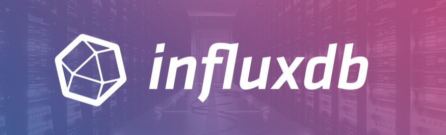
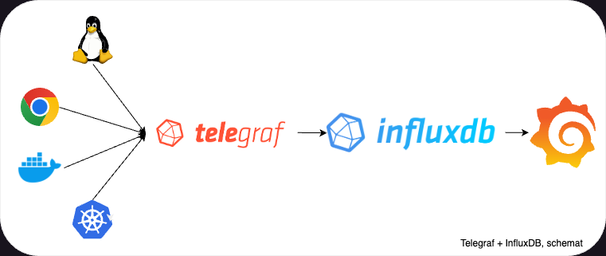
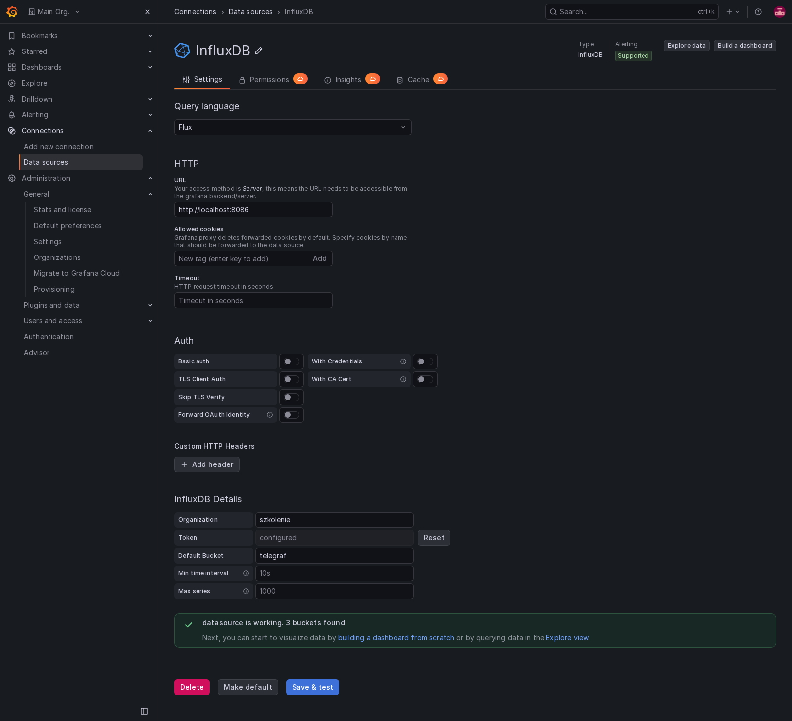
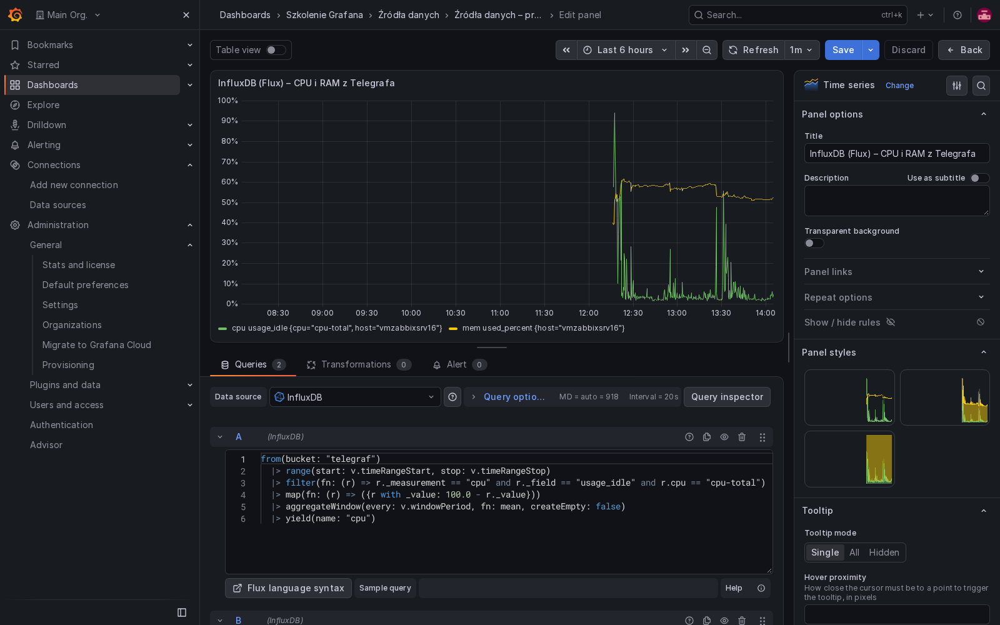

# InfluxDB

## Wprowadzenie do InfluxDB


**InfluxDB** to otwartoźródłowa baza danych szeregów czasowych (time-series database) zaprojektowana specjalnie do przechowywania i analizowania danych z dużą liczbą pomiarów w czasie. Jest idealnym rozwiązaniem do monitorowania infrastruktury IT, aplikacji IoT, metryk biznesowych oraz analizy wydajności.

W labie działa **InfluxDB 2.9** (pakiety `influxdb2` i `influxdb2-cli` z repozytorium InfluxData), a dane zbiera **Telegraf 1.40**.

### Kluczowe cechy InfluxDB:

- **Wysoka wydajność zapisu** - wysoka przepustowość dla operacji zapisu danych czasowych
- **Kompresja danych** - automatyczna kompresja danych czasowych pozwala na efektywne wykorzystanie przestrzeni dyskowej
- **Język zapytań Flux** - funkcyjny język do zapytań i przetwarzania danych (w InfluxDB 2.x; obok niego działa InfluxQL)
- **Retencja bucketów** - automatyczne usuwanie danych starszych niż okres retencji bucketa
- **Tasks** - zaplanowane zapytania Flux, np. do downsamplingu (następca *continuous queries* z 1.x)
- **Natywna integracja** - łatwa integracja z narzędziami takimi jak Grafana i Telegraf

### Architektura InfluxDB 2.x:

InfluxDB 2.x to jeden proces (`influxd`), który łączy:
- **Bazę danych** - przechowywanie danych szeregów czasowych (silnik TSM)
- **Interfejs UI** - wbudowany graficzny interfejs na porcie 8086 (Data Explorer, buckety, tokeny, dashboardy)
- **API v2** - zapis (line protocol) i odczyt (Flux) przez HTTP z autoryzacją tokenem
- **Tasks** - zaplanowane zadania przetwarzania danych
- **Checks i notifications** - prosty, wbudowany system alertów

Telegraf jest osobnym agentem — InfluxDB UI potrafi jedynie wygenerować dla niego konfigurację.

### Różnice między InfluxDB 1.x a 2.x:

| Cecha | InfluxDB 1.x | InfluxDB 2.x |
|-------|--------------|--------------|
| Język zapytań | InfluxQL | Flux (+ kompatybilność z InfluxQL) |
| Autoryzacja | Użytkownik/hasło | Tokeny API |
| Organizacja danych | Database + Retention Policy | Organization > Bucket |
| UI | Chronograf (osobny) | Wbudowany UI |
| API | API v1 | API v2 (+ endpointy zgodności z v1) |

> **InfluxDB 3:** Najnowsza generacja (InfluxDB 3 Core / Enterprise) obsługuje zapytania **SQL** i **InfluxQL**, ale **nie obsługuje Flux** — Flux jest w trybie utrzymania. Na szkoleniu używamy InfluxDB 2.x i Flux; w Grafanie przy źródle InfluxDB wybiera się język zapytań (InfluxQL, Flux albo SQL) zależnie od wersji serwera.

## Telegraf - Agent zbierający metryki



**Telegraf** to lekki agent serwerowy do zbierania i raportowania metryk. Jest napisany w języku Go i charakteryzuje się minimalnym zużyciem zasobów systemowych.

### Kluczowe cechy Telegraf:

- **Architektura plugin-based** - ponad 300 wtyczek wejściowych i wyjściowych
- **Małe zużycie zasobów** - niewielkie obciążenie CPU i pamięci
- **Łatwa konfiguracja** - prosty format konfiguracji TOML
- **Wsparcie dla wielu protokołów** - StatsD, Graphite, collectd, OpenTelemetry
- **Przetwarzanie danych** - możliwość agregacji i transformacji metryk przed wysłaniem

### Architektura Telegraf:

```
┌─────────────────────────────────────────────────────────┐
│                       Telegraf                          │
│                                                         │
│  ┌──────────────┐   ┌──────────────┐   ┌────────────┐   │
│  │   Input      │──▶│  Processor   │──▶│ Aggregator │   │
│  │   Plugins    │   │   Plugins    │   │  Plugins   │   │
│  └──────────────┘   └──────────────┘   └────────────┘   │
│         │                                      │        │
│         │                                      ▼        │
│         │            ┌──────────────┐   ┌────────────┐  │
│         └───────────▶│   Output     │◀──│   Buffer   │  │
│                      │   Plugins    │   │            │  │
│                      └──────────────┘   └────────────┘  │
└─────────────────────────────────────────────────────────┘
                                │
                                ▼
                      ┌──────────────────┐
                      │   InfluxDB       │
                      │   Prometheus     │
                      │   Elasticsearch  │
                      │   ...            │
                      └──────────────────┘
```

## Instalacja i konfiguracja InfluxDB 2.x

### Wymagania systemowe:

- **System operacyjny**: Linux (Ubuntu, Debian, RHEL i pochodne), macOS, Windows, Docker
- **Pamięć RAM**: minimum 2 GB (zalecane 4 GB+)
- **Przestrzeń dyskowa**: zależna od liczby serii i retencji danych
- **CPU**: 2+ rdzenie (zalecane)

### Instalacja InfluxDB i Telegrafa na Ubuntu 26.04

Poniższe polecenia (uruchamiane jako root, np. po `sudo -i`) to dokładnie te, którymi zainstalowano InfluxDB i Telegraf w labie:

1. **Dodaj klucz i repozytorium InfluxData:**
   ```bash
   curl -fsSL https://repos.influxdata.com/influxdata-archive.key | \
       gpg --dearmor --yes -o /etc/apt/trusted.gpg.d/influxdata-archive.gpg
   chmod 644 /etc/apt/trusted.gpg.d/influxdata-archive.gpg

   echo "deb [signed-by=/etc/apt/trusted.gpg.d/influxdata-archive.gpg] https://repos.influxdata.com/debian stable main" \
       > /etc/apt/sources.list.d/influxdata.list
   ```

2. **Zainstaluj InfluxDB 2.x, klienta CLI i Telegraf:**
   ```bash
   apt-get update
   apt-get install -y influxdb2 influxdb2-cli telegraf
   ```

3. **Uruchom i włącz autostart InfluxDB:**
   ```bash
   systemctl enable --now influxdb
   systemctl status influxdb
   ```

4. **Sprawdź, czy InfluxDB działa:**
   ```bash
   curl http://localhost:8086/health
   ```

   Odpowiedź w labie: `{"name":"influxdb", "message":"ready for queries and writes", "status":"pass", "checks":[], "version": "v2.9.1", ...}`

> **Wskazówka:** Razem z pakietami instaluje się `influxdata-archive-keyring`, który przejmuje zarządzanie repozytorium — po instalacji plik `/etc/apt/sources.list.d/influxdata.list` wskazuje na klucz `/usr/share/keyrings/influxdata-archive.gpg`. To normalne, nie trzeba tego poprawiać.

> Usługa systemd nazywa się `influxdb` (nie `influxdb2`), konfiguracja serwera jest w `/etc/influxdb/config.toml`, a dane w `/var/lib/influxdb/`.

### Konfiguracja początkowa InfluxDB

Świeżo zainstalowany InfluxDB nie ma użytkownika, organizacji ani tokenu — trzeba wykonać jednorazowy *setup*.

#### Metoda 1: Przez interfejs webowy

1. Otwórz przeglądarkę i przejdź do: `http://<IP-serwera>:8086`
2. Wypełnij formularz początkowej konfiguracji:
   - **Username**: admin (lub inna nazwa użytkownika)
   - **Password**: silne hasło (minimum 8 znaków)
   - **Initial Organization Name**: nazwa organizacji (w labie `szkolenie`)
   - **Initial Bucket Name**: `telegraf` (nazwa pierwszego bucketa)
3. Kliknij **Continue**
4. Skopiuj i zapisz wygenerowany **API Token** (token operatora) - będzie potrzebny do konfiguracji Telegrafa i Grafany

#### Metoda 2: Przez wiersz poleceń (tak skonfigurowano lab)

```bash
influx setup \
    --username admin \
    --password 'Szkolenie123!' \
    --org szkolenie \
    --bucket telegraf \
    --retention 30d \
    --token 'szkolenie-token-influx' \
    --force
```

**Wyjaśnienie parametrów:**
- `--username` / `--password` - konto administratora (hasło min. 8 znaków)
- `--org` - nazwa organizacji
- `--bucket` - nazwa pierwszego bucketa do przechowywania danych
- `--retention` - okres retencji danych (`30d` = 30 dni, `168h` = 7 dni, `0` = bez limitu)
- `--token` - własna wartość tokenu operatora (bez tego parametru InfluxDB wygeneruje losowy)
- `--force` - pomija pytanie o potwierdzenie

> **Wskazówka:** `influx setup` zapisuje profil połączenia (adres, organizacja, token) w `~/.influxdbv2/configs` użytkownika, który go uruchomił (w labie: `root`). Inny użytkownik musi podać dane połączenia — najprościej przez zmienne środowiskowe:
> ```bash
> export INFLUX_HOST=http://localhost:8086
> export INFLUX_TOKEN=szkolenie-token-influx
> export INFLUX_ORG=szkolenie
> influx bucket list
> ```

### Generowanie dodatkowych tokenów

Tokeny z ograniczeniem do bucketa przyjmują **ID bucketa**, a nie jego nazwę:

```bash
# ID bucketa telegraf
BUCKET_ID=$(influx bucket list --name telegraf --hide-headers | cut -f1)

# Token tylko do zapisu do bucketa (dla Telegrafa)
influx auth create --org szkolenie --write-bucket "$BUCKET_ID" \
    --description "Telegraf - zapis do telegraf"

# Token tylko do odczytu (dla Grafany)
influx auth create --org szkolenie --read-bucket "$BUCKET_ID" \
    --description "Grafana - odczyt z telegraf"

# Token z pełnymi uprawnieniami w organizacji
influx auth create --org szkolenie --all-access \
    --description "Pelny dostep"
```

### Lista istniejących tokenów

```bash
influx auth list --org szkolenie
```

## Konfiguracja Telegrafa

Telegraf instaluje się z tego samego repozytorium (krok 2 powyżej). Konfiguracja:
- `/etc/telegraf/telegraf.conf` - plik główny (sekcja `[agent]` + domyślne wtyczki),
- `/etc/telegraf/telegraf.d/*.conf` - dodatkowe pliki, ładowane automatycznie przez usługę systemd.

Domyślny `telegraf.conf` z pakietu ma włączone wejścia `cpu`, `disk`, `diskio`, `kernel`, `mem`, `processes`, `swap`, `system` oraz interwał `10s`. Zamiast przepisywać cały plik, w labie dodano dwa małe pliki w `telegraf.d`.

1. **Wyjście do InfluxDB 2.x** - `/etc/telegraf/telegraf.d/influx.conf`:
   ```toml
   [[outputs.influxdb_v2]]
     urls = ["http://127.0.0.1:8086"]
     token = "szkolenie-token-influx"
     organization = "szkolenie"
     bucket = "telegraf"
   ```

2. **Dodatkowe wejścia (sieć, procesy)** - `/etc/telegraf/telegraf.d/inputs.conf`:
   ```toml
   [[inputs.net]]
   [[inputs.netstat]]
   [[inputs.nstat]]
   [[inputs.processes]]
   ```

3. **Wyłącz domyślne wyjście InfluxDB v1** w `telegraf.conf`:
   ```bash
   sudo sed -i 's/^\[\[outputs.influxdb\]\]/# [[outputs.influxdb]]/' /etc/telegraf/telegraf.conf
   ```
   > **Uwaga (pułapka):** Domyślny `telegraf.conf` ma **włączone** `[[outputs.influxdb]]` (API v1, baza `telegraf` na `localhost:8086`). Jeśli go nie zakomentujesz, Telegraf będzie próbował zapisywać dane także przez API v1 i logował błędy zapisu, mimo że `outputs.influxdb_v2` działa poprawnie. W wyniku `grep` poniżej linia `[[outputs.influxdb]]` ma być poprzedzona `#`.

4. **Przetestuj konfigurację** (zbiera metryki raz i wypisuje je na ekran, bez wysyłania do InfluxDB):
   ```bash
   sudo telegraf --test --config /etc/telegraf/telegraf.conf --config-directory /etc/telegraf/telegraf.d
   ```

5. **Uruchom Telegraf i sprawdź logi:**
   ```bash
   sudo systemctl enable --now telegraf
   sudo systemctl restart telegraf
   sudo journalctl -u telegraf -n 50 --no-pager
   ```

### Dodatkowe wtyczki input Telegraf

Każdą wtyczkę można dodać jako osobny plik w `/etc/telegraf/telegraf.d/` i zrestartować Telegraf. Przykłady (poza labem):

#### Docker
```toml
[[inputs.docker]]
  endpoint = "unix:///var/run/docker.sock"
  timeout = "5s"
  perdevice_include = ["cpu", "blkio", "network"]
  total = false
```
Użytkownik `telegraf` musi należeć do grupy `docker`.

#### NGINX
```toml
[[inputs.nginx]]
  urls = ["http://localhost/nginx_status"]
  response_timeout = "5s"
```

#### MySQL / MariaDB
```toml
[[inputs.mysql]]
  servers = ["telegraf:haslo@tcp(127.0.0.1:3306)/"]
  gather_process_list = true
  gather_innodb_metrics = true
```

#### PostgreSQL
```toml
[[inputs.postgresql]]
  address = "host=localhost user=telegraf password=haslo sslmode=disable dbname=postgres"
```

#### Redis
```toml
[[inputs.redis]]
  servers = ["tcp://localhost:6379"]
```

#### Temperatura i procesy
```toml
[[inputs.temp]]          # czujniki temperatury (nie działa w maszynach wirtualnych)

[[inputs.procstat]]      # metryki wybranych procesów
  pattern = "grafana|influxd|prometheus"
```

## Konfiguracja Grafany z InfluxDB

### Dodawanie źródła danych InfluxDB 2.x do Grafany

1. W Grafanie przejdź do **Connections > Data sources** i kliknij **Add new data source**.

2. **Wybierz "InfluxDB"** z listy (kategoria *Time series databases*).

3. **Skonfiguruj połączenie:**

   **Query language**: wybierz **Flux** (dla InfluxDB 2.x; od tego wyboru zależy reszta formularza)

   **HTTP:**
   - **URL**: `http://localhost:8086` (lub adres IP serwera InfluxDB) — Grafana łączy się z InfluxDB ze swojego serwera (*access method Server*)

   **Auth:**
   - Pozostaw wszystkie przełączniki wyłączone (autoryzacja przez token)

   **InfluxDB Details:**
   - **Organization**: `szkolenie` (nazwa organizacji w InfluxDB)
   - **Token**: token z setupu InfluxDB (w labie `szkolenie-token-influx`; w produkcji token tylko do odczytu)
   - **Default Bucket**: `telegraf` (opcjonalnie - bucket domyślny)
   - **Min time interval**: `10s` (zgodnie z interwałem Telegrafa; puste = domyślne 10s)

4. **Kliknij "Save & test"** - powinieneś zobaczyć komunikat: *"datasource is working. 3 buckets found"* (w labie: `telegraf` oraz systemowe `_monitoring` i `_tasks`).



### Tworzenie pierwszego panelu

1. **Utwórz nowy dashboard**: **Dashboards > New > New dashboard > Add visualization**

2. **Wybierz źródło danych**: InfluxDB

3. **Wpisz zapytanie Flux** w edytorze (przykłady poniżej). Pod edytorem są przyciski **Flux language syntax** (dokumentacja) i **Sample query** (gotowe szablony).

4. **Skonfiguruj wizualizację** i **zapisz dashboard**



> **Wskazówka:** Nazwy serii w legendzie pochodzą z nazwy pola i tagów, np. `usage_idle {cpu="cpu-total", host="vmzabbixsrv16"}` — nawet po przeliczeniu `map()` pole nadal nazywa się `usage_idle`. Czytelną nazwę ustawisz w opcjach panelu (**Standard options > Display name**) albo przez `|> set(key: "_field", value: "CPU %")` przed `aggregateWindow`.

## Przykładowe zapytania Flux

Zmienne `v.timeRangeStart`, `v.timeRangeStop` i `v.windowPeriod` Grafana podstawia automatycznie (zakres czasu dashboardu i interwał zależny od szerokości panelu). Wszystkie zapytania z tej sekcji przetestowano na buckecie `telegraf` w labie, o ile nie zaznaczono inaczej.

### 1. Wykorzystanie CPU (wszystkie rdzenie)

```flux
from(bucket: "telegraf")
  |> range(start: v.timeRangeStart, stop: v.timeRangeStop)
  |> filter(fn: (r) => r["_measurement"] == "cpu")
  |> filter(fn: (r) => r["_field"] == "usage_idle")
  |> filter(fn: (r) => r["cpu"] == "cpu-total")
  |> aggregateWindow(every: v.windowPeriod, fn: mean, createEmpty: false)
  |> map(fn: (r) => ({ r with _value: 100.0 - r._value }))
  |> yield(name: "cpu_usage")
```

**Wyjaśnienie:**
- `from(bucket: "telegraf")` - wybierz bucket
- `range()` - zakres czasowy ze zmiennych Grafany
- `filter()` - filtruj measurement `cpu`, pole `usage_idle` i tag `cpu-total` (suma wszystkich rdzeni)
- `aggregateWindow()` - agreguj dane według okna czasowego Grafany
- `map()` - przekształć idle na usage (100% - idle)

### 2. Wykorzystanie pamięci RAM (procenty)

```flux
from(bucket: "telegraf")
  |> range(start: v.timeRangeStart, stop: v.timeRangeStop)
  |> filter(fn: (r) => r["_measurement"] == "mem")
  |> filter(fn: (r) => r["_field"] == "used_percent")
  |> aggregateWindow(every: v.windowPeriod, fn: mean, createEmpty: false)
  |> yield(name: "memory_usage")
```

### 3. Wykorzystanie dysku (procenty dla każdej partycji)

```flux
from(bucket: "telegraf")
  |> range(start: v.timeRangeStart, stop: v.timeRangeStop)
  |> filter(fn: (r) => r["_measurement"] == "disk")
  |> filter(fn: (r) => r["_field"] == "used_percent")
  |> filter(fn: (r) => r["path"] == "/" or r["path"] == "/boot")
  |> aggregateWindow(every: v.windowPeriod, fn: mean, createEmpty: false)
  |> yield(name: "disk_usage")
```

W labie są partycje `/` i `/boot` — listę ścieżek sprawdzisz zmienną z sekcji „Zmienne w Grafanie dla InfluxDB”.

### 4. Transfer sieciowy (bajty/s in/out)

```flux
from(bucket: "telegraf")
  |> range(start: v.timeRangeStart, stop: v.timeRangeStop)
  |> filter(fn: (r) => r["_measurement"] == "net")
  |> filter(fn: (r) => r["_field"] == "bytes_sent" or r["_field"] == "bytes_recv")
  |> filter(fn: (r) => r["interface"] =~ /^(eth|enp|ens)/)
  |> derivative(unit: 1s, nonNegative: true)
  |> aggregateWindow(every: v.windowPeriod, fn: mean, createEmpty: false)
  |> yield(name: "network_traffic")
```

**Wyjaśnienie:**
- `derivative(unit: 1s)` - oblicza przyrost wartości na sekundę (liczniki `bytes_*` stale rosną)
- `nonNegative: true` - ignoruje wartości ujemne (reset licznika)
- w labie interfejs sieciowy to `ens18`

### 5. Load average systemu

```flux
from(bucket: "telegraf")
  |> range(start: v.timeRangeStart, stop: v.timeRangeStop)
  |> filter(fn: (r) => r["_measurement"] == "system")
  |> filter(fn: (r) => r["_field"] == "load1" or r["_field"] == "load5" or r["_field"] == "load15")
  |> aggregateWindow(every: v.windowPeriod, fn: mean, createEmpty: false)
  |> yield(name: "system_load")
```

### 6. Liczba procesów

```flux
from(bucket: "telegraf")
  |> range(start: v.timeRangeStart, stop: v.timeRangeStop)
  |> filter(fn: (r) => r["_measurement"] == "processes")
  |> filter(fn: (r) => r["_field"] == "total" or r["_field"] == "running" or r["_field"] == "sleeping")
  |> aggregateWindow(every: v.windowPeriod, fn: mean, createEmpty: false)
  |> yield(name: "processes")
```

### 7. IOPS dysku (operacje odczytu/zapisu na sekundę)

```flux
from(bucket: "telegraf")
  |> range(start: v.timeRangeStart, stop: v.timeRangeStop)
  |> filter(fn: (r) => r["_measurement"] == "diskio")
  |> filter(fn: (r) => r["_field"] == "reads" or r["_field"] == "writes")
  |> derivative(unit: 1s, nonNegative: true)
  |> aggregateWindow(every: v.windowPeriod, fn: mean, createEmpty: false)
  |> yield(name: "disk_iops")
```

Wynik zawiera osobną serię dla każdego urządzenia (`sda`, `dm-0`, `loop*`…). Aby zostawić tylko dyski, dodaj np. `|> filter(fn: (r) => r["name"] !~ /^loop/)`.

### 8. Uptime systemu (w godzinach)

```flux
from(bucket: "telegraf")
  |> range(start: v.timeRangeStart, stop: v.timeRangeStop)
  |> filter(fn: (r) => r["_measurement"] == "system")
  |> filter(fn: (r) => r["_field"] == "uptime")
  |> map(fn: (r) => ({ r with _value: float(v: r._value) / 3600.0 }))
  |> aggregateWindow(every: v.windowPeriod, fn: last, createEmpty: false)
  |> yield(name: "uptime_hours")
```

### 9. Temperatura CPU i top 5 procesów (wymagają dodatkowych wtyczek)

Poniższe zapytania zwrócą dane dopiero po włączeniu wtyczek `[[inputs.temp]]` i `[[inputs.procstat]]` (patrz „Dodatkowe wtyczki input Telegraf”). W labie nie są włączone, więc wynik będzie pusty.

```flux
// Temperatura (measurement temp)
from(bucket: "telegraf")
  |> range(start: v.timeRangeStart, stop: v.timeRangeStop)
  |> filter(fn: (r) => r["_measurement"] == "temp")
  |> filter(fn: (r) => r["_field"] == "temp")
  |> aggregateWindow(every: v.windowPeriod, fn: mean, createEmpty: false)

// Top 5 procesów według CPU (measurement procstat)
from(bucket: "telegraf")
  |> range(start: v.timeRangeStart, stop: v.timeRangeStop)
  |> filter(fn: (r) => r["_measurement"] == "procstat")
  |> filter(fn: (r) => r["_field"] == "cpu_usage")
  |> aggregateWindow(every: v.windowPeriod, fn: mean, createEmpty: false)
  |> top(n: 5, columns: ["_value"])
```

## Zaawansowane funkcje Flux

### Agregacje i transformacje

```flux
// Średnia z ostatnich 5 minut (jedna wartość)
from(bucket: "telegraf")
  |> range(start: -5m)
  |> filter(fn: (r) => r["_measurement"] == "cpu")
  |> filter(fn: (r) => r["_field"] == "usage_idle")
  |> filter(fn: (r) => r["cpu"] == "cpu-total")
  |> mean()

// Maksymalna wartość w ostatniej godzinie
from(bucket: "telegraf")
  |> range(start: -1h)
  |> filter(fn: (r) => r["_measurement"] == "mem")
  |> filter(fn: (r) => r["_field"] == "used_percent")
  |> max()
```

Analogicznie działają `min()`, `sum()`, `count()`, `last()`. Zapytania zwracające jedną wartość nadają się do paneli **Stat** i **Gauge**.

### Join - łączenie dwóch zapytań

```flux
// Porównaj użycie CPU (user) i pamięci w jednej tabeli
cpu = from(bucket: "telegraf")
  |> range(start: v.timeRangeStart, stop: v.timeRangeStop)
  |> filter(fn: (r) => r["_measurement"] == "cpu" and r["_field"] == "usage_user" and r["cpu"] == "cpu-total")
  |> aggregateWindow(every: v.windowPeriod, fn: mean, createEmpty: false)

mem = from(bucket: "telegraf")
  |> range(start: v.timeRangeStart, stop: v.timeRangeStop)
  |> filter(fn: (r) => r["_measurement"] == "mem" and r["_field"] == "used_percent")
  |> aggregateWindow(every: v.windowPeriod, fn: mean, createEmpty: false)

join(tables: {cpu: cpu, mem: mem}, on: ["_time", "host"])
```

Wynik ma kolumny `_value_cpu` i `_value_mem`. Bez `createEmpty: false` puste okna czasowe mnożą liczbę punktów i Grafana może zgłosić błąd *query returned too many datapoints*.

## Zmienne w Grafanie dla InfluxDB

Zmienne pozwalają na tworzenie dynamicznych dashboardów (szczegóły w dziale V). Zmienną typu **Query** ze źródłem InfluxDB definiuje się zapytaniem Flux:

### 1. Zmienna: Lista hostów

**Query:**
```flux
import "influxdata/influxdb/schema"

schema.tagValues(
  bucket: "telegraf",
  tag: "host"
)
```

**Użycie w zapytaniu:**
```flux
from(bucket: "telegraf")
  |> range(start: v.timeRangeStart, stop: v.timeRangeStop)
  |> filter(fn: (r) => r["host"] == "${host}")
  |> filter(fn: (r) => r["_measurement"] == "cpu" and r["_field"] == "usage_user" and r["cpu"] == "cpu-total")
  |> aggregateWindow(every: v.windowPeriod, fn: mean, createEmpty: false)
```

### 2. Zmienna: Lista interfejsów sieciowych

**Query:**
```flux
import "influxdata/influxdb/schema"

schema.tagValues(
  bucket: "telegraf",
  tag: "interface",
  predicate: (r) => r._measurement == "net"
)
```

### 3. Zmienna: Lista dysków

**Query:**
```flux
import "influxdata/influxdb/schema"

schema.tagValues(
  bucket: "telegraf",
  tag: "path",
  predicate: (r) => r._measurement == "disk"
)
```

### 4. Lista measurementów w buckecie

```flux
import "influxdata/influxdb/schema"

schema.measurements(bucket: "telegraf")
```

W labie zwraca: `cpu`, `disk`, `diskio`, `kernel`, `mem`, `net`, `netstat`, `nstat`, `processes`, `swap`, `system`.

## Zarządzanie bucketami i retencją

Poniższe polecenia zakładają ustawione `INFLUX_HOST`, `INFLUX_TOKEN` i `INFLUX_ORG` (patrz „Konfiguracja początkowa”).

### Tworzenie nowego bucketa

```bash
# Bucket z retencją 30 dni
influx bucket create --name metrics-30d --retention 30d

# Bucket bez limitu retencji
influx bucket create --name metrics-unlimited --retention 0
```

### Lista bucketów

```bash
influx bucket list
```

### Zmiana retencji istniejącego bucketa

`influx bucket update` wskazuje bucket po **ID** (`--name` w tym poleceniu oznacza *nową nazwę*):

```bash
influx bucket update --id $(influx bucket list --name telegraf --hide-headers | cut -f1) --retention 168h
```

### Usuwanie bucketa

```bash
influx bucket delete --name old-bucket --org szkolenie
```

## Zadania (Tasks) w InfluxDB

Tasks pozwalają na automatyczne przetwarzanie danych, np. downsampling (agregację starszych danych do mniejszej rozdzielczości w osobnym buckecie).

### Przykład: Downsampling danych CPU do średnich godzinowych

```flux
option task = {
  name: "downsample-cpu-hourly",
  every: 1h,
  offset: 5m
}

from(bucket: "telegraf")
  |> range(start: -1h)
  |> filter(fn: (r) => r["_measurement"] == "cpu")
  |> filter(fn: (r) => r["_field"] == "usage_idle" or r["_field"] == "usage_user")
  |> aggregateWindow(every: 1h, fn: mean, createEmpty: false)
  |> to(bucket: "telegraf_hourly", org: "szkolenie")
```

Bucket docelowy (`telegraf_hourly`) musi istnieć przed uruchomieniem taska.

### Tworzenie i lista tasków przez CLI

```bash
# Zapisz zadanie do pliku task.flux, następnie:
influx task create --org szkolenie --file task.flux
influx task list --org szkolenie
```

## Alerting

InfluxDB 2.x ma wbudowane *checks* i *notifications*, ale zwykle alerty definiuje się w Grafanie — działają dla wszystkich źródeł danych w jednym miejscu. Szczegółowy opis znajduje się w dziale VI.

1. Przejdź do **Alerting > Alert rules** i kliknij **New alert rule**.
2. W sekcji zapytania wybierz źródło **InfluxDB** i wpisz zapytanie Flux zwracające metrykę CPU (np. zapytanie nr 1).
3. Dodaj wyrażenia **Reduce** (np. *Mean*) i **Threshold** (np. *IS ABOVE 80*).
4. Wybierz folder, grupę ewaluacji i **Contact point** (e-mail, Slack, PagerDuty itp.).
5. Zapisz regułę.

## Najlepsze praktyki

### 1. Optymalizacja wydajności

- **Dobieraj retencję bucketów** - nie przechowuj szczegółowych danych dłużej niż to konieczne
- **Downsampling** - agreguj stare dane do mniejszej granularności (np. z 10s do 1h) za pomocą tasków
- **Indeksowanie** - InfluxDB automatycznie indeksuje tagi, nie pola
- **Ograniczaj kardynalność** - nie używaj wartości o wysokiej zmienności (ID żądań, UUID, timestampy) jako tagów
- **Batch writes** - Telegraf domyślnie wysyła dane w paczkach, nie zmieniaj tej konfiguracji bez potrzeby

### 2. Bezpieczeństwo

- **Używaj tokenów z ograniczonymi uprawnieniami** - token Telegrafa tylko do zapisu do konkretnego bucketa, token Grafany tylko do odczytu
- **Włącz TLS/HTTPS** - szczególnie dla zdalnego dostępu
- **Regularnie rotuj tokeny** - zmniejsz ryzyko kompromitacji
- **Firewall** - InfluxDB domyślnie nasłuchuje na wszystkich interfejsach (`*:8086`); ogranicz dostęp do zaufanych hostów

### 3. Monitorowanie InfluxDB

InfluxDB 2.x udostępnia własne metryki w formacie Prometheusa pod adresem `http://localhost:8086/metrics` (np. `http_api_requests_total`). Można je zbierać Prometheusem albo wtyczką Telegrafa:

```toml
[[inputs.prometheus]]
  urls = ["http://localhost:8086/metrics"]
```

### 4. Backup i restore

Backup wymaga tokenu operatora (z `influx setup`):

```bash
# Backup wszystkich danych i metadanych
influx backup /root/backup-influx

# Backup konkretnego bucketa
influx backup /root/backup-influx --bucket telegraf

# Restore
influx restore /root/backup-influx
```

### 5. Struktura danych

**Dobrze:**
- Użyj tagów dla wartości kategorycznych (hostname, region, environment)
- Użyj pól dla wartości numerycznych (cpu_usage, mem_usage)
- Zachowaj niską kardynalność tagów

**Źle:**
- Nie używaj timestampu jako tagu
- Nie używaj UUID jako tagu
- Nie twórz zbyt wielu tagów na measurement

### 6. Konfiguracja agenta Telegraf

```toml
[agent]
  interval = "10s"              # Częstotliwość zbierania metryk
  round_interval = true         # Zaokrąglaj czas zbierania
  metric_batch_size = 1000      # Liczba metryk w jednej paczce
  metric_buffer_limit = 10000   # Maksymalny bufor metryk (np. przy niedostępnym InfluxDB)
  flush_interval = "10s"        # Jak często wysyłać dane
  flush_jitter = "5s"           # Losowe opóźnienie wysyłki (redukuje skoki obciążenia)
```

## Rozwiązywanie problemów

### InfluxDB nie startuje

```bash
sudo systemctl status influxdb
sudo journalctl -u influxdb -n 100 --no-pager
sudo ss -ltnp | grep 8086
ls -la /var/lib/influxdb/
```

### Telegraf nie wysyła danych

```bash
# Test konfiguracji (z katalogiem telegraf.d)
sudo telegraf --test --config /etc/telegraf/telegraf.conf --config-directory /etc/telegraf/telegraf.d

# Logi - szukaj błędów outputs.influxdb / outputs.influxdb_v2
sudo journalctl -u telegraf -n 50 --no-pager

# Czy InfluxDB jest dostępny
curl http://localhost:8086/health

# Czy w buckecie przybywa danych (liczba punktów z ostatniej minuty)
influx query 'from(bucket: "telegraf") |> range(start: -1m) |> group() |> count()'
```

### Grafana nie łączy się z InfluxDB

1. Sprawdź, czy InfluxDB jest dostępny z serwera Grafany: `curl http://localhost:8086/health`
2. Sprawdź **Query language** — dla InfluxDB 2.x z tokenem wybierz **Flux**
3. Sprawdź token, nazwę organizacji (wielkość liter ma znaczenie) i bucketa
4. Zobacz logi Grafany: `sudo journalctl -u grafana-server -f`

## Przydatne komendy

### InfluxDB CLI

```bash
influx ping                     # test połączenia
influx org list                 # organizacje
influx bucket list              # buckety
influx auth list                # tokeny
influx task list                # zadania
influx server-config            # bieżąca konfiguracja serwera (token operatora)

# Zapytanie Flux z linii poleceń
influx query 'from(bucket: "telegraf") |> range(start: -1m) |> filter(fn: (r) => r._measurement == "mem" and r._field == "used_percent") |> last()'

# Eksport wyniku do CSV
influx query 'from(bucket: "telegraf") |> range(start: -1h)' --raw > export.csv
```

### Telegraf

```bash
telegraf --version
telegraf plugins inputs              # lista dostępnych wtyczek wejściowych
telegraf plugins outputs             # lista wtyczek wyjściowych
telegraf config > telegraf.conf      # wygeneruj przykładową pełną konfigurację
sudo telegraf --config /etc/telegraf/telegraf.conf --config-directory /etc/telegraf/telegraf.d --debug   # uruchom na pierwszym planie
```

### Usługi systemd

```bash
sudo systemctl status influxdb telegraf
sudo systemctl restart influxdb
sudo systemctl restart telegraf
sudo journalctl -u influxdb -f
```

## Zasoby i dokumentacja

- **InfluxDB 2.x**: https://docs.influxdata.com/influxdb/v2/
- **Telegraf**: https://docs.influxdata.com/telegraf/
- **Flux**: https://docs.influxdata.com/flux/
- **Grafana – źródło InfluxDB**: https://grafana.com/docs/grafana/latest/datasources/influxdb/
- **InfluxData Community**: https://community.influxdata.com/

## Podsumowanie

InfluxDB i Telegraf tworzą sprawdzony stos do zbierania, przechowywania i analizowania danych szeregów czasowych. W połączeniu z Grafaną otrzymujemy kompletne rozwiązanie do monitorowania infrastruktury IT:

- **Telegraf** zbiera metryki z różnych źródeł
- **InfluxDB** przechowuje dane w sposób zoptymalizowany pod kątem szeregów czasowych
- **Grafana** wizualizuje dane i zarządza alertami

**Kluczowe punkty do zapamiętania:**
- InfluxDB 2.x używa tokenów i organizacji/bucketów zamiast użytkownika/hasła i baz
- W Grafanie dla InfluxDB 2.x wybieramy język **Flux**; InfluxDB 3 używa SQL/InfluxQL
- W `telegraf.conf` trzeba wyłączyć domyślne `[[outputs.influxdb]]` (v1)
- Retencja danych powinna być dostosowana do potrzeb, a stare dane warto agregować taskami

---

## Ćwiczenie w labie

Grafana: **http://10.123.2.206:3000** (admin / admin). InfluxDB UI: **http://10.123.2.206:8086** (admin / `Szkolenie123!`). Organizacja `szkolenie`, bucket `telegraf` (retencja 30 dni), token `szkolenie-token-influx`. Telegraf zbiera metryki maszyny `vmzabbixsrv16` co 10 s.

1. **Stan usług.** Zaloguj się przez SSH (`ssh szkolenie@10.123.2.206`, hasło `szkolenie`) i sprawdź:
   ```bash
   systemctl is-active influxdb telegraf
   curl -s http://localhost:8086/health; echo
   export INFLUX_HOST=http://localhost:8086 INFLUX_TOKEN=szkolenie-token-influx INFLUX_ORG=szkolenie
   influx bucket list
   influx query 'from(bucket: "telegraf") |> range(start: -1m) |> filter(fn: (r) => r._measurement == "mem" and r._field == "used_percent") |> last()'
   ```
2. **Konfiguracja Telegrafa.** Obejrzyj pliki i sprawdź, że wyjście v1 jest zakomentowane:
   ```bash
   cat /etc/telegraf/telegraf.d/influx.conf /etc/telegraf/telegraf.d/inputs.conf
   grep -n '^#* *\[\[outputs.influxdb' /etc/telegraf/telegraf.conf
   ```
3. **InfluxDB UI.** Zaloguj się na http://10.123.2.206:8086 i w **Data Explorer** wybierz bucket `telegraf`, measurement `cpu`, pole `usage_idle`. Przełącz na **Script Editor** i porównaj wygenerowany Flux z zapytaniem nr 1.
4. **Źródło w Grafanie.** Otwórz **Connections > Data sources > InfluxDB**, sprawdź ustawienia (Flux, `http://localhost:8086`, organizacja `szkolenie`, Default Bucket `telegraf`) i kliknij **Save & test** — oczekiwany komunikat: *datasource is working. 3 buckets found*.
5. **Gotowy panel.** Na dashboardzie **Szkolenie Grafana > Źródła danych > Źródła danych – przegląd** otwórz panel „InfluxDB (Flux) – CPU i RAM z Telegrafa” (menu panelu > **Edit**) i przeanalizuj oba zapytania (A – CPU, B – RAM).
6. **Własny dashboard.** Utwórz **Dashboards > New > New dashboard > Add visualization**, źródło **InfluxDB**, i dodaj panele:
   - **CPU %** (Time series) — zapytanie nr 1, jednostka *Percent (0-100)*,
   - **RAM %** (Gauge) — zapytanie nr 2, w opcjach **Value options > Calculation** ustaw *Last*,
   - **Ruch sieciowy** (Time series) — zapytanie nr 4, jednostka *bytes/sec(IEC)*,
   - **Load average** (Time series) — zapytanie nr 5.
7. **Zmienna host.** W trybie edycji dashboardu dodaj zmienną typu **Query** o nazwie `host` (sposób dodawania zmiennych w Grafanie 13 opisuje dział V), źródło InfluxDB, zapytanie:
   ```flux
   import "influxdata/influxdb/schema"

   schema.tagValues(bucket: "telegraf", tag: "host")
   ```
   Podgląd wartości powinien pokazać `vmzabbixsrv16`. W zapytaniu CPU dodaj filtr `|> filter(fn: (r) => r["host"] == "${host}")`.
8. Zapisz dashboard jako `InfluxDB – <Twoje imię>` w folderze **Szkolenie Grafana**.
