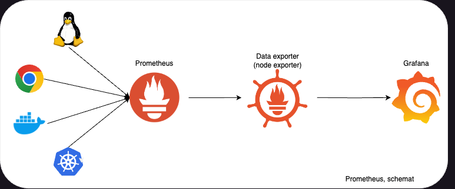
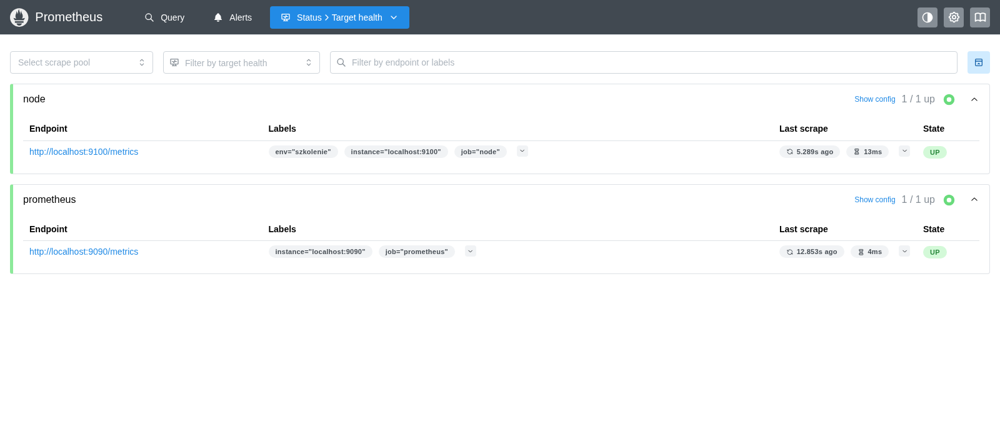
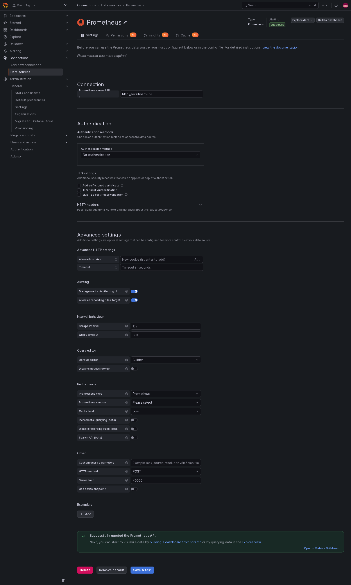
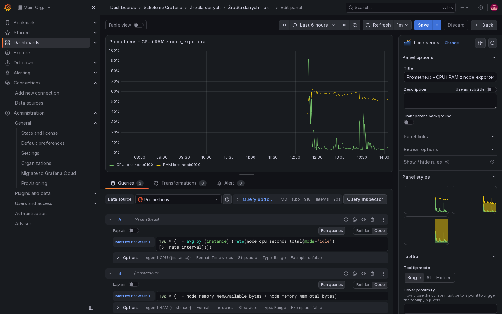

## Wprowadzenie do Prometheusa


**Prometheus** to otwartoźródłowe narzędzie do monitorowania i alertowania, zaprojektowane z myślą o elastycznym zbieraniu metryk z systemów oraz aplikacji. Działa jako baza danych szeregów czasowych (time-series database) z wbudowanym mechanizmem zapytań i obsługą alertów. W labie działa **Prometheus 3.16** i **node_exporter 1.12.1**.

### Kluczowe cechy Prometheusa:

- Gromadzenie danych za pomocą mechanizmu pull (odpytywanie endpointów HTTP `/metrics`, tzw. *scrape*).
- Wbudowany język zapytań **PromQL** do analizy i wizualizacji danych.
- Niezależność od zewnętrznych baz danych, dzięki lokalnemu przechowywaniu danych (TSDB).
- Model danych oparty na etykietach (labels), np. `node_load1{instance="localhost:9100", job="node"}`.

### Infrastruktura



```
┌───────────────────────────────────────────────────┐
│                Monitorowane hosty                 │
│                                                   │
│  ┌─────────────┐  ┌─────────────┐  ┌───────────┐  │
│  │    Node     │  │   cAdvisor  │  │    App    │  │
│  │  Exporter   │  │  (Docker)   │  │  /metrics │  │
│  │   :9100     │  │   :8080     │  │   :9xxx   │  │
│  └─────────────┘  └─────────────┘  └───────────┘  │
└───────────────────────────────────────────────────┘
              │               │              │
              └───────────────┴──────────────┘
                              │  HTTP scrape (pull)
                              ▼
               ┌──────────────────────────┐
               │    Prometheus Server     │
               │    :9090                 │
               │   ┌────────────────────┐ │
               │   │  Time-series       │ │
               │   │  storage (TSDB)    │ │
               │   └────────────────────┘ │
               └─────────────┬────────────┘
                             │  PromQL / HTTP
                             ▼
               ┌──────────────────────────┐
               │         Grafana          │
               └──────────────────────────┘
```

## Grafana i Prometheus

Grafana jest najczęściej używanym narzędziem do wizualizacji danych zgromadzonych w Prometheusie. Integracja tych narzędzi pozwala na tworzenie zaawansowanych dashboardów (także gotowych, importowanych z grafana.com, np. *Node Exporter Full* o ID 1860), łatwe monitorowanie systemów oraz definiowanie alertów.

## Instalacja i konfiguracja Prometheusa

Prometheus nie ma oficjalnego repozytorium apt — instaluje się go z archiwum (tarball) z GitHuba. Pakiet `prometheus` z repozytorium Ubuntu jest zwykle starszy niż wydania upstream.

### Skąd brać najnowszą wersję

Polecenia poniżej używają wersji z labu (**Prometheus 3.16.0**, **node_exporter 1.12.1**). Najnowsze wersje sprawdzisz na stronach [Prometheus Releases](https://github.com/prometheus/prometheus/releases) i [node_exporter Releases](https://github.com/prometheus/node_exporter/releases) albo poleceniem (tak zrobiono w labie):

```bash
PV=$(curl -s https://api.github.com/repos/prometheus/prometheus/releases/latest | grep -oP '"tag_name": "v\K[^"]+')
NV=$(curl -s https://api.github.com/repos/prometheus/node_exporter/releases/latest | grep -oP '"tag_name": "v\K[^"]+')
echo "Prometheus $PV, node_exporter $NV"
```

### Instalacja Prometheusa (na przykładzie Ubuntu 26.04)

1. Pobierz i rozpakuj Prometheusa:
   ```bash
   cd /tmp
   wget https://github.com/prometheus/prometheus/releases/download/v3.16.0/prometheus-3.16.0.linux-amd64.tar.gz
   tar xzf prometheus-3.16.0.linux-amd64.tar.gz
   ```
2. Utwórz dedykowanego użytkownika systemowego i katalogi, skopiuj pliki binarne:
   ```bash
   sudo useradd --no-create-home --shell /usr/sbin/nologin prometheus
   sudo mkdir -p /etc/prometheus /var/lib/prometheus
   sudo cp prometheus-3.16.0.linux-amd64/{prometheus,promtool} /usr/local/bin/
   ```
3. Utwórz plik konfiguracyjny `/etc/prometheus/prometheus.yml` (zawartość — patrz niżej „Konfiguracja `prometheus.yml`”) i nadaj uprawnienia:
   ```bash
   sudo nano /etc/prometheus/prometheus.yml
   sudo chown -R prometheus:prometheus /etc/prometheus /var/lib/prometheus
   ```
4. Utwórz plik usługi systemd:
   ```bash
   sudo nano /etc/systemd/system/prometheus.service
   ```
   Wklej zawartość:
   ```ini
   [Unit]
   Description=Prometheus
   Wants=network-online.target
   After=network-online.target

   [Service]
   User=prometheus
   Group=prometheus
   Type=simple
   ExecStart=/usr/local/bin/prometheus \
     --config.file=/etc/prometheus/prometheus.yml \
     --storage.tsdb.path=/var/lib/prometheus/ \
     --web.enable-lifecycle
   ExecReload=/bin/kill -HUP $MAINPID
   Restart=on-failure

   [Install]
   WantedBy=multi-user.target
   ```
   - Prometheus domyślnie nasłuchuje na porcie **9090** (zmiana: `--web.listen-address=:PORT`).
   - `--web.enable-lifecycle` pozwala przeładować konfigurację przez HTTP (`curl -X POST http://localhost:9090/-/reload`).
   - `ExecReload` pozwala przeładować konfigurację poleceniem `systemctl reload prometheus` (sygnał HUP).
   - Domyślna retencja danych to 15 dni (zmiana: `--storage.tsdb.retention.time=30d`).
5. Uruchom i włącz usługę:
   ```bash
   sudo systemctl daemon-reload
   sudo systemctl enable --now prometheus
   sudo systemctl status prometheus
   ```

> **Uwaga:** Prometheus 3.x nie zawiera już katalogów `consoles` i `console_libraries` znanych z 2.x — nie kopiuj ich i nie podawaj flag `--web.console.*`. Kopiujemy tylko pliki `prometheus` i `promtool`.

### Konfiguracja `prometheus.yml`

Konfiguracja z labu — Prometheus zbiera metryki sam o sobie (job `prometheus`) i z node_exportera (job `node`, dodatkowa etykieta `env`):

```yaml
global:
  scrape_interval: 15s
  evaluation_interval: 15s

scrape_configs:
  - job_name: "prometheus"
    static_configs:
      - targets: ["localhost:9090"]

  - job_name: "node"
    static_configs:
      - targets: ["localhost:9100"]
        labels:
          env: "szkolenie"
```

- **scrape_interval:** Określa częstotliwość zbierania danych.
- **job_name:** Unikalna nazwa zadania zbierania danych (trafia do etykiety `job`).
- **targets:** Lista endpointów do monitorowania (adres trafia do etykiety `instance`).
- **labels:** Dodatkowe etykiety doklejane do wszystkich metryk z tych targetów.

Przed restartem zawsze sprawdź składnię:

```bash
promtool check config /etc/prometheus/prometheus.yml
```

## Instalacja Node Exporter

**Node Exporter** to eksporter Prometheusa udostępniający metryki systemu operacyjnego Linux: CPU, pamięć, dysk, sieć i inne (port **9100**, endpoint `/metrics`). Jest wymagany do uzyskania danych z serwerów opisanych w przykładach PromQL poniżej.

1. Pobierz i zainstaluj Node Exporter:
   ```bash
   cd /tmp
   wget https://github.com/prometheus/node_exporter/releases/download/v1.12.1/node_exporter-1.12.1.linux-amd64.tar.gz
   tar xzf node_exporter-1.12.1.linux-amd64.tar.gz
   sudo cp node_exporter-1.12.1.linux-amd64/node_exporter /usr/local/bin/
   sudo useradd --no-create-home --shell /usr/sbin/nologin node_exporter
   ```
2. Utwórz plik usługi systemd:
   ```bash
   sudo nano /etc/systemd/system/node_exporter.service
   ```
   Wklej zawartość:
   ```ini
   [Unit]
   Description=Node Exporter
   Wants=network-online.target
   After=network-online.target

   [Service]
   User=node_exporter
   Group=node_exporter
   Type=simple
   ExecStart=/usr/local/bin/node_exporter
   Restart=on-failure

   [Install]
   WantedBy=multi-user.target
   ```
3. Uruchom usługę i sprawdź, czy wystawia metryki:
   ```bash
   sudo systemctl daemon-reload
   sudo systemctl enable --now node_exporter
   curl -s localhost:9100/metrics | grep ^node_load
   ```
4. Dodaj Node Exporter jako target w `prometheus.yml` (job `node` powyżej) i przeładuj Prometheusa:
   ```bash
   promtool check config /etc/prometheus/prometheus.yml
   sudo systemctl reload prometheus
   ```
5. Sprawdź stan targetów w interfejsie Prometheusa: `http://<IP-serwera>:9090` → **Status > Target health**. Oba joby powinny mieć stan **UP**.



> **Wskazówka:** Interfejs Prometheusa 3.x jest nowy: górne menu to **Query**, **Alerts** i **Status** (m.in. **Target health**, **Configuration**, **TSDB status**). W zakładce **Query** przetestujesz zapytania PromQL przed użyciem w Grafanie.

## Konfiguracja Grafany z Prometheusem

1. Zaloguj się do interfejsu webowego Grafany.
2. Przejdź do sekcji **Connections > Data sources** i kliknij **Add new data source**.
3. Wybierz **Prometheus** (kategoria *Time series databases*).
4. Wypełnij pola:
   - **Connection > Prometheus server URL**: `http://localhost:9090`
   - **Authentication method**: `No Authentication` (Prometheus w labie nie wymaga logowania)
   - Pozostaw pozostałe ustawienia domyślne. Warto znać sekcje: **Interval behaviour > Scrape interval** (powinien odpowiadać `scrape_interval`, tu `15s`), **Query editor > Default editor** (`Builder` lub `Code`), **Performance > Prometheus type / version**, **Other > HTTP method** (`POST`).
5. Kliknij **Save & test** — oczekiwany komunikat: **Successfully queried the Prometheus API.**



W labie Prometheus jest **źródłem domyślnym** (przycisk **Make default** / **Remove default**) — nowe panele dostają je automatycznie.

## Tworzenie Dashboardów

### Tworzenie panelu z wykorzystaniem PromQL

1. Przejdź do **Dashboards > New > New dashboard** i kliknij **Add visualization**.
2. Wybierz **Prometheus** jako źródło danych.
3. Wpisz zapytanie PromQL. Edytor ma dwa tryby: **Builder** (wybór metryki, etykiet i operacji z list) oraz **Code** (pisanie PromQL; przycisk **Metrics browser** pomaga znaleźć metrykę i etykiety). Zapytanie uruchamia **Run queries**.
4. W sekcji **Options** pod zapytaniem ustaw **Legend** (np. `CPU {{instance}}` — w nawiasach klamrowych nazwa etykiety).
5. Dostosuj wizualizację (np. Time series) i zapisz dashboard.



### Przykładowe zapytania PromQL

#### 1. Średnie wykorzystanie CPU (wszystkie rdzenie)
```promql
100 - (avg(rate(node_cpu_seconds_total{mode="idle"}[5m])) * 100)
```

**Wyjaśnienie zapytania:**
- `node_cpu_seconds_total{mode="idle"}` - licznik sekund spędzonych przez każdy rdzeń CPU w trybie bezczynności
- `rate(...[5m])` - średni przyrost licznika na sekundę w oknie 5 minut (dla jednego rdzenia: ułamek czasu bezczynności, 0–1)
- `avg(...)` - średnia ze wszystkich rdzeni
- `100 - (... * 100)` - zamiana bezczynności na wykorzystanie CPU w procentach

W panelach Grafany zamiast stałego okna lepiej używać zmiennej `$__rate_interval`, którą Grafana dobiera do zakresu czasu i interwału scrapowania. To wersja z panelu w labie (osobna seria dla każdej instancji):

```promql
100 * (1 - avg by (instance) (rate(node_cpu_seconds_total{mode="idle"}[$__rate_interval])))
```

#### 2. Wykorzystanie pamięci RAM (%)
```promql
100 * (1 - node_memory_MemAvailable_bytes / node_memory_MemTotal_bytes)
```

#### 3. Trend wykorzystania pamięci (średnia z 15 minut)
```promql
avg_over_time(((node_memory_MemTotal_bytes - node_memory_MemAvailable_bytes) / node_memory_MemTotal_bytes * 100)[15m:1m])
```

**Wyjaśnienie zapytania:**
- `node_memory_MemTotal_bytes` - całkowita ilość pamięci RAM w systemie (w bajtach)
- `node_memory_MemAvailable_bytes` - ilość dostępnej pamięci RAM (w bajtach)
- `node_memory_MemTotal_bytes - node_memory_MemAvailable_bytes` - użyta pamięć
- `(...) / node_memory_MemTotal_bytes * 100` - procent wykorzystania pamięci
- `avg_over_time(...[15m:1m])` - *subquery*: średnia w oknie 15 minut z próbkowaniem co 1 minutę

#### 4. Zajętość systemu plików `/` (%)
```promql
100 - (node_filesystem_avail_bytes{mountpoint="/",fstype!="rootfs"} / node_filesystem_size_bytes{mountpoint="/",fstype!="rootfs"} * 100)
```

#### 5. Ruch sieciowy przychodzący (bity/s, bez interfejsu loopback)
```promql
rate(node_network_receive_bytes_total{device!="lo"}[$__rate_interval]) * 8
```

#### 6. Stan targetów i liczba rdzeni
```promql
up
count by (instance) (node_cpu_seconds_total{mode="idle"})
```

`up` ma wartość 1, gdy ostatni scrape się udał, i 0, gdy target jest niedostępny — to podstawa alertu „host nie odpowiada”.

## Alerting: Prometheus Alertmanager vs Grafana Alerting

Prometheus posiada własny **Alertmanager** do wysyłania powiadomień, niezależny od Grafana Alerting. Oba systemy mogą działać równolegle:

| | **Prometheus Alertmanager** | **Grafana Alerting** |
|---|---|---|
| Reguły alertów | Definiowane w plikach YAML (PromQL), ewaluowane przez Prometheusa | Definiowane w UI Grafany (lub provisioning), ewaluowane przez Grafanę |
| Źródła danych | Tylko Prometheus | Dowolne źródło danych Grafany obsługujące alerty |
| Kanały powiadomień | E-mail, Slack, PagerDuty, Webhook i inne | E-mail, Slack, Teams, PagerDuty, Webhook i inne |
| Zarządzanie | Pliki konfiguracyjne | UI Grafany |
| Zalecenie | Alerty infrastrukturalne niezależne od Grafany | Alerty oparte na wielu źródłach danych |

Grafana potrafi też wyświetlać reguły z Prometheusa (**Manage alerts via Alerting UI** w ustawieniach źródła) i używać zewnętrznego Alertmanagera jako źródła danych.

## Najlepsze praktyki

- **Optymalizacja:** Używaj `$__rate_interval` w `rate()`/`increase()` i agregacji (`sum by`, `avg by`), aby nie pobierać tysięcy serii do panelu.
- **Eksploracja danych:** Wykorzystuj zakładkę **Query** w interfejsie Prometheusa (`http://<IP-serwera>:9090`) albo **Explore** w Grafanie do testowania zapytań PromQL przed ich użyciem w dashboardzie.
- **Kontrola konfiguracji:** Po każdej zmianie `prometheus.yml` uruchom `promtool check config` przed przeładowaniem.
- **Alerting:** Zdecyduj, czy alerty mają być zarządzane przez Alertmanager (infrastruktura) czy Grafana Alerting (dashboardy i wiele źródeł).

## Podsumowanie

Prometheus i Grafana są fundamentem nowoczesnych systemów monitoringu. Łatwość integracji oraz możliwość tworzenia zaawansowanych zapytań PromQL pozwala na pełne wykorzystanie potencjału danych metrycznych. Node Exporter dostarcza gotowych metryk dla serwerów Linux, a Alertmanager lub Grafana Alerting zapewniają system powiadomień. Przy odpowiedniej konfiguracji narzędzia te mogą dostarczyć kluczowych informacji o stanie infrastruktury IT.

---

## Ćwiczenie w labie

Grafana: **http://10.123.2.206:3000** (admin / admin). Prometheus: **http://10.123.2.206:9090**. node_exporter: **http://10.123.2.206:9100/metrics**. Źródło **Prometheus** w Grafanie jest już skonfigurowane i ustawione jako domyślne.

1. **Wersje i usługi.** Zaloguj się przez SSH (`ssh szkolenie@10.123.2.206`, hasło `szkolenie`):
   ```bash
   prometheus --version | head -1
   node_exporter --version 2>&1 | head -1
   systemctl is-active prometheus node_exporter
   promtool check config /etc/prometheus/prometheus.yml
   cat /etc/prometheus/prometheus.yml
   ```
2. **Metryki eksportera.** Zobacz surowe metryki, które zbiera Prometheus:
   ```bash
   curl -s localhost:9100/metrics | grep -E '^node_(load|memory_MemAvailable)'
   ```
3. **Target health.** Otwórz http://10.123.2.206:9090 → **Status > Target health**. Sprawdź, że joby `node` i `prometheus` są **UP**, a target `localhost:9100` ma etykietę `env="szkolenie"`.
4. **Zapytanie w Prometheusie.** W zakładce **Query** wpisz `up` i kliknij **Execute**, potem zapytanie nr 2 (RAM %).
5. **Źródło w Grafanie.** **Connections > Data sources > Prometheus** → **Save & test** (*Successfully queried the Prometheus API*).
6. **Explore.** Kliknij **Explore** w menu, wybierz źródło Prometheus, w trybie **Code** wpisz `node_load1` i uruchom zapytanie. Przełącz edytor na **Builder** i zobacz, jak to samo zapytanie wygląda w trybie wizualnym.
7. **Własny dashboard.** Utwórz **Dashboards > New > New dashboard > Add visualization**, źródło **Prometheus**, i dodaj panele:
   - **CPU %** (Time series), legenda `CPU {{instance}}`, jednostka *Percent (0-100)*:
     ```promql
     100 * (1 - avg by (instance) (rate(node_cpu_seconds_total{mode="idle"}[$__rate_interval])))
     ```
   - **RAM %** (Gauge):
     ```promql
     100 * (1 - node_memory_MemAvailable_bytes / node_memory_MemTotal_bytes)
     ```
   - **Dysk / %** (Stat):
     ```promql
     100 - (node_filesystem_avail_bytes{mountpoint="/",fstype!="rootfs"} / node_filesystem_size_bytes{mountpoint="/",fstype!="rootfs"} * 100)
     ```
   - **Sieć – odbiór** (Time series), legenda `{{device}}`, jednostka *bits/sec(SI)*:
     ```promql
     rate(node_network_receive_bytes_total{device!="lo"}[$__rate_interval]) * 8
     ```
   - **Liczba rdzeni** (Stat):
     ```promql
     count by (instance) (node_cpu_seconds_total{mode="idle"})
     ```
     (w labie: 2)
8. Porównaj swój panel CPU z panelem „Prometheus – CPU i RAM z node_exportera” na dashboardzie **Szkolenie Grafana > Źródła danych > Źródła danych – przegląd** oraz z dashboardem **Produkcja > Serwer Linux – przegląd**.
9. Zapisz dashboard jako `Prometheus – <Twoje imię>` w folderze **Szkolenie Grafana**.
