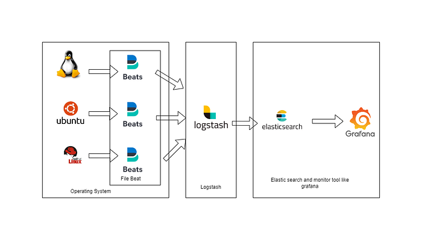
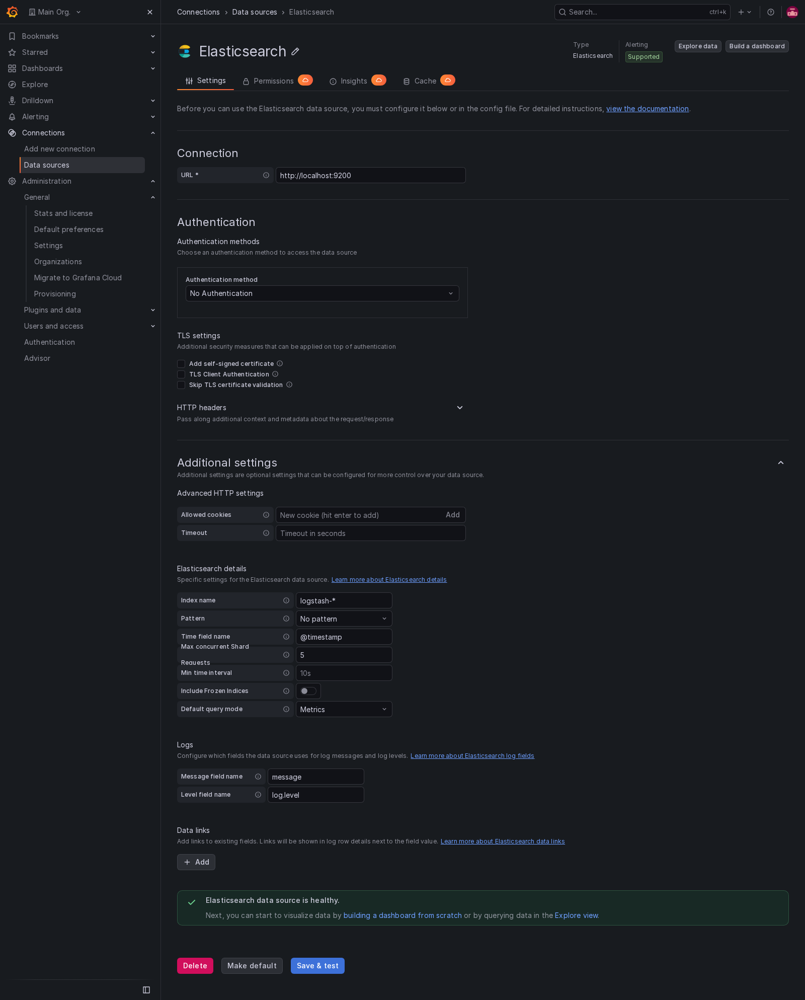
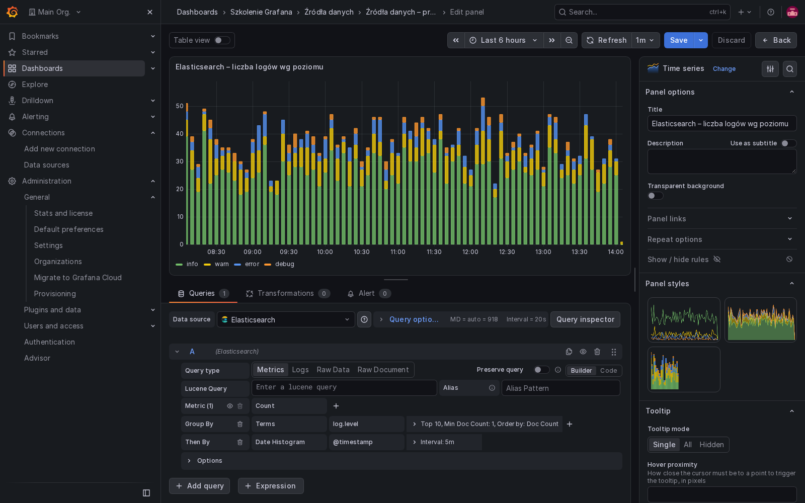

## Wprowadzenie do Elasticsearch

**Elasticsearch** to rozproszona wyszukiwarka i baza dokumentów (NoSQL), zoptymalizowana do przechowywania i wyszukiwania danych tekstowych oraz analizy danych szeregów czasowych (logi, zdarzenia, metryki). Jest częścią zestawu **Elastic Stack (ELK)**, który obejmuje również:
- **Logstash** — zbieranie i przetwarzanie danych (filtrowanie, parsowanie),
- **Beats** (Filebeat, Metricbeat) i **Elastic Agent** — lekkie agenty zbierające logi i metryki,
- **Kibana** — natywny interfejs wizualizacji Elastic Stack (Grafana może go zastąpić lub uzupełnić).

W labie działa **Elasticsearch 9.5** z repozytorium Elastic.

### Kluczowe cechy Elasticsearch:

- Szybkie wyszukiwanie pełnotekstowe i filtrowanie danych.
- Obsługa ogromnych wolumenów danych z możliwością skalowania poziomego (shardy, repliki).
- Wbudowana obsługa agregacji danych i analiz czasowych.

### Infrastruktura



```
┌───────────────────────────────────────────────────┐
│                  Źródła danych                    │
│                                                   │
│  ┌─────────────┐  ┌─────────────┐  ┌───────────┐  │
│  │  Filebeat   │  │  Metricbeat │  │ Logstash  │  │
│  │   (logi)    │  │  (metryki)  │  │ (filter)  │  │
│  └─────────────┘  └─────────────┘  └───────────┘  │
└───────────────────────────────────────────────────┘
              │               │              │
              └───────────────┴──────────────┘
                              │
                              ▼
               ┌──────────────────────────────┐
               │        Elasticsearch         │
               │                              │
               │  ┌───────────┐ ┌───────────┐ │
               │  │  Index    │ │  Index    │ │
               │  │  shard 1  │ │  shard 2  │ │
               │  └───────────┘ └───────────┘ │
               └──────────────┬───────────────┘
                              │  REST API / port 9200
                              ▼
               ┌──────────────────────────┐
               │         Grafana          │
               └──────────────────────────┘
```

## Grafana i Elasticsearch

Grafana umożliwia wizualizację danych z Elasticsearch, co czyni ją przydatnym narzędziem do monitorowania aplikacji, analizy logów i danych metrycznych w czasie rzeczywistym. Źródło Elasticsearch w Grafanie obsługuje zarówno **metryki** (agregacje: count, avg, sum, percentyle…), jak i **logi** (przeglądanie dokumentów w Explore i panelu Logs).

> **OpenSearch:** Grafana obsługuje również **OpenSearch** (fork Elasticsearch rozwijany pod egidą Linux Foundation, zapoczątkowany przez AWS) jako osobne źródło danych (plugin). Jeśli Twoja organizacja używa OpenSearch zamiast Elasticsearch, wybierz typ źródła danych **OpenSearch**.

## Instalacja i konfiguracja Elasticsearch

### Instalacja Elasticsearch (na przykładzie Ubuntu 26.04)

1. Dodaj klucz GPG i repozytorium Elastic dla wersji **9.x**:
   ```bash
   wget -qO - https://artifacts.elastic.co/GPG-KEY-elasticsearch | \
     sudo gpg --dearmor --yes -o /usr/share/keyrings/elasticsearch-keyring.gpg

   echo "deb [signed-by=/usr/share/keyrings/elasticsearch-keyring.gpg] https://artifacts.elastic.co/packages/9.x/apt stable main" | \
     sudo tee /etc/apt/sources.list.d/elastic-9.x.list
   ```
   > **Uwaga:** Adres repozytorium zawiera numer wersji głównej. Repozytorium `8.x` z wcześniejszych instrukcji instaluje starszą linię 8 — dla Elasticsearch 9 musi być `packages/9.x/apt`.

2. Zainstaluj Elasticsearch:
   ```bash
   sudo apt update
   sudo apt install -y elasticsearch | sudo tee /root/elasticsearch-install.log
   ```
   Podczas instalacji pakiet **automatycznie włącza zabezpieczenia** (TLS na porcie 9200 i uwierzytelnianie) i wypisuje wygenerowane hasło użytkownika `elastic` — dlatego zapisujemy wynik do pliku.

3. Ogranicz pamięć JVM (domyślnie Elasticsearch zajmuje ok. połowy RAM-u; na małej maszynie labowej z ~3,4 GB RAM to za dużo). Utwórz plik `/etc/elasticsearch/jvm.options.d/heap.options`:
   ```
   -Xms512m
   -Xmx512m
   ```

4. Skonfiguruj Elasticsearch w pliku `/etc/elasticsearch/elasticsearch.yml`. W labie (dane testowe, dostęp tylko z tej maszyny) **wyłączono zabezpieczenia**, żeby Grafana mogła łączyć się po zwykłym HTTP bez hasła:
   ```bash
   sudo sed -i 's/^xpack.security.enabled: true/xpack.security.enabled: false/; s/^  enabled: true/  enabled: false/' /etc/elasticsearch/elasticsearch.yml
   printf 'network.host: localhost\nhttp.port: 9200\n' | sudo tee -a /etc/elasticsearch/elasticsearch.yml
   ```
   Pierwsze polecenie zmienia `xpack.security.enabled` oraz `enabled` w sekcjach `xpack.security.http.ssl` i `xpack.security.transport.ssl` na `false`. Wynik (fragment):
   ```yaml
   xpack.security.enabled: false
   xpack.security.http.ssl:
     enabled: false
   xpack.security.transport.ssl:
     enabled: false
   http.host: 0.0.0.0
   network.host: localhost
   http.port: 9200
   ```
   > **Wskazówka:** Instalator dopisuje też `http.host: 0.0.0.0`, które dla HTTP ma pierwszeństwo przed `network.host` — dlatego w labie port 9200 jest dostępny na wszystkich interfejsach. Aby ograniczyć go do localhosta, zmień tę linię na `http.host: localhost`.

5. Uruchom i włącz Elasticsearch (start trwa kilkadziesiąt sekund):
   ```bash
   sudo systemctl daemon-reload
   sudo systemctl enable --now elasticsearch
   ```
6. Sprawdź działanie:
   ```bash
   curl -s "localhost:9200"
   curl -s "localhost:9200/_cluster/health?pretty"
   ```
   W labie klaster ma status **green** (jeden węzeł, indeksy bez replik).

### Wariant z włączonymi zabezpieczeniami (produkcja)

Jeśli nie wyłączasz zabezpieczeń (zalecane poza labem), Elasticsearch 9 działa na **https** z certyfikatem wygenerowanym przy instalacji:

```bash
# Nowe hasło dla użytkownika elastic (gdy zgubisz to z instalacji)
sudo /usr/share/elasticsearch/bin/elasticsearch-reset-password -u elastic

# Test połączenia z certyfikatem CA z instalacji
sudo curl --cacert /etc/elasticsearch/certs/http_ca.crt -u elastic https://localhost:9200
```

W Grafanie użyj wtedy URL `https://localhost:9200`, metody **Basic authentication** (najlepiej z osobnym użytkownikiem z rolą tylko do odczytu, nie `elastic`) i w **TLS settings** dodaj certyfikat CA (**Add self-signed certificate**, zawartość `http_ca.crt`) albo — tylko w testach — zaznacz **Skip TLS certificate validation**.

## Konfiguracja Grafany z Elasticsearch

1. Zaloguj się do interfejsu webowego Grafany.
2. Przejdź do sekcji **Connections > Data sources** i kliknij **Add new data source**.
3. Wybierz **Elasticsearch** (kategoria *Logging & document databases*).
4. Wypełnij pola:
   - **Connection > URL**: `http://localhost:9200`
   - **Authentication method**: `No Authentication` (w labie zabezpieczenia są wyłączone)
   - **Elasticsearch details > Index name**: `logstash-*` (wzorzec obejmujący indeksy dzienne `logstash-RRRR.MM.DD`)
   - **Pattern**: `No pattern` (przy wzorcu z gwiazdką; opcje `Daily`, `Hourly` itd. służą do wskazania indeksów po dacie w nazwie)
   - **Time field name**: `@timestamp`
   - **Default query mode**: `Metrics` (domyślny tryb nowych zapytań; drugi to `Logs`)
   - **Logs > Message field name**: `message`
   - **Logs > Level field name**: `log.level` (Grafana koloruje wpisy logów według poziomu)
5. Kliknij **Save & test** — oczekiwany komunikat: **Elasticsearch data source is healthy.**



## Tworzenie Dashboardów

### Tworzenie panelu z wykorzystaniem query buildera

Grafana posiada wbudowany **query builder** dla Elasticsearch — nie musisz pisać surowego Query DSL w JSON.

1. Przejdź do **Dashboards > New > New dashboard** i kliknij **Add visualization**.
2. Wybierz **Elasticsearch** jako źródło danych.
3. W edytorze zapytania (tryb **Builder**) skonfiguruj:
   - **Query type** — `Metrics` (agregacje do wykresów), `Logs` (wpisy logów), `Raw Data` / `Raw Document` (surowe dokumenty).
   - **Lucene Query** — opcjonalny filtr w składni Lucene, np. `log.level:error` albo `service.name:payments AND http.response.status_code:>=500`.
   - **Metric** — agregacja (np. `Count`, `Average`, `Sum`, `Max`, `Percentiles`, `Unique Count`) i pole, którego dotyczy.
   - **Group By** — podział na grupy według wartości pola (`Terms`, np. `log.level`) lub według czasu (`Date Histogram` na polu `@timestamp`).
   - **Then By** — kolejny poziom grupowania (np. najpierw `Terms` po `log.level`, potem `Date Histogram`).
   - **Alias** — nazwa serii (np. `{{term log.level}}`), opcjonalnie.
4. Dostosuj wizualizację (np. Time series w stylu słupków, Table, Pie chart).
5. Zapisz dashboard.



> **Ważne – nazwy pól:** W grupowaniu `Terms` używa się pól typu `keyword`. W labie pola `log.level`, `service.name`, `host.name` i `geo.city` są już typu `keyword`, więc używamy ich bezpośrednio. W indeksach z mapowaniem dynamicznym (np. Logstash bez szablonu) tekst trafia do pola `text` z podpolem `.keyword` — wtedy grupuje się po `host.name.keyword`.

> **Zaawansowane zapytania:** Jeśli query builder nie wystarczy, przełącz edytor na **Code** i wpisz zapytanie bezpośrednio. Jest to jednak zalecane tylko dla zaawansowanych użytkowników.

## Najlepsze praktyki

- **Optymalizacja zapytań:** Zawężaj indeks (`Index name`) i filtruj w **Lucene Query**, aby minimalizować ilość przetwarzanych danych.
- **Mapowanie danych:** Upewnij się, że dane mają poprawne mapowanie — pole czasu typu `date` (`@timestamp`), pola do grupowania typu `keyword`, liczby jako `long`/`float`.
- **Wydajność:** Regularnie monitoruj stan klastra (`_cluster/health`) i stosuj shardowanie oraz replikację zgodnie z wymaganiami; ustaw rozsądny heap JVM.
- **Bezpieczeństwo:** W produkcji zostaw włączone TLS i uwierzytelnianie, a Grafanie daj konto z prawem odczytu tylko do potrzebnych indeksów.

## Podsumowanie

Elasticsearch i Grafana to potężne narzędzia do analizy i wizualizacji danych. Wbudowany query builder Grafany znacznie upraszcza pracę z danymi Elasticsearch bez konieczności znajomości Query DSL. Dla środowisk używających OpenSearch — Grafana oferuje dedykowane źródło danych.

---

## Ćwiczenie w labie

Grafana: **http://10.123.2.206:3000** (admin / admin). Elasticsearch: **http://10.123.2.206:9200** (bez hasła). Źródło **Elasticsearch** w Grafanie jest już skonfigurowane.

Dane: generator `labdata.py` zapisuje co minutę dokumenty logów do indeksów dziennych `logstash-RRRR.MM.DD`. Pola: `@timestamp`, `host.name`, `log.level` (`info`/`warn`/`error`/`debug`), `service.name` (`nginx`/`api`/`auth`/`payments`/`cron`), `message`, `http.response.status_code`, `response_time_ms`, `geo.city`, `geo.lat`, `geo.lon`.

1. **Stan klastra i indeksy.** Zaloguj się przez SSH (`ssh szkolenie@10.123.2.206`, hasło `szkolenie`):
   ```bash
   curl -s localhost:9200 | grep '"number"'
   curl -s 'localhost:9200/_cluster/health?pretty' | grep status
   curl -s 'localhost:9200/_cat/indices/logstash-*?v'
   curl -s 'localhost:9200/logstash-*/_mapping?pretty' | head -40
   curl -s 'localhost:9200/logstash-*/_search?size=1&pretty'
   ```
   Sprawdź wersję (9.5.x), status `green`, liczbę dokumentów w indeksach i typy pól w mapowaniu.
2. **Źródło w Grafanie.** **Connections > Data sources > Elasticsearch** → porównaj pola z opisem lekcji → **Save & test** (*Elasticsearch data source is healthy*).
3. **Gotowy panel.** Na dashboardzie **Szkolenie Grafana > Źródła danych > Źródła danych – przegląd** otwórz panel „Elasticsearch – liczba logów wg poziomu” w trybie edycji i przeanalizuj konfigurację query buildera.
4. **Explore – logi.** Otwórz **Explore**, źródło Elasticsearch, **Query type: Logs**, w polu **Lucene Query** wpisz:
   ```
   log.level:error AND service.name:payments
   ```
   Uruchom zapytanie i obejrzyj wpisy (np. *Payment gateway returned 502*); rozwiń jeden wpis, aby zobaczyć wszystkie pola.
5. **Własny dashboard.** Utwórz **Dashboards > New > New dashboard > Add visualization**, źródło **Elasticsearch**, i zbuduj w query builderze:
   - **Logi wg poziomu** (Time series, styl *Bars*, *Stack series: Normal*): Query type `Metrics`, Lucene Query puste, Metric `Count`, Group By `Terms` → `log.level`, Then By `Date Histogram` → `@timestamp` (interwał `5m`).
   - **Błędy wg usługi** (Time series): Lucene Query `log.level:error`, Metric `Count`, Group By `Terms` → `service.name`, Then By `Date Histogram` → `@timestamp` (interwał `auto`).
   - **Średni czas odpowiedzi API i płatności** (Time series, jednostka *milliseconds (ms)*): Lucene Query `service.name:api OR service.name:payments`, Metric `Average` → `response_time_ms`, Group By `Terms` → `service.name`, Then By `Date Histogram` → `@timestamp`.
   - **Odpowiedzi 5xx** (Stat): Lucene Query `http.response.status_code:>=500`, Metric `Count`, Group By `Date Histogram` → `@timestamp`; w opcjach panelu **Value options > Calculation** ustaw *Total*.
6. Ustaw zakres czasu **Last 6 hours** i zapisz dashboard jako `Elasticsearch – <Twoje imię>` w folderze **Szkolenie Grafana**.
