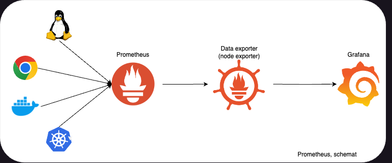

§## Wprowadzenie do Prometheusa


**Prometheus** to otwartoźródłowe narzędzie do monitorowania i alertowania, zaprojektowane z myślą o elastycznym zbieraniu metryk z systemów oraz aplikacji. Działa jako baza danych szeregów czasowych (time-series database) z wbudowanym mechanizmem zapytań i obsługą alertów.

### Kluczowe cechy Prometheusa:

- Gromadzenie danych za pomocą mechanizmu pull (odpytywanie endpointów HTTP).
- Wbudowany język zapytań **PromQL** do analizy i wizualizacji danych.
- Niezależność od zewnętrznych baz danych, dzięki lokalnemu przechowywaniu danych.

### Infrastruktura:



## Grafana i Prometheus

Grafana jest świetnym narzędziem do wizualizacji danych zgromadzonych w Prometheusie. Integracja tych narzędzi pozwala na tworzenie zaawansowanych dashboardów, łatwe monitorowanie systemów oraz ustalanie progów alertów.

## Instalacja i konfiguracja Prometheusa

### Instalacja Prometheusa (na przykładzie Ubuntu 24.04)

1. Pobierz najnowszą wersję Prometheusa z oficjalnej strony:
   ```bash
   wget https://github.com/prometheus/prometheus/releases/download/v2.47.0/prometheus-2.47.0.linux-amd64.tar.gz
   ```
2. Rozpakuj plik:
   ```bash
   tar xvf prometheus-2.47.0.linux-amd64.tar.gz
   cd prometheus-2.47.0.linux-amd64
   ```
3. Skopiuj pliki binarne do katalogu systemowego:
   ```bash
   sudo mv prometheus /usr/local/bin/
   sudo mv promtool /usr/local/bin/
   ```
4. Utwórz katalogi na dane i konfigurację:
   ```bash
   sudo mkdir /etc/prometheus /var/lib/prometheus
   sudo mv prometheus.yml /etc/prometheus/
   ```
5. Uruchom Prometheusa:
   ```bash
   prometheus --config.file=/etc/prometheus/prometheus.yml
   ```

### Przykładowa konfiguracja `prometheus.yml`

```yaml
global:
  scrape_interval: 15s
  evaluation_interval: 15s

scrape_configs:
  - job_name: 'node_exporter'
    static_configs:
      - targets: ['localhost:9100']
```

- **scrape_interval:** Określa częstotliwość zbierania danych.
- **job_name:** Unikalna nazwa zadania zbierania danych.
- **targets:** Lista endpointów do monitorowania (w tym przypadku Node Exporter).

## Konfiguracja Grafany z Prometheusem

1. Zaloguj się do interfejsu webowego Grafany.
2. Przejdź do sekcji **Configuration > Data Sources**.
3. Kliknij przycisk **Add data source** i wybierz **Prometheus**.
4. Wypełnij pola:
   - **URL**: `http://localhost:9090`
   - Pozostaw pozostałe ustawienia domyślne.
5. Kliknij **Save & Test**, aby upewnić się, że Grafana poprawnie połączyła się z Prometheusem.

## Tworzenie Dashboardów

### Tworzenie panelu z wykorzystaniem PromQL

1. Przejdź do sekcji **Dashboards > New Dashboard** w Grafanie.
2. Dodaj nowy panel (**Add a new panel**).
3. Wybierz Prometheus jako źródło danych.
4. Napisz zapytanie PromQL, które zwróci dane o zużyciu pamięci RAM z Node Exporter. Przykład:

### Przykładowe zapytania PromQL

#### 1. Średnie wykorzystanie CPU (wszystkie rdzenie)
```PromQL
100 - (avg(rate(node_cpu_seconds_total{mode="idle"}[15m])) * 100)
```

**Wyjaśnienie zapytania:**
- `node_cpu_seconds_total{mode="idle"}` - metryka Node Exporter pokazująca czas spędzony przez CPU w trybie bezczynności
- `rate(...[15m])` - oblicza średnią zmianę wartości na sekundę w ciągu ostatnich 15 minut
- `avg(...)` - oblicza średnią ze wszystkich rdzeni CPU
- `100 - (... * 100)` - konwertuje bezczynność na wykorzystanie CPU w procentach (100% - bezczynność = wykorzystanie)

#### 2. Trend wykorzystania pamięci (średnia z 15 minut)
```PromQL
avg_over_time(((node_memory_MemTotal_bytes - node_memory_MemAvailable_bytes) / node_memory_MemTotal_bytes * 100)[15m:1m])
```

**Wyjaśnienie zapytania:**
- `node_memory_MemTotal_bytes` - całkowita ilość pamięci RAM w systemie (w bajtach)
- `node_memory_MemAvailable_bytes` - ilość dostępnej pamięci RAM (w bajtach)
- `node_memory_MemTotal_bytes - node_memory_MemAvailable_bytes` - oblicza użytą pamięć
- `(...) / node_memory_MemTotal_bytes * 100` - konwertuje na procent wykorzystania pamięci
- `avg_over_time(...[15m:1m])` - oblicza średnią wartość w oknie 15 minut z próbkowaniem co 1 minutę


5. Dostosuj wizualizację (np. wykres liniowy).
6. Zapisz panel i dodaj go do dashboardu.

## Najlepsze praktyki

- **Optymalizacja:** Używaj odpowiednio dobranych przedziałów czasowych, aby uniknąć nadmiernego obciążenia Prometheusa.
- **Eksploracja danych:** Wykorzystuj interfejs Prometheusa do testowania zapytań PromQL przed ich użyciem w Grafanie.
- **Alerting:** Konfiguruj alerty w Prometheusie i Grafanie, aby natychmiast reagować na problemy.

## Podsumowanie

Prometheus i Grafana są fundamentem nowoczesnych systemów monitoringu. Łatwość integracji oraz możliwość tworzenia zaawansowanych zapytań PromQL pozwala na pełne wykorzystanie potencjału danych metrycznych. Przy odpowiedniej konfiguracji narzędzia te mogą dostarczyć kluczowych informacji o stanie infrastruktury IT.
