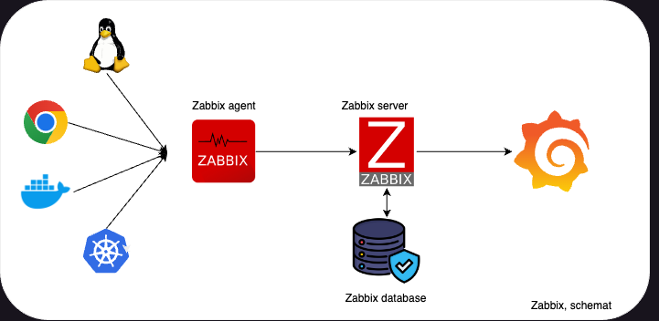
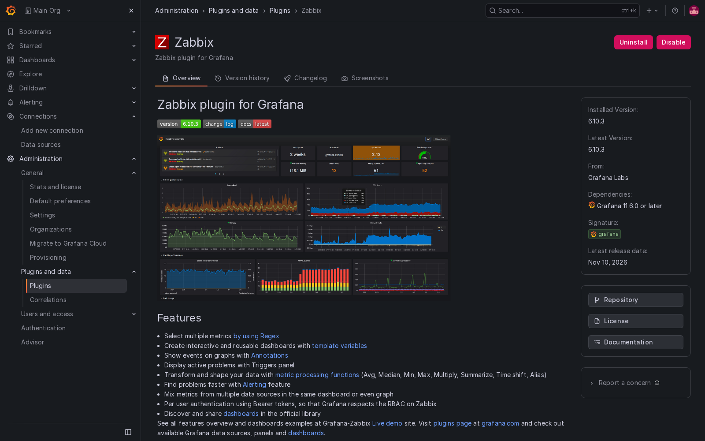
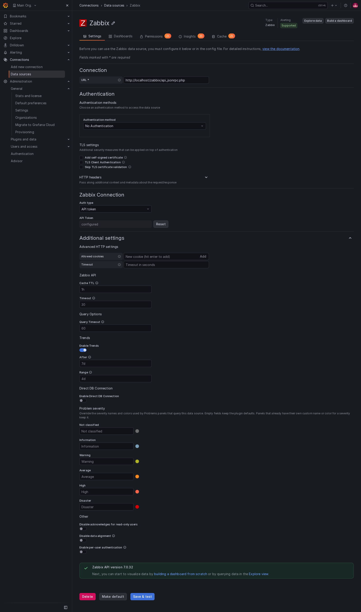
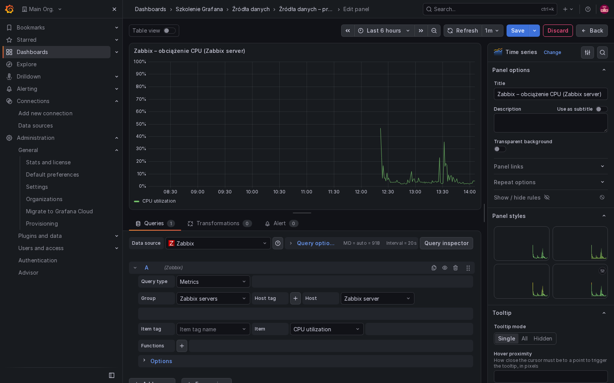
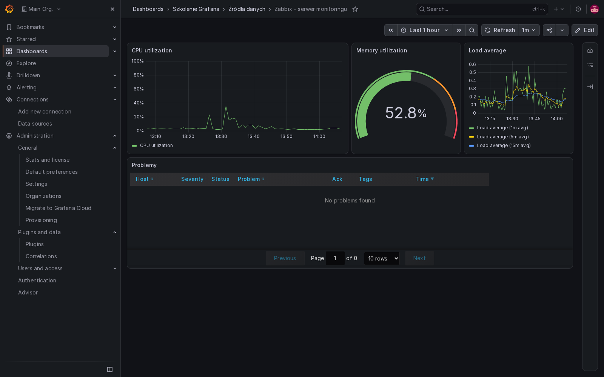

# Zabbix


## Wprowadzenie do Zabbix

**Zabbix** to rozbudowane narzędzie do monitorowania infrastruktury IT, umożliwiające zbieranie danych o wydajności, dostępności i zdarzeniach z serwerów, sieci oraz aplikacji. Posiada wbudowany system alertów i zaawansowane funkcje raportowania, co czyni go jednym z najpopularniejszych rozwiązań monitorujących na świecie. W labie działa **Zabbix 7.0 LTS** (7.0.32) z bazą MariaDB 11.8 i frontendem na Apache + PHP 8.5.

### Kluczowe cechy Zabbixa:

- Agentowe i bezagentowe monitorowanie zasobów.
- Elastyczne mechanizmy zbierania danych, w tym integracje z SNMP, IPMI, JMX, HTTP/API i logami systemowymi.
- Szablony (templates) z gotowymi itemami, triggerami i wykresami, np. *Linux by Zabbix agent*.
- Wbudowane alerty (triggery, problemy) i raportowanie w czasie rzeczywistym.

### Infrastruktura



```
┌───────────────────────────────────────────────────┐
│               Monitorowane hosty                  │
│                                                   │
│  ┌─────────────┐  ┌─────────────┐  ┌───────────┐  │
│  │   Zabbix    │  │    SNMP     │  │   IPMI    │  │
│  │    Agent    │  │   Device    │  │   Device  │  │
│  │   :10050    │  │             │  │           │  │
│  └─────────────┘  └─────────────┘  └───────────┘  │
└───────────────────────────────────────────────────┘
              │               │              │
              └───────────────┴──────────────┘
                              │  TCP / SNMP / IPMI
                              ▼
               ┌──────────────────────────────┐
               │        Zabbix Server         │
               │                              │
               │  ┌────────────────────────┐  │
               │  │  Database              │  │
               │  │  (MySQL / PostgreSQL)  │  │
               │  └────────────────────────┘  │
               └──────────────┬───────────────┘
                              │  Zabbix API (JSON-RPC, HTTP)
                              ▼
               ┌──────────────────────────┐
               │         Grafana          │
               │     (plugin Zabbix)      │
               └──────────────────────────┘
```

## Grafana i Zabbix

Grafana doskonale współpracuje z Zabbixem, pozwalając na tworzenie dynamicznych i interaktywnych dashboardów. Dzięki integracji można wizualizować dane zgromadzone w Zabbixie w bardziej zaawansowany sposób niż w natywnym interfejsie, łączyć je na jednym dashboardzie z danymi z innych źródeł (Prometheus, SQL, Elasticsearch) oraz wyświetlać aktualne problemy Zabbixa w panelu **Zabbix Problems**.

## Instalacja i konfiguracja Zabbixa

### Instalacja Zabbixa 7.0 LTS (na przykładzie Ubuntu 26.04)

Polecenia wykonujemy jako root (`sudo -i`). To dokładnie te kroki, którymi postawiono Zabbixa w labie.

1. Zainstaluj serwer bazy danych MariaDB:
   ```bash
   apt-get install -y mariadb-server
   systemctl enable --now mariadb
   ```
2. Dodaj oficjalne repozytorium Zabbix 7.0 dla Ubuntu 26.04:
   ```bash
   cd /tmp
   wget https://repo.zabbix.com/zabbix/7.0/ubuntu/pool/main/z/zabbix-release/zabbix-release_latest_7.0+ubuntu26.04_all.deb
   dpkg -i zabbix-release_latest_7.0+ubuntu26.04_all.deb
   apt-get update
   ```
3. Zainstaluj serwer, frontend, konfigurację Apache, skrypty SQL i agenta:
   ```bash
   apt-get install -y zabbix-server-mysql zabbix-frontend-php zabbix-apache-conf zabbix-sql-scripts zabbix-agent
   ```
   > **Uwaga:** Pakiet `zabbix-apache-conf` jest potrzebny, aby frontend był dostępny pod `/zabbix` w Apache, a `zabbix-sql-scripts` zawiera schemat bazy. Pominięcie któregoś z nich to najczęstsza przyczyna problemów w kolejnych krokach.
4. Utwórz bazę danych i użytkownika (`mysql` jako root):
   ```sql
   CREATE DATABASE zabbix CHARACTER SET utf8mb4 COLLATE utf8mb4_bin;
   CREATE USER 'zabbix'@'localhost' IDENTIFIED BY 'haslo';
   GRANT ALL PRIVILEGES ON zabbix.* TO 'zabbix'@'localhost';
   SET GLOBAL log_bin_trust_function_creators = 1;
   FLUSH PRIVILEGES;
   ```
   `log_bin_trust_function_creators = 1` jest wymagane tylko na czas importu schematu (schemat tworzy wyzwalacze/funkcje).
5. Zaimportuj schemat bazy danych i przywróć ustawienie:
   ```bash
   zcat /usr/share/zabbix-sql-scripts/mysql/server.sql.gz | mysql --default-character-set=utf8mb4 -uzabbix -phaslo zabbix
   mysql -e 'SET GLOBAL log_bin_trust_function_creators = 0;'
   ```
   > **Uwaga (pułapka):** W Zabbixie 7.0 na Ubuntu 26.04 schemat leży w `/usr/share/zabbix-sql-scripts/mysql/server.sql.gz` (pakiet `zabbix-sql-scripts`) — **nie** w `/usr/share/doc/zabbix-server-mysql/` (starsze wersje) ani w `/usr/share/zabbix/sql-scripts/`. Import trwa kilka minut i nie wypisuje nic na ekran.
6. Ustaw hasło do bazy w `/etc/zabbix/zabbix_server.conf`:
   ```
   DBPassword=haslo
   ```
7. Włącz moduły Apache potrzebne do PHP-FPM:
   ```bash
   a2enmod proxy proxy_fcgi setenvif
   a2enconf php8.5-fpm
   ```
   > **Uwaga (pułapka):** Ubuntu 26.04 dostarcza PHP 8.5 w trybie **PHP-FPM**. Bez tych modułów Apache nie wystartuje z konfiguracją Zabbixa i zgłosi błąd `Invalid command 'ProxyTimeout'`.
8. Wygeneruj locale `en_US.UTF-8` (frontend Zabbixa wymaga go do wyboru języka):
   ```bash
   locale-gen en_US.UTF-8
   ```
9. Uruchom i włącz usługi:
   ```bash
   systemctl enable --now zabbix-server zabbix-agent apache2
   systemctl restart zabbix-server zabbix-agent apache2
   ```
10. Otwórz frontend `http://<adres_serwera>/zabbix` i przejdź kreator instalacji (połączenie z bazą: `localhost`, baza `zabbix`, użytkownik `zabbix`, hasło `haslo`). Kreator zapisuje plik `/etc/zabbix/web/zabbix.conf.php` — w labie utworzono go bezpośrednio, więc od razu pojawia się ekran logowania. Domyślne konto frontendu: **Admin** / **zabbix**.

Sprawdzenie API z konsoli (bez logowania):

```bash
curl -s -X POST -H 'Content-Type: application/json-rpc' \
  -d '{"jsonrpc":"2.0","method":"apiinfo.version","params":{},"id":1}' \
  http://localhost/zabbix/api_jsonrpc.php
```

Odpowiedź w labie: `{"jsonrpc":"2.0","result":"7.0.32","id":1}`.

## Konfiguracja Grafany z Zabbix

Integracja Grafany z Zabbixem odbywa się przez plugin **Zabbix** (`alexanderzobnin-zabbix-app`) autorstwa Alexandra Zobnina, obecnie rozwijany i podpisywany przez **Grafana Labs** (na stronie pluginu: *From: Grafana Labs*, podpis `grafana`). Nie jest wbudowany w Grafanę — wymaga instalacji i włączenia, a jego wersja musi być zgodna z wersją Grafany (w labie: plugin 6.10.3, wymaga Grafany 11.6.0 lub nowszej).

1. Zainstaluj plugin i zrestartuj Grafanę:
   ```bash
   sudo grafana cli plugins install alexanderzobnin-zabbix-app
   sudo systemctl restart grafana-server
   ```
2. W Grafanie przejdź do **Administration > Plugins and data > Plugins**, wyszukaj **Zabbix**, otwórz stronę pluginu i kliknij **Enable**. Po włączeniu w prawym górnym rogu widać przyciski **Uninstall** i **Disable**.

   

3. Utwórz w Zabbixie **API token** dla Grafany (Zabbix 5.4+ — metoda zalecana):
   - w Zabbixie przejdź do **Users > API tokens** (albo **User settings > API tokens** dla własnego konta) i kliknij **Create API token**,
   - wybierz użytkownika, nadaj nazwę (np. `grafana`), opcjonalnie datę wygaśnięcia,
   - skopiuj wygenerowany token — Zabbix pokazuje go tylko raz.

   > **Bezpieczeństwo:** Grafana widzi w Zabbixie dokładnie to, do czego ma dostęp użytkownik tokenu. W produkcji utwórz osobnego użytkownika z rolą tylko do odczytu i uprawnieniami do wybranych grup hostów.

4. Przejdź do **Connections > Data sources**, kliknij **Add new data source** i wybierz **Zabbix**.
5. Wypełnij pola konfiguracyjne:
   - **Connection > URL**: `http://<adres_zabbix>/zabbix/api_jsonrpc.php` — pełny adres API, w labie `http://localhost/zabbix/api_jsonrpc.php`
   - **Authentication method** (sekcja HTTP): `No Authentication` — to uwierzytelnianie HTTP przed serwerem WWW, nie logowanie do Zabbixa
   - **Zabbix Connection > Auth type**: `API token`
   - **API Token**: wklej token z kroku 3
   - **Additional settings** (opcjonalnie): **Cache TTL**, **Trends** (od jakiego wieku danych korzystać z trendów zamiast historii — domyślnie po 7 dniach), **Direct DB Connection** (odczyt historii bezpośrednio z bazy przez osobne źródło MySQL/PostgreSQL — szybsze przy długich zakresach), nazwy i kolory ważności problemów
6. Kliknij **Save & test** — przy poprawnej konfiguracji pojawi się komunikat z wersją API, w labie **Zabbix API version 7.0.32**.



### Autoryzacja: użytkownik i hasło

Zamiast tokenu można wybrać **Auth type: User and password** i podać login oraz hasło użytkownika Zabbixa. To jedyna metoda dla Zabbixa starszego niż 5.4; w nowszych wersjach zalecany jest token (nie wygasa przy zmianie hasła, można go odwołać niezależnie).

> **Wskazówka:** Na stronie źródła Zabbix jest dodatkowa zakładka **Dashboards** — można z niej zaimportować gotowe dashboardy dostarczane z pluginem (np. przegląd serwera Zabbix).

## Tworzenie Dashboardów

### Tworzenie panelu z wykorzystaniem danych z Zabbixa

1. Przejdź do **Dashboards > New > New dashboard** i kliknij **Add visualization**.
2. Wybierz **Zabbix** jako źródło danych.
3. W edytorze zapytania skonfiguruj:
   - **Query type**: `Metrics` (wartości liczbowe itemów; inne typy to `Text`, `Item Id`, `Services`, `Triggers`, `Problems`, `User macros`),
   - **Group**: grupa hostów z Zabbixa (np. `Zabbix servers`),
   - **Host**: konkretny host (np. `Zabbix server`),
   - **Item tag** (opcjonalnie): filtr itemów po tagu, np. `component: memory`,
   - **Item**: metryka, np. `CPU utilization`,
   - **Functions** (opcjonalnie): funkcje pluginu przetwarzające serie, np. skalowanie, agregacja, zmiana nazwy serii (lista po kliknięciu **+**).
4. Dostosuj wizualizację (np. Time series) i zapisz dashboard.



> **Uwaga:** Pole **Application** zostało usunięte w Zabbix 5.4 i zastąpione przez **tagi**. W pluginie do filtrowania służy pole **Item tag**.

> **Wskazówka:** Pola Group, Host i Item przyjmują też **wyrażenia regularne** w ukośnikach, np. Item `/Load average/` zwróci trzy serie: *Load average (1m avg)*, *(5m avg)* i *(15m avg)*; Host `/.*/` — wszystkie hosty w grupie.

### Przykładowe zapytanie: Użycie pamięci RAM

W szablonie *Linux by Zabbix agent* (Zabbix 7.0) procentowe użycie pamięci to item **Memory utilization** (klucz `vm.memory.util`). Inne itemy pamięci: *Available memory* (`vm.memory.size[available]`), *Available memory in %* (`vm.memory.size[pavailable]`), *Total memory* (`vm.memory.size[total]`). Ustaw Group `Zabbix servers`, Host `Zabbix server`, Item `Memory utilization` i wizualizację **Gauge** z jednostką *Percent (0-100)*.

### Panel Zabbix Problems

Wizualizacja **Zabbix Problems** (dostarczana z pluginem Zabbix, Query type `Problems`) pokazuje aktualne problemy z Zabbixa: host, ważność (severity), status, opis, potwierdzenie (Ack), tagi i czas. Gdy nie ma aktywnych problemów, panel wyświetla *No problems found*.



## Najlepsze praktyki

- **Optymalizacja zbierania danych:** Ustaw odpowiednie interwały zbierania danych, aby nie obciążać serwera Zabbix.
- **Trendy i Direct DB:** Dla długich zakresów czasu korzystaj z trendów (włączone domyślnie) albo z **Direct DB Connection** — odpytywanie historii przez API przy zakresie kilku tygodni jest wolne.
- **Wersjonowanie pluginu:** Upewnij się, że wersja pluginu jest kompatybilna z wersją Grafany — sprawdź zależności na stronie pluginu (*Dependencies*) lub w katalogu pluginów na grafana.com.
- **Alerty:** Problemy z Zabbixa pokazuj w panelu Problems, a w Grafana Alerting twórz reguły tylko dla tego, czego nie da się (lub nie warto) zrobić w Zabbixie — np. reguł łączących dane z kilku źródeł. Unikaj dublowania tych samych alertów w obu systemach.

## Podsumowanie

Integracja Zabbixa z Grafaną pozwala na pełniejsze wykorzystanie danych monitorujących dzięki zaawansowanej wizualizacji. Odpowiednia konfiguracja obu narzędzi umożliwia skuteczne monitorowanie infrastruktury IT oraz szybkie reagowanie na pojawiające się problemy.

---

## Ćwiczenie w labie

Grafana: **http://10.123.2.206:3000** (admin / admin). Zabbix: **http://10.123.2.206/zabbix** (Admin / zabbix). Plugin Zabbix jest zainstalowany i włączony, źródło **Zabbix** w Grafanie uwierzytelnia się API tokenem. Zabbix monitoruje sam siebie: host **Zabbix server** w grupie **Zabbix servers**, szablon *Linux by Zabbix agent*.

1. **Usługi i API.** Zaloguj się przez SSH (`ssh szkolenie@10.123.2.206`, hasło `szkolenie`):
   ```bash
   systemctl is-active zabbix-server zabbix-agent apache2 mariadb php8.5-fpm
   zabbix_server -V | head -1
   ls /usr/share/zabbix-sql-scripts/mysql/
   curl -s -X POST -H 'Content-Type: application/json-rpc' \
     -d '{"jsonrpc":"2.0","method":"apiinfo.version","params":{},"id":1}' \
     http://localhost/zabbix/api_jsonrpc.php
   ```
2. **Frontend Zabbixa.** Zaloguj się na http://10.123.2.206/zabbix jako `Admin` / `zabbix`. Otwórz **Monitoring > Hosts**, znajdź **Zabbix server** i obejrzyj **Latest data** — zwróć uwagę na nazwy itemów *CPU utilization*, *Memory utilization*, *Load average (1m avg)*. Zajrzyj do **Users > API tokens** — tam jest token używany przez Grafanę.
3. **Plugin.** W Grafanie: **Administration > Plugins and data > Plugins** → wyszukaj *Zabbix* → sprawdź wersję i zależności.
4. **Źródło.** **Connections > Data sources > Zabbix** → **Save & test**. Oczekiwany komunikat: *Zabbix API version 7.0.32*.
5. **Gotowy dashboard.** Otwórz **Dashboards > Szkolenie Grafana > Źródła danych > Zabbix – serwer monitoringu** i przejrzyj panele (CPU, Memory gauge, Load, Problemy) w trybie edycji — panel „Problemy” to wizualizacja **Zabbix Problems** z Query type `Problems`.
6. **Własny dashboard.** Utwórz **Dashboards > New > New dashboard > Add visualization**, źródło **Zabbix**, Query type **Metrics**, Group `Zabbix servers`, Host `Zabbix server`, i dodaj panele:
   - **CPU** (Time series, jednostka *Percent (0-100)*): Item `CPU utilization`,
   - **RAM** (Gauge, jednostka *Percent (0-100)*): Item `Memory utilization`,
   - **Load average** (Time series): Item `/Load average/` (wyrażenie regularne — trzy serie),
   - **Pamięć – itemy z tagiem** (Table): Item tag `component: memory`, Item `/.*/` — panel zwróci kilka serii (pamięć i swap); dodaj transformację **Reduce** z obliczeniem *Last*, aby dostać tabelę „item – ostatnia wartość” (transformacje omawia dział IV).
7. **Ruch sieciowy.** Dodaj panel Time series z Item `/Interface .*: Bits received/` (w labie: *Interface ens18: Bits received*) i jednostką *bits/sec(SI)*. Zmień nazwę serii w **Standard options > Display name** na `Odbiór`.
8. **Problemy.** Dodaj wizualizację **Zabbix Problems** (źródło Zabbix, Query type `Problems`, Group `Zabbix servers`, Host `/.*/`). Jeśli lista jest pusta — to dobrze, Zabbix nie ma aktywnych problemów.
9. Zapisz dashboard jako `Zabbix – <Twoje imię>` w folderze **Szkolenie Grafana**.
