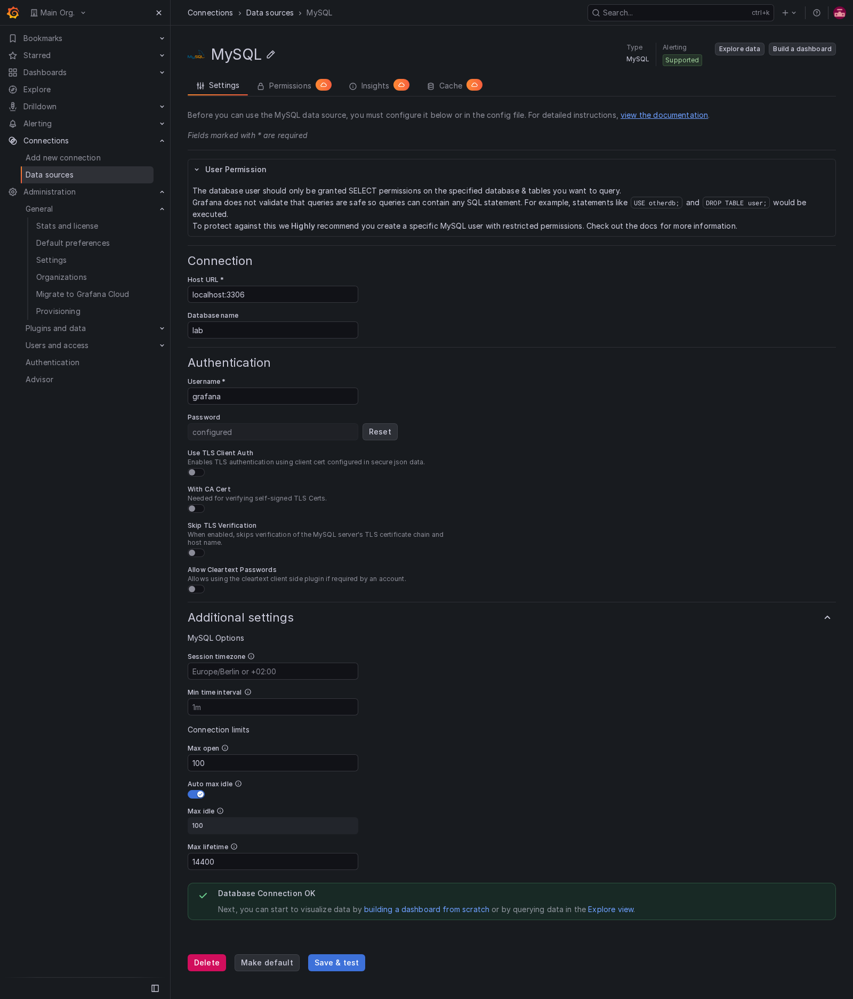
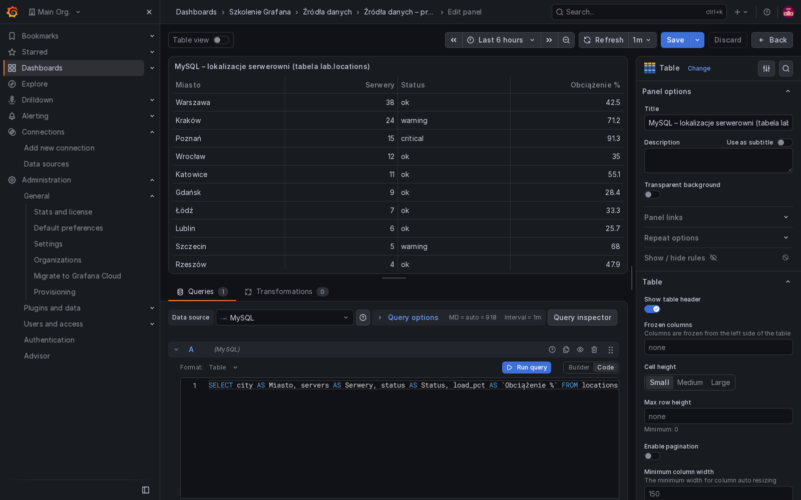

# MySQL

## Wprowadzenie do MySQL i MariaDB

**MySQL** to jeden z najpopularniejszych otwartoźródłowych systemów zarządzania relacyjnymi bazami danych (RDBMS), rozwijany przez Oracle. **MariaDB** to jego fork rozwijany przez społeczność i MariaDB Foundation — zgodny z MySQL na poziomie protokołu i składni SQL w zakresie potrzebnym Grafanie.

Grafana ma jedno wbudowane źródło danych **MySQL**, które obsługuje zarówno MySQL, jak i MariaDB (a także zgodne usługi chmurowe, np. Amazon RDS/Aurora MySQL, Azure Database for MySQL). W labie działa **MariaDB 11.8** z pakietów Ubuntu 26.04 — ta sama instancja przechowuje bazę Zabbixa (`zabbix`) i bazę ćwiczeniową `lab`.

### Kiedy używać MySQL w Grafanie?

- Gdy dane aplikacji (zamówienia, użytkownicy, stany magazynowe) leżą w MySQL/MariaDB i trzeba je pokazać na dashboardzie.
- Gdy chcesz wyświetlić dane, które nie są szeregami czasowymi — tabele, listy, lokalizacje na mapie (Geomap).
- Gdy inne narzędzie zapisuje dane do MySQL (np. Zabbix) i chcesz je czytać bezpośrednio z bazy.

## Instalacja MariaDB (na przykładzie Ubuntu 26.04)

1. Zainstaluj i uruchom serwer:
   ```bash
   sudo apt update
   sudo apt install -y mariadb-server
   sudo systemctl enable --now mariadb
   mysql --version
   ```
   Domyślnie MariaDB nasłuchuje tylko na `127.0.0.1:3306`, a użytkownik `root` loguje się przez gniazdo uniksowe (`sudo mysql`, bez hasła).

2. Utwórz bazę danych, przykładową tabelę i użytkownika **tylko do odczytu** dla Grafany (`sudo mysql`):
   ```sql
   CREATE DATABASE lab CHARACTER SET utf8mb4;
   USE lab;
   CREATE TABLE locations (
     city      VARCHAR(40) PRIMARY KEY,
     latitude  DOUBLE,
     longitude DOUBLE,
     servers   INT,
     status    VARCHAR(10),
     load_pct  DOUBLE
   );
   INSERT INTO locations VALUES
     ('Warszawa', 52.2297, 21.0122, 38, 'ok', 42.5),
     ('Kraków',   50.0647, 19.9450, 24, 'warning', 71.2);

   CREATE USER 'grafana'@'localhost' IDENTIFIED BY 'grafana';
   GRANT SELECT ON lab.* TO 'grafana'@'localhost';
   FLUSH PRIVILEGES;
   ```
   > **Bezpieczeństwo:** Tak jak przy PostgreSQL — Grafana nie sprawdza, czy zapytanie jest bezpieczne (ostrzega o tym ramka **User Permission** w konfiguracji źródła: `USE otherdb;` czy `DROP TABLE user;` zostałyby wykonane). Użytkownik Grafany powinien mieć wyłącznie `SELECT` i tylko do potrzebnych baz. W labie użytkownik `grafana` ma `SELECT` na bazach `lab` i `zabbix`.

3. Sprawdź uprawnienia:
   ```sql
   SHOW GRANTS FOR 'grafana'@'localhost';
   ```

## Konfiguracja Grafany z MySQL

1. Przejdź do **Connections > Data sources** i kliknij **Add new data source**.
2. Wybierz **MySQL**.
3. Wypełnij pola:
   - **Connection > Host URL**: `localhost:3306`
   - **Connection > Database name**: `lab` (baza domyślna; inne bazy, do których użytkownik ma prawo, odpytasz pełną nazwą `baza.tabela`)
   - **Authentication > Username**: `grafana`
   - **Authentication > Password**: `grafana`
   - przełączniki TLS (**Use TLS Client Auth**, **With CA Cert**, **Skip TLS Verification**) — wyłączone dla połączenia lokalnego
   - **Additional settings > Session timezone**: puste (strefa serwera MySQL); ustaw, jeśli kolumny `DATETIME` są zapisywane w innej strefie niż UTC
4. Kliknij **Save & test** — oczekiwany komunikat: **Database Connection OK**.



## Tworzenie zapytań

Edytor zapytań MySQL działa tak samo jak PostgreSQL: tryby **Builder** i **Code**, pole **Format** (**Time series** lub **Table**), przycisk **Run query**.

### Zapytanie tabelaryczne (Format: Table)

```sql
SELECT city AS Miasto, servers AS Serwery, status AS Status, load_pct AS `Obciążenie %`
FROM locations
ORDER BY servers DESC
```

W MySQL aliasy ze spacjami lub znakami specjalnymi zapisuje się w odwrotnych apostrofach (`` ` ``), a nie w cudzysłowach jak w PostgreSQL.



### Makra czasu w MySQL

Makra są takie same jak w PostgreSQL (`$__timeFilter`, `$__timeGroup`, `$__timeGroupAlias`, `$__timeFrom`, `$__timeTo`), a dla kolumn z czasem uniksowym (liczba sekund) służą wersje `$__unixEpoch...`:

| Makro | Opis |
|-------|------|
| `$__unixEpochFilter(kolumna)` | Filtr zakresu czasu dla kolumny z liczbą sekund od 1970 r. |
| `$__unixEpochGroupAlias(kolumna, '1m')` | Grupowanie w przedziały czasu + alias `time` dla kolumny z czasem uniksowym |

Przykład (format **Time series**): wykorzystanie CPU odczytane **bezpośrednio z bazy Zabbixa** — Zabbix zapisuje historię w tabeli `history` z kolumną `clock` (czas uniksowy):

```sql
SELECT
  $__unixEpochGroupAlias(h.clock, '1m'),
  avg(h.value) AS "CPU utilization"
FROM zabbix.history h
JOIN zabbix.items i ON i.itemid = h.itemid
WHERE i.key_ = 'system.cpu.util'
  AND $__unixEpochFilter(h.clock)
GROUP BY 1
ORDER BY 1
```

> To ten sam mechanizm, którego używa opcja **Direct DB Connection** w pluginie Zabbix — odczyt historii z bazy jest znacznie szybszy niż przez API przy długich zakresach czasu.

## Najlepsze praktyki

- **Konto tylko do odczytu** z uprawnieniami ograniczonymi do potrzebnych baz.
- **Indeks na kolumnie czasu** w tabelach odpytywanych z `$__timeFilter`.
- **Agregacja w SQL** (`GROUP BY` z makrami czasu) zamiast pobierania surowych wierszy.
- **Strefy czasowe:** przechowuj czas w UTC (`TIMESTAMP` lub liczba sekund) — Grafana sama przelicza go na strefę przeglądarki.

## Podsumowanie

Źródło MySQL w Grafanie obsługuje MySQL i MariaDB w ten sam sposób co PostgreSQL: zapytania SQL z makrami czasu, format Time series lub Table, edytor Builder/Code. Dobrze nadaje się do danych biznesowych i tabelarycznych, a także do bezpośredniego odczytu danych narzędzi zapisujących do MySQL, takich jak Zabbix.

---

## Ćwiczenie w labie

Grafana: **http://10.123.2.206:3000** (admin / admin). Źródło **MySQL** jest już skonfigurowane: `localhost:3306`, baza `lab`, użytkownik `grafana` / `grafana` (SELECT na bazach `lab` i `zabbix`). Tabela `lab.locations(city, latitude, longitude, servers, status, load_pct)` zawiera 10 miast w Polsce.

1. **Baza w konsoli.** Zaloguj się przez SSH (`ssh szkolenie@10.123.2.206`, hasło `szkolenie`) i połącz się jako użytkownik Grafany:
   ```bash
   mysql --version
   mysql -ugrafana -pgrafana lab -e 'SHOW TABLES; SELECT * FROM locations;'
   mysql -ugrafana -pgrafana -e "SHOW GRANTS FOR CURRENT_USER;"
   ```
2. **Źródło w Grafanie.** **Connections > Data sources > MySQL** → **Save & test** (*Database Connection OK*).
3. **Gotowy panel.** Na dashboardzie **Szkolenie Grafana > Źródła danych > Źródła danych – przegląd** otwórz panel „MySQL – lokalizacje serwerowni (tabela lab.locations)” w trybie edycji.
4. **Własny dashboard.** Utwórz **Dashboards > New > New dashboard > Add visualization**, źródło **MySQL**, edytor **Code**:
   - **Lokalizacje** (Table, Format **Table**):
     ```sql
     SELECT city AS Miasto, servers AS Serwery, status AS Status, load_pct AS `Obciążenie %`
     FROM locations
     ORDER BY servers DESC
     ```
   - **Serwery wg statusu** (Pie chart lub Bar chart, Format **Table**):
     ```sql
     SELECT status AS Status, COUNT(*) AS Lokalizacje, SUM(servers) AS Serwery
     FROM locations
     GROUP BY status
     ORDER BY Serwery DESC
     ```
   - **Przeciążone lokalizacje** (Bar gauge, Format **Table**, jednostka *Percent (0-100)*, progi 65 i 85):
     ```sql
     SELECT city AS Miasto, load_pct AS `Obciążenie %`
     FROM locations
     WHERE load_pct > 60
     ORDER BY load_pct DESC
     ```
     (w labie: Poznań, Kraków, Szczecin)
   - **Klasy obciążenia** (Table):
     ```sql
     SELECT
       CASE WHEN load_pct >= 85 THEN 'krytyczne'
            WHEN load_pct >= 65 THEN 'wysokie'
            ELSE 'normalne' END AS `Obciążenie`,
       COUNT(*) AS Lokalizacje,
       SUM(servers) AS Serwery
     FROM locations
     GROUP BY 1
     ORDER BY Serwery DESC
     ```
5. **Mapa (Geomap).** Dodaj wizualizację **Geomap** z zapytaniem (Format **Table**):
   ```sql
   SELECT city, latitude, longitude, servers, status, load_pct FROM locations
   ```
   W warstwie **Markers** ustaw **Location mode: Coords** (Latitude field `latitude`, Longitude field `longitude`), rozmiar znacznika z pola `servers`, kolor z pola `load_pct` (progi 65/85), tekst z `city`. Szczegóły wizualizacji Geomap — lekcja IV.13.
6. **Time series z bazy Zabbixa.** Dodaj wizualizację Time series, Format **Time series**, i wklej zapytanie z sekcji „Makra czasu w MySQL” (`zabbix.history`). Porównaj wynik z panelem CPU ze źródła Zabbix (lekcja II.5) — to te same dane, odczytane z bazy zamiast przez API.
7. Zapisz dashboard jako `MySQL – <Twoje imię>` w folderze **Szkolenie Grafana**.
