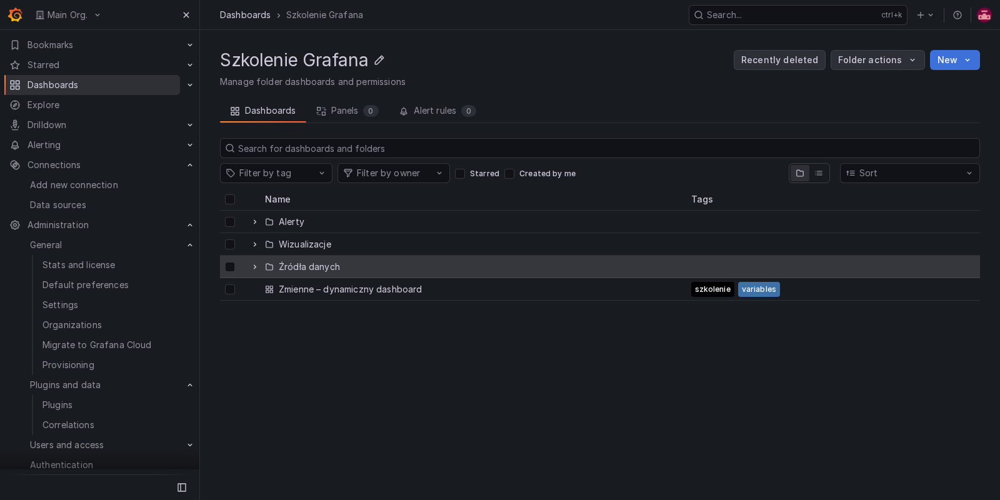
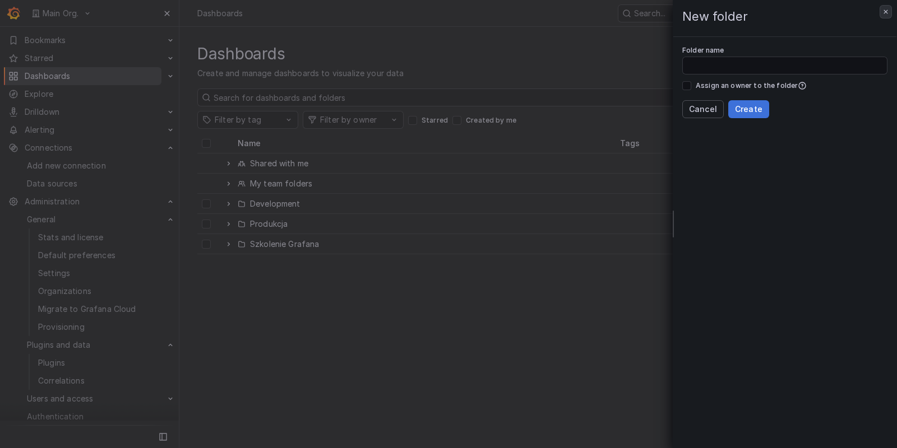
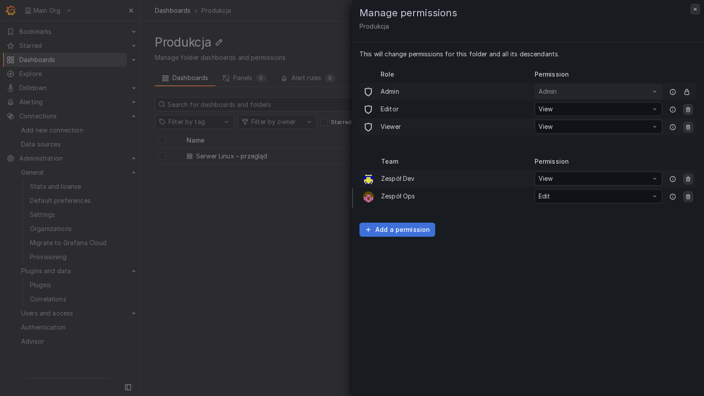

![[Pasted image 20260608074735.png]]

Folder w Grafanie grupuje dashboardy (a także reguły alertów i panele biblioteczne) i jest podstawową jednostką nadawania uprawnień. Przy kilkudziesięciu dashboardach bez folderów trudno cokolwiek znaleźć, a przyznawanie dostępu dashboard po dashboardzie szybko przestaje być wykonalne.

## Do czego służą foldery

- **Porządek** – grupowanie według zespołów, systemów, środowisk (np. `Produkcja`, `Development`) albo projektów.
- **Uprawnienia** – prawa nadane folderowi dziedziczą wszystkie dashboardy i podfoldery w środku.
- **Hierarchia** – Grafana obsługuje **foldery zagnieżdżone** (folder w folderze), np. `Szkolenie Grafana / Źródła danych`.
- **Alerting** – każda reguła alertu musi należeć do folderu; nazwa folderu trafia do etykiety `grafana_folder`, po której grupuje się powiadomienia.

## Lista folderów

Menu **Dashboards** pokazuje drzewo folderów i dashboardów. Na górze listy Grafana dodaje dwa wirtualne węzły: **Shared with me** (dashboardy udostępnione Ci bezpośrednio) i **My team folders** (foldery Twoich zespołów). Strzałka przy folderze rozwija jego zawartość, a przełącznik po prawej zmienia widok z drzewa na płaską listę.

Po wejściu w folder widać jego zawartość z zakładkami **Dashboards**, **Panels** (panele biblioteczne) i **Alert rules** oraz przyciski **Recently deleted**, **Folder actions** i **New**.

## Tworzenie folderu

1. Przejdź do **Dashboards**.
2. Kliknij **New → New folder**.
3. Wpisz **Folder name** i kliknij **Create**. Opcjonalnie zaznacz **Assign an owner to the folder**, aby od razu wskazać właściciela folderu.

Aby utworzyć **podfolder**, najpierw wejdź do folderu nadrzędnego, a dopiero potem kliknij **New → New folder**. Nowy folder powstanie w tym, który masz otwarty.

## Przenoszenie dashboardów i folderów

- **Z listy:** zaznacz checkbox przy jednym lub kilku dashboardach (albo folderach). Nad listą pojawią się przyciski **Move** i **Delete**. Kliknij **Move**, wybierz folder docelowy i potwierdź. Grafana ostrzega, że przeniesienie może zmienić uprawnienia, bo element przejmie je od nowego folderu.
- **Z ustawień dashboardu:** w trybie edycji otwórz **Settings** (zakładka **General**), zmień pole **Folder** i zapisz dashboard.
- **Cały folder:** wejdź do folderu, kliknij **Folder actions → Move this folder** i wskaż nowy folder nadrzędny.

Nazwę folderu zmienisz ikoną ołówka przy tytule folderu. Folder usuniesz przez **Folder actions → Delete this folder**. Usunięte dashboardy trafiają do **Recently deleted**, skąd można je przywrócić.

## Uprawnienia folderu

1. Wejdź do folderu.
2. Kliknij **Folder actions → Manage permissions**.
3. W panelu **Manage permissions** widać uprawnienia dla ról (**Role**), zespołów (**Team**) i pojedynczych użytkowników. Komunikat na górze przypomina, że zmiana dotyczy folderu **i wszystkich jego potomków** (podfolderów i dashboardów).
4. **Add a permission** dodaje wpis: wybierasz, komu nadajesz prawo (rola, zespół, użytkownik albo konto serwisowe), i poziom dostępu.

Poziomy dostępu:
- **View** – przeglądanie dashboardów,
- **Edit** – edycja, tworzenie i usuwanie dashboardów w folderze,
- **Admin** – to co Edit oraz zarządzanie uprawnieniami folderu.

W labie folder **Produkcja** ma ograniczone uprawnienia: rola Editor dostaje tylko **View** (domyślnie miałaby Edit), więc dashboard w tym folderze może edytować wyłącznie **Zespół Ops** i administratorzy. Folder **Development** jest otwarty do edycji dla roli Editor, a **Zespół Dev** jest jego administratorem. Uprawnienia są sumowane: użytkownik dostaje najwyższy poziom z ról, zespołów i wpisów indywidualnych. Uprawnień nie da się odebrać na niższym poziomie hierarchii, jeśli wyższy je nadaje. Szczegółowo zajmiemy się tym w module VII (Administration).

## Dobre praktyki

- Ustal jeden schemat podziału (np. `Zespół / System` albo `Środowisko / Usługa`) i trzymaj się go. Nie mieszaj kilku schematów na jednym poziomie.
- Nadawaj uprawnienia **zespołom na folderach**, a nie pojedynczym użytkownikom na dashboardach. Łatwiej to utrzymać i sprawdzić.
- Foldery „produkcyjne” zabezpieczaj (Editor = View), a do eksperymentów daj osobny folder z prawem edycji.
- Nie zagnieżdżaj zbyt głęboko: zwykle 2–3 poziomy wystarczają.
- Okresowo przeglądaj foldery i usuwaj porzucone dashboardy.

## Ćwiczenie w labie

Zaloguj się na http://10.123.2.206:3000 jako `admin` / `admin`.

1. **Dashboards** → otwórz folder **Szkolenie Grafana**. Sprawdź, że zawiera podfoldery **Alerty**, **Wizualizacje**, **Źródła danych** oraz dashboard **Zmienne – dynamiczny dashboard**.
2. Będąc w folderze **Szkolenie Grafana**, kliknij **New → New folder** i utwórz podfolder `Moje – <Twoje inicjały>` (np. `Moje – JK`).
   - Efekt: w drzewie pod **Szkolenie Grafana** pojawia się nowy podfolder, a ścieżka (breadcrumb) na górze strony to `Dashboards › Szkolenie Grafana › Moje – JK`.
3. Otwórz dashboard **Produkcja › Serwer Linux – przegląd**, kliknij **Edit**, potem strzałkę przy **Save → Save as copy**. W oknie zapisu wybierz swój nowy folder i zapisz kopię pod nazwą `Serwer Linux – kopia <inicjały>`.
4. Wróć do **Dashboards**, zaznacz checkbox przy swojej kopii i przenieś ją przyciskiem **Move** do folderu **Development**, a potem z powrotem do swojego folderu.
5. Wejdź do folderu **Produkcja** i otwórz **Folder actions → Manage permissions**. Nic nie zmieniaj, tylko odczytaj, kto ma jakie prawa. Odpowiedz: czy użytkownik `anna.nowak` (rola Editor, członkini Zespołu Ops) może edytować dashboard **Serwer Linux – przegląd**? (Tak – dostaje **Edit** przez Zespół Ops, mimo że sama rola Editor ma tu tylko View.)
6. Sprzątanie: usuń swoją kopię dashboardu i folder przez **Folder actions → Delete this folder**.
