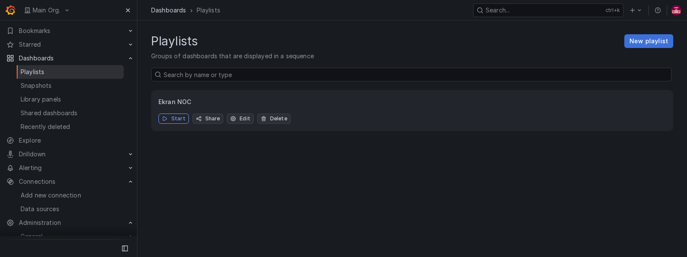
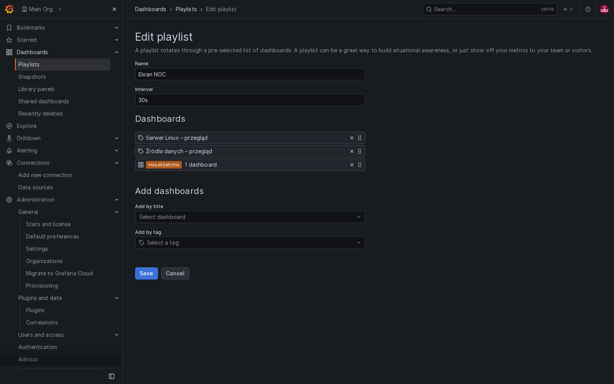
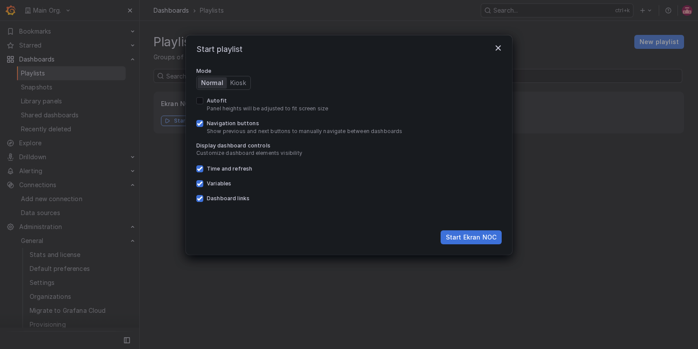

![[Pasted image 20260608074746.png]]

Playlista wyświetla po kolei wybrane dashboardy i przełącza je automatycznie co ustalony czas. Typowe zastosowanie to ekran ścienny w NOC/SOC albo telewizor w pokoju zespołu, na którym bez niczyjej obsługi zmieniają się widoki infrastruktury, aplikacji i biznesu.

## Jak działa playlista

- **Interval** – jak długo wyświetlany jest każdy dashboard (np. `30s`, `1m`, `5m`).
- **Dashboards** – lista elementów w ustalonej kolejności. Element może być:
  - pojedynczym dashboardem (**Add by title**),
  - **tagiem** (**Add by tag**) – wtedy w pętli pojawiają się wszystkie dashboardy z danym tagiem, także te dodane później. Nowy dashboard trafia na ekran, gdy tylko dostanie tag, bez edycji playlisty.
- Po ostatnim dashboardzie playlista zaczyna od początku.
- Playlista jest obiektem organizacji, więc widzą ją wszyscy jej użytkownicy. Uprawnienia do poszczególnych dashboardów nadal obowiązują: kto nie ma dostępu do dashboardu, ten go nie zobaczy.

## Lista playlist

Playlisty znajdziesz w **Dashboards → Playlists**. Każda karta ma przyciski **Start**, **Share** (link do uruchomienia playlisty, np. na komputerze przy ekranie), **Edit** i **Delete**.

## Tworzenie i edycja playlisty

1. **Dashboards → Playlists → New playlist**.
2. Wpisz **Name** i **Interval**.
3. W sekcji **Add dashboards** dodaj elementy polem **Add by title** (wybór dashboardu) lub **Add by tag** (wybór tagu).
4. Kolejność zmieniasz, przeciągając element za uchwyt po prawej. Krzyżyk usuwa element z listy.
5. Kliknij **Save**.

Na zrzucie trzeci element to tag `visualizations` z informacją, ile dashboardów aktualnie go ma (`1 dashboard`).

## Uruchamianie playlisty

Kliknij **Start** przy playliście. Otworzy się okno **Start playlist**:

- **Mode**
  - **Normal** – dashboardy w zwykłym widoku Grafany (z menu i paskiem nawigacji),
  - **Kiosk** – tryb kiosku: bez menu bocznego i górnego paska, przeznaczony na ekrany ścienne. Z trybu kiosku wychodzi się klawiszem **Esc**.
- **Autofit** – dopasowuje wysokość paneli do ekranu, żeby cały dashboard zmieścił się bez przewijania.
- **Navigation buttons** – przyciski „poprzedni / następny dashboard” do ręcznego przełączania.
- **Display dashboard controls** – które elementy dashboardu mają być widoczne: **Time and refresh** (wybór zakresu czasu i odświeżania), **Variables** (zmienne), **Dashboard links** (linki).

Przycisk **Start <nazwa playlisty>** uruchamia pętlę. W trybie Normal na pasku dashboardu pojawiają się przyciski **Go to previous dashboard**, **Stop playlist** i **Go to next dashboard**.

## Dobre praktyki

- Na ekranach ściennych używaj trybu **Kiosk** i włącz **Autofit**. Dashboardy pod playlistę projektuj tak, żeby mieściły się na jednym ekranie (bez przewijania i zwiniętych wierszy).
- Ustaw na tych dashboardach **auto-odświeżanie** (np. `1m`). Playlista przełącza widoki, ale odświeżanie danych zależy od ustawień dashboardu.
- Dobierz interwał do treści: prosty dashboard ze wskaźnikami wystarczy pokazać przez 15–30 s, szczegółowy przez 1–2 min.
- Dodawaj dashboardy **tagiem** (np. `noc`, `tv`), wtedy zarządzasz zawartością ekranu przez tagi, bez edycji playlisty.
- Ekran ścienny powinien działać na koncie z rolą **Viewer** (np. osobny użytkownik), nie na koncie administratora.

## Ćwiczenie w labie

Zaloguj się na http://10.123.2.206:3000 jako `admin` / `admin`.

1. **Dashboards → Playlists** → przy **Ekran NOC** kliknij **Edit**. Sprawdź interwał (`30s`) i elementy: **Serwer Linux – przegląd**, **Źródła danych – przegląd** i tag **visualizations**. Kliknij **Cancel**.
2. Utwórz własną playlistę: **New playlist**, nazwa `NOC – <Twoje inicjały>`, **Interval** `15s`.
   - **Add by title**: `Serwer Linux – przegląd`, `Zmienne – dynamiczny dashboard`.
   - **Add by tag**: `visualizations`.
   - Przeciągnij `Zmienne – dynamiczny dashboard` na koniec listy i kliknij **Save**.
3. Kliknij **Start** przy swojej playliście, wybierz **Mode: Normal**, zaznacz **Navigation buttons** i uruchom.
   - Efekt: co 15 s zmienia się dashboard (Serwer Linux → Wizualizacje → Zmienne → od początku). Sprawdź przyciski poprzedni/następny i zatrzymaj pętlę przyciskiem **Stop playlist**.
4. Uruchom playlistę ponownie w trybie **Kiosk** z zaznaczonym **Autofit** i odznaczonym **Variables**.
   - Efekt: nie ma menu ani paska Grafany, panele mieszczą się na ekranie, a na dashboardzie Zmienne nie widać listy zmiennych. Wyjdź klawiszem **Esc**.
5. Usuń swoją playlistę (**Delete**). Nie zmieniaj playlisty **Ekran NOC**, korzystają z niej inni.
