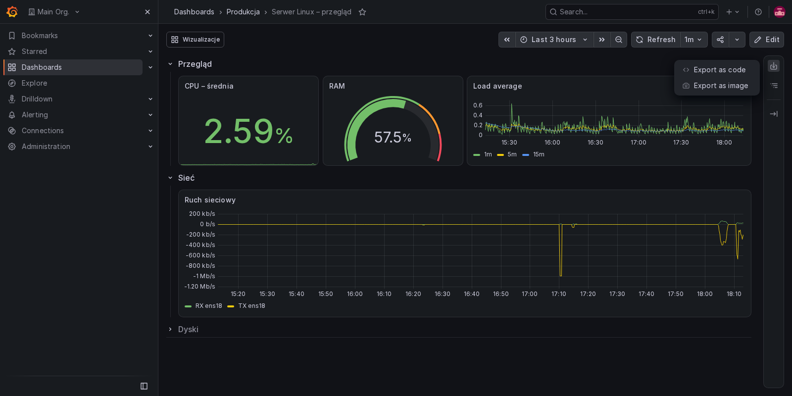
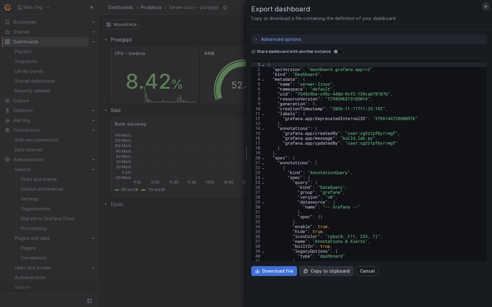
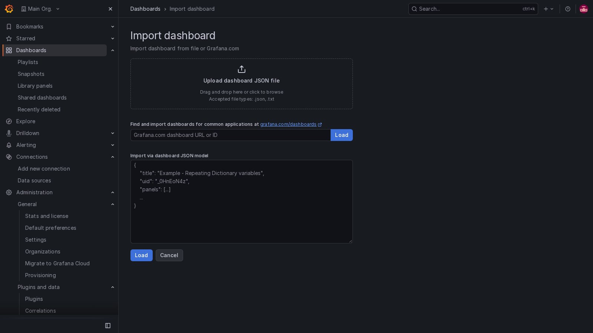
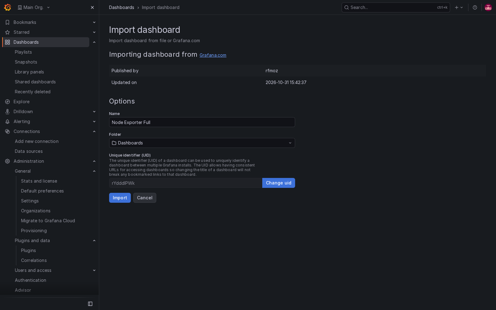

![[Pasted image 20260608074755.png]]

Dashboard w Grafanie to dokument JSON (od Grafany 12 także YAML), który opisuje panele, zapytania, zmienne i ustawienia. Eksport i import tego dokumentu służą do:
- przenoszenia dashboardów między instancjami (test → produkcja, Grafana lokalna → Grafana Cloud),
- kopii zapasowych i trzymania dashboardów w Git (dashboards as code),
- korzystania z gotowych dashboardów społeczności z [grafana.com/grafana/dashboards](https://grafana.com/grafana/dashboards).

## Eksport dashboardu

W Grafanie 13 eksport jest dostępny bezpośrednio na dashboardzie, zarówno w trybie podglądu, jak i edycji:

1. Otwórz dashboard.
2. Kliknij ikonę **Export** w pasku bocznym po prawej stronie dashboardu.
3. Wybierz:
   - **Export as code** – definicja dashboardu (JSON/YAML),
   - **Export as image** – obraz PNG całego dashboardu.



Po wybraniu **Export as code** otwiera się panel **Export dashboard**:

- **Advanced options**
  - **Model**: **Classic** (klasyczny JSON dashboardu, zgodny ze starszymi wersjami Grafany) albo **V2 Resource** (nowy format zasobu `dashboard.grafana.app/v2` z sekcjami `metadata` i `spec`),
  - **Format**: JSON lub YAML (dla modelu V2 Resource).
- **Share dashboard with another instance** – przygotowuje plik dla innej instancji Grafany: usuwa metadane tej instancji i zamienia odwołania do konkretnych źródeł danych (ich `uid`) na **zmienne wejściowe** (`__inputs`). Przy imporcie Grafana poprosi wtedy o wskazanie źródła danych. Włącz tę opcję zawsze, gdy plik trafi poza Twoją instancję.
- **Download file** zapisuje plik, a **Copy to clipboard** kopiuje treść do schowka.



> Definicję dashboardu można też podejrzeć i edytować w trybie edycji: ikona **{} Code** (Edit as code) w pasku bocznym. Opisujemy ją w lekcji „Ustawienia”.

## Import dashboardu

1. **Dashboards → New → Import** (adres `/dashboard/import`).
2. Wybierz jedną z trzech metod:
   - **Upload dashboard JSON file** – przeciągnij plik `.json` (lub `.txt`) albo kliknij, aby go wybrać,
   - **Grafana.com dashboard URL or ID** – wpisz ID lub adres dashboardu z grafana.com i kliknij **Load**,
   - **Import via dashboard JSON model** – wklej treść JSON i kliknij **Load**.
3. Na drugim ekranie ustaw:
   - **Name** – nazwę dashboardu,
   - **Folder** – folder docelowy,
   - **Unique identifier (UID)** – identyfikator używany w adresie URL. Jeśli dashboard o takim UID już istnieje, zmień UID (**Change uid**), żeby nie nadpisać istniejącego,
   - źródła danych – tylko jeśli plik zawiera zmienne wejściowe (`__inputs`), np. po eksporcie z opcją **Share dashboard with another instance**.
4. Kliknij **Import**.



### Import z grafana.com: Node Exporter Full (ID 1860)

Dashboard **Node Exporter Full** (ID `1860`) to jeden z najpopularniejszych dashboardów dla metryk z `node_exporter`. W labie zbiera je Prometheus.



Aktualna wersja tego dashboardu nie ma zmiennych wejściowych, więc ekran importu pokazuje tylko **Name**, **Folder** i **UID**. Źródło danych wybiera się już po imporcie, zmienną **Datasource** na górze dashboardu (są tam też zmienne **Job**, **Nodename** i **Instance**). Inne dashboardy z grafana.com często mają `__inputs` i wtedy formularz importu zawiera listę wyboru źródła danych.

Przed importem z grafana.com sprawdź na stronie dashboardu, dla jakiego źródła danych i jakiego eksportera został przygotowany. Dashboard dla innej wersji eksportera może mieć puste panele, bo nazwy metryk się zmieniają.

## Przykład minimalnego dashboardu do importu

Poniższy JSON (model Classic) możesz wkleić w **Import via dashboard JSON model**. Używa źródła Prometheus z labu (`uid: prom`):

```json
{
  "title": "CPU – import testowy",
  "uid": "cpu-import-test",
  "time": { "from": "now-1h", "to": "now" },
  "refresh": "1m",
  "panels": [
    {
      "id": 1,
      "type": "timeseries",
      "title": "Użycie CPU",
      "gridPos": { "x": 0, "y": 0, "w": 24, "h": 9 },
      "datasource": { "type": "prometheus", "uid": "prom" },
      "fieldConfig": { "defaults": { "unit": "percent", "min": 0, "max": 100 }, "overrides": [] },
      "targets": [
        {
          "refId": "A",
          "datasource": { "type": "prometheus", "uid": "prom" },
          "expr": "100 * (1 - avg by (instance) (rate(node_cpu_seconds_total{mode=\"idle\"}[$__rate_interval])))",
          "legendFormat": "{{instance}}"
        }
      ]
    }
  ]
}
```

Typ panelu wykresu czasowego to `timeseries`. Stary typ `graph` jest wycofany i przy imporcie Grafana automatycznie przerabia go na Time series.

## Dobre praktyki

- Trzymaj definicje dashboardów w **Git** i zmieniaj je przez przegląd kodu. Na produkcji wczytuj je przez provisioning (pliki YAML w `/etc/grafana/provisioning/dashboards/`) albo Terraform.
- Do przenoszenia między instancjami eksportuj z opcją **Share dashboard with another instance**. Plik bez niej zawiera `uid` źródeł danych, które na innej instancji nie istnieją.
- Celowo dbaj o **UID**: stały UID oznacza stały adres URL i działające linki między dashboardami.
- Dashboardy z grafana.com traktuj jak punkt startowy: po imporcie usuń zbędne panele i dopasuj progi do swojego środowiska.
- Przed publicznym udostępnieniem sprawdź JSON pod kątem nazw hostów, adresów IP i innych danych wewnętrznych.

## Ćwiczenie w labie

Zaloguj się na http://10.123.2.206:3000 jako `admin` / `admin`.

1. **Eksport:** otwórz **Produkcja › Serwer Linux – przegląd**, kliknij ikonę **Export → Export as code**.
   - Rozwiń **Advanced options**, przełącz **Model** między **Classic** i **V2 Resource** i porównaj strukturę: w Classic panele są w tablicy `panels`, w V2 w obiekcie `spec.elements`.
   - Włącz **Share dashboard with another instance** i znajdź w JSON sekcję `__inputs` (w modelu Classic) – źródło `prom` zostało zastąpione zmienną wejściową.
   - Kliknij **Download file**.
2. **Import z grafana.com:** **Dashboards → New → Import**, wpisz `1860`, kliknij **Load**. Ustaw **Name** `Node Exporter Full – <inicjały>`, **Folder** = Twój folder z lekcji o folderach (albo **Development**), kliknij **Change uid** i zostaw wygenerowany nowy UID, potem **Import**.
   - Efekt: dashboard z kilkudziesięcioma panelami. Na górze wybierz **Datasource = Prometheus**, **Job = node**, **Nodename = vmzabbixsrv16**, **Instance = localhost:9100**. Panele (CPU Busy, RAM Used, Root FS Used…) pokazują dane maszyny szkoleniowej.
3. **Import z JSON:** **Dashboards → New → Import**, wklej JSON z przykładu powyżej, zmień w nim `"uid"` na `cpu-import-<inicjały>`, kliknij **Load → Import**.
   - Efekt: dashboard z jednym wykresem CPU maszyny szkoleniowej (`localhost:9100`) z ostatniej godziny.
4. **Import z pliku:** zaimportuj plik pobrany w kroku 1, zmieniając **Name** i **UID** (żeby nie nadpisać oryginału). Jeśli eksportowałeś z **Share dashboard with another instance**, wybierz źródło **Prometheus** z listy.
5. Sprzątanie: usuń zaimportowane dashboardy (zaznacz na liście → **Delete**).
