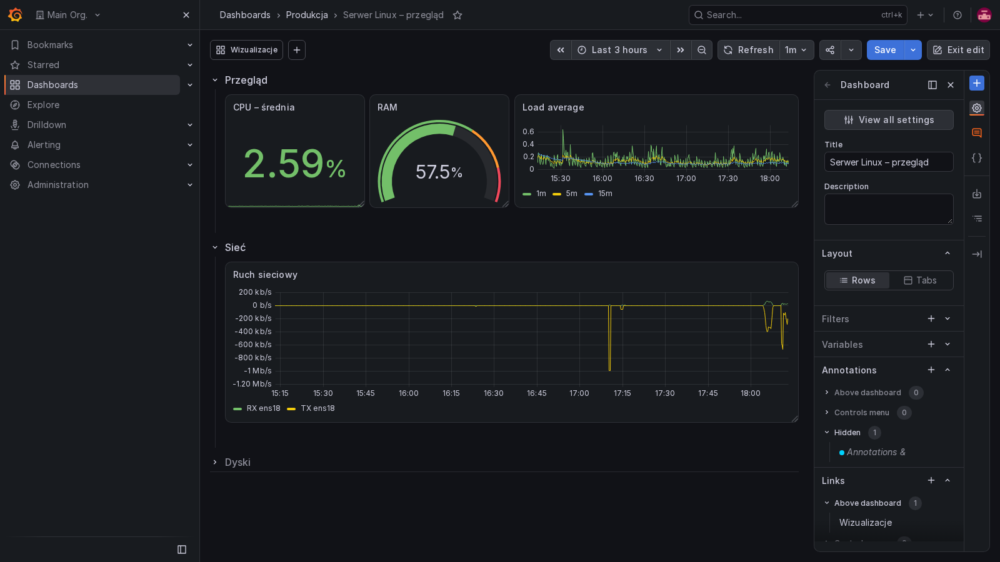
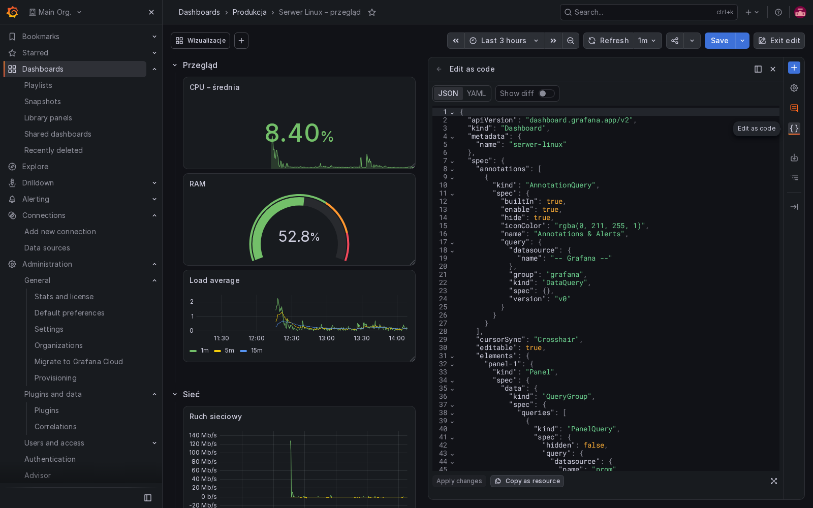
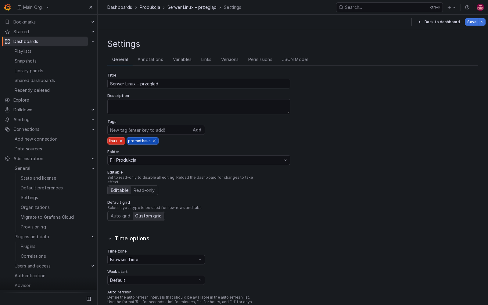
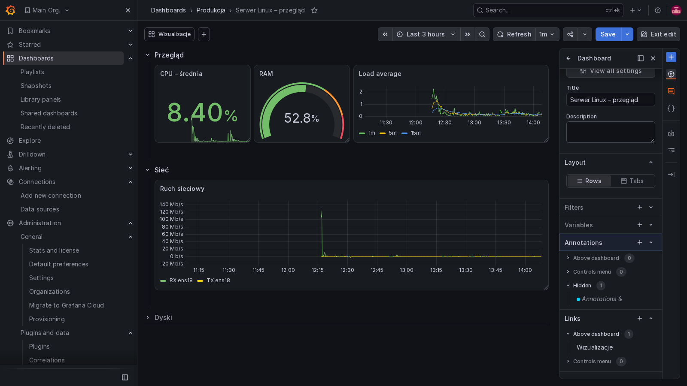
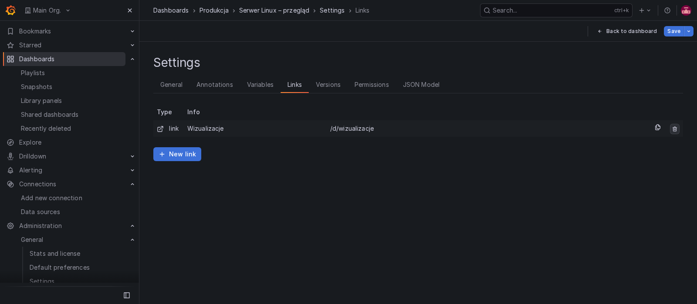
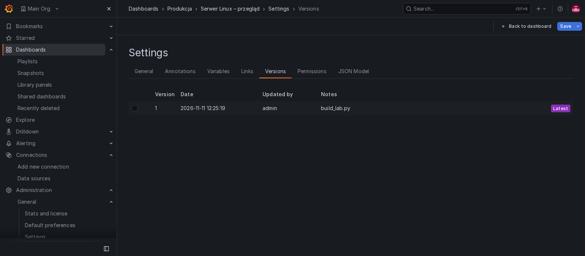

![[Pasted image 20260608074802.png]]

Ustawienia dashboardu określają jego tytuł, folder, tagi, zakres czasu, zmienne, adnotacje, linki, historię wersji i uprawnienia. W Grafanie 13 większość z nich edytuje się w **pasku bocznym trybu edycji**, a klasyczne okno **Settings** z zakładkami nadal istnieje dla pozostałych opcji.

## Tryb edycji i pasek boczny

Dashboard otwiera się w trybie podglądu. Przycisk **Edit** (prawy górny róg) włącza tryb edycji: pojawiają się przyciski **Save** (ze strzałką: m.in. **Save as copy**) i **Exit edit**, a po prawej stronie pionowy pasek ikon:

| Ikona | Funkcja |
|---|---|
| **+** (niebieska) | **Add** – dodawanie elementów: panelu, wklejenie skopiowanego panelu, wierszy i zakładek, zmiennej, filtra, zapytania adnotacji, linku |
| zębatka | **Options** – ustawienia dashboardu (opisane niżej) |
| dymek (pomarańczowy) | opinia o nowym edytorze dashboardów (feedback dla Grafana Labs) |
| **{ }** | **Code** (Edit as code) – definicja dashboardu w JSON lub YAML |
| strzałka w dół | **Export** – Export as code / Export as image |
| lista | **Outline** – drzewo zawartości dashboardu |
| strzałka w prawo | zwija pasek boczny |

Ikony **Export** i **Outline** są dostępne także w trybie podglądu.

### Options (zębatka)

Panel **Dashboard** zawiera:
- **View all settings** – otwiera klasyczne okno Settings (niżej),
- **Title** i **Description**,
- **Layout** – układ najwyższego poziomu: **Rows** (wiersze) albo **Tabs** (zakładki). Panele w obrębie wiersza lub zakładki układają się w siatce **Custom** (ręczne położenie i rozmiar każdego panelu) albo **Auto** (Grafana sama rozkłada panele),
- **Filters** – filtry ad hoc,
- **Variables** – lista zmiennych dashboardu (klik w zmienną otwiera jej edycję). Zmiennymi zajmiemy się w module V,
- **Annotations** i **Links** – pogrupowane według miejsca wyświetlania: **Above dashboard** (nad panelami), **Controls menu** (w rozwijanym menu kontrolek), **Hidden** (ukryte).

Kliknięcie dowolnego elementu dashboardu (panelu, wiersza, zmiennej) przełącza pasek boczny na opcje tego elementu.

### Outline

**Outline** (Content outline) pokazuje drzewo dashboardu: filtry, zmienne, adnotacje i alerty, linki, wiersze i panele. Przy dużych dashboardach to najszybszy sposób, żeby znaleźć i zaznaczyć konkretny element.

### Code – edycja jako kod

**Edit as code** pokazuje definicję dashboardu w formacie **JSON** lub **YAML**. Przełącznik **Show diff** pokazuje różnice względem zapisanej wersji. **Apply changes** wczytuje Twoje zmiany do dashboardu (trzeba go potem jeszcze zapisać przyciskiem **Save**), a **Copy as resource** kopiuje definicję jako zasób Kubernetes-style (`apiVersion: dashboard.grafana.app/v2`).

## Okno Settings (View all settings)

**View all settings** otwiera stronę **Settings** z zakładkami **General**, **Annotations**, **Variables**, **Links**, **Versions**, **Permissions**, **JSON Model**. Z niej wracasz przyciskiem **Back to dashboard**, a zmiany zapisujesz przyciskiem **Save**.

Zakładki **Annotations**, **Variables** i **JSON Model** w Grafanie 13 wyświetlają tylko komunikat, że te ustawienia przeniesiono do paska bocznego (Options i Code).

### General

- **Title**, **Description**.
- **Tags** – etykiety ułatwiające wyszukiwanie. Używają ich też playlisty (Add by tag) i linki do dashboardów.
- **Folder** – w którym folderze jest dashboard (zmiana = przeniesienie).
- **Editable** – **Editable** / **Read-only**. Read-only ukrywa możliwość edycji (np. dla dashboardów wczytywanych z provisioningu). To nie jest mechanizm bezpieczeństwa: o tym, kto może zapisać zmiany, decydują uprawnienia.
- **Default grid** – domyślny układ (**Auto grid** / **Custom grid**) dla nowych wierszy i zakładek.
- **Time options** – **Time zone** (np. Browser Time, UTC), **Week start**, **Auto refresh** (lista interwałów dostępnych w menu odświeżania), **Now delay** (pomija najnowsze, jeszcze niepełne dane), **Hide time picker**.
- **Graph tooltip** – czy kursor i tooltip mają być zsynchronizowane między panelami (Default / Shared crosshair / Shared tooltip).

### Annotations – adnotacje

Adnotacja to znacznik zdarzenia na osi czasu (wdrożenie, restart, incydent, alert). Każdy dashboard ma wbudowane zapytanie **Annotations & Alerts (Built-in)**, które pokazuje adnotacje dodane ręcznie na tym dashboardzie i zmiany stanu alertów. Kolejne źródła adnotacji (np. zapytanie do Elasticsearch o logi z poziomem `error`) dodajesz w pasku bocznym: **Options → Annotations → +** lub **Add → Annotation query**.

Ręczną adnotację dodasz na wykresie Time series: **Ctrl + klik** w punkt wykresu (albo **Ctrl + przeciągnięcie** dla zakresu czasu), wpisz opis i tagi.

### Links – linki dashboardu

Linki wyświetlają się nad dashboardem i prowadzą do innych dashboardów (np. wszystkich z danym tagiem) albo do zewnętrznych adresów. Opcje linku pozwalają przenieść aktualny zakres czasu i wartości zmiennych, dzięki czemu drill-down zachowuje kontekst.

### Versions – historia wersji

Każdy zapis tworzy nową wersję z datą, autorem i notatką (**Notes** – opis zmian wpisany przy zapisie). Zaznacz dwie wersje, aby je porównać, albo przywróć starszą (**Restore**).

### Permissions

Uprawnienia do pojedynczego dashboardu (View / Edit / Admin dla ról, zespołów i użytkowników). Dashboard dziedziczy uprawnienia folderu i można je tu tylko **rozszerzyć**, nie ograniczyć. Zwykle wystarczą uprawnienia na folderze (patrz lekcja „Foldery”).

## Dobre praktyki

- Uzupełniaj **Description** i **Tags**: opis wyjaśnia, do czego służy dashboard, a tagi pozwalają go znaleźć i dodać do playlisty.
- Wpisuj **notatkę przy zapisie**. Historia wersji z opisami „dodano panel dysków” jest dużo bardziej użyteczna niż lista bezimiennych wersji.
- Ustaw sensowne **domyślne zakres czasu i odświeżanie**: zbyt częste odświeżanie dużego dashboardu obciąża źródła danych.
- Linkami dashboardu buduj nawigację: przegląd → szczegóły, z przenoszeniem czasu i zmiennych.
- Większe zmiany struktury rób w **Edit as code** z włączonym **Show diff**, a dashboardy produkcyjne trzymaj w Git (lekcja „Import – export”).

## Ćwiczenie w labie

Zaloguj się na http://10.123.2.206:3000 jako `admin` / `admin`. Pracuj na kopii, żeby nie zmieniać dashboardu, z którego korzystają inni.

1. Otwórz **Produkcja › Serwer Linux – przegląd**, kliknij **Edit → Save (strzałka) → Save as copy**, zapisz jako `Serwer Linux – <inicjały>` w folderze **Development**. Dalej pracuj na kopii.
2. W trybie **Edit** kliknij zębatkę (**Options**):
   - wpisz **Description**: `Przegląd zasobów maszyny szkoleniowej (Prometheus)`,
   - w sekcji **Annotations** rozwiń **Hidden** – znajdziesz wbudowane **Annotations & Alerts (Built-in)**,
   - w sekcji **Links** rozwiń **Above dashboard** – to link **Wizualizacje** widoczny nad panelami.
3. Kliknij **View all settings → General**: dodaj tag `szkolenie`, w **Auto refresh** sprawdź dostępne interwały, ustaw **Time zone** na `Coordinated Universal Time`. Wróć **Back to dashboard**.
   - Efekt: osie czasu na wykresach przesuwają się o różnicę między czasem lokalnym a UTC (zimą 1 godzina).
4. Zapisz dashboard (**Save**) z notatką `opis i tag`. Potem przywróć strefę **Browser Time** i zapisz z notatką `powrót do czasu przeglądarki`.
5. **View all settings → Versions**: zaznacz dwie ostatnie wersje i kliknij **Compare versions**.
   - Efekt: różnica w polu `timezone` i notatki z obu zapisów.
6. Otwórz **{ } Code**, przełącz na **YAML**, znajdź pole `title` i zmień tytuł na `Serwer Linux – <inicjały> (YAML)`. Włącz **Show diff**, zobacz zmianę, kliknij **Apply changes**, a potem **Save**.
   - Efekt: nowy tytuł widać w breadcrumbie i na liście dashboardów.
7. Na wykresie **Load average** zrób **Ctrl + klik**, dodaj adnotację `test restartu` i zapisz ją.
   - Efekt: na wykresie pojawia się pionowa linia z opisem widocznym po najechaniu kursorem.
8. Sprzątanie: usuń swoją kopię dashboardu.
