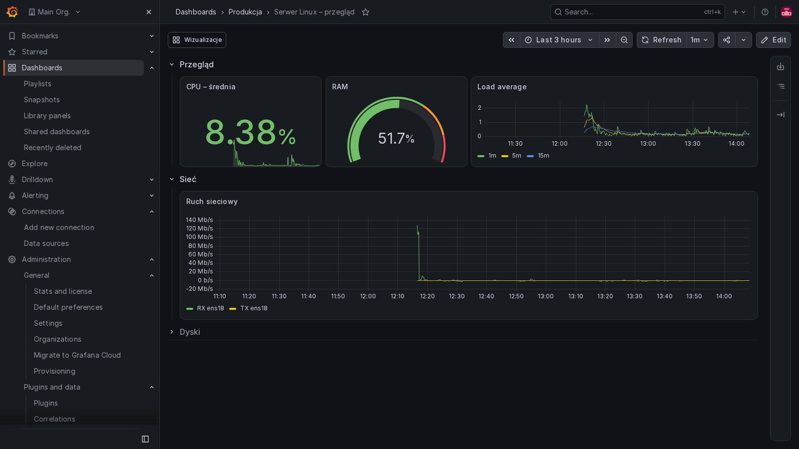
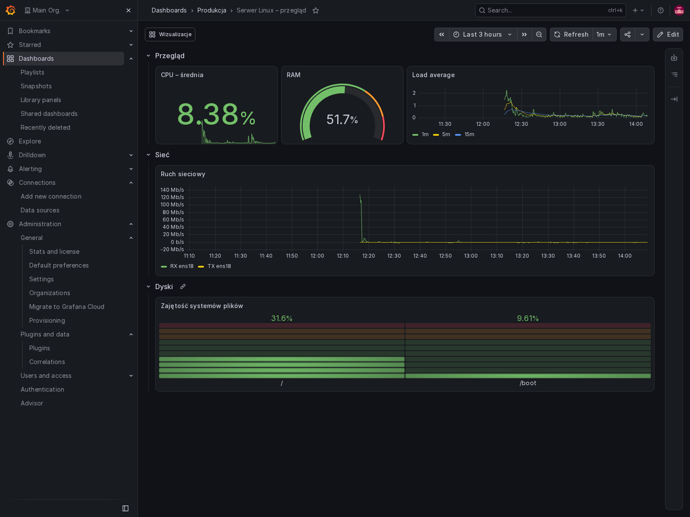

![[Pasted image 20260608074809.png]]

Wiersz (row) to nazwana, zwijana sekcja dashboardu, która grupuje powiązane panele, np. „Przegląd”, „Sieć”, „Dyski”. Dzięki wierszom duży dashboard da się czytać od ogółu do szczegółu. Zwinięty wiersz w ogóle nie wysyła zapytań swoich paneli, więc wiersze pomagają też w wydajności.

## Wiersze i zakładki w Grafanie 13

Od Grafany 12 dashboard ma **układ (Layout)** wybierany w pasku bocznym (**Options → Layout**):
- **Rows** – dashboard dzieli się na wiersze ułożone jeden pod drugim,
- **Tabs** – dashboard dzieli się na zakładki, a w danej chwili widać jedną z nich.

Wewnątrz wiersza lub zakładki panele układają się w siatce **Custom** (ręczne położenie) lub **Auto** (automatyczna). Wiersze i zakładki można zagnieżdżać (np. zakładki „Produkcja” / „Test”, a w każdej wiersze „CPU”, „Sieć”), z ograniczeniem liczby poziomów. Zakładek nie można zagnieżdżać w zakładkach.

## Wiersze w trybie podglądu

Na dashboardzie **Serwer Linux – przegląd** są trzy wiersze: **Przegląd**, **Sieć** i zwinięty **Dyski**.



- Kliknięcie nazwy wiersza (lub strzałki przed nią) zwija albo rozwija wiersz.
- Ikona łańcucha obok nazwy (**Copy link to row**) kopiuje link prowadzący prosto do tego wiersza.
- Stan zwinięcia, który widzi każdy po otwarciu dashboardu, zapisuje się razem z dashboardem.



## Tworzenie wierszy

W trybie **Edit**:

1. Kliknij **+** (**Add**) w pasku bocznym. W sekcji **Group layouts** są dwie akcje:
   - **Add row** – dodaje nowy, pusty wiersz,
   - **Group into rows** – gdy dashboard nie ma jeszcze wierszy, zamienia go na układ wierszowy: wszystkie dotychczasowe panele trafiają do pierwszego wiersza.
2. Możesz też zaznaczyć kilka paneli i w pasku bocznym wybrać **Group into row**.
3. Panele przenosisz między wierszami przez przeciągnięcie.

## Opcje wiersza

Klik w nagłówek wiersza w trybie edycji pokazuje jego opcje w pasku bocznym:
- **Title** – nazwa wiersza (musi być unikalna na dashboardzie). Może zawierać zmienne, np. `Serwer $instance`,
- **Fill screen** – wiersz zajmuje całą wysokość ekranu,
- **Hide row header** – ukrywa nagłówek wiersza w trybie podglądu (nagłówek widać tylko w trybie edycji),
- **Repeat options → Repeat by variable** – powtarza wiersz dla każdej wartości wybranej zmiennej (np. jeden wiersz na każdy host). Wymaga zmiennej z wieloma wartościami, opisujemy to w module V,
- sekcje **Variables** i **Filters** – zmienne i filtry działające tylko w obrębie wiersza,
- **Delete** – usuwa wiersz. Grafana zapyta, czy usunąć go razem z panelami, czy tylko wiersz (**Delete row only** – panele zostają).

**Ungroup rows** (w opcjach układu Rows) likwiduje podział na wiersze i zostawia same panele.

## Przykładowe podziały

- **Według warstwy:** Przegląd (najważniejsze wskaźniki) → Sieć → Dyski → Procesy.
- **Według priorytetu:** u góry „Stan usług” z wskaźnikami Stat i alertami, niżej zwinięte wiersze ze szczegółami do diagnostyki.
- **Według obiektu:** jeden wiersz na host lub usługę, najlepiej wygenerowany przez **Repeat by variable** zamiast ręcznego kopiowania.

## Dobre praktyki

- Nazwy opisowe („Sieć – ruch na interfejsach”), nie „Sekcja 1”.
- Najważniejsze informacje w pierwszym wierszu, rozwiniętym. Szczegóły w kolejnych, **domyślnie zwiniętych**: dashboard szybciej się ładuje i mniej obciąża źródła danych.
- Nie przesadzaj z liczbą wierszy. Jeśli sekcje są niezależne, rozważ **zakładki** albo osobne dashboardy połączone linkami.
- Na dashboardach do playlist i ekranów ściennych nie zwijaj wierszy, bo nikt ich tam nie rozwinie.

## Ćwiczenie w labie

Zaloguj się na http://10.123.2.206:3000 jako `admin` / `admin`.

1. Otwórz **Produkcja › Serwer Linux – przegląd**. Zwiń wiersz **Przegląd** i rozwiń **Dyski**. Kliknij ikonę łańcucha przy **Dyski**, wklej skopiowany link w nowej karcie przeglądarki i sprawdź, dokąd prowadzi.
2. Zrób kopię do ćwiczeń: **Edit → Save (strzałka) → Save as copy**, nazwa `Wiersze – <inicjały>`, folder **Development**. Dalej pracuj na kopii.
3. W trybie **Edit** kliknij **+ → Add row**. Kliknij nagłówek nowego wiersza i w pasku bocznym ustaw **Title** `Dyski – I/O`.
4. Dodaj do nowego wiersza panel (**+ → Panel**, przeciągnij go do wiersza **Dyski – I/O** albo dodaj go, gdy wiersz jest zaznaczony). Źródło danych **Prometheus**, tryb **Code**, dwa zapytania:
   ```promql
   rate(node_disk_read_bytes_total{device="sda"}[$__rate_interval])
   ```
   ```promql
   rate(node_disk_written_bytes_total{device="sda"}[$__rate_interval])
   ```
   W **Options → Legend** zapytań wpisz `odczyt` i `zapis`, tytuł panelu `Dysk sda – odczyt/zapis`, w **Standard options → Unit** wybierz `Data rate → bytes/sec(IEC)`. Wróć do dashboardu przyciskiem **Back**.
   - Efekt: wykres z dwiema seriami przepustowości dysku `sda` maszyny szkoleniowej.
5. Zwiń wiersz **Dyski – I/O** i zapisz dashboard. Odśwież stronę (F5).
   - Efekt: wiersz otwiera się zwinięty. Po jego rozwinięciu wykres dopiero wtedy pobiera dane.
6. Kliknij **Options** (zębatka) i przełącz **Layout** z **Rows** na **Tabs**. Zobacz, jak wiersze zamieniły się w zakładki. Wróć do **Rows** (albo kliknij **Exit edit** i odrzuć niezapisane zmiany).
7. Sprzątanie: usuń swoją kopię dashboardu.
