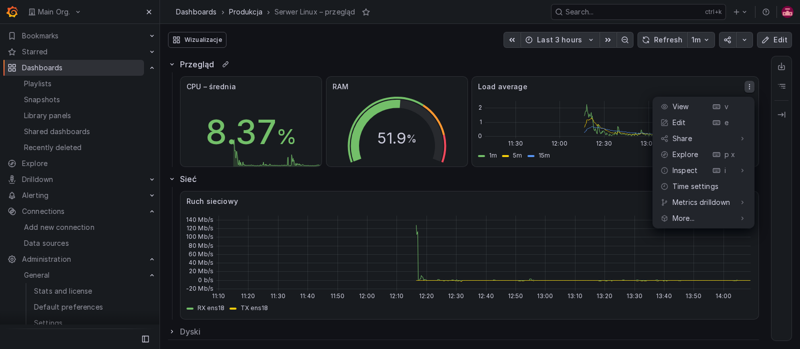
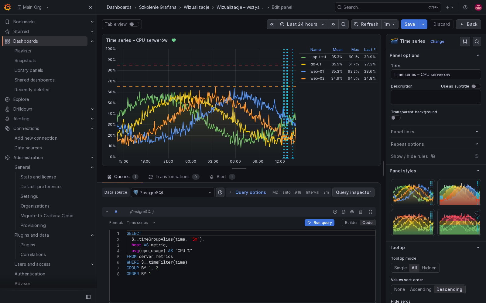

![[Pasted image 20260608074814.png]]

Panel to podstawowy element dashboardu: pobiera dane jednym lub kilkoma **zapytaniami**, opcjonalnie je **przekształca** (transformacje) i pokazuje w wybranej **wizualizacji** (wykres, wskaźnik, tabela, mapa…). Każdy panel składa się więc z trzech warstw:

1. **Queries** – zapytania do źródła danych (lub kilku źródeł, przez źródło `-- Mixed --`),
2. **Transformations** – operacje na wynikach: łączenie zapytań, filtrowanie i zmiana nazw pól, obliczenia, grupowanie,
3. **Visualization** – typ wizualizacji i jej opcje (jednostki, progi, kolory, legenda, mapowania wartości).

## Typy wizualizacji

| Grupa | Wizualizacje |
|---|---|
| Szeregi czasowe | **Time series**, **State timeline**, **Status history**, **Heatmap**, **Candlestick**, **Trend** |
| Pojedyncze wartości i porównania | **Stat**, **Gauge**, **Bar gauge**, **Bar chart**, **Pie chart**, **Histogram**, **XY Chart** |
| Dane tabelaryczne i tekst | **Table**, **Text**, **Logs**, **Annotations list**, **Alert list**, **Dashboard list**, **News** |
| Specjalne | **Geomap**, **Node Graph**, **Traces**, **Flame Graph**, **Canvas** |

Typy omawiane w module IV są zebrane na dashboardzie **Szkolenie Grafana › Wizualizacje › Wizualizacje – wszystkie typy**. Dodatkowe wizualizacje instaluje się jako pluginy (moduł VIII).

## Menu panelu

W trybie podglądu po najechaniu na panel w prawym górnym rogu pojawia się ikona menu (trzy kropki):



- **View** (`v`) – panel na cały ekran, z paskiem bocznym **View panel** (szybkie przełączniki, np. legenda, skala osi),
- **Edit** (`e`) – edytor panelu,
- **Share** – link do panelu, osadzenie (embed), snapshot,
- **Explore** (`p x`) – otwiera zapytanie panelu w Explore,
- **Inspect** (`i`) – podgląd danych (**Data**), wykonanego zapytania (**Query**) i definicji panelu (**Panel JSON**). Przydaje się przy diagnozie: „czy problem jest w zapytaniu, czy w wizualizacji?”,
- **Time settings** – własny zakres czasu panelu (np. ostatnie 7 dni na dashboardzie ustawionym na 6 godzin) lub przesunięcie w czasie,
- **Metrics drilldown** – dla zapytań Prometheus: przejście do aplikacji Metrics Drilldown,
- **More…** – dodatkowe akcje, m.in. **New alert rule** (reguła alertu na podstawie zapytania panelu), **Hide legend** / **Show legend**, **Get help**. Akcje zmieniające dashboard (**Duplicate**, **Copy**, **Remove**) wykonujesz w trybie edycji.

## Dodawanie panelu

1. Na dashboardzie kliknij **Edit**.
2. Kliknij **+** (**Add**) w pasku bocznym i wybierz **Panel** (kliknij albo przeciągnij w wybrane miejsce na dashboardzie). Na nowym, pustym dashboardzie jest od razu przycisk **Add visualization**.
3. Wybierz źródło danych, wpisz zapytanie, wybierz wizualizację i ustaw opcje (opis edytora poniżej).
4. Kliknij **Back**, aby wrócić do dashboardu, i zapisz dashboard (**Save**).

Skopiowany panel (**Copy**) wkleisz przez **+ → Paste panel**.

## Edytor panelu

Edytor otwierasz z menu panelu (**Edit**), skrótem `e` (kursor nad panelem) albo adresem z parametrem `?editPanel=<id>`.



**Górny pasek:**
- **Table view** – przełącza podgląd na surowe dane w tabeli. Najszybszy sposób, żeby zobaczyć, co naprawdę zwraca zapytanie,
- wybór zakresu czasu i odświeżania,
- **Save** (zapis całego dashboardu), **Discard** (odrzucenie zmian w panelu), **Back** (powrót do dashboardu z zachowaniem zmian).

**Dół – zakładki:**
- **Queries** – **Data source**, **Query options** (Max data points, Min interval, Relative time, Time shift; obok aktualne wartości, np. `MD = auto = 918`, `Interval = 2m`), **Query inspector**, edytor zapytania (tryb **Builder** lub **Code**, dla SQL także **Format**: Time series / Table), **Run query**, **Add query**, **Expression** (obliczenia po stronie Grafany: matematyka, Reduce, Resample, Threshold),
- **Transformations** – lista transformacji wyniku,
- **Alert** – reguły alertów powiązane z panelem (licznik na zakładce). Ikona serca w tytule panelu pokazuje stan powiązanej reguły.

**Prawa strona – opcje wizualizacji:**
- nazwa wizualizacji i **Change** – zmiana typu (wybór z listy, z podpowiedziami dopasowanymi do danych),
- wyszukiwarka opcji (lupa) – po wpisaniu np. `unit` pokazuje tylko pasujące opcje,
- **Panel options** – **Title**, **Description** (z przełącznikiem **Use as subtitle** – opis pod tytułem zamiast w dymku), **Transparent background**, **Panel links**, **Repeat options** (powtarzanie panelu dla wartości zmiennej), **Show / hide rules**,
- **Panel styles** – gotowe zestawy stylów dla danej wizualizacji (klik = szybka zmiana wyglądu),
- sekcje specyficzne dla wizualizacji (np. Tooltip, Legend, Axis, Graph styles dla Time series),
- sekcje wspólne dla wszystkich wizualizacji: **Standard options** (Unit, Min, Max, Decimals, Display name, Color scheme, No value), **Data links and actions**, **Value mappings**, **Thresholds**,
- **Overrides** (na końcu listy) – nadpisanie opcji dla wybranych pól lub serii, np. inny kolor i jednostka dla jednej serii.

## Operacje na panelach (tryb Edit)

- **Przesuwanie** – przeciągnij panel za nagłówek.
- **Rozmiar** – przeciągnij prawy dolny róg panelu.
- **Duplikowanie / kopiowanie / usuwanie** – zaznacz panel kliknięciem: w pasku bocznym pojawią się jego opcje i akcje (**Duplicate**, **Copy**, **Delete**). Te same akcje są w menu panelu.
- **Zaznaczanie wielu paneli** – z wciśniętym Ctrl/Shift. Zaznaczone panele można razem usunąć lub zgrupować w wiersz (**Group into row**) albo zakładkę.

## Zaawansowane możliwości

- **Zmienne w zapytaniach i tytułach** – np. `host IN ($host)` w SQL albo `instance="$instance"` w PromQL (moduł V).
- **Repeat options** – jeden panel definiowany raz, powtarzany automatycznie dla każdej wartości zmiennej.
- **Data links** – klik w punkt wykresu lub komórkę tabeli otwiera inny dashboard (z przekazaniem czasu i zmiennych) albo zewnętrzny system.
- **Library panels** – panel zapisany w bibliotece i używany na wielu dashboardach. Zmiana w jednym miejscu zmienia go wszędzie (**Dashboards → Library panels**).
- **Overrides** – formatowanie konkretnych serii, np. czerwona linia dla serwera produkcyjnego, oś po prawej dla drugiej jednostki.

## Dobre praktyki

- Tytuł mówi, co i skąd: `CPU – serwery produkcyjne`, nie `Panel 1`. Dłuższe wyjaśnienia (co oznaczają progi, kto odpowiada) wpisz w **Description**.
- Zawsze ustaw **Unit**: `percent`, `bytes`, `ms`, `reqps`… Grafana sama dobierze wtedy przedrostki (KiB, MiB, s, min).
- Jedno pytanie = jeden panel. Kilkanaście serii o różnych jednostkach na jednym wykresie jest nieczytelne.
- Agreguj w zapytaniu (SQL `GROUP BY`, PromQL `avg by`, `rate`), nie ściągaj surowych punktów, żeby uśredniać je w przeglądarce.
- Do diagnozy używaj **Table view** i **Inspect → Data / Query**.

## Ćwiczenie w labie

Zaloguj się na http://10.123.2.206:3000 jako `admin` / `admin`.

1. Otwórz **Szkolenie Grafana › Wizualizacje › Wizualizacje – wszystkie typy**. Na panelu **Time series – CPU serwerów** otwórz menu panelu → **Inspect → Data**: obejrzyj dane (kolumny `Time`, `app-test`, `db-01`, `web-01`, `web-02`). Potem **Inspect → Query** i kliknij **Refresh**, aby zobaczyć zapytanie wysłane do PostgreSQL i czas jego wykonania.
2. Utwórz nowy dashboard: **Dashboards → New → New dashboard → Add visualization**, źródło **PostgreSQL**. W edytorze zapytania przełącz na **Code**, ustaw **Format: Time series** i wpisz:
   ```sql
   SELECT
     $__timeGroupAlias(time, '15m'),
     host AS metric,
     avg(response_ms) AS "Odpowiedź ms"
   FROM server_metrics
   WHERE $__timeFilter(time)
     AND env = 'prod'
   GROUP BY 1, 2
   ORDER BY 1
   ```
   Kliknij **Run query**, ustaw zakres czasu **Last 24 hours**.
   - Efekt: wykres Time series z trzema seriami: `db-01`, `web-01`, `web-02` (host `app-test` z env `test` jest odfiltrowany), wartości ok. 120–200 ms.
3. Włącz **Table view** i sprawdź dane w postaci tabeli. Wyłącz.
4. Ustaw w opcjach: **Title** `Czas odpowiedzi – produkcja`, **Description** `Średni czas odpowiedzi w oknach 15 min` z włączonym **Use as subtitle**, w wyszukiwarce opcji wpisz `unit` i wybierz **Time → milliseconds (ms)**. Wypróbuj kilka stylów z **Panel styles**.
5. **Change** → wybierz **Bar chart**, zobacz efekt, potem wróć do **Time series**.
6. Zmień **Data source** panelu na **-- Mixed --** (zapytanie A zostaje przy PostgreSQL), kliknij **Add query**, w nowym zapytaniu wybierz źródło **Prometheus**, tryb **Code** i wpisz:
   ```promql
   sum by (code) (rate(prometheus_http_requests_total[$__rate_interval]))
   ```
   - Efekt: obok czasów odpowiedzi z PostgreSQL pojawiają się serie z liczbą zapytań HTTP na sekundę do samego Prometheusa, wg kodu odpowiedzi (`200`, `302`…). Wartości rzędu 0,1–0,3 req/s leżą przy samym dnie osi wyskalowanej w milisekundach. Dwie różne jednostki na jednej osi pokazują, dlaczego zasada „jedno pytanie = jeden panel” ma sens. Usuń to zapytanie ikoną kosza.
7. **Back**, zapisz dashboard jako `Panel – <inicjały>` w folderze **Development**. W trybie edycji zaznacz panel, zduplikuj go (**Duplicate**), zmień rozmiar kopii i przesuń ją obok oryginału, potem usuń kopię.
8. Sprzątanie: usuń dashboard.
