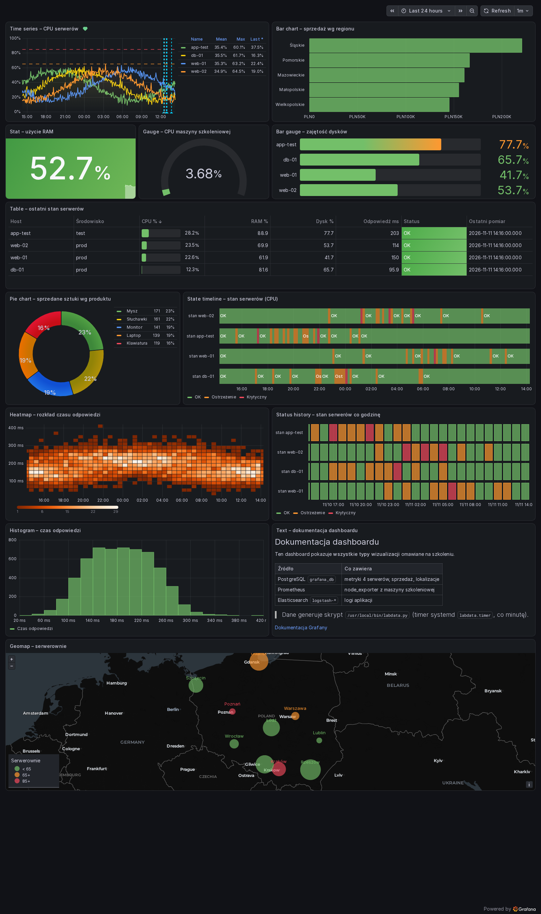
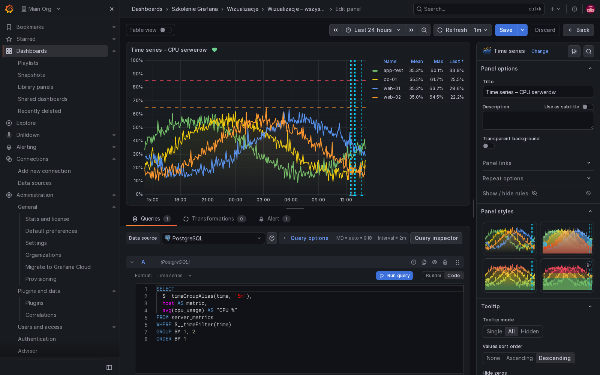
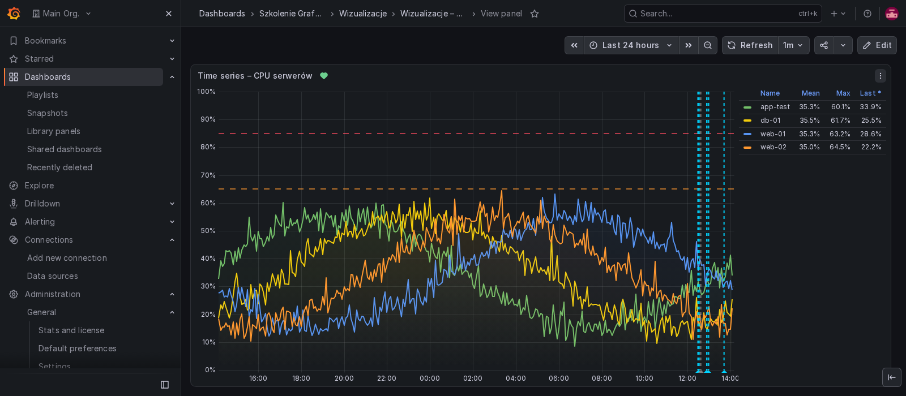

![[Pasted image 20260608074839.png]]
Time series to domyślna i najczęściej używana wizualizacja Grafany: wykres wartości w funkcji czasu (linie, słupki lub punkty). Nadaje się do wszystkiego, co zmienia się w czasie: obciążenia CPU i pamięci, ruchu sieciowego, liczby zapytań, czasu odpowiedzi, temperatury.

## Dashboard do ćwiczeń modułu IV

Wszystkie wizualizacje z tego modułu są zebrane na dashboardzie **Szkolenie Grafana › Wizualizacje › Wizualizacje – wszystkie typy** (`/d/wizualizacje`), w kolejności lekcji. Dane pochodzą głównie z bazy PostgreSQL `grafana_db` (tabele `server_metrics` i `sales`, uzupełniane co minutę przez generator `labdata.py`) oraz z Prometheusa (node_exporter maszyny szkoleniowej).



## Dane szeregów czasowych

Szereg czasowy to ciąg par **(czas, wartość)**, zwykle zbieranych w regularnych odstępach:

| time | host | cpu_usage |
|---|---|---|
| 2026-11-11 12:00 | web-01 | 34.2 |
| 2026-11-11 12:01 | web-01 | 36.8 |
| 2026-11-11 12:02 | web-01 | 35.1 |

Na jednym wykresie może być wiele serii, np. po jednej na każdy host. Źródło danych musi zwrócić dla Time series co najmniej jedno pole czasu i jedno pole liczbowe:
- **Prometheus / InfluxDB** zwracają serie z etykietami (labels), np. `{instance="localhost:9100"}`. Z etykiet powstaje nazwa serii w legendzie,
- **SQL** (PostgreSQL, MySQL) – zapytanie w formacie **Time series** z kolumną czasu. Kolumna `metric` (tekst) dzieli wynik na osobne serie, a pozostałe kolumny liczbowe stają się wartościami.

### Liczniki i rate() w Prometheusie

Metryki Prometheusa typu **counter** (nazwy kończące się na `_total`, np. `node_cpu_seconds_total`, `prometheus_http_requests_total`) tylko rosną od startu procesu. Wykres surowego licznika to linia rosnąca, z której nic nie wynika, a `avg()` czy `sum()` na surowym liczniku daje bezsensowną sumę „od początku świata”. Licznik zawsze najpierw przelicz na tempo zmian funkcją `rate()` (na sekundę), a dopiero potem agreguj:

```promql
sum by (code) (rate(prometheus_http_requests_total[$__rate_interval]))
```

Zapytanie zwraca liczbę zapytań HTTP na sekundę do Prometheusa, z podziałem na kody odpowiedzi. `$__rate_interval` to zmienna Grafany, która dobiera okno `rate()` do interwału wykresu i interwału zbierania danych. Używaj jej zamiast sztywnego `[5m]`.

Metryki typu **gauge** (np. `node_memory_MemAvailable_bytes`, `node_load1`) pokazują stan w danej chwili i można je wyświetlać bezpośrednio.

## Panel „Time series – CPU serwerów”

Pierwszy panel dashboardu pokazuje średnie użycie CPU czterech serwerów z tabeli `server_metrics`, w oknach 5-minutowych:

```sql
SELECT
  $__timeGroupAlias(time, '5m'),
  host AS metric,
  avg(cpu_usage) AS "CPU %"
FROM server_metrics
WHERE $__timeFilter(time)
GROUP BY 1, 2
ORDER BY 1
```

- `$__timeFilter(time)` – warunek na zakres czasu wybrany na dashboardzie,
- `$__timeGroupAlias(time, '5m')` – zaokrągla czas do 5 minut i nazywa kolumnę `time`. Razem z `GROUP BY` i `avg()` daje jeden punkt na 5 minut,
- `host AS metric` – każdy host to osobna seria (`app-test`, `db-01`, `web-01`, `web-02`).



Na zrzucie widać elementy ustawione na tym panelu:
- legenda w formie **tabeli po prawej** z wartościami **Mean**, **Max** i **Last \*** (ostatnia niepusta wartość),
- **progi** 65% (pomarańczowy) i 85% (czerwony) narysowane przerywanymi liniami,
- **Tooltip mode: All** i **Values sort order: Descending** – po najechaniu kursorem tooltip pokazuje wszystkie serie posortowane malejąco,
- oś Y od 0 do 100% (**Standard options → Unit: Percent (0-100)**, **Min 0**, **Max 100**),
- ikona serca przy tytule i licznik na zakładce **Alert** – z panelem jest powiązana reguła alertu „Wysokie CPU serwera” (moduł VI).

## Najważniejsze opcje Time series

Opcje są po prawej stronie edytora panelu. Wyszukiwarka (lupa) szybko znajduje konkretną opcję.

**Panel styles** – gotowe zestawy wyglądu (linie, wypełnienie, schemat kolorów). Dobry punkt startowy, potem dopracowujesz szczegóły.

**Tooltip**
- **Tooltip mode**: **Single** (tylko seria pod kursorem), **All** (wszystkie serie), **Hidden**,
- **Values sort order**: None / Ascending / Descending,
- **Hide zeros** – pomija w tooltipie serie z wartością 0.

**Legend**
- **Visibility** – pokaż/ukryj,
- **Mode**: **List** albo **Table**,
- **Placement**: **Bottom** albo **Right**,
- **Values** – obliczenia dodawane do legendy (Mean, Max, Min, Last, Last \*, Total…). Kliknięcie nagłówka kolumny w legendzie-tabeli sortuje serie.

Kliknięcie serii w legendzie pokazuje tylko ją, a Ctrl + klik dodaje kolejne serie do widoku.

**Axis**
- **Placement** (Auto / Left / Right / Hidden), **Label**, **Width**, **Show grid lines**, **Show border**,
- **Scale**: **Linear**, **Logarithmic** (dla danych w wielu rzędach wielkości), **Symlog**,
- **Centered zero**, **Soft min** / **Soft max** – „miękkie” granice osi: oś obejmie co najmniej ten zakres, ale rozszerzy się, jeśli dane go przekroczą (w odróżnieniu od twardych **Min/Max** ze Standard options, które ucinają wykres).

**Graph styles**
- **Style**: **Lines**, **Bars**, **Points**,
- **Line interpolation**: Linear, Smooth, Step before, Step after (schodki dla wartości zmieniających się skokowo),
- **Line width**, **Fill opacity**, **Gradient mode** (None, Opacity, Hue, Scheme), **Line style** (Solid, Dash, Dots),
- **Connect null values** / **Disconnect values** – co robić z brakami danych (łączyć linią czy przerywać),
- **Show points**: Auto / Always / Never, **Point size**,
- **Stack series**: **Off**, **Normal** (serie piętrowane), **100%** (udział procentowy).

**Standard options** – **Unit** (najważniejsza opcja: percent, bytes, ms, reqps…), **Min**, **Max**, **Decimals**, **Display name**, **Color scheme**, **No value**.

**Thresholds** – progi kolorów (Absolute lub Percentage) i **Show thresholds**: Off, As lines, As lines (dashed), As filled regions, As filled regions and lines.

**Overrides** – opcje dla wybranych serii, np. jedna seria jako słupki z osią po prawej albo stały kolor dla `db-01`.

## Tryb View i szybkie przełączniki

W trybie **View** (menu panelu → View, skrót `v`) Grafana 13 pokazuje pasek boczny **View panel** z sekcją **Quick toggles**: widoczność i położenie legendy, skala osi (Linear / Logarithmic / Symlog), piętrowanie serii (Off / Normal / 100%). Sekcja **Fan-out by series or label** rozbija wykres na osobne panele: jeden na serię albo na wartość wybranej etykiety. Te zmiany służą do doraźnej analizy i nie zmieniają zapisanego panelu.



## Dobre praktyki

- Ustaw **Unit** i, dla procentów, **Min 0 / Max 100**. Bez tego oś skacze przy każdym odświeżeniu i trudno porównywać wykresy.
- Liczniki zawsze przez `rate()` / `increase()`, z oknem `$__rate_interval`.
- Agreguj w zapytaniu (`$__timeGroupAlias`, `avg by`) – wykres z 10 tys. punktów na serię jest wolny i nieczytelny.
- Do 5–7 serii legenda jako lista na dole, przy większej liczbie legenda-tabela po prawej z wartościami (Mean, Max, Last \*).
- Progi pokazuj jako linie lub obszary, żeby od razu było widać, kiedy wartość była w strefie ostrzeżenia.
- Piętrowanie (**Stack series**) tylko dla wartości, które sensownie się sumują (ruch sieciowy, liczba zapytań), nigdy dla procentów CPU różnych hostów.

## Ćwiczenie w labie

Zaloguj się na http://10.123.2.206:3000 jako `admin` / `admin`. Pracuj na kopii: otwórz **Wizualizacje – wszystkie typy**, kliknij **Edit → Save (strzałka) → Save as copy**, zapisz jako `Wizualizacje – <inicjały>` w folderze **Development**.

1. Na kopii otwórz edycję panelu **Time series – CPU serwerów** (menu panelu → **Edit**). Włącz **Table view** i obejrzyj kolumny `Time`, `app-test`, `db-01`, `web-01`, `web-02`. Wyłącz.
2. W zapytaniu zmień `'5m'` na `'1h'` i kliknij **Run query**.
   - Efekt: linie są dużo gładsze (ok. 25 punktów na serię przy zakresie 24 h zamiast ok. 290). Wróć do `'5m'`.
3. Zmień opcje i obserwuj podgląd:
   - **Graph styles → Line interpolation: Smooth**, **Fill opacity** 30,
   - **Thresholds → Show thresholds: As filled regions and lines (dashed)**,
   - **Legend → Mode: List**, **Placement: Bottom**, a potem przywróć **Table** / **Right**,
   - **Graph styles → Stack series: Normal** – zauważ, że suma CPU czterech hostów przekracza 100%, więc piętrowanie nie ma tu sensu. Przywróć **Off**.
4. Dodaj nowy panel (**Back**, potem **+ → Panel**) ze źródłem **Prometheus** w trybie **Code**:
   ```promql
   sum by (code) (rate(prometheus_http_requests_total[$__rate_interval]))
   ```
   W **Options** zapytania ustaw **Legend: Custom** `HTTP {{code}}`, a w **Standard options → Unit** wybierz `Throughput → requests/sec (rps)`.
   - Efekt: serie `HTTP 200`, `HTTP 302`… z wartościami rzędu dziesiątych części zapytania na sekundę.
   - Dla porównania zmień zapytanie na sam licznik `prometheus_http_requests_total` – linie tylko rosną (to licznik od startu Prometheusa). Wróć do wersji z `rate()`.
5. Dodaj trzeci panel (Prometheus, CPU maszyny szkoleniowej):
   ```promql
   100 * (1 - avg by (instance) (rate(node_cpu_seconds_total{mode="idle"}[$__rate_interval])))
   ```
   **Unit** `Percent (0-100)`, **Min** 0, **Max** 100, w **Thresholds** dodaj próg 80 (czerwony) i ustaw **Show thresholds: As lines**.
   - Efekt: wykres CPU `localhost:9100` (zwykle kilka–kilkanaście procent, z pikami przy odświeżaniu dashboardów).
6. Zapisz dashboard. Otwórz panel z kroku 1 w trybie **View** i wypróbuj **Quick toggles** (legenda, skala, piętrowanie) oraz **Fan-out by series or label → By series**.
   - Efekt: każdy host na osobnym małym wykresie.
