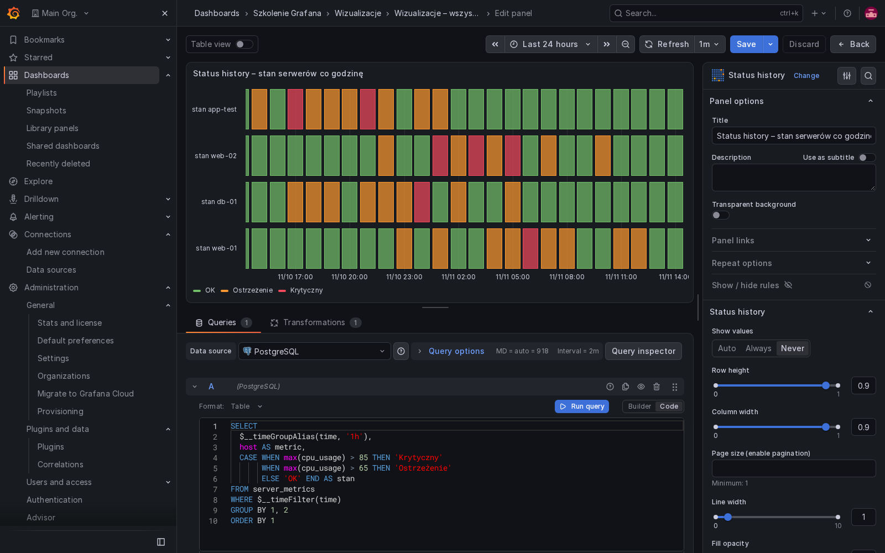
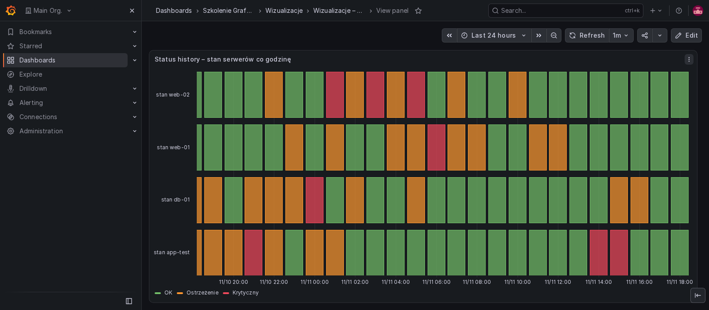

![[Pasted image 20260608075249.png]]

## Wprowadzenie

**Status history** pokazuje stan obiektów w czasie w postaci **siatki kratek**: wiersz to obiekt (host, usługa), kolumna to próbka w czasie, a kolor kratki to stan lub wartość. W odróżnieniu od State timeline kratki **nie są łączone** – każda próbka ma własne pole o tej samej szerokości. Dzięki temu łatwo policzyć, ile razy coś się wydarzyło, i porównać te same godziny między obiektami.

## Status history a State timeline

| | State timeline | Status history |
|---|---|---|
| Kształt | ciągłe paski, odcinki o różnej długości | równe kratki, jedna na próbkę |
| Łączenie takich samych stanów | tak (**Merge equal consecutive values**) | nie |
| Najlepszy do | czasu trwania stanu („jak długo był DOWN?”) | regularnych próbek („ile godzin w tygodniu było ostrzeżenie?”) |
| Gęstość danych | może być duża | najlepiej kilkadziesiąt kolumn – przy setkach kratki robią się nieczytelne |

Oba typy przyjmują te same dane i korzystają z tych samych mechanizmów: Value mappings (stany tekstowe) albo Thresholds (wartości liczbowe).

## Zastosowania

- **Stan usług co godzinę / co dzień** – raport dostępności.
- **Wyniki cyklicznych zadań** – backup, test syntetyczny, health check (OK / błąd).
- **Wartości liczbowe w kolorach** – np. średnie obciążenie każdego serwera w każdej godzinie, z progami.

## Panel w labie

W dashboardzie **Wizualizacje – wszystkie typy** panel **Status history – stan serwerów co godzinę** pokazuje te same stany co panel State timeline (lekcja 8), ale w **godzinnych** przedziałach – ok. 24 kratki na host dla ostatniej doby.



### Zapytanie

Źródło danych **PostgreSQL**, tryb **Code**, **Format: Table**:

```sql
SELECT
  $__timeGroupAlias(time, '1h'),
  host AS metric,
  CASE WHEN max(cpu_usage) > 85 THEN 'Krytyczny'
       WHEN max(cpu_usage) > 65 THEN 'Ostrzeżenie'
       ELSE 'OK' END AS stan
FROM server_metrics
WHERE $__timeFilter(time)
GROUP BY 1, 2
ORDER BY 1
```

Jedyna różnica względem State timeline to przedział `'1h'` zamiast `'10m'`. Stan godziny wynika z **najwyższego** CPU w tej godzinie – wystarczy jeden skok powyżej 65%, żeby kratka była pomarańczowa.

### Transformacja i kolory

Tak samo jak w State timeline:

- **Transformations → Partition by values**: **Field** = `metric`, **Naming** = As frame name, **Keep fields** = No – powstaje osobny wiersz na każdy host (`stan web-02`, `stan db-01`, `stan web-01`, `stan app-test`).
- **Value mappings** (typ **Value**): `OK` – zielony, `Ostrzeżenie` – pomarańczowy, `Krytyczny` – czerwony.
- **Standard options → Color scheme**: **Single color**.

Szczegółowe wyjaśnienie, po co jest transformacja, znajdziesz w lekcji „State timeline”.

### Opcje wizualizacji

Sekcja **Status history**:

- **Show values** – **Auto**, **Always**, **Never**. W labie: **Never** – przy 24 kratkach w wierszu napisy tylko by przeszkadzały; stan widać po kolorze i w podpowiedzi.
- **Row height** – 0.9 (wysokość wiersza, 0–1).
- **Column width** – 0.9 (szerokość kratki względem dostępnego miejsca; przy 1 kratki stykają się).
- **Page size (enable pagination)** – stronicowanie przy wielu obiektach.
- **Line width**, **Fill opacity** – obramowanie i krycie kratek.

W sekcji **Legend** można zmienić tryb (**List** / **Table**) i położenie (**Bottom** / **Right**); w sekcji **Axis** – ukryć etykiety wierszy (**Placement: Hidden**) lub ustawić ich szerokość (**Width**).

### Efekt



Jak czytać: każdy wiersz to host, każda kratka to jedna godzina. Na zrzucie od razu widać, że np. `web-02` miał kilka godzin z czerwonym stanem w okolicach północy, a `app-test` – głównie po południu. Na podglądzie prawą część siatki zasłania boczny pasek „View panel”; pełną dobę widać na zrzucie edycji.

## Typowe pułapki

- **Za dużo kolumn.** Status history z przedziałem 1 minuta i zakresem 24 h to 1440 kratek w wierszu – nieczytelne. Dobierz przedział tak, by kratek było kilkanaście do kilkudziesięciu (przy 7 dniach: `'6h'` lub `'1d'`).
- **Agregacja decyduje o wyniku.** `max(cpu_usage)` pokazuje najgorszy moment w godzinie, `avg(cpu_usage)` – typowy. Przy zmianie na średnią dużo czerwonych kratek zmieni się na zielone. Wybierz funkcję świadomie i opisz ją w tytule lub opisie panelu.
- **Brak transformacji / zły format.** Jak w State timeline: bez **Partition by values** dane z jednej kolumny nie rozdzielą się na hosty.
- **Brak danych w przedziale.** Gdy w danej godzinie nie ma pomiaru, kratka jest pusta – to informacja („brak danych”), a nie stan OK.

## Ćwiczenie w labie

Cel: zbudować Status history ze stanem serwerów co godzinę, a potem porównać agregację `max` i `avg`.

1. Zaloguj się na http://10.123.2.206:3000 (**admin / admin**). W dashboardzie ćwiczeniowym z lekcji Bar gauge (albo nowym: **Dashboards → New → New dashboard**) kliknij **Edit**, a potem w pasku po prawej **+** (**Add**) → **Panel** i na nowym panelu **Configure visualization**. Zakres czasu: **Last 24 hours**.
2. **Data source**: **PostgreSQL**, tryb **Code**, **Format: Table**. Wklej zapytanie z sekcji „Zapytanie” i kliknij **Run query**.
3. Wizualizacja: **Status history**. **Title**: `Status history – stan serwerów co godzinę`.
4. **Transformations → Add transformation → Partition by values**: **Field** = `metric`, **Naming** = As frame name, **Keep fields** = No.
5. **Value mappings**: `OK` zielony, `Ostrzeżenie` pomarańczowy, `Krytyczny` czerwony. **Color scheme**: Single color.
6. **Status history**: **Show values** = Never, **Row height** = 0.9, **Column width** = 0.9.
7. **Save**.
8. Porównaj z panelem **Status history – stan serwerów co godzinę** w dashboardzie „Wizualizacje – wszystkie typy” – układ kratek i kolory powinny być identyczne (te same dane).
9. Wariant: w zapytaniu zamień oba `max(cpu_usage)` na `avg(cpu_usage)` i kliknij **Run query**. Wszystkie kratki zrobią się zielone – średnie godzinowe CPU w labie nie przekracza 65% (przy `max` w ciągu doby jest zwykle kilkadziesiąt kratek pomarańczowych i kilka czerwonych). Wróć do `max` przed zapisaniem albo zapisz wariant jako osobny panel z tytułem „(średnia)”.

**Oczekiwany efekt:** 4 wiersze po 24–25 kratek (bieżąca, niepełna godzina też ma kratkę), legenda OK / Ostrzeżenie / Krytyczny pod spodem, przy najechaniu myszą podpowiedź z godziną i stanem.
