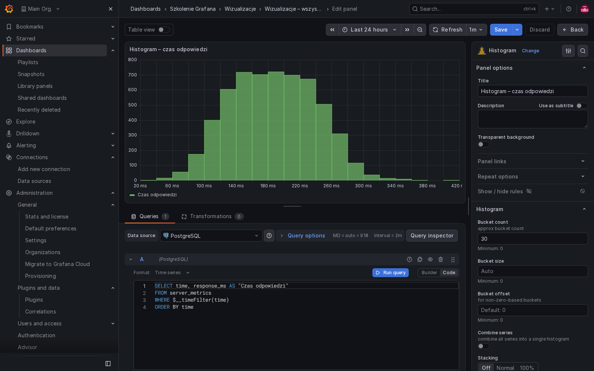
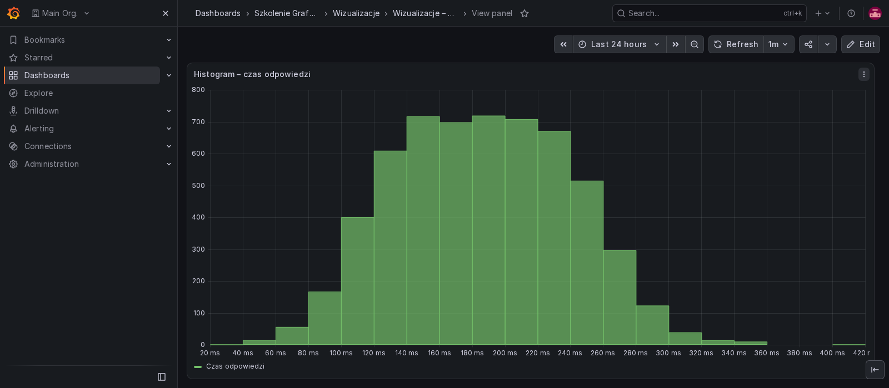

![[Pasted image 20260608075256.png]]

**Histogram** pokazuje **rozkład wartości** w całym wybranym zakresie czasu. Grafana dzieli wartości na przedziały (kubełki, ang. *buckets*), a wysokość słupka to liczba pomiarów w danym przedziale. Oś X to **wartość** (np. czas odpowiedzi w ms), a nie czas – histogram „spłaszcza” całą historię do jednego obrazu.

## Kiedy używać

- **Jaki jest typowy wynik i jak duży rozrzut** – np. czy większość odpowiedzi mieści się w 100–250 ms, czy są dwa „garby” (dwie grupy żądań).
- **Wartości odstające** – długi „ogon” po prawej stronie to rzadkie, bardzo wolne odpowiedzi.
- **Porównanie rozkładów** – np. czasy odpowiedzi różnych hostów na jednym wykresie.

Histogram a Heatmap: heatmapa pokazuje rozkład **w każdym okresie** (oś X = czas), histogram – rozkład **dla całego zakresu naraz**. Jeśli interesuje Cię, czy rozkład zmieniał się w ciągu dnia – użyj heatmapy; jeśli „jak to wygląda ogólnie” – histogramu.

## Panel w labie

W dashboardzie **Wizualizacje – wszystkie typy** panel **Histogram – czas odpowiedzi** pokazuje rozkład wszystkich pomiarów `response_ms` z ostatniej doby (ok. 5760 punktów – 4 hosty × 1440 minut).



### Zapytanie

Źródło danych **PostgreSQL**, tryb **Code**, **Format: Time series**:

```sql
SELECT time, response_ms AS "Czas odpowiedzi"
FROM server_metrics
WHERE $__timeFilter(time)
ORDER BY time
```

To samo zapytanie zasila panel Heatmap – oba panele pokazują te same dane na dwa sposoby. Podobnie jak przy heatmapie, do histogramu podaje się **surowe pomiary**, a nie średnie.

### Ustawienia

Sekcja **Histogram**:

| Opcja | Wartość w labie | Znaczenie |
|---|---|---|
| **Bucket count** | 30 | przybliżona liczba słupków (*approx bucket count*) |
| **Bucket size** | Auto | stała szerokość przedziału, np. `20` = co 20 ms; nadpisuje Bucket count |
| **Bucket offset** | 0 (domyślnie) | przesunięcie granic przedziałów, gdy nie mają zaczynać się od zera |
| **Combine series** | wyłączone | czy wiele szeregów połączyć w jeden histogram |
| **Stacking** | Off | (Normal, 100%) – układanie słupków wielu szeregów jeden na drugim |
| **Fill opacity** | 70 | krycie słupków |

Dodatkowo: **Line width**, **Gradient mode** (None, Opacity, Hue, Scheme), **Legend** (z opcją **Values** – np. średnia w legendzie), **Standard options → Unit** = milliseconds (ms) – jednostka osi X.

### Efekt



Jak czytać: najwięcej pomiarów (ok. 700 na słupek) leży między ok. 140 a 240 ms. Rozkład jest zbliżony do dzwonu, z krótkim ogonem w prawo – pojedyncze odpowiedzi trwają 340–420 ms. Najkrótsze odpowiedzi to ok. 20–60 ms i jest ich bardzo mało.

## Typowe pułapki

- **Uśrednione dane.** Gdy zapytanie zwraca `avg()` na 5 minut, histogram pokazuje rozkład średnich, a nie pomiarów – ogon z wolnymi odpowiedziami znika. Podawaj surowe wartości.
- **Za mało lub za dużo kubełków.** Przy 5 kubełkach wszystko zlewa się w jeden blok, przy 200 – wykres jest „poszarpany”. Zacznij od 20–40 albo ustaw stałe **Bucket size**, które ma sens biznesowy (np. 50 ms).
- **Zakres czasu zmienia wynik.** Histogram zależy od zakresu dashboardu: dla 1 godziny dostaniesz ok. 240 pomiarów, dla 7 dni – ponad 40 tysięcy. Porównując histogramy, porównuj te same zakresy.
- **Wiele szeregów nakłada się na siebie.** Przy kilku hostach słupki zasłaniają się nawzajem. Zmniejsz **Fill opacity**, włącz **Stacking** albo **Combine series**.

## Ćwiczenie w labie

Cel: histogram czasu odpowiedzi **osobno dla każdego hosta** i porównanie z wersją połączoną.

1. Zaloguj się na http://10.123.2.206:3000 (**admin / admin**). W dashboardzie ćwiczeniowym z lekcji Bar gauge (albo nowym: **Dashboards → New → New dashboard**) kliknij **Edit**, a potem w pasku po prawej **+** (**Add**) → **Panel** i na nowym panelu **Configure visualization**. Zakres czasu: **Last 24 hours**.
2. **Data source**: **PostgreSQL**, tryb **Code**, **Format: Time series**:

   ```sql
   SELECT time, host AS metric, response_ms
   FROM server_metrics
   WHERE $__timeFilter(time)
   ORDER BY time
   ```

   Kolumna `metric` w formacie Time series dzieli dane na 4 szeregi: `app-test`, `db-01`, `web-01`, `web-02` (sprawdź przełącznikiem **Table view**).
3. Wizualizacja: **Histogram**. **Title**: `Histogram – czas odpowiedzi wg hosta`.
4. **Histogram**: **Bucket size** = `20` (słupek co 20 ms), **Fill opacity** = 40.
5. **Standard options → Unit**: milliseconds (ms).
6. Obejrzyj wykres z **Stacking: Off**, potem przełącz na **Normal** – słupki hostów ułożą się jeden na drugim.
7. Włącz **Combine series** – zostanie jeden histogram ze wszystkich hostów.
8. **Save**.

**Oczekiwany efekt:** z **Combine series** wykres ma ten sam kształt co panel **Histogram – czas odpowiedzi** w dashboardzie „Wizualizacje – wszystkie typy” (dzwon z maksimum w okolicy 140–240 ms), tylko słupki mają równą szerokość 20 ms. Bez łączenia, przy **Stacking: Off**, widać cztery nakładające się rozkłady w kolorach hostów.
