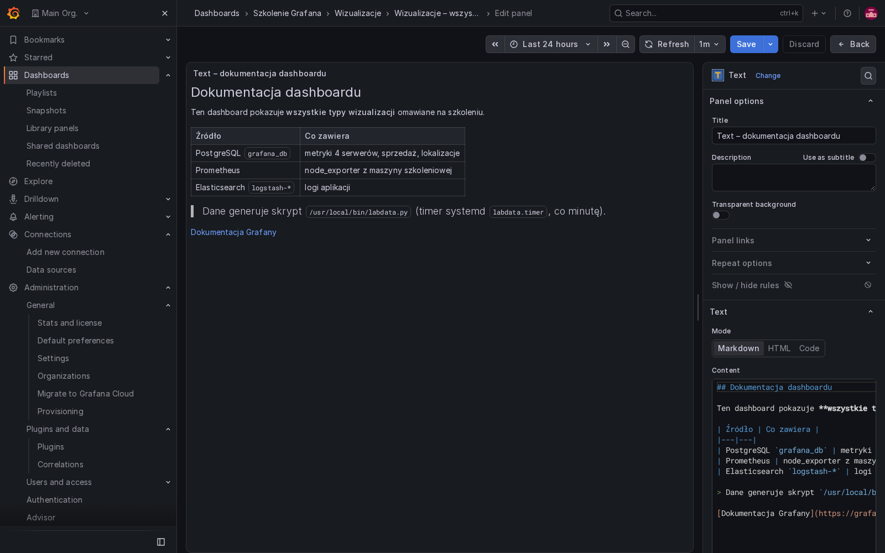
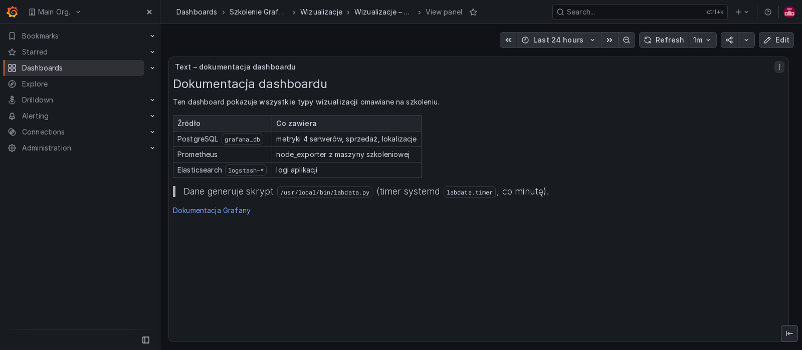

![[Pasted image 20260608075302.png]]
**Text** to panel do wyświetlania **własnej treści**: opisu dashboardu, instrukcji dla dyżurnego, linków do procedur, legendy kolorów, kontaktów. Treść pisze się w **Markdown**, **HTML** albo jako fragment kodu. Panel Text **nie pobiera danych ze źródła** – nie ma w nim zapytań. Może natomiast wstawiać do treści **wartości zmiennych** dashboardu.

## Kiedy używać

- **Opis dashboardu** – co pokazuje, skąd są dane, kto jest właścicielem.
- **Instrukcje i runbooki** – „jeśli panel X jest czerwony, zrób Y” + link do procedury.
- **Nagłówki sekcji** – krótki tekst nad grupą paneli.
- **Dynamiczny tekst ze zmiennych** – np. „Pokazuję hosty: web-01, web-02” albo zakres czasu raportu.

Jeśli chcesz pokazać **wartość z bazy** jako tekst (np. ostatni status, wersję aplikacji) – użyj panelu **Stat** z tekstowym polem albo **Table**; panel Text nie wykona zapytania.

## Panel w labie

W dashboardzie **Wizualizacje – wszystkie typy** panel **Text – dokumentacja dashboardu** opisuje dashboard: nagłówek, pogrubienie, tabela źródeł danych, cytat i link do dokumentacji Grafany.



W edytorze panelu Text pod podglądem nie ma zakładek **Queries** i **Transformations** – panel nie korzysta ze źródeł danych.

### Opcje

Sekcja **Text**:

- **Mode** – **Markdown**, **HTML** albo **Code** (wyświetla treść jako blok kodu, np. przykład konfiguracji).
- **Content** – edytor treści. Podgląd odświeża się po kliknięciu poza polem edycji.

### Treść panelu w labie (Markdown)

```markdown
## Dokumentacja dashboardu

Ten dashboard pokazuje **wszystkie typy wizualizacji** omawiane na szkoleniu.

| Źródło | Co zawiera |
|---|---|
| PostgreSQL `grafana_db` | metryki 4 serwerów, sprzedaż, lokalizacje |
| Prometheus | node_exporter z maszyny szkoleniowej |
| Elasticsearch `logstash-*` | logi aplikacji |

> Dane generuje skrypt `/usr/local/bin/labdata.py` (timer systemd `labdata.timer`, co minutę).

[Dokumentacja Grafany](https://grafana.com/docs/grafana/latest/panels-visualizations/visualizations/)
```

### Efekt



Markdown obsługuje m.in. nagłówki (`#`, `##`), **pogrubienie** (`**tekst**`), *kursywę* (`*tekst*`), listy (`-`, `1.`), tabele, cytaty (`>`), kod (`` `kod` ``) i linki (`[opis](adres)`).

## Zmienne w treści

Panel Text podstawia zmienne tak samo jak zapytania. Działa to zarówno dla zmiennych dashboardu (`$host`, `${env}`), jak i dla zmiennych globalnych Grafany, np.:

| Zapis | Wynik (przykład) |
|---|---|
| `${__user.login}` | `admin` |
| `${__dashboard}` | `Wizualizacje – wszystkie typy` |
| `${__from:date:YYYY-MM-DD HH:mm}` | `2026-11-10 13:45` – początek zakresu czasu |
| `${__to:date:YYYY-MM-DD HH:mm}` | koniec zakresu czasu |

Przykład w labie: dashboard **Zmienne – dynamiczny dashboard** ma panel Text w trybie **HTML** („Formaty zmiennych”), który pokazuje, jak zmienna `$host` wygląda w różnych formatach (`${host:csv}`, `${host:regex}`, `${host:sqlstring}` itd.). Więcej w module o zmiennych.

## HTML i bezpieczeństwo

W trybie **HTML** (a także wewnątrz Markdown) można używać znaczników i stylów, np.:

```html
<h3>Stan systemu</h3>
<p style="color:green">Wszystkie usługi działają.</p>
<p>Dyżur: <a href="mailto:ops@szkolenie.lab">ops@szkolenie.lab</a></p>
```

Grafana **czyści (sanityzuje) HTML**: style i zwykłe znaczniki działają, ale skrypty – nie. Wpisany znacznik `<script>` nie zostanie wykonany – w labie w trybie Markdown wyświetla się po prostu jako tekst. Wyłączenie sanityzacji (`disable_sanitize_html` w sekcji `[panels]` pliku `grafana.ini`) otwiera drogę do ataków XSS – na współdzielonej Grafanie nie należy tego robić.

## Typowe pułapki

- **Szukanie zapytania.** Panel Text nie ma zapytań i nie pokaże danych z bazy – do tego służą Stat i Table.
- **Domykanie nawiasów w edytorze.** Pole **Content** samo dopisuje zamykający nawias `}` po wpisaniu `${`. Przy ręcznym wpisywaniu zmiennej łatwo uzyskać `${host}}` – sprawdź wynik w podglądzie.
- **Podgląd się nie odświeża.** Zmiana w **Content** jest widoczna po kliknięciu poza edytorem.
- **Tabela Markdown się nie renderuje.** Przed tabelą i po niej potrzebna jest pusta linia, a wiersz `|---|---|` musi mieć tyle kolumn co nagłówek.
- **Za długi tekst.** Panel nie rośnie automatycznie – dłuższą dokumentację lepiej podlinkować (np. do wiki) niż wklejać w całości.

## Ćwiczenie w labie

Cel: panel z instrukcją dla dyżurnego, który pokazuje też aktualny zakres czasu i zalogowanego użytkownika.

1. Zaloguj się na http://10.123.2.206:3000 (**admin / admin**). W dashboardzie ćwiczeniowym z lekcji Bar gauge (albo nowym: **Dashboards → New → New dashboard**) kliknij **Edit**, a potem w pasku po prawej **+** (**Add**) → **Panel** i na nowym panelu **Configure visualization**.
2. Po prawej, pod listą wizualizacji, w części **Start without data** wybierz **Text** (albo wybierz **Text** z **All visualizations**).
3. **Title**: `Instrukcja dyżurnego`. **Mode**: **Markdown**.
4. W **Content** usuń domyślny tekst i wklej (wklejenie omija automatyczne domykanie nawiasów):

   ```markdown
   ## Instrukcja dyżurnego

   Zakres: **${__from:date:YYYY-MM-DD HH:mm}** – **${__to:date:YYYY-MM-DD HH:mm}**

   Ogląda: `${__user.login}`

   | Kolor | Znaczenie | Co robić |
   |---|---|---|
   | zielony | OK | nic |
   | pomarańczowy | ostrzeżenie (CPU > 65%) | obserwuj |
   | czerwony | krytyczny (CPU > 85%) | zgłoś na ops@szkolenie.lab |

   [Wszystkie typy wizualizacji](/d/wizualizacje)
   ```

5. Kliknij poza edytorem – podgląd pokaże tabelę, daty i login `admin`.
6. Zmień zakres czasu na **Last 7 days** – daty w tekście zmienią się same.
7. Przełącz **Mode** na **HTML** i zamień treść na fragment z sekcji „HTML i bezpieczeństwo”. Dopisz na końcu `<script>alert(1)</script>` – okienko z komunikatem się nie pojawi, bo Grafana nie wykonuje skryptów z panelu. Usuń tę linię.
8. **Save**.

**Oczekiwany efekt:** panel z nagłówkiem, zakresem dat, loginem i tabelą kolorów. Link prowadzi do dashboardu „Wizualizacje – wszystkie typy”, gdzie panel **Text – dokumentacja dashboardu** zbudowano w ten sam sposób.
