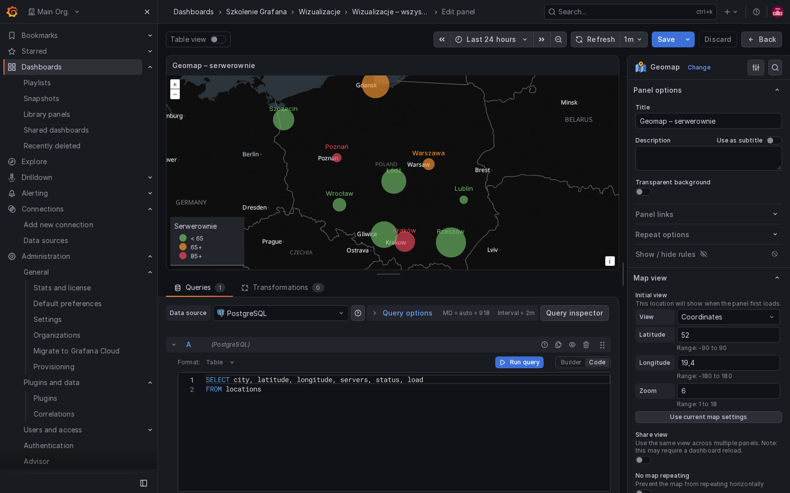
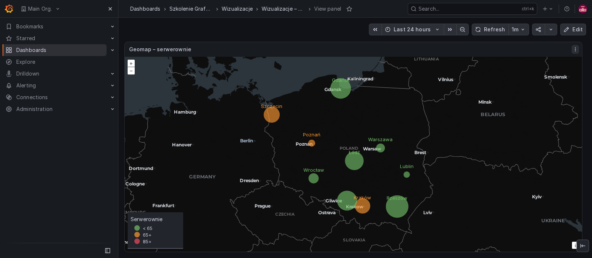

![[Pasted image 20260608075309.png]]
## Wprowadzenie

**Geomap** pokazuje dane na mapie geograficznej. Każdy wiersz wyniku zapytania, który ma położenie (współrzędne, geohash albo nazwę kraju/miasta), staje się punktem na mapie, a jego wielkość, kolor i podpis mogą zależeć od wartości z danych. Geomap jest wbudowany w Grafanę i zastąpił dawny plugin **Worldmap Panel** – był on oparty na AngularJS, którego obecne wersje Grafany (w labie 13.3) już nie obsługują. Stare dashboardy z Worldmap trzeba przenieść na Geomap.

## Zastosowania

- **Lokalizacje infrastruktury** – serwerownie, oddziały, stacje bazowe, czujniki, z kolorem stanu.
- **Ruch i zdarzenia według miejsca** – skąd przychodzą żądania, gdzie są błędy (np. z pól geo w logach).
- **Pojazdy i trasy** – punkty GPS połączone w trasę.

## Skąd mapa bierze położenie

W ustawieniach warstwy (**Map layers**) opcja **Location Mode** ma cztery tryby:

| Tryb | Co musi być w danych |
|---|---|
| **Auto** | Grafana sama szuka pól o typowych nazwach (np. `latitude`/`longitude`, `lat`/`lon`) |
| **Coords** | wskazujesz pole szerokości (**Latitude field**) i długości (**Longitude field**) geograficznej |
| **Geohash** | pole z kodem geohash |
| **Lookup** | pole z nazwą lub kodem (np. kraj) dopasowywane do wbudowanego słownika (*Gazetteer*) |

Najbezpieczniej jest wybrać **Coords** i wskazać pola ręcznie.

## Panel w labie

W dashboardzie **Wizualizacje – wszystkie typy** panel **Geomap – serwerownie** pokazuje 10 serwerowni w polskich miastach z tabeli `locations` (PostgreSQL). Wielkość kółka to liczba serwerów, kolor – obciążenie, podpis – nazwa miasta.



### Zapytanie

Źródło danych **PostgreSQL**, tryb **Code**, **Format: Table**:

```sql
SELECT city, latitude, longitude, servers, status, load
FROM locations
```

Wynik: 10 wierszy (Warszawa, Kraków, Wrocław, Gdańsk, Poznań, Katowice, Łódź, Szczecin, Lublin, Rzeszów) z kolumnami `latitude` i `longitude` (liczby), `servers` (liczba serwerów), `status` (`ok`/`warning`) i `load` (obciążenie w %). Generator danych zmienia `load` co minutę, więc kolory punktów zmieniają się między odświeżeniami.

### Ustawienia

**Map view** – widok początkowy:
- **View**: **Coordinates**, **Latitude** 52, **Longitude** 19,4, **Zoom** 6 – mapa wyśrodkowana na Polsce.
- Przycisk **Use current map settings** zapisuje bieżące położenie i powiększenie mapy z podglądu – wygodniej niż wpisywać liczby.

**Map layers** – jedna warstwa o nazwie **Serwerownie**:

| Opcja | Wartość w labie |
|---|---|
| **Layer type** | **Markers** |
| **Location Mode** | **Coords**, **Latitude field** = `latitude`, **Longitude field** = `longitude` |
| **Styles → Size** | pole `servers`, **Min** 8, **Max** 30 (średnica w pikselach) |
| **Styles → Symbol** | kółko (circle) |
| **Styles → Color** | pole `load` – kolor z progów |
| **Styles → Fill opacity** | 0.8 |
| **Styles → Text label** | **Source** = Field, **Field** = `city`, **Font size** 13, **Y offset** -22 (napis nad kółkiem) |
| **Show legend** | włączone – legenda progów w lewym dolnym rogu |
| **Display tooltip** | włączone – po wskazaniu punktu myszą dymek z wartościami wiersza |

**Basemap layer** – **Default base layer** (mapa podkładowa). **Map controls** – **Show zoom control** (przyciski +/-) i **Mouse wheel zoom** włączone.

**Standard options → Color scheme**: **From thresholds (by value)**, **Thresholds**: zielony, 65 pomarańczowy, 85 czerwony. Stąd legenda „< 65 / 65+ / 85+”.

### Efekt



Największe kółka to Rzeszów, Gdańsk, Katowice i Łódź (31–37 serwerów), najmniejsze – Lublin i Poznań (12–13). Kolor pomarańczowy mają lokalizacje z obciążeniem powyżej 65% w chwili wykonania zrzutu.

### Inne typy warstw

Na liście **Layer type** są też m.in.: **Heatmap** (mapa ciepła z gęstości punktów), **GeoJSON** (własne obszary z pliku), **Night / Day**, **Route** (punkty połączone w trasę), **Photos**, **Network** oraz warstwy podkładowe (**OpenStreetMap**, **CARTO basemap**, **ArcGIS MapServer**, **XYZ Tile layer**, **MapLibre layer**). Przyciskiem **Add layer** można nałożyć kilka warstw na jedną mapę.

## Typowe pułapki

- **Format: Time series.** Dla zapytań SQL z lokalizacjami ustaw **Format: Table** – dane nie mają osi czasu.
- **Zamienione współrzędne.** Szerokość (latitude, dla Polski ok. 49–55) i długość (longitude, ok. 14–24) zamienione miejscami przenoszą punkty do Afryki. Jeśli mapa „nic nie pokazuje”, oddal ją i poszukaj punktów.
- **Współrzędne jako tekst.** Kolumny muszą być liczbowe; jeśli baza zwraca tekst, rzutuj je w zapytaniu (`latitude::float`).
- **Kolor z pola bez progów.** Ustawienie **Color** na pole `load` działa razem z **Standard options → Color scheme** i **Thresholds**. Bez progów wszystkie punkty dostaną jeden kolor.
- **Brak mapy podkładowej.** Domyślna mapa podkładowa pobiera kafelki z internetu. W sieci bez dostępu do internetu punkty będą widoczne, ale na pustym tle – wtedy trzeba wskazać własny serwer kafelków (np. warstwa **XYZ Tile layer**).
- **Za dużo punktów.** Tysiące markerów spowalniają panel; agreguj dane w zapytaniu albo użyj warstwy **Heatmap**.

## Ćwiczenie w labie

Cel: odtworzyć mapę serwerowni z PostgreSQL, a potem zbudować ten sam panel na danych z MySQL.

**Część 1 – PostgreSQL**

1. Zaloguj się na http://10.123.2.206:3000 (**admin / admin**). W dashboardzie ćwiczeniowym z lekcji Bar gauge (albo nowym: **Dashboards → New → New dashboard**) kliknij **Edit**, a potem w pasku po prawej **+** (**Add**) → **Panel** i na nowym panelu **Configure visualization**.
2. **Data source**: **PostgreSQL**, tryb **Code**, **Format: Table**. Wklej zapytanie z sekcji „Zapytanie” i kliknij **Run query**.
3. Wizualizacja: **Geomap**. **Title**: `Geomap – serwerownie`.
4. **Map layers** – kliknij domyślną warstwę i ustaw: **Layer type** = Markers, **Location Mode** = Coords, **Latitude field** = `latitude`, **Longitude field** = `longitude`. Punkty pojawią się na mapie.
5. **Styles**: **Size** = pole `servers`, Min 8, Max 30; **Color** = pole `load`; **Text label** = Field → `city`, **Y offset** = -22.
6. **Standard options → Color scheme** = From thresholds (by value). **Thresholds**: zielony, **65** pomarańczowy, **85** czerwony.
7. Przybliż mapę w podglądzie na Polskę i w **Map view** kliknij **Use current map settings**.
8. **Save**.

**Oczekiwany efekt:** 10 kółek o różnej wielkości z nazwami miast, w kolorach zielonym/pomarańczowym i legenda progów – jak panel **Geomap – serwerownie** w dashboardzie „Wizualizacje – wszystkie typy”. Wskaż kółko myszą – dymek pokaże wszystkie kolumny wiersza.

**Część 2 – MySQL (Geolokalizacja)**

1. Dodaj nowy panel Geomap albo zduplikuj poprzedni (menu panelu → **More…** → **Duplicate**).
2. **Data source**: **MySQL** (baza `lab`), tryb **Code**, **Format: Table**:

   ```sql
   SELECT city, latitude, longitude, servers, status, load_pct
   FROM locations
   ```

3. W **Styles → Color** wybierz pole `load_pct` (w MySQL kolumna obciążenia nazywa się inaczej niż w PostgreSQL).
4. Dodaj drugą warstwę: **Add layer** → **Layer type** = Heatmap, **Location Mode** = Coords, te same pola współrzędnych.

**Oczekiwany efekt:** te same miasta, ale z innymi liczbami serwerów i obciążeniem (tabela w MySQL ma własne dane), plus rozmyta mapa ciepła pod kółkami.
