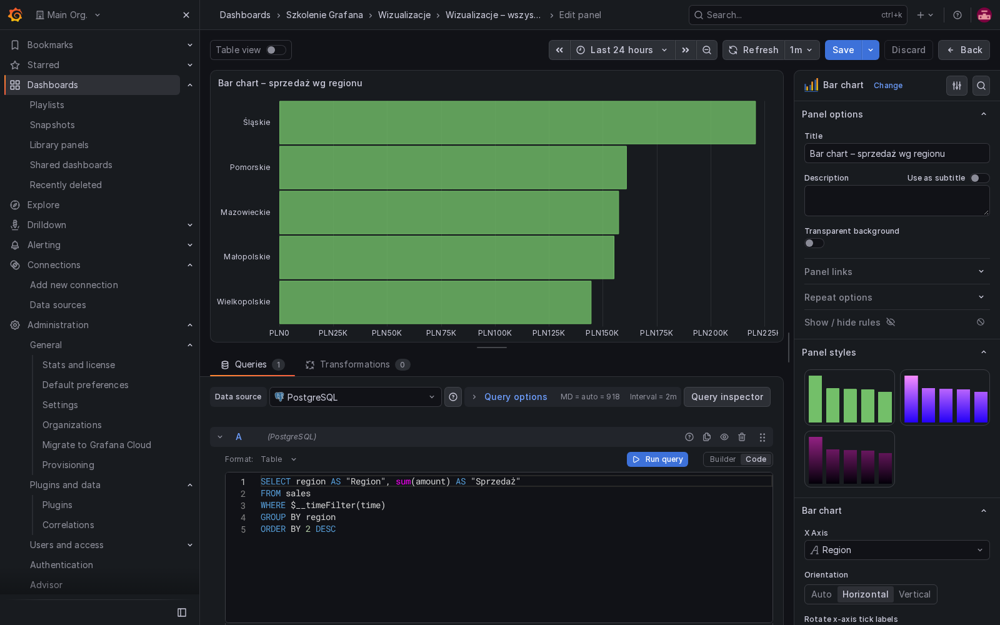
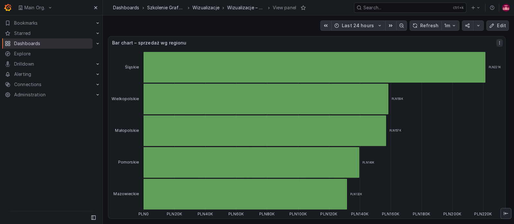

![[Pasted image 20260608074846.png]]

Bar chart (wykres słupkowy) porównuje wartości **kategorii**: sprzedaż w regionach, liczbę błędów na usługę, średni czas odpowiedzi na host. W odróżnieniu od Time series oś X to nie czas, tylko etykiety tekstowe (lub ewentualnie kilka wybranych punktów w czasie).

## Kiedy Bar chart, a kiedy coś innego

- **Bar chart** – kilka do kilkunastu kategorii, porównanie wartości między nimi, także w grupach (np. region × produkt).
- **Time series ze stylem Bars** – wartości w kolejnych przedziałach czasu (np. liczba logów co 5 minut).
- **Bar gauge** – pojedyncza wartość na kategorię na tle skali min–max (np. zajętość dysków w %).
- **Pie chart** – udział części w całości, przy małej liczbie kategorii.

## Jakie dane są potrzebne

Bar chart oczekuje danych **tabelarycznych**: jednej kolumny z etykietami (tekst albo czas) i jednej lub kilku kolumn liczbowych. W zapytaniach SQL ustaw więc **Format: Table**. Gdy zapytanie nie ma kolumny tekstowej ani czasu, panel wyświetla komunikat *Bar charts require a string or time field*, a gdy nie ma liczb – *No numeric fields found*.

Agregację rób w zapytaniu (`GROUP BY`). Bar chart nie sumuje danych sam.

## Panel „Bar chart – sprzedaż wg regionu”

Drugi panel dashboardu **Wizualizacje – wszystkie typy** pokazuje sumę sprzedaży w województwach w wybranym zakresie czasu:

```sql
SELECT region AS "Region", sum(amount) AS "Sprzedaż"
FROM sales
WHERE $__timeFilter(time)
GROUP BY region
ORDER BY 2 DESC
```

- **Format: Table**, kolumna `Region` to etykiety słupków, `Sprzedaż` to wartości,
- `ORDER BY 2 DESC` – słupki od największego, bo Bar chart zachowuje kolejność wierszy z zapytania,
- **Orientation: Horizontal** – przy dłuższych nazwach kategorii poziome słupki czyta się łatwiej niż pionowe,
- **Unit: Polish Złoty (PLN)** – oś opisana jako `PLN20K`, `PLN40K`…





## Najważniejsze opcje Bar chart

**Panel styles** – gotowe style: Palette classic, Palette classic stacked, Fixed purple hue, Viridis hue (zestaw zależy od danych).

**Bar chart**
- **X Axis** – pole z etykietami. Domyślnie pierwsze pole tekstowe lub czasu (*First string or time field*), warto wskazać je jawnie,
- **Orientation**: **Auto**, **Horizontal**, **Vertical**,
- **Rotate x-axis tick labels** – obrót etykiet przy pionowych słupkach i długich nazwach, **X-axis tick label max length** – obcięcie etykiet do zadanej długości, **X-axis labels minimum spacing** – rzadsze etykiety przy wielu słupkach,
- **Show values**: **Auto**, **Always**, **Never** – wartości liczbowe przy słupkach,
- **Stacking**: Off / Normal / 100% – przy kilku kolumnach liczbowych słupki stoją obok siebie (grupa) albo jeden na drugim,
- **Group width** (szerokość grupy słupków) i **Bar width** (szerokość słupka w grupie), **Bar radius** (zaokrąglenie),
- **Line width**, **Fill opacity**, **Gradient mode**,
- **Highlight full area on hover** – podświetlenie całego pasa kategorii pod kursorem,
- **Color by field** – kolor każdego słupka brany z wartości innego pola zapytania (pole musi zawierać kolor, np. `red` albo `#ff0000`).

**Legend**, **Tooltip**, **Axis** – jak w Time series. Przy jednej serii legenda nic nie wnosi i można ją wyłączyć (**Visibility**).

**Standard options** – **Unit**, **Min/Max**, **Decimals**, **Color scheme**. Każda kolumna liczbowa to osobna seria z własnym kolorem, więc przy jednej kolumnie wszystkie słupki mają ten sam kolor (jak na zrzucie).

**Thresholds** – progi z opcją **Show thresholds** (np. linia planu sprzedaży).

## Dobre praktyki

- Sortuj kategorie w zapytaniu (`ORDER BY wartość DESC`) – porównanie jest wtedy natychmiastowe.
- Oś wartości powinna zaczynać się od zera. Słupek „ucięty” na osi wizualnie przekłamuje proporcje.
- Długie nazwy → **Horizontal**. Kategorie mające naturalny porządek (godziny, dni tygodnia) → **Vertical**.
- Przy wielu kategoriach (> 15–20) pokaż top N (`LIMIT 10`) albo użyj tabeli.
- Grupy słupków (kilka kolumn liczbowych) maks. 3–4 serie, więcej robi się nieczytelne. Wtedy lepsze jest **Stacking: Normal** albo kilka paneli.

## Ćwiczenie w labie

Zaloguj się na http://10.123.2.206:3000 jako `admin` / `admin`. Pracuj na swojej kopii dashboardu `Wizualizacje – <inicjały>` (z lekcji Time series) albo na nowym dashboardzie w folderze **Development**.

1. Otwórz edycję panelu **Bar chart – sprzedaż wg regionu**. Przełącz **Orientation** na **Vertical**, a potem ustaw **Rotate x-axis tick labels** na `-45`. Przywróć **Horizontal**.
2. Ustaw **Show values: Always** i **Bar radius** `0.2`. Zmień **Unit** na `Misc → Short`, a potem z powrotem na `Currency → Polish Złoty (PLN)` – porównaj opis osi.
3. Dodaj nowy panel Bar chart, źródło **PostgreSQL**, tryb **Code**, **Format: Table**:
   ```sql
   SELECT product AS "Produkt", sum(quantity) AS "Sztuki"
   FROM sales
   WHERE $__timeFilter(time)
   GROUP BY product
   ORDER BY 2 DESC
   ```
   **Orientation: Vertical**, **Show values: Always**, tytuł `Sprzedane sztuki wg produktu`.
   - Efekt: 5 słupków (Mysz, Słuchawki, Klawiatura, Monitor, Laptop – kolejność zależy od danych), dla 24 h po ok. 120–170 sztuk.
4. Dodaj panel z wykresem grupowanym – sprzedaż w regionach z podziałem na grupy produktów:
   ```sql
   SELECT region AS "Region",
     sum(amount) FILTER (WHERE product = 'Laptop')  AS "Laptop",
     sum(amount) FILTER (WHERE product = 'Monitor') AS "Monitor",
     sum(amount) FILTER (WHERE product NOT IN ('Laptop', 'Monitor')) AS "Akcesoria"
   FROM sales
   WHERE $__timeFilter(time)
   GROUP BY region
   ORDER BY region
   ```
   **Format: Table**, **Unit: Polish Złoty (PLN)**.
   - Efekt: przy każdym z 5 regionów trzy słupki w różnych kolorach (Laptop wyraźnie najwyższy), legenda z nazwami serii.
   - Ustaw **Stacking: Normal** – słupki ustawiają się jeden na drugim, a ich wysokość to łączna sprzedaż regionu. Ustaw **Stacking: 100%** – każdy słupek pokazuje udział grup produktów w sprzedaży regionu.
5. Dodaj panel ze średnim czasem odpowiedzi hostów:
   ```sql
   SELECT host AS "Host", round(avg(response_ms)::numeric, 1) AS "Średni czas ms"
   FROM server_metrics
   WHERE $__timeFilter(time)
   GROUP BY host
   ORDER BY 2 DESC
   ```
   **Format: Table**, **Unit: Time → milliseconds (ms)**, w **Thresholds** ustaw próg `185` (czerwony) i **Show thresholds: As lines (dashed)**.
   - Efekt: 4 słupki o zbliżonej długości (ok. 180–190 ms) z przerywaną linią progu. Wartości różnią się nieznacznie, więc warto pokazać je liczbowo (**Show values: Always**).
6. Zapisz dashboard.
