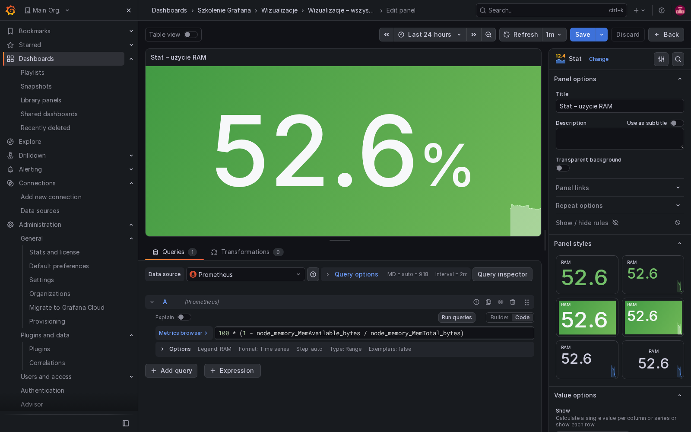
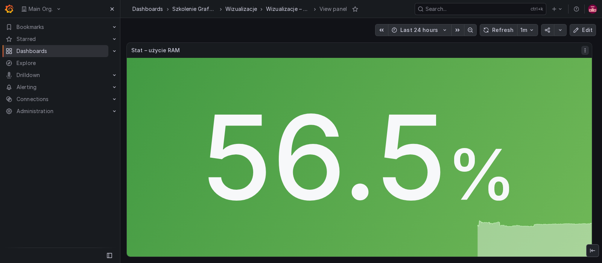

![[Pasted image 20260608074856.png]]

Stat pokazuje **jedną liczbę** (lub kilka liczb) dużą czcionką, opcjonalnie z kolorem zależnym od progów i małym wykresem w tle (sparkline). Służy do najważniejszych wskaźników, które mają być czytelne z daleka: aktualne użycie RAM, liczba aktywnych alertów, sprzedaż dzisiaj, dostępność usługi.

## Jak Stat liczy wartość

Zapytanie zwykle zwraca **serię** wartości z zakresu czasu, a Stat musi ją sprowadzić do jednej liczby. Robi to sekcja **Value options**:

- **Show**
  - **Calculate** – oblicz jedną wartość na serię (lub kolumnę) funkcją z pola **Calculation**,
  - **All values** – pokaż każdy wiersz osobno (przydatne dla danych tabelarycznych, np. jeden kafelek na host; pole **Limit** ogranicza liczbę wierszy).
- **Calculation** – funkcja redukująca, m.in.:
  - **Last \*** – ostatnia niepusta wartość (stan „teraz”; najczęstszy wybór),
  - **Last** – ostatnia wartość, nawet pusta,
  - **Mean**, **Max**, **Min** – średnia / maksimum / minimum w zakresie czasu,
  - **Total** – suma (np. łączna liczba zdarzeń),
  - **Count**, **Delta**, **Range** i inne.
- **Fields** – które pola mają być pokazane: **Numeric Fields** (domyślnie), **All Fields** albo wskazane pole.

Ta sama sekcja jest w Gauge i Bar gauge.

## Panel „Stat – użycie RAM”

Trzeci panel dashboardu **Wizualizacje – wszystkie typy** pokazuje procent zajętej pamięci RAM maszyny szkoleniowej (Prometheus, node_exporter):

```promql
100 * (1 - node_memory_MemAvailable_bytes / node_memory_MemTotal_bytes)
```

- **Calculation: Last \***, **Unit: Percent (0-100)**, **Decimals: 1**,
- **Thresholds**: zielony do 65, pomarańczowy od 65, czerwony od 85,
- **Color mode: Background Gradient** – tło kafelka w kolorze progu (z lekkim gradientem),
- **Graph mode: Area** – sparkline z przebiegu wartości w zakresie czasu (na dole kafelka).



W zapytaniu w **Options** ustawiono **Legend: RAM** – to nazwa serii, którą Stat pokazuje jako etykietę przy trybie tekstu **Value and name** (podglądy w **Panel styles** mają etykietę `RAM`).



## Najważniejsze opcje Stat

**Panel styles** – gotowe warianty: wartość w kolorze progu, tło w kolorze progu, z sparkline lub bez, układ poziomy, lista. To najszybszy sposób na uzyskanie typowego wyglądu.

**Value options** – Show / Calculation / Fields (opisane wyżej).

**Stat styles**
- **Orientation**: Auto / Horizontal / Vertical – układ kafelków, gdy wartości jest kilka,
- **Text mode**: Auto, **Value**, **Value and name**, **Name**, **None**,
- **Wide layout**: On / Off – nazwa i wartość obok siebie przy szerokich kafelkach,
- **Color mode**: **None**, **Value** (kolor liczby), **Background Gradient**, **Background Solid** (kolor tła),
- **Graph mode**: **None** albo **Area** (sparkline),
- **Text alignment**: Auto / Center,
- **Show percent change** – zmiana procentowa wartości w wybranym zakresie czasu (np. `+12%` ze strzałką), z opcją **Percent change color mode**: Standard (wzrost zielony), Inverted (wzrost czerwony – dla błędów, czasu odpowiedzi), Same as Value.

**Text size** – ręczny rozmiar tytułu i wartości (domyślnie dopasowany do kafelka).

**Standard options** – **Unit**, **Decimals**, **Min/Max**, **Color scheme** (dla kolorowania wg progów: *From thresholds (by value)*), **No value** (tekst, gdy brak danych – np. `brak danych` zamiast `No data`).

**Value mappings** – zamiana wartości na tekst i kolor, np. `1` → `UP` (zielony), `0` → `DOWN` (czerwony). Klasyczne zastosowanie przy metrykach stanu (`up`, kody statusu).

**Thresholds** – progi kolorów. **Absolute** – wartości bezwzględne, **Percentage** – procent zakresu Min–Max.

## Dobre praktyki

- Wybieraj **Calculation** świadomie: **Last \*** dla „stanu teraz”, **Mean** lub **Max** dla „jak było w tym okresie”, **Total** dla sum zdarzeń. Tytuł panelu powinien to mówić (np. `RAM – teraz`, `CPU – średnia 24 h`).
- Zawsze ustaw **Unit** i **Decimals**. `57.9%` czyta się lepiej niż `57.91283746`.
- Kolor ma nieść informację: progi dobrane do realnych granic (ostrzeżenie / krytyczny), a nie „ładny kolor”.
- **Graph mode: Area** dodaje kontekst (czy wartość rośnie, czy spada), ale na małych kafelkach może zasłaniać liczbę.
- Rząd kilku Statów na górze dashboardu daje szybki przegląd. Szczegóły pokazuj niżej na wykresach.

## Ćwiczenie w labie

Zaloguj się na http://10.123.2.206:3000 jako `admin` / `admin`. Pracuj na swojej kopii dashboardu `Wizualizacje – <inicjały>` (z lekcji Time series).

1. Otwórz edycję panelu **Stat – użycie RAM**. Przejrzyj kilka wariantów w **Panel styles**. Ustaw ręcznie:
   - **Color mode: Value**, potem **Background Gradient**,
   - **Graph mode: None**, potem **Area**,
   - **Calculation: Max** – zauważ, że wartość zmieniła się na maksimum z zakresu czasu. Wróć do **Last \***.
2. W **Thresholds** zmień próg pomarańczowy z `65` na `50`.
   - Efekt: przy RAM ok. 55–58% kafelek zmienia kolor na pomarańczowy. Przywróć `65`.
3. Dodaj panel Stat ze sprzedażą w wybranym zakresie czasu (źródło **PostgreSQL**, **Format: Table**):
   ```sql
   SELECT sum(amount) AS "Sprzedaż"
   FROM sales
   WHERE $__timeFilter(time)
   ```
   **Unit: Polish Złoty (PLN)**, **Decimals: 0**, **Color mode: None**.
   - Efekt: jedna liczba, dla 24 h ok. 800 tys. PLN. Zmień zakres czasu na **Last 7 days** – wartość rośnie, bo zapytanie sumuje cały zakres.
4. Dodaj panel Stat ze sprzedażą godzinową jako szeregiem czasowym (**Format: Time series**):
   ```sql
   SELECT
     $__timeGroupAlias(time, '1h'),
     sum(amount) AS "Sprzedaż"
   FROM sales
   WHERE $__timeFilter(time)
   GROUP BY 1
   ORDER BY 1
   ```
   **Calculation: Total**, **Graph mode: Area**, **Show percent change** włączone, **Unit: Polish Złoty (PLN)**.
   - Efekt: suma sprzedaży z całego zakresu (taka sama jak w kroku 3 dla tego samego zakresu), sparkline pokazuje rozkład w ciągu doby, a strzałka – zmianę procentową. Przełącz **Calculation** na **Last \*** – to sprzedaż w ostatniej, niepełnej godzinie.
5. Dodaj panel Stat z ostatnim pomiarem CPU każdego hosta (**Format: Table**):
   ```sql
   SELECT DISTINCT ON (host) host AS metric, cpu_usage AS "CPU %"
   FROM server_metrics
   ORDER BY host, time DESC
   ```
   **Value options → Show: All values**, **Text mode: Value and name**, **Unit: Percent (0-100)**, **Color mode: Background Solid**, progi 65 / 85.
   - Efekt: 4 kafelki (`app-test`, `db-01`, `web-01`, `web-02`) z aktualnym CPU w kolorze progu. Przełącz **Orientation** na **Horizontal** i porównaj układ.
6. Dodaj panel Stat ze stanem node_exportera (źródło **Prometheus**):
   ```promql
   up{job="node"}
   ```
   W **Value mappings** dodaj: wartość `1` → tekst `UP`, kolor zielony; wartość `0` → tekst `DOWN`, kolor czerwony. **Color mode: Background Solid**, **Graph mode: None**.
   - Efekt: zielony kafelek z napisem `UP`.
7. Zapisz dashboard.
