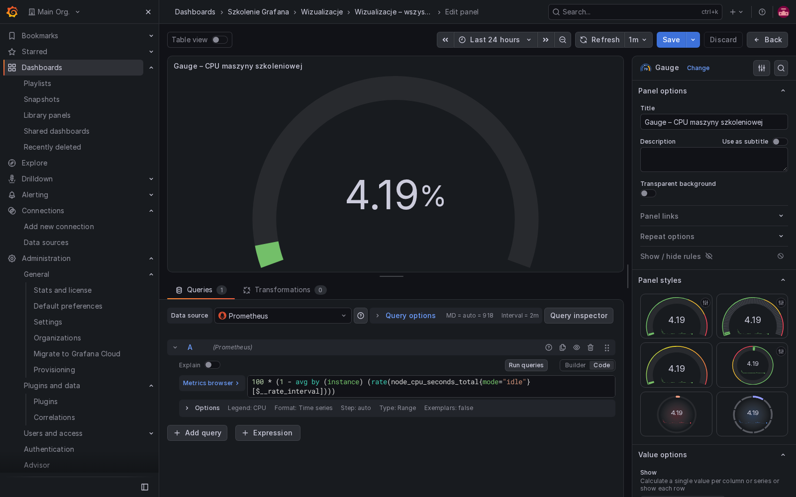
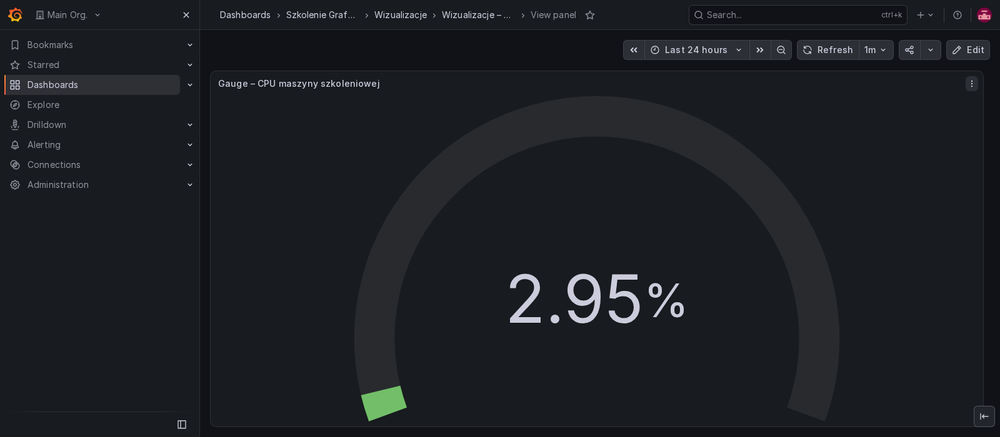

![[Pasted image 20260608074918.png]]

Gauge (wskaźnik zegarowy) pokazuje jedną wartość na tle **skali od Min do Max**, w formie łuku lub okręgu. Odpowiada na pytanie: „jak blisko granicy jesteśmy?”. Dlatego nadaje się do wielkości o naturalnym zakresie: procent użycia CPU, RAM, dysku, wypełnienie kolejki, temperatura w dopuszczalnym przedziale.

## Gauge, Stat czy Bar gauge?

| Wizualizacja | Kiedy |
|---|---|
| **Stat** | sama liczba jest najważniejsza, skala nie ma znaczenia (liczba alertów, sprzedaż) |
| **Gauge** | wartość względem znanego zakresu 0–100% lub Min–Max, jedna lub kilka wartości |
| **Bar gauge** | wiele wartości na tej samej skali obok siebie (zajętość kilkunastu dysków) – zajmuje mniej miejsca niż rząd Gauge'ów |

Gauge bez sensownie ustawionych **Min** i **Max** wprowadza w błąd: Grafana wylicza wtedy zakres z danych, więc ten sam wskaźnik może raz wyglądać na „prawie pełny”, a raz na „prawie pusty”.

## Panel „Gauge – CPU maszyny szkoleniowej”

Czwarty panel dashboardu **Wizualizacje – wszystkie typy** pokazuje bieżące użycie CPU maszyny szkoleniowej:

```promql
100 * (1 - avg by (instance) (rate(node_cpu_seconds_total{mode="idle"}[$__rate_interval])))
```

Zapytanie liczy udział czasu, w którym CPU **nie** był bezczynny (`mode="idle"`), uśredniony po wszystkich rdzeniach. `node_cpu_seconds_total` to licznik, więc konieczne jest `rate()`.

Ustawienia panelu: **Calculation: Last \***, **Unit: Percent (0-100)**, **Min 0**, **Max 100**, progi 65 (pomarańczowy) i 85 (czerwony).





Przy niskim obciążeniu (kilka procent) wypełniona jest tylko niewielka część łuku, w kolorze zielonym.

## Najważniejsze opcje Gauge (Grafana 13)

W Grafanie 13 wizualizacja Gauge ma nowy wygląd i więcej opcji stylu niż w starszych wersjach.

**Panel styles** – gotowe warianty: **Standard**, **Gradient**, **Neon**, **Segmented**, **Circle**. Podglądy na zrzucie pokazują je z kolorami progów na łuku.

**Value options** – **Show** (Calculate / All values), **Calculation**, **Fields** – tak samo jak w Stat (lekcja „Stat”). Przy **All values** dla danych tabelarycznych powstaje jeden wskaźnik na wiersz.

**Gauge**
- **Style**: **Arc** (łuk) albo **Circle** (pełny okrąg),
- **Bar Style**: **Flat** albo **Rounded** (zaokrąglone końce paska),
- **Bar width factor** – grubość paska,
- **Segments** i **Segment spacing** – podział paska na segmenty (wygląd „diodowy”; 1 = pasek ciągły),
- **Endpoint marker**: **None**, **Point**, **Glow** – znacznik na końcu wypełnienia (Glow działa tylko w ciemnym motywie),
- **Show thresholds** – kolorowa skala progów wzdłuż łuku, **Show labels** – wartości progów (i wartości neutralnej) przy skali,
- **Show sparkline** – mały wykres przebiegu w zakresie czasu,
- **Effects** – **Bar glow**, **Center glow**, **Gradient**,
- **Neutral value** – punkt, od którego rysowane jest wypełnienie (domyślnie Min). Przydaje się dla wartości mogących być ujemne, np. odchyłki od normy: z neutralną `0` pasek rośnie w lewo lub w prawo od środka,
- **Text mode**: Auto, Value, Value and name, Name, None,
- **Gauge size**: **Auto** albo **Manual** z **Min width** / **Min height** – minimalny rozmiar wskaźnika przy wielu wartościach,
- **Orientation** – układ wielu wskaźników (poziomo / pionowo).

**Text size** – ręczny rozmiar nazwy i wartości.

**Standard options** – **Unit**, **Min**, **Max** (kluczowe dla Gauge), **Decimals**, **Color scheme**.

**Thresholds** – progi kolorów: **Absolute** (np. 65 i 85 dla procentów) albo **Percentage** (procent zakresu Min–Max – wygodne, gdy Max zmienia się między panelami).

**Value mappings** – np. zamiana braku danych na tekst.

## Dobre praktyki

- Zawsze ustaw **Min** i **Max** (dla procentów 0 i 100). Bez tego wskaźnik nie ma punktu odniesienia.
- Progi dopasuj do realnych granic: dla CPU ostrzeżenie zwykle ok. 70–80%, krytyczny 90%. Dla dysku ostrzeżenie już od 80–85%, bo zapełniony dysk zatrzymuje usługi.
- Gauge zajmuje dużo miejsca. Więcej niż 4–6 wskaźników obok siebie zastąp **Bar gauge** albo tabelą z komórkami typu gauge.
- Gauge pokazuje wartość z jednej chwili (**Last \***) albo jedną statystykę okresu. Kiedy ważny jest przebieg, włącz **Show sparkline** albo dodaj obok wykres Time series.
- Efekty (glow, gradient) stosuj oszczędnie, szczególnie na ekranach ściennych, gdzie liczy się czytelność z daleka.

## Ćwiczenie w labie

Zaloguj się na http://10.123.2.206:3000 jako `admin` / `admin`. Pracuj na swojej kopii dashboardu `Wizualizacje – <inicjały>` (z lekcji Time series).

1. Dla porównania otwórz **Produkcja › Serwer Linux – przegląd** i spójrz na wskaźnik **RAM**: wypełnienie łuku pokazuje bieżące użycie RAM, a na końcu skali widać kolory progów (pomarańczowy, czerwony).
2. Na swojej kopii otwórz edycję panelu **Gauge – CPU maszyny szkoleniowej**. Przejrzyj **Panel styles** (Standard, Gradient, Neon, Segmented, Circle) i wybierz jeden.
3. Ustaw ręcznie: **Style: Circle**, **Bar Style: Rounded**, **Segments** `20`, **Show labels** włączone, **Show sparkline** włączone.
   - Efekt: okrągły, segmentowany wskaźnik z opisem progów `65` i `85` i małym wykresem CPU.
4. Usuń **Max** (wyczyść pole w **Standard options**) i obserwuj podgląd.
   - Efekt: skala dopasowuje się do danych, więc kilka procent CPU wygląda jak duża wartość. Przywróć **Max** `100`.
5. Dodaj panel Gauge z zajętością głównego systemu plików (źródło **Prometheus**, tryb **Code**):
   ```promql
   100 - 100 * node_filesystem_avail_bytes{mountpoint="/"} / node_filesystem_size_bytes{mountpoint="/"}
   ```
   **Unit: Percent (0-100)**, **Min** 0, **Max** 100, **Decimals** 1, w **Thresholds** progi `80` (pomarańczowy) i `90` (czerwony), tytuł `Dysk / – zajętość`.
   - Efekt: wskaźnik ok. 30–32%, zielony.
6. Dodaj panel Gauge z pamięcią RAM czterech serwerów z PostgreSQL (**Format: Table**):
   ```sql
   SELECT DISTINCT ON (host) host AS metric, mem_usage AS "RAM %"
   FROM server_metrics
   ORDER BY host, time DESC
   ```
   **Value options → Show: All values**, **Text mode: Value and name**, **Unit: Percent (0-100)**, **Min** 0, **Max** 100, progi `70` i `85`.
   - Efekt: 4 wskaźniki (`app-test`, `db-01`, `web-01`, `web-02`). `app-test` ma zwykle ok. 85% RAM, więc jest w strefie czerwonej lub na jej granicy, pozostałe ok. 55–80%.
   - Zmień typ wizualizacji (**Change**) na **Bar gauge** i porównaj, ile miejsca zajmuje ta sama informacja.
7. Zapisz dashboard.
