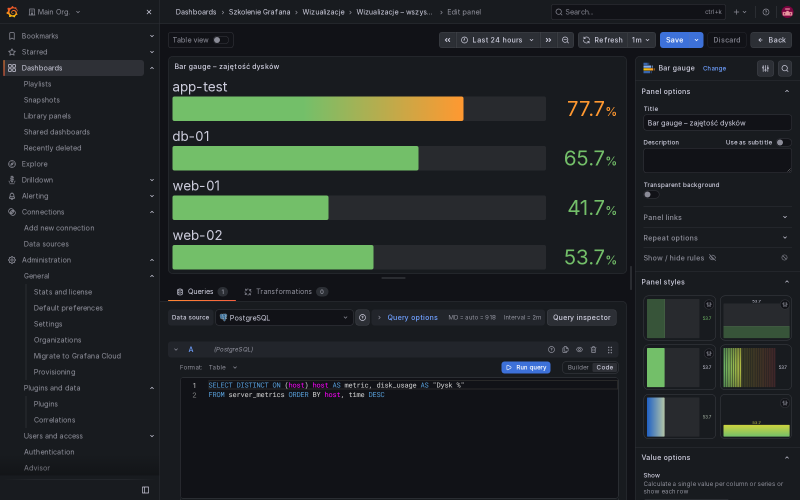
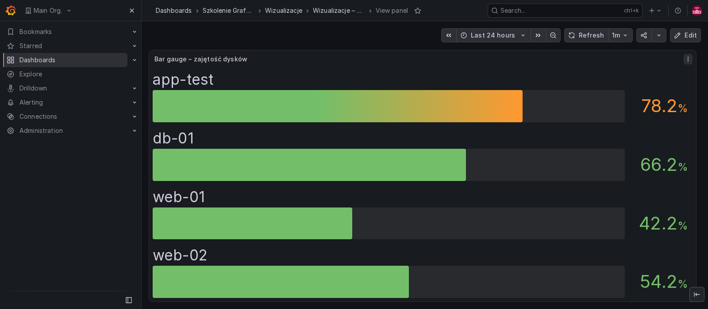

![[Pasted image 20260608074926.png]]

**Bar gauge** to wizualizacja, która pokazuje bieżącą wartość jako pasek wypełniony w odniesieniu do zakresu (Min–Max). Najczęściej rysuje się wiele pasków jeden pod drugim – po jednym na host, dysk, kolejkę czy usługę – dzięki czemu od razu widać, który element jest najbliżej granicy. Kolor paska wynika z progów (Thresholds).

## Kiedy używać

- **Zajętość zasobów wielu obiektów naraz** – dyski, systemy plików, pamięć na serwerach, wypełnienie kolejek.
- **Porównanie „ile zostało do limitu”** – pasek ma sens tylko wtedy, gdy wartość ma naturalny zakres (np. 0–100%).
- **Ranking** – posortowane paski czyta się szybciej niż tabelę liczb.

Bar gauge pokazuje **jedną wartość na element** (np. ostatnią). Jeżeli chcesz zobaczyć zmiany w czasie – użyj Time series. Jeżeli porównujesz kategorie bez zakresu i progów (np. sprzedaż w regionach) – lepszy będzie Bar chart. Jeżeli masz jedną wartość – wystarczy Gauge lub Stat.

## Panel w labie

W dashboardzie **Wizualizacje – wszystkie typy** (folder *Szkolenie Grafana / Wizualizacje*) panel **Bar gauge – zajętość dysków** pokazuje ostatni pomiar zajętości dysku dla czterech serwerów z tabeli `server_metrics` (PostgreSQL).



### Zapytanie

Źródło danych **PostgreSQL**, edytor w trybie **Code**, **Format: Table**:

```sql
SELECT DISTINCT ON (host) host AS metric, disk_usage AS "Dysk %"
FROM server_metrics ORDER BY host, time DESC
```

`DISTINCT ON (host)` razem z `ORDER BY host, time DESC` zwraca dokładnie jeden, najnowszy wiersz dla każdego hosta. Wynik to tabela z 4 wierszami: kolumna tekstowa (nazwa hosta) i kolumna liczbowa (`Dysk %`). Kolumna tekstowa daje etykietę paska, kolumna liczbowa – jego wartość.

### Ustawienia

| Sekcja | Opcja | Wartość w labie | Po co |
|---|---|---|---|
| Value options | **Show** | **All values** | każdy wiersz tabeli = osobny pasek |
| Value options | **Fields** | Numeric Fields | bierze wszystkie kolumny liczbowe |
| Bar gauge | **Orientation** | Horizontal | paski poziome, czytelne nazwy hostów |
| Bar gauge | **Display mode** | Gradient | pasek przechodzi kolorami progów |
| Bar gauge | **Show unfilled area** | włączone | szare tło pokazuje, ile zostało do 100% |
| Standard options | **Unit** | Percent (0-100) | wartość z symbolem % |
| Standard options | **Min** / **Max** | 0 / 100 | stała skala dla wszystkich pasków |
| Standard options | **Color scheme** | From thresholds (by value) | kolor z progów |
| Thresholds | progi | Base zielony, 70 pomarańczowy, 85 czerwony | ostrzeżenie i stan krytyczny |

Pozostałe opcje w sekcji **Bar gauge**, które warto znać:

- **Display mode**: **Gradient**, **Retro LCD** (pasek z segmentów, jak wskaźnik LED), **Basic** (jednolity kolor).
- **Value display**: **Value color** (liczba w kolorze progu), **Text color**, **Hidden**.
- **Name placement**: **Auto**, **Top**, **Left**, **Hidden** – gdzie stoi nazwa elementu.
- **Bar size**: **Auto** lub **Manual** (stała wysokość paska, przy wielu elementach panel się przewija).
- **Text size** – osobno dla tytułu (**Title**) i wartości (**Value**).
- Sekcja **Panel styles** pokazuje miniatury gotowych wariantów – kliknięcie przełącza wygląd jednym ruchem.

### Efekt



Host `app-test` (ok. 77%) przekroczył próg 70%, więc jego pasek przechodzi z zielonego w pomarańczowy, a wartość jest pomarańczowa. Pozostałe hosty są poniżej progu – zielone.

## Drugi przykład: Prometheus

W dashboardzie **Serwer Linux – przegląd** (folder *Produkcja*), w zwiniętym wierszu **Dyski**, panel **Zajętość systemów plików** to także Bar gauge – tym razem z Prometheusa, w trybie **Retro LCD**:

```promql
100 - 100 * node_filesystem_avail_bytes{fstype!~"tmpfs|ramfs"} / node_filesystem_size_bytes
```

Legenda zapytania (**Legend** → Custom) ustawiona na `{{mountpoint}}`, więc paski nazywają się `/`, `/boot` itd. Tu dane są szeregami czasowymi, dlatego **Show** zostaje na **Calculate** z obliczeniem **Last \***.

## Typowe pułapki

- **Jeden pasek zamiast czterech.** Przy danych w formacie Table i **Show: Calculate** Grafana redukuje całą kolumnę do jednej wartości. Dla tabeli ustaw **Show: All values**; dla szeregów czasowych (Prometheus, Format: Time series) zostaw **Calculate**.
- **Brak Min/Max.** Puste pola Min i Max oznaczają, że skala jest liczona z danych – najmniejsza wartość dostaje prawie pusty pasek, nawet jeśli to 40%. Dla procentów zawsze wpisz 0 i 100.
- **Progi a jednostka.** Progi wpisuje się w jednostkach danych (70 = 70%), chyba że przełączysz **Thresholds mode** na **Percentage** – wtedy liczą się względem Min–Max.
- **Za dużo elementów.** Przy kilkudziesięciu paskach przełącz **Bar size** na **Manual** albo ogranicz wynik zapytania (`LIMIT`, `topk()` w PromQL).

## Ćwiczenie w labie

Cel: zbudować Bar gauge z **zajętością pamięci RAM** na serwerach i porównać go z panelem „Bar gauge – zajętość dysków”.

1. Otwórz http://10.123.2.206:3000 i zaloguj się jako **admin / admin**.
2. **Dashboards → New → New dashboard**. Nowy dashboard otwiera się w trybie edycji z panelem bocznym **Add** – kliknij w nim **Panel**, a na nowym panelu **Configure visualization**. Ten dashboard wykorzystasz w kolejnych lekcjach (dashboard ćwiczeniowy).
3. Ustaw zakres czasu w prawym górnym rogu na **Last 24 hours**.
4. W **Data source** wybierz **PostgreSQL**. W edytorze zapytania przełącz **Builder → Code**, ustaw **Format: Table** i wklej:

   ```sql
   SELECT DISTINCT ON (host) host AS metric, mem_usage AS "RAM %"
   FROM server_metrics
   ORDER BY host, time DESC
   ```

   Kliknij **Run query**. Przełącznik **Table view** nad podglądem pokaże 4 wiersze: `app-test`, `db-01`, `web-01`, `web-02`.
5. Po prawej wybierz wizualizację **Bar gauge** (lista **All visualizations** albo przycisk **Change**).
6. **Panel options → Title**: `Bar gauge – RAM serwerów`.
7. **Value options → Show**: **All values**.
8. **Bar gauge**: **Orientation** = Horizontal, **Display mode** = Retro LCD, **Show unfilled area** = włączone.
9. **Standard options**: **Unit** = Percent (0-100), **Min** = 0, **Max** = 100.
10. **Thresholds**: zostaw zielony Base, zmień 80 na **70** (pomarańczowy) i dodaj **85** (czerwony) przyciskiem **Add threshold**.
11. **Save** – nadaj dashboardowi nazwę, np. `Ćwiczenia – wizualizacje`.

**Oczekiwany efekt:** cztery poziome paski LCD z wartościami RAM. Hosty z RAM powyżej 70% (zwykle `app-test` i `db-01`) mają pomarańczowe segmenty, powyżej 85% – czerwone. Układ jest taki sam jak w panelu **Bar gauge – zajętość dysków** w dashboardzie „Wizualizacje – wszystkie typy”; różnią się danymi i trybem wyświetlania.

Dla porównania przełącz **Show** na **Calculate** – zostanie jeden pasek. Wróć do **All values**.
