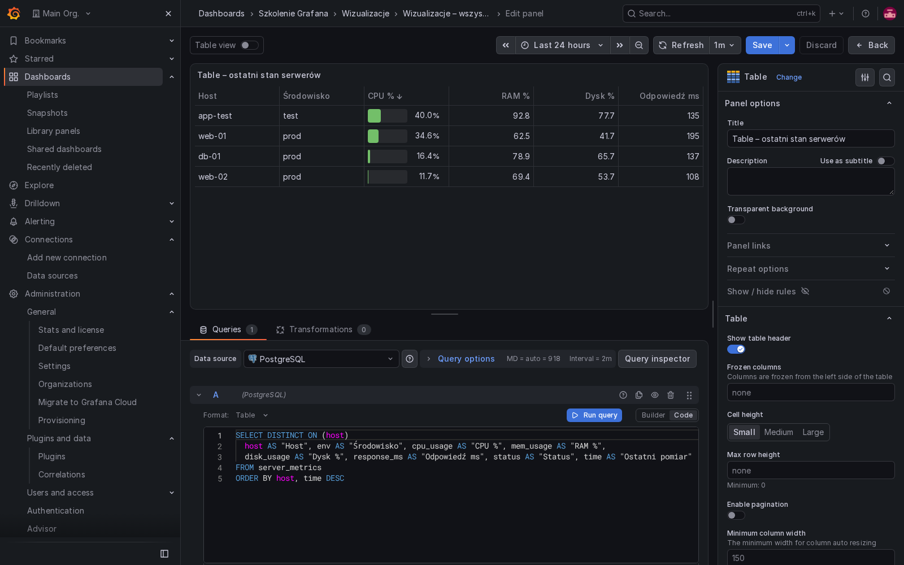
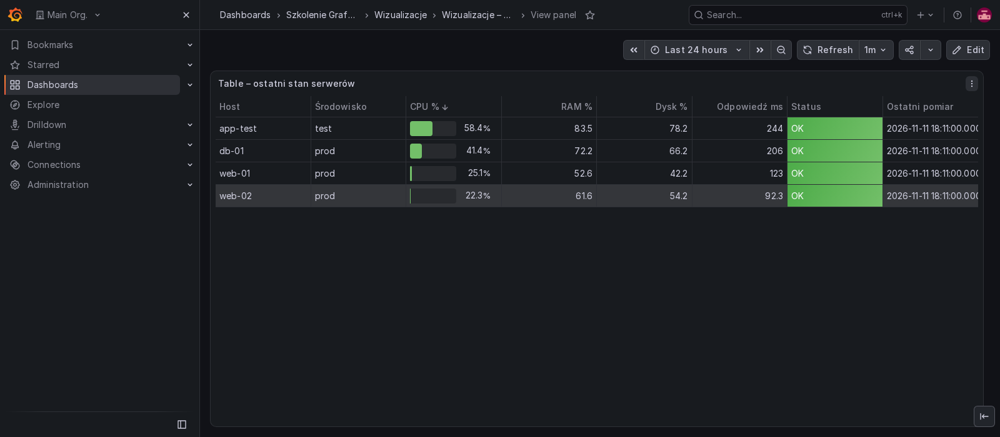

![[Pasted image 20260608074933.png]]
**Table** wyświetla dane w wierszach i kolumnach. To najbardziej uniwersalna wizualizacja w Grafanie: pokaże wynik prawie każdego zapytania, a dzięki typom komórek (paski, kolorowe tło, mapowania wartości) może być czytelna jak mały dashboard w jednym panelu.

## Kiedy używać

- **Stan wielu obiektów naraz** – lista serwerów z kilkoma metrykami, ostatni pomiar, status.
- **Szczegóły do wykresu** – wykres pokazuje trend, a tabela obok dokładne wartości.
- **Dane nieliczbowe** – nazwy, statusy, wersje, adresy, daty.
- **Diagnostyka zapytania** – zanim dobierzesz wizualizację, warto zobaczyć surowe dane. W edytorze każdego panelu służy do tego przełącznik **Table view** nad podglądem.

## Panel w labie

W dashboardzie **Wizualizacje – wszystkie typy** panel **Table – ostatni stan serwerów** pokazuje ostatni pomiar każdego z czterech serwerów z tabeli `server_metrics`.



### Zapytanie

Źródło danych **PostgreSQL**, tryb **Code**, **Format: Table**:

```sql
SELECT DISTINCT ON (host)
  host AS "Host", env AS "Środowisko", cpu_usage AS "CPU %", mem_usage AS "RAM %",
  disk_usage AS "Dysk %", response_ms AS "Odpowiedź ms", status AS "Status", time AS "Ostatni pomiar"
FROM server_metrics
ORDER BY host, time DESC
```

Aliasy w cudzysłowach stają się nagłówkami kolumn – nie trzeba zmieniać nazw w Grafanie. Kolumna `status` w bazie zawiera wartości `ok`, `warning`, `critical`; ich wyświetlanie zmienia mapowanie wartości (niżej).

### Ustawienia całej tabeli

Sekcja **Table** w opcjach panelu:

- **Show table header** – nagłówek z nazwami kolumn (włączony).
- **Frozen columns** – liczba kolumn przyklejonych z lewej przy przewijaniu w poziomie.
- **Cell height** – **Small**, **Medium**, **Large**; **Max row height** – limit wysokości wiersza.
- **Enable pagination** – dzielenie na strony zamiast przewijania.
- **Minimum column width**, **Column width**, **Column alignment** (**Auto**, **Left**, **Center**, **Right**).
- **Wrap text**, **Wrap header text** – zawijanie długich tekstów.
- **Column filter** – ikonka filtra w nagłówku, pozwala zawęzić wiersze do wybranych wartości.
- **Table footer → Calculation** – wiersz podsumowania (np. Mean, Max, Total) pod tabelą; puste pole = brak stopki.
- **Cell options → Cell type** – domyślny typ komórek dla wszystkich kolumn.

Sortowanie: kliknięcie nagłówka kolumny sortuje rosnąco/malejąco. Panel w labie zapisano z sortowaniem malejącym po **CPU %** (strzałka przy nagłówku). Sortowanie zapisuje się w panelu po zapisaniu dashboardu.

### Ustawienia pojedynczych kolumn (overrides)

Wygląd konkretnych kolumn ustawia się przez **Add field override → Fields with name**. W labie są dwa nadpisania:

**Override 1 – kolumna `CPU %`:**
- **Cell options → Cell type**: **Gauge**, **Gauge display mode**: **Gradient** (inne: Basic, Retro LCD).
- **Thresholds**: zielony, 65 pomarańczowy, 85 czerwony.
- **Standard options → Max**: 100, **Unit**: Percent (0-100).

**Override 2 – kolumna `Status`:**
- **Cell options → Cell type**: **Colored background** (**Background display mode**: Basic lub Gradient; opcja **Apply to entire row** koloruje cały wiersz).
- **Value mappings**: `ok` → tekst **OK**, kolor zielony; `warning` → **Ostrzeżenie**, pomarańczowy; `critical` → **Krytyczny**, czerwony.

Pozostałe kolumny mają typ komórki **Auto** – liczby wyrównane do prawej, tekst do lewej.

### Efekt



Na zrzucie podglądu prawą część tabeli zasłania boczny pasek „View panel”; pełną tabelę (z kolumną Status w kolorze i kolumną „Ostatni pomiar”) widać w edytorze i w dashboardzie.

## Przydatne transformacje

Tabela często potrzebuje obróbki danych w zakładce **Transformations** (pod podglądem panelu):

- **Organize fields by name** – zmiana kolejności, ukrywanie i zmiana nazw kolumn bez ruszania zapytania.
- **Join by field** / **Merge series/tables** – połączenie wyników kilku zapytań (A, B) w jedną tabelę.
- **Reduce** – zamiana szeregów czasowych w tabelę „seria → Last / Max / Mean”; przydatne przy danych z Prometheusa.
- **Filter data by values**, **Sort by**, **Limit** – filtrowanie, sortowanie i obcięcie liczby wierszy.

## Typowe pułapki

- **Format: Time series zamiast Table.** Dla zapytań SQL zwracających listę obiektów ustaw w edytorze **Format: Table**. Time series wymaga kolumny czasu i układa dane jak wykres.
- **Mapowanie a wielkość liter.** Value mapping porównuje wartość dokładnie: `ok` to nie `OK`. W labie mapujemy wartości z bazy (`ok`, `warning`, `critical`) na teksty wyświetlane.
- **Override po nazwie.** **Fields with name** odnosi się do nazwy kolumny po aliasie (`CPU %`, nie `cpu_usage`). Po zmianie aliasu w zapytaniu override przestaje działać.
- **Prometheus w tabeli.** Zapytanie zakresowe daje wiele wierszy na serię. Ustaw w zapytaniu **Format: Table** i **Type: Instant** albo użyj transformacji **Reduce**.

## Ćwiczenie w labie

Cel: odtworzyć panel „Table – ostatni stan serwerów” i dodać wiersz podsumowania.

1. Zaloguj się na http://10.123.2.206:3000 (**admin / admin**). W dashboardzie ćwiczeniowym z lekcji Bar gauge (albo nowym: **Dashboards → New → New dashboard**) kliknij **Edit**, a potem w pasku po prawej **+** (**Add**) → **Panel** i na nowym panelu **Configure visualization**.
2. Zakres czasu: **Last 24 hours**. **Data source**: **PostgreSQL**, tryb **Code**, **Format: Table**. Wklej zapytanie z sekcji „Zapytanie” powyżej i kliknij **Run query**.
3. Wybierz wizualizację **Table**. **Title**: `Table – stan serwerów`.
4. Kliknij nagłówek **CPU %** w podglądzie dwa razy – tabela posortuje się malejąco.
5. **Add field override → Fields with name → CPU %**, potem **Add override property**:
   - **Cell options > Cell type** → **Gauge**, **Gauge display mode** → **Gradient**,
   - **Standard options > Max** → `100`, **Standard options > Unit** → Percent (0-100),
   - **Thresholds** → zielony, 65 pomarańczowy, 85 czerwony.
6. Drugi override: **Fields with name → Status**:
   - **Cell options > Cell type** → **Colored background**,
   - **Value mappings** → **Add value mappings** → typ **Value**: `ok` → OK (zielony), `warning` → Ostrzeżenie (pomarańczowy), `critical` → Krytyczny (czerwony).
7. W sekcji **Table**, w części **Table footer**, w polu **Calculation** wybierz **Mean** – pod tabelą pojawi się wiersz ze średnimi.
8. **Save**.

**Oczekiwany efekt:** 4 wiersze (`web-01`, `app-test`, `db-01`, `web-02` – kolejność zależy od bieżącego CPU), kolumna CPU % z paskami, kolumna Status z zielonym tłem i napisem „OK” (pomarańczowym przy „Ostrzeżenie”), pod spodem wiersz ze średnimi. Porównaj z panelem **Table – ostatni stan serwerów** w dashboardzie „Wizualizacje – wszystkie typy” – różni się tylko stopką.
