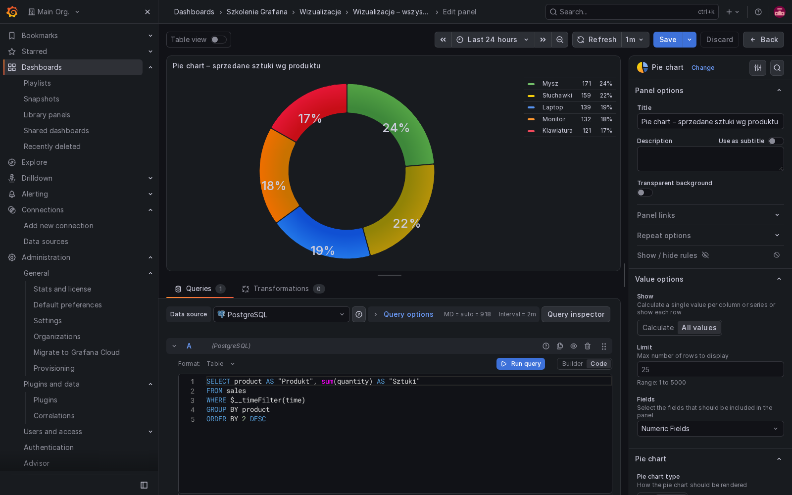
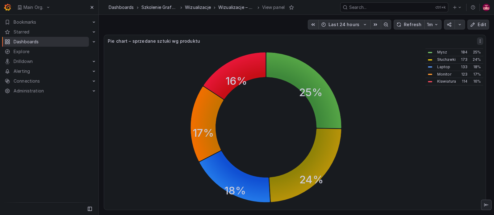

![[Pasted image 20260608074943.png]]

**Pie chart** to wykres kołowy (lub pierścieniowy – donut), w którym każdy wycinek odpowiada udziałowi jednej kategorii w całości. Sprawdza się tylko wtedy, gdy wartości naprawdę **sumują się do sensownej całości**: sprzedaż w podziale na produkty, ruch w podziale na typ żądań, liczba logów w podziale na poziom.

## Kiedy używać, a kiedy nie

Dobrze:
- **Struktura całości** – jaki procent sprzedaży dał każdy produkt, jaki udział mają błędy wśród wszystkich logów.
- **Kilka kategorii** – 2 do ok. 6 wycinków. Przy większej liczbie kategorii wykres przestaje być czytelny.

Źle:
- **Wartości, które się nie sumują** – np. CPU% kilku serwerów. Suma 35% + 36% + 17% + 14% nie jest „całością”, więc procenty wycinków nic nie znaczą. Do porównania hostów użyj Bar gauge lub Bar chart.
- **Zmiany w czasie** – wykres kołowy pokazuje jedną chwilę lub sumę z okresu; trend pokaże Time series.
- **Podobne wartości** – oko słabo porównuje kąty. Gdy wycinki mają 18%, 18% i 22%, czytelniejszy będzie Bar chart.

## Panel w labie

W dashboardzie **Wizualizacje – wszystkie typy** panel **Pie chart – sprzedane sztuki wg produktu** pokazuje, ile sztuk każdego produktu sprzedano w wybranym zakresie czasu (tabela `sales` w PostgreSQL).



### Zapytanie

Źródło danych **PostgreSQL**, tryb **Code**, **Format: Table**:

```sql
SELECT product AS "Produkt", sum(quantity) AS "Sztuki"
FROM sales
WHERE $__timeFilter(time)
GROUP BY product
ORDER BY 2 DESC
```

Makro `$__timeFilter(time)` ogranicza dane do zakresu czasu dashboardu – po zmianie zakresu z 24 godzin na 7 dni wartości urosną, a proporcje się przesuną. Wynik to 5 wierszy (Mysz, Słuchawki, Laptop, Monitor, Klawiatura): jedna kolumna tekstowa i jedna liczbowa.

### Ustawienia

| Sekcja | Opcja | Wartość w labie |
|---|---|---|
| Value options | **Show** | **All values** – każdy wiersz tabeli to osobny wycinek |
| Value options | **Limit** | 25 (domyślnie) – maksymalna liczba wierszy |
| Value options | **Fields** | Numeric Fields |
| Pie chart | **Pie chart type** | **Donut** (druga opcja: **Pie**) |
| Pie chart | **Slice sorting** | Descending (inne: Ascending, None) |
| Pie chart | **Labels** | **Percent** (do wyboru także **Name** i **Value**, można kilka naraz) |
| Legend | **Mode** / **Placement** | **Table** / **Right** |
| Legend | **Legend values** | **Value** i **Percent** |
| Standard options | **Color scheme** | Classic palette |

Kolumna tekstowa (`Produkt`) daje nazwy wycinków, kolumna liczbowa (`Sztuki`) – ich wielkość. Procenty liczy Grafana z sumy wszystkich wierszy.

### Efekt



Na podglądzie legendę zasłania boczny pasek „View panel”; w edytorze (pierwszy zrzut) widać ją w trybie tabeli: nazwa, liczba sztuk i procent.

## Typowe pułapki

- **Show: Calculate przy danych tabelarycznych.** Wtedy cała kolumna `Sztuki` jest redukowana do jednej liczby i powstaje jeden wycinek = 100%. Dla zapytania SQL w formacie Table ustaw **All values**.
- **Szeregi czasowe.** Przy danych z Prometheusa (np. `sum by (mode) (rate(node_cpu_seconds_total[$__rate_interval]))`) zostaw **Show: Calculate** i wybierz obliczenie (np. **Last \*** lub **Mean**) – każdy szereg zostanie zredukowany do jednej liczby i da jeden wycinek.
- **Brak `$__timeFilter`.** Bez filtra czasu zapytanie zsumuje całą tabelę, a panel nie zareaguje na zmianę zakresu czasu.
- **Za dużo wycinków.** Ogranicz kategorie w zapytaniu (`LIMIT 5`) albo zmniejsz **Limit** w Value options.
- **Kolory zbliżone do siebie.** Klasyczna paleta może dać dwa podobne odcienie (w labie Monitor i Laptop są pomarańczowe). Konkretny kolor przypiszesz przez **Add field override → Fields with name** lub klikając kolor przy pozycji legendy.

## Ćwiczenie w labie

Cel: wykres kołowy **wartości sprzedaży w podziale na regiony**.

1. Zaloguj się na http://10.123.2.206:3000 (**admin / admin**). W dashboardzie ćwiczeniowym z lekcji Bar gauge (albo nowym: **Dashboards → New → New dashboard**) kliknij **Edit**, a potem w pasku po prawej **+** (**Add**) → **Panel** i na nowym panelu **Configure visualization**.
2. Zakres czasu: **Last 24 hours**. **Data source**: **PostgreSQL**, tryb **Code**, **Format: Table**:

   ```sql
   SELECT region AS "Region", sum(amount) AS "Sprzedaż"
   FROM sales
   WHERE $__timeFilter(time)
   GROUP BY region
   ORDER BY 2 DESC
   ```

   **Run query** – 5 regionów (Śląskie, Pomorskie, Mazowieckie, Małopolskie, Wielkopolskie).
3. Wizualizacja: **Pie chart**. **Title**: `Pie chart – sprzedaż wg regionu`.
4. **Value options → Show**: **All values**.
5. **Pie chart → Pie chart type**: **Pie**. **Labels**: **Name** i **Percent**.
6. **Legend**: **Mode** = Table, **Placement** = Right, **Legend values** = Value, Percent.
7. **Standard options → Unit**: w wyszukiwarce wpisz `PLN` i wybierz złotówki (**Currency → Polish Złoty (PLN)**).
8. **Save**.

**Oczekiwany efekt:** pełne koło z 5 wycinkami o zbliżonej wielkości (po kilkanaście–dwadzieścia kilka procent), na wycinkach nazwa regionu i procent, w legendzie kwota w PLN i procent. Te same dane pokazuje panel **Bar chart – sprzedaż wg regionu** w dashboardzie „Wizualizacje – wszystkie typy” – porównaj, na którym wykresie łatwiej odczytać, który region jest drugi.
