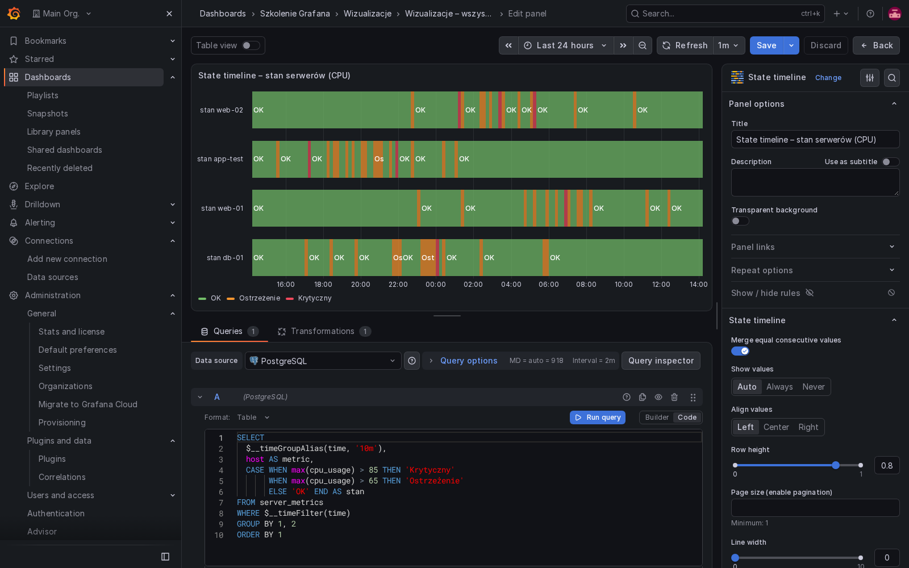
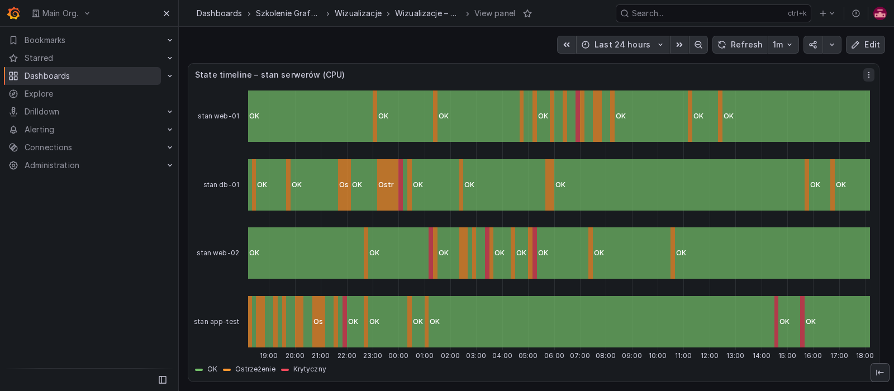

![[Pasted image 20260608075236.png]]

**State timeline** pokazuje, w jakim **stanie** był każdy obiekt w kolejnych chwilach. Każdy obiekt (host, usługa, czujnik) ma własny poziomy pasek, a pasek jest podzielony na odcinki – kolor odcinka to stan, długość to czas trwania. Od razu widać, kiedy i jak długo coś było w stanie ostrzegawczym albo krytycznym.

## Kiedy używać

- **Stany dyskretne** – OK / Ostrzeżenie / Krytyczny, UP / DOWN, ON / OFF, tryb pracy urządzenia.
- **Wartości liczbowe zamienione na stany** – np. CPU powyżej progu, temperatura w strefach (kolory z progów).
- **Analiza incydentów** – na jednym widoku: który host miał problem, o której i jak długo.

State timeline **łączy kolejne takie same wartości w jeden odcinek** (opcja **Merge equal consecutive values**), więc długie okresy „OK” są jednym zielonym blokiem. Jeśli chcesz zobaczyć każdą próbkę osobno, w równych kratkach – użyj **Status history** (następna lekcja).

## Panel w labie

W dashboardzie **Wizualizacje – wszystkie typy** panel **State timeline – stan serwerów (CPU)** pokazuje stan każdego z czterech serwerów w 10-minutowych przedziałach, wyliczony z maksymalnego obciążenia CPU.



### Zapytanie

Źródło danych **PostgreSQL**, tryb **Code**, **Format: Table**:

```sql
SELECT
  $__timeGroupAlias(time, '10m'),
  host AS metric,
  CASE WHEN max(cpu_usage) > 85 THEN 'Krytyczny'
       WHEN max(cpu_usage) > 65 THEN 'Ostrzeżenie'
       ELSE 'OK' END AS stan
FROM server_metrics
WHERE $__timeFilter(time)
GROUP BY 1, 2
ORDER BY 1
```

- `$__timeGroupAlias(time, '10m')` grupuje pomiary w 10-minutowe przedziały i nazywa kolumnę `time`.
- `CASE` zamienia maksymalne CPU w przedziale na **tekst stanu**: powyżej 85% – Krytyczny, powyżej 65% – Ostrzeżenie, w przeciwnym razie OK.
- Wynik jest w formacie „długim”: kolumny `time`, `metric` (host), `stan` – po jednym wierszu na host i przedział (ok. 580 wierszy dla 24 godzin).

### Transformacja: Partition by values

State timeline rysuje **jeden pasek na pole (kolumnę) z wartościami**. W danych „długich” wszystkie hosty są wymieszane w jednej kolumnie `stan`, więc trzeba je rozdzielić. Robi to zakładka **Transformations** pod podglądem:

- **Partition by values** (transformacja oznaczona jako *Alpha*),
- **Field**: `metric`,
- **Naming**: **As frame name** (druga opcja: As label),
- **Keep fields**: **No** – kolumna `metric` nie trafia do wyniku.

Po transformacji powstają cztery osobne zestawy danych – po jednym na host – a panel rysuje cztery paski: `stan app-test`, `stan web-02`, `stan web-01`, `stan db-01` (nazwa kolumny wartości + wartość z `metric`).

### Value mappings – kolory stanów

Stany są tekstem, więc progi (Thresholds) nic tu nie dadzą – kolory nadaje się przez **Value mappings** (typ **Value**):

| Wartość | Kolor |
|---|---|
| `OK` | zielony |
| `Ostrzeżenie` | pomarańczowy |
| `Krytyczny` | czerwony |

**Color scheme** w Standard options to **Single color** (zielony) – kolory z mapowań mają pierwszeństwo. Legenda pod wykresem (OK, Ostrzeżenie, Krytyczny) powstaje automatycznie z mapowań.

### Opcje wizualizacji

Sekcja **State timeline**:

- **Merge equal consecutive values** – włączone; sąsiednie takie same stany łączą się w jeden odcinek.
- **Show values** – **Auto** (napis pokazuje się, gdy mieści się w odcinku), **Always**, **Never**.
- **Align values** – **Left**, **Center**, **Right**.
- **Row height** – 0.8 (wysokość paska względem dostępnego miejsca, 0–1).
- **Page size (enable pagination)** – stronicowanie przy wielu obiektach.
- **Line width**, **Fill opacity** – obramowanie i krycie odcinków.
- **Connect null values** (**Never**, **Always**, **Threshold**) i **Disconnect values** – co zrobić z brakami danych.

### Efekt



Długie zielone odcinki to okresy spokoju, wąskie pomarańczowe i czerwone – krótkie skoki CPU. Krótkie odcinki mają ucięte etykiety (np. „Os”, „Ostr”) – przy **Show values: Auto** Grafana pokazuje tyle tekstu, ile się zmieści. Szczegóły odcinka zobaczysz w podpowiedzi po najechaniu myszą.

## Typowe pułapki

- **Brak transformacji.** Bez **Partition by values** dane z jednej kolumny `stan` nie rozdzielą się na hosty – nie dostaniesz osobnego paska dla każdego serwera.
- **Format Time series przy tekstach.** Kolumna stanu jest tekstowa; w labie zapytanie ma **Format: Table**, a podział na hosty robi transformacja.
- **Mapowanie musi pasować dokładnie.** `Ostrzeżenie` w mapowaniu i w zapytaniu muszą być identyczne (wielkość liter, polskie znaki). Niezmapowana wartość dostanie kolor z **Color scheme**.
- **Za drobne przedziały.** Przy przedziale 1 minuta i zakresie 7 dni odcinków jest tysiące – zwiększ przedział w `$__timeGroupAlias` albo skróć zakres czasu.
- **Dane liczbowe.** State timeline działa także na liczbach: wtedy kolory dają **Thresholds** z **Color scheme: From thresholds (by value)**, a **Show values** pokazuje liczby.

## Ćwiczenie w labie

Cel: odtworzyć panel stanu serwerów, a potem zrobić wariant liczbowy z progami.

**Część 1 – stany tekstowe**

1. Zaloguj się na http://10.123.2.206:3000 (**admin / admin**). W dashboardzie ćwiczeniowym z lekcji Bar gauge (albo nowym: **Dashboards → New → New dashboard**) kliknij **Edit**, a potem w pasku po prawej **+** (**Add**) → **Panel** i na nowym panelu **Configure visualization**. Zakres czasu: **Last 24 hours**.
2. **Data source**: **PostgreSQL**, tryb **Code**, **Format: Table**. Wklej zapytanie z sekcji „Zapytanie” i kliknij **Run query**.
3. Wizualizacja: **State timeline**. **Title**: `State timeline – stan serwerów`. Na razie wykres nie pokazuje osobnych pasków dla hostów.
4. Zakładka **Transformations → Add transformation** → wyszukaj **Partition by values**. **Field**: `metric`, **Naming**: As frame name, **Keep fields**: No. Pojawią się 4 paski.
5. **Value mappings → Add value mappings** → trzy wiersze typu **Value**: `OK` (zielony), `Ostrzeżenie` (pomarańczowy), `Krytyczny` (czerwony).
6. **Standard options → Color scheme**: **Single color**.
7. **Save**.

**Oczekiwany efekt:** cztery paski `stan …` z przewagą zieleni i krótkimi pomarańczowymi/czerwonymi odcinkami oraz legenda OK / Ostrzeżenie / Krytyczny – tak jak panel **State timeline – stan serwerów (CPU)** w dashboardzie „Wizualizacje – wszystkie typy”.

**Część 2 – wariant liczbowy (bez transformacji)**

1. Dodaj kolejny panel State timeline z PostgreSQL, tym razem **Format: Time series**:

   ```sql
   SELECT
     $__timeGroupAlias(time, '10m'),
     host AS metric,
     avg(cpu_usage) AS "CPU %"
   FROM server_metrics
   WHERE $__timeFilter(time)
   GROUP BY 1, 2
   ORDER BY 1
   ```

   W formacie Time series kolumna `metric` od razu dzieli dane na szeregi `app-test`, `db-01`, `web-01`, `web-02` – transformacja nie jest potrzebna.
2. **Standard options**: **Unit** = Percent (0-100), **Color scheme** = **From thresholds (by value)**.
3. **Thresholds**: zielony Base, **40** pomarańczowy, **55** czerwony. (Średnie CPU w 10 minut rzadko przekracza 60%, dlatego progi są niższe niż w części 1, gdzie liczyliśmy maksimum.)
4. **State timeline → Show values**: **Never**.

**Oczekiwany efekt:** te same cztery hosty, ale kolory wynikają z progów średniego CPU, a podpowiedź pokazuje liczby w procentach. Porównaj, który wariant jest czytelniejszy dla dyżurnego.
