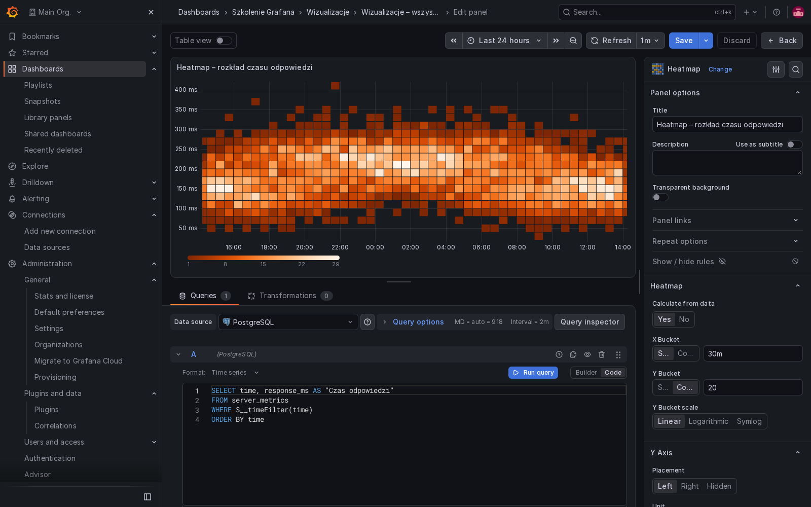
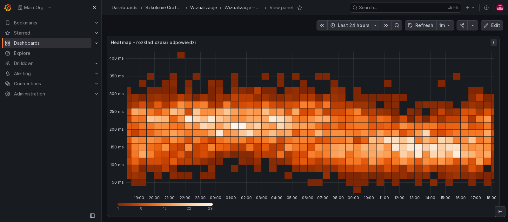

![[Pasted image 20260608075243.png]]

**Heatmap** (mapa ciepła) pokazuje **rozkład wartości w czasie**. Oś X to czas, oś Y to przedziały wartości (np. 100–120 ms), a kolor komórki mówi, **ile pomiarów** wpadło do danego przedziału w danym okresie. Dzięki temu na jednym wykresie widać nie tylko średnią, ale też rozrzut i rzadkie, odstające wartości.

## Kiedy używać

- **Czasy odpowiedzi i opóźnienia** – średnia może być dobra, a mimo to część żądań trwa bardzo długo; heatmapa to pokaże.
- **Duża liczba pomiarów** – tysiące punktów, których nie da się czytelnie narysować jako linii.
- **Histogramy z Prometheusa** – metryki typu `*_bucket` (np. `http_request_duration_seconds_bucket`) są już podzielone na przedziały i heatmapa rysuje je bezpośrednio.

Heatmapa **nie służy do porównywania hostów** (to zadanie dla Time series lub State timeline) – odpowiada na pytanie „jak rozkładały się wartości i jak ten rozkład zmieniał się w czasie”. Rozkład bez osi czasu pokazuje Histogram (lekcja 11).

## Panel w labie

W dashboardzie **Wizualizacje – wszystkie typy** panel **Heatmap – rozkład czasu odpowiedzi** pokazuje wszystkie pomiary czasu odpowiedzi (`response_ms`) czterech serwerów z ostatniej doby.



### Zapytanie

Źródło danych **PostgreSQL**, tryb **Code**, **Format: Time series**:

```sql
SELECT time, response_ms AS "Czas odpowiedzi"
FROM server_metrics
WHERE $__timeFilter(time)
ORDER BY time
```

Zapytanie zwraca **surowe pomiary** – ok. 5760 punktów na dobę (4 hosty × 1440 minut). Nie grupujemy ich w SQL; przedziały policzy Grafana.

### Ustawienia

Sekcja **Heatmap**:

| Opcja | Wartość w labie | Znaczenie |
|---|---|---|
| **Calculate from data** | **Yes** | Grafana sama dzieli surowe punkty na komórki |
| **X Bucket** | **Size** = `30m` | każda kolumna to 30 minut |
| **Y Bucket** | **Count** = `20` | zakres wartości podzielony na ok. 20 przedziałów |
| **Y Bucket scale** | **Linear** | (inne: Logarithmic, Symlog) |

Pozostałe sekcje:

- **Y Axis** – **Placement** (Left / Right / Hidden), **Unit** = milliseconds (ms), **Decimals**, **Min value** / **Max value**, **Reverse**.
- **Colors** – **Mode** = **Scheme** (druga opcja: **Opacity** – jeden kolor o różnym kryciu), **Scheme** = **Oranges**, **Steps** = 64 (liczba odcieni, 2–128), **Reverse**, **Start color scale from value** / **End color scale at value**.
- **Cell display** – **Unit**, **Decimals**, **Cell gap** = 1 (odstęp między komórkami w pikselach), **Hide cells with values <=** / **>=** (ukrywanie pustych lub skrajnych komórek).
- **Tooltip** – **Tooltip mode**, **Show histogram (Y axis)** – w podpowiedzi mały histogram dla wskazanej kolumny.
- **Legend → Show legend** – pasek z kolorami i liczbami pod wykresem.

### Efekt



Jak czytać: najjaśniejsze komórki (ok. 150–250 ms) to najczęstsze czasy odpowiedzi – w 30-minutowym oknie trafia tam do ok. 29 pomiarów (skala pod wykresem: od 1 do 29). Ciemne, pojedyncze kwadraty na górze (300–400 ms) to rzadkie, wolne odpowiedzi. Widać też, że w ciągu doby „jasne pasmo” przesuwa się w górę i w dół – czasy odpowiedzi zmieniają się wraz z obciążeniem.

## Calculate from data: Yes czy No

- **Yes** – dane to zwykłe pomiary (SQL, InfluxDB, Elasticsearch, gauge z Prometheusa). Grafana liczy przedziały według **X Bucket** i **Y Bucket**.
- **No** – dane są **już podzielone na przedziały**, np. histogram z Prometheusa:

  ```promql
  sum by (le) (rate(prometheus_http_request_duration_seconds_bucket[$__rate_interval]))
  ```

  Wtedy w opcjach zapytania Prometheus ustawia się **Format: Heatmap**, a w panelu **Calculate from data: No**. Granice przedziałów biorą się z etykiety `le`.

## Typowe pułapki

- **Zgrupowane dane w zapytaniu.** Jeśli w SQL policzysz `avg()` na 30 minut, heatmapa dostanie jedną wartość na kolumnę – zniknie cały rozkład. Do heatmapy podaje się surowe pomiary albo gotowe kubełki.
- **Za mało danych na komórkę.** Przy X Bucket = 1 minuta i 4 hostach w każdej kolumnie są tylko 4 punkty – mapa robi się „dziurawa”. Zwiększ **X Bucket** (`15m`, `30m`, `1h`).
- **Pojedyncze skrajne wartości.** Jedna odpowiedź 5000 ms rozciąga oś Y i spłaszcza resztę. Pomaga **Y Axis → Max value** lub **Y Bucket scale: Logarithmic**.
- **Kolor to liczba pomiarów, nie wartość.** Jasna komórka nie oznacza „wysokiego czasu odpowiedzi”, tylko „dużo pomiarów w tym przedziale”. Wysokość odpowiedzi czytamy z osi Y.

## Ćwiczenie w labie

Cel: heatmapa **obciążenia CPU** serwerów i porównanie jej z panelem czasu odpowiedzi.

1. Zaloguj się na http://10.123.2.206:3000 (**admin / admin**). W dashboardzie ćwiczeniowym z lekcji Bar gauge (albo nowym: **Dashboards → New → New dashboard**) kliknij **Edit**, a potem w pasku po prawej **+** (**Add**) → **Panel** i na nowym panelu **Configure visualization**. Zakres czasu: **Last 24 hours**.
2. **Data source**: **PostgreSQL**, tryb **Code**, **Format: Time series**:

   ```sql
   SELECT time, cpu_usage AS "CPU %"
   FROM server_metrics
   WHERE $__timeFilter(time)
   ORDER BY time
   ```

   **Run query**.
3. Wizualizacja: **Heatmap**. **Title**: `Heatmap – rozkład CPU`.
4. **Heatmap**: **Calculate from data** = Yes, **X Bucket** = Size, `30m`, **Y Bucket** = Count, `20`.
5. **Y Axis → Unit**: Percent (0-100).
6. **Colors**: **Mode** = Scheme, **Scheme** = wybierz inną paletę niż w labie (np. **Blues** lub **Spectral**), **Steps** = 64.
7. **Cell display → Cell gap**: `1`.
8. Włącz **Tooltip → Show histogram (Y axis)** i najedź myszą na kilka kolumn – podpowiedź pokaże rozkład wartości w całej kolumnie.
9. **Save**.

**Oczekiwany efekt:** mapa, na której większość pomiarów mieści się mniej więcej w przedziale 20–50% CPU, a nieliczne komórki powyżej 65% są ciemne (pojedyncze pomiary). Pasmo przesuwa się w ciągu doby, bo obciążenie serwerów w labie zmienia się falami. Porównaj z panelem **Heatmap – rozkład czasu odpowiedzi** w dashboardzie „Wizualizacje – wszystkie typy”: ten sam typ panelu i te same ustawienia kubełków, inne dane. Na koniec zmień **X Bucket** na `5m` i zobacz, jak mapa staje się mniej czytelna.
