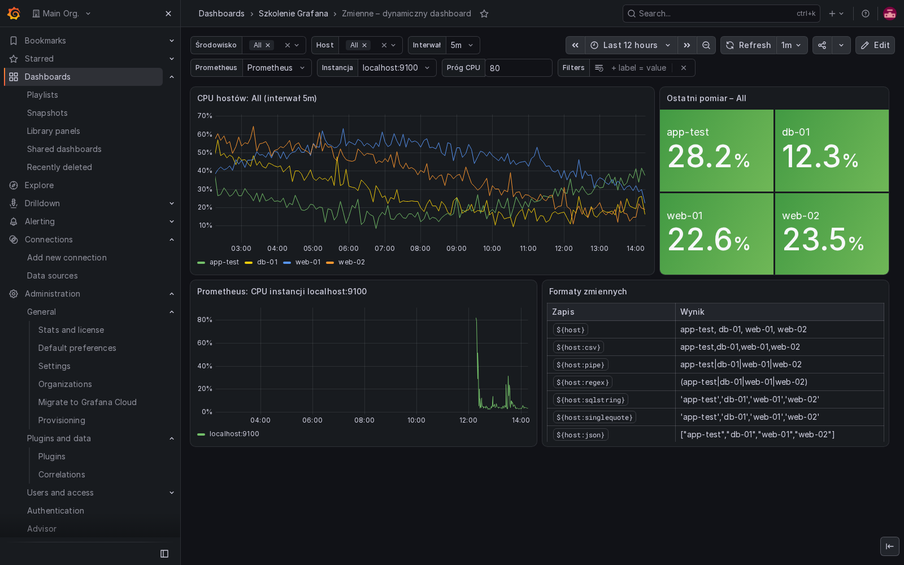
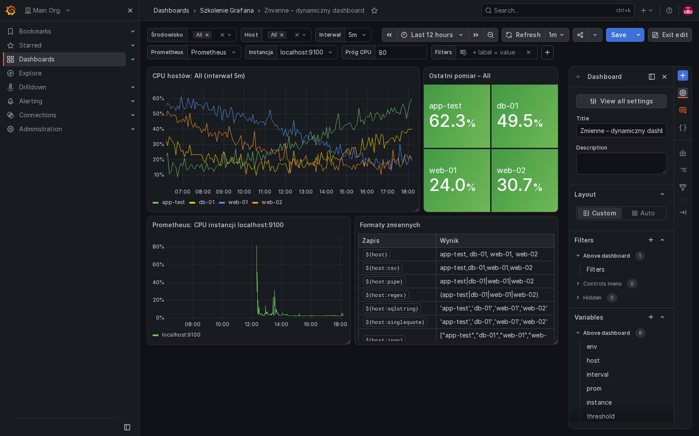
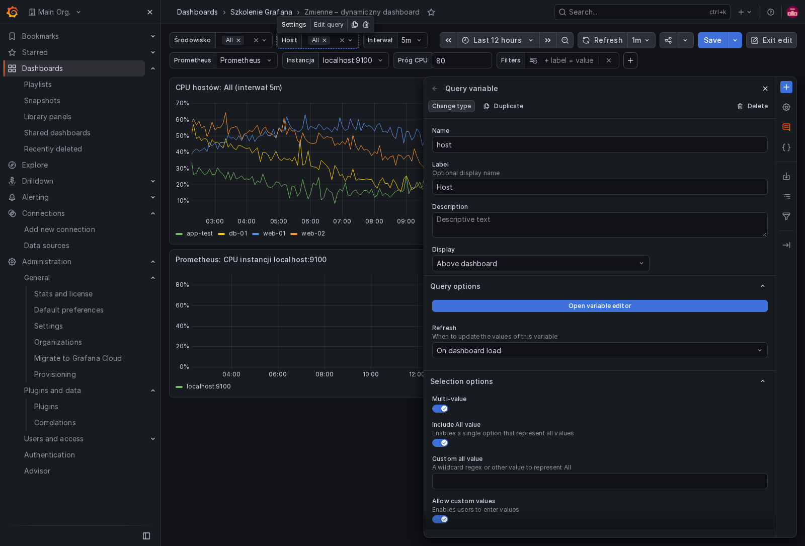
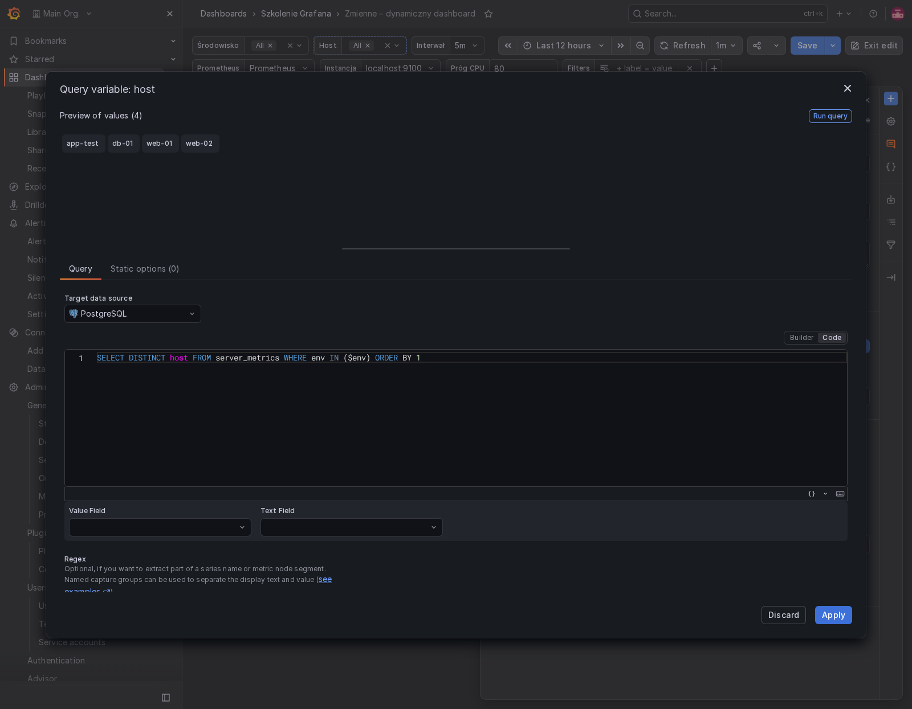
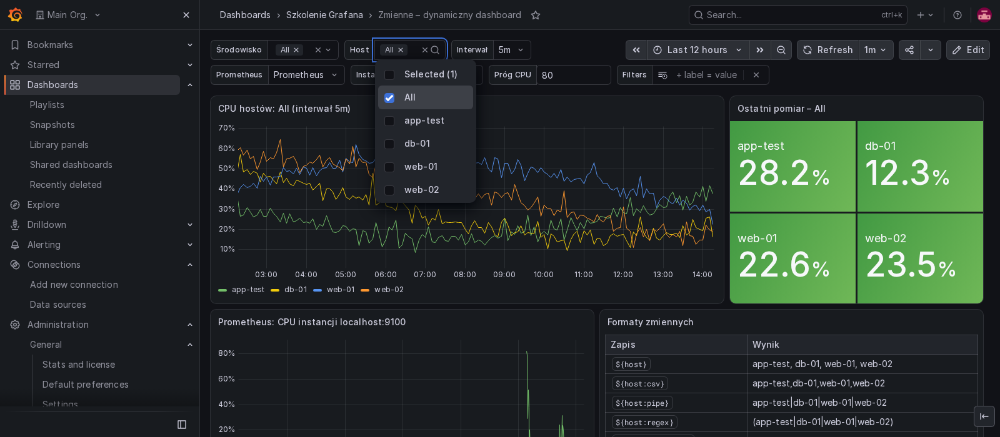

**Zmienne** (ang. *variables*) to wartości, które Grafana podstawia do zapytań, tytułów paneli i linków w chwili wyświetlania dashboardu. Zamiast budować osobny panel dla każdego hosta, środowiska czy źródła danych, budujesz jeden panel z zapytaniem zawierającym np. `$host`, a użytkownik wybiera wartość z listy nad dashboardem.

W labie wszystkie przykłady z tego modułu są na dashboardzie **Szkolenie Grafana → Zmienne – dynamiczny dashboard** (uid `zmienne`):



Nad panelami widać zmienne: **Środowisko** (`env`), **Host** (`host`), **Interwał** (`interval`), **Prometheus** (`prom`), **Instancja** (`instance`), **Próg CPU** (`threshold`) oraz pole **Filters** (filtr ad hoc). Tytuły paneli też korzystają ze zmiennych – „CPU hostów: All (interwał 5m)” powstaje z tytułu `CPU hostów: ${host} (interwał $interval)`.

---

## Gdzie edytuje się zmienne w Grafanie 13

W Grafanie 13 zmienne są częścią **trybu edycji dashboardu** i paska bocznego. Klasyczne **Settings → Variables** nie służy już do edycji – po wejściu w *Edit → View all settings → Variables* zobaczysz tylko komunikat, że ustawienia przeniesiono do paska bocznego.

### Lista zmiennych w pasku bocznym

1. Otwórz dashboard i kliknij **Edit** (prawy górny róg).
2. Po prawej otworzy się pasek boczny z panelem **Dashboard** (ikona zębatki – *Options*). Pod polami Title / Description / Layout są sekcje **Filters**, **Variables**, **Annotations** i **Links**.
3. Sekcja **Variables** grupuje zmienne według miejsca wyświetlania: **Above dashboard** (nad panelami), **Controls menu** (w menu kontrolek) i **Hidden** (ukryte). Filtr ad hoc jest pokazany osobno w sekcji **Filters**.



Nową zmienną dodasz na trzy sposoby:
- przycisk **+** przy nagłówku **Variables** w pasku bocznym,
- niebieski przycisk **+** (dodaj element) na pionowym pasku po prawej → *Variable*,
- przycisk **+** na końcu wiersza zmiennych nad dashboardem (widoczny tylko w trybie edycji).

### Edycja istniejącej zmiennej

W trybie edycji najedź lub kliknij etykietę zmiennej nad dashboardem. Pojawi się małe menu:
- **Settings | Edit query** – dla zmiennej typu Query,
- **Settings | Edit values** – dla zmiennej typu Custom,
- **Settings** – dla pozostałych typów,
- oraz ikony *Duplicate* i *Delete*.

**Settings** otwiera w pasku bocznym panel edycji zmiennej. Dla zmiennej `host` wygląda on tak:



Wspólne pola wszystkich typów:

| Pole | Znaczenie |
|------|-----------|
| **Change type** | zmiana typu zmiennej (Query, Custom, Interval…) |
| **Duplicate** / ikona kosza | kopia / usunięcie zmiennej |
| **Name** | nazwa używana w zapytaniach: `host` → `$host` |
| **Label** | etykieta widoczna nad dashboardem, np. „Host” (opcjonalna) |
| **Description** | opis (podpowiedź) |
| **Display** | *Above dashboard*, *Controls menu* albo *Hidden* |

Dla zmiennej typu Query dochodzą:
- **Query options → Open variable editor** – okno z zapytaniem (opis niżej),
- **Refresh** – kiedy odświeżać listę wartości: *On dashboard load* albo *On time range change* (gdy zapytanie zależy od zakresu czasu),
- **Selection options**:
  - **Multi-value** – można zaznaczyć kilka wartości naraz,
  - **Include All value** – na liście pojawia się opcja **All**,
  - **Custom all value** – co ma zostać podstawione, gdy wybrano All (np. `.*` dla Prometheusa); puste pole = Grafana podstawia listę wszystkich wartości,
  - **Allow custom values** – użytkownik może wpisać wartość spoza listy.

### Okno Open variable editor

Przycisk **Open variable editor** otwiera okno z pełnym edytorem zapytania:



- **Preview of values (4)** – wynik zapytania (`app-test`, `db-01`, `web-01`, `web-02`), przycisk **Run query** wykonuje je ponownie,
- zakładki **Query** i **Static options** (stałe pozycje dopisywane do listy niezależnie od zapytania),
- **Target data source** – źródło danych, z którego pobierana jest lista (tu PostgreSQL),
- edytor zapytania w trybie **Builder** albo **Code**,
- **Value Field** / **Text Field** – która kolumna jest wartością, a która tekstem na liście (gdy zapytanie zwraca dwie kolumny),
- **Regex** – opcjonalne filtrowanie/wycinanie fragmentu wartości (z nazwanymi grupami `text` i `value`),
- **Discard** / **Apply** – odrzucenie lub zastosowanie zmian.

Zapytanie zmiennej `host` w labie:

```sql
SELECT DISTINCT host FROM server_metrics WHERE env IN ($env) ORDER BY 1
```

Zmiany w zmiennych, jak wszystkie zmiany w trybie edycji, zapisujesz przyciskiem **Save** (i wychodzisz przez **Exit edit**).

---

## Użycie zmiennych w panelach

Zmienną wstawiasz do zapytania jako `$nazwa` albo `${nazwa}`. Panel „CPU hostów” w labie ma zapytanie:

```sql
SELECT
  $__timeGroupAlias(time, '$interval'),
  host AS metric,
  avg(cpu_usage) AS cpu
FROM server_metrics
WHERE $__timeFilter(time)
  AND host IN ($host)
GROUP BY 1, 2
ORDER BY 1
```

- `$host` – zmienna wielowartościowa; źródła SQL same zamieniają listę na `'app-test','db-01',...`, więc pasuje do `IN (...)`,
- `$interval` – zmienna typu Interval (szerokość kubełka czasu),
- `$__timeFilter(time)` i `$__timeGroupAlias(...)` – to **makra** źródła SQL, a nie zmienne dashboardu.

Zmienne działają też w **tytułach paneli** (`Ostatni pomiar – ${host}`), opisach, linkach i w polach tekstowych panelu Text.

Wybór wartości z listy (zmienna z Multi-value i Include All):



### Wartość All

Gdy wybrano **All**, Grafana zapisuje wewnętrznie specjalną wartość `$__all` (widać ją np. w adresie URL dashboardu: `var-host=$__all`). Przy podstawianiu do zapytania:
- jeśli **Custom all value** jest puste – podstawiana jest lista wszystkich wartości z listy,
- jeśli jest ustawione (np. `.*`) – podstawiana jest dokładnie ta wartość, bez cudzysłowów i bez escape'owania. Dla Prometheusa: `instance=~"$instance"` + Custom all value `.*` daje krótkie zapytanie zamiast długiej listy.

---

## Zmienne wbudowane (globalne)

Oprócz własnych zmiennych w zapytaniach można używać zmiennych wbudowanych:

| Zmienna | Znaczenie |
|---------|-----------|
| `$__interval` | interwał wyliczony przez Grafanę z zakresu czasu i szerokości panelu (np. `1m`) |
| `$__interval_ms` | to samo w milisekundach |
| `$__rate_interval` | interwał dla `rate()`/`increase()` w Prometheusie – nigdy mniejszy niż 4× scrape interval; zalecany zamiast `$__interval` w funkcjach `rate` |
| `$__range` | długość wybranego zakresu czasu (np. `12h`) |
| `$__from`, `$__to` | początek i koniec zakresu (ms od epoki) |
| `$__dashboard` | nazwa dashboardu |
| `$__user.login`, `$__org.name` | zalogowany użytkownik, organizacja |

Przykład z labu (panel „Prometheus: CPU instancji”):

```promql
100 * (1 - avg by (instance) (rate(node_cpu_seconds_total{mode="idle", instance="$instance"}[$__rate_interval])))
```

---

## Podsumowanie

- W Grafanie 13 zmienne edytujesz w trybie **Edit**: pasek boczny **Dashboard → Variables** albo klik w etykietę zmiennej → **Settings / Edit query**.
- Zakładka Settings → Variables pokazuje tylko informację o przeniesieniu.
- Najważniejsze opcje: **Refresh**, **Multi-value**, **Include All value**, **Custom all value**, **Display**.
- Zmienne podstawiasz jako `$nazwa` / `${nazwa}` w zapytaniach, tytułach i linkach; `$__interval` i `$__rate_interval` to zmienne wbudowane.

---

## Ćwiczenie w labie

Grafana: http://10.123.2.206:3000 (admin / admin).

1. Otwórz **Dashboards → Szkolenie Grafana → Zmienne – dynamiczny dashboard**.
2. Z listy **Host** wybierz tylko `web-01` i `db-01`. Sprawdź, że tytuł panelu „CPU hostów” pokazuje teraz wybrane hosty zamiast „All”, a panel Stat ma dwa kafelki.
3. Kliknij **Edit**, potem etykietę **Host** → **Settings**. Odczytaj w pasku bocznym: Refresh, Multi-value, Include All value.
4. Kliknij **Open variable editor** i **Run query** – w *Preview of values* powinny być 4 hosty. Zamknij przez **Discard**.
5. Dodaj własną zmienną: przycisk **+** przy **Variables** → typ **Custom**, Name `metryka`, wartości `cpu_usage,mem_usage,disk_usage`, Label „Metryka”.
6. W panelu „CPU hostów” (menu panelu → **Edit**) zamień `avg(cpu_usage)` na `avg($metryka)` i zmień tytuł na `${metryka}: ${host}`. Wróć do dashboardu. (Zmienna jest jednowartościowa, więc źródło SQL wstawi ją bez cudzysłowów – jako nazwę kolumny.)
7. **Oczekiwany efekt:** wybór „mem_usage” z nowej listy przełącza wykres na zajętość pamięci, a tytuł panelu pokazuje wybraną metrykę. Nie zapisuj zmian – wyjdź przez **Exit edit** i odrzuć zmiany, chyba że prowadzący poprosi inaczej.
