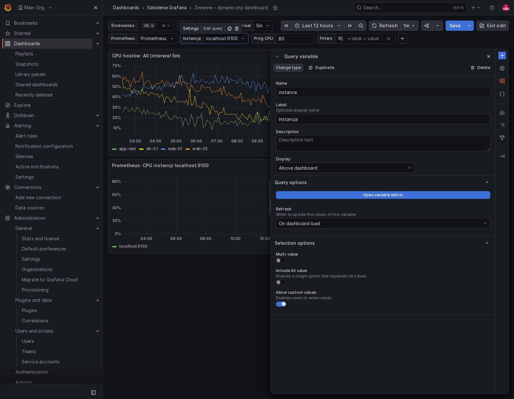
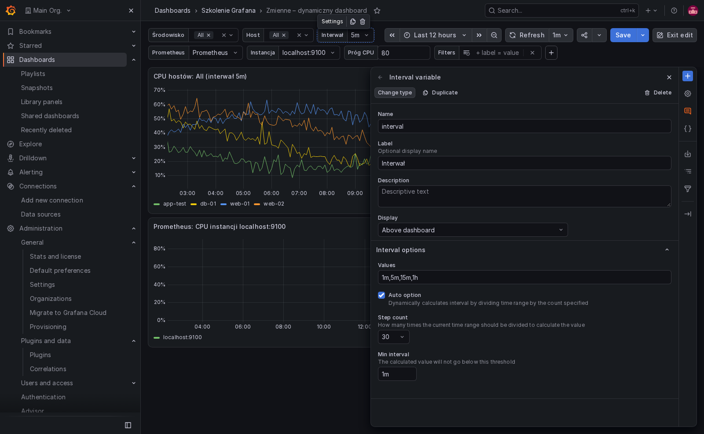
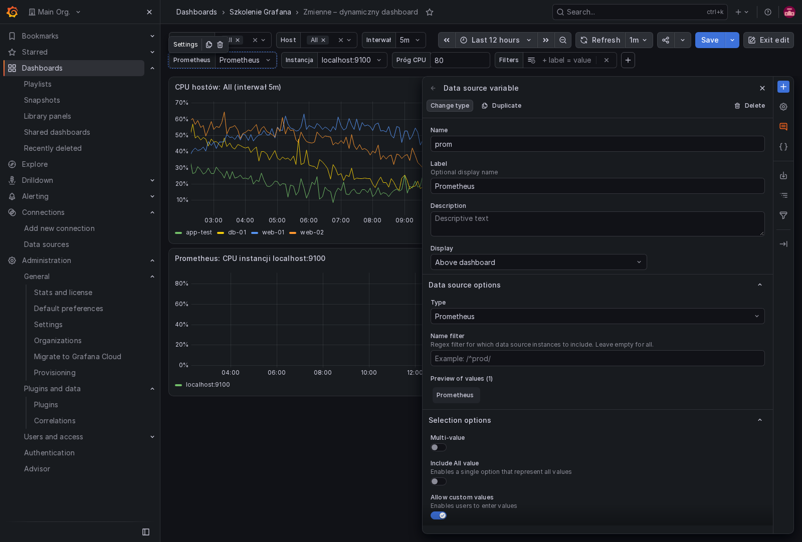
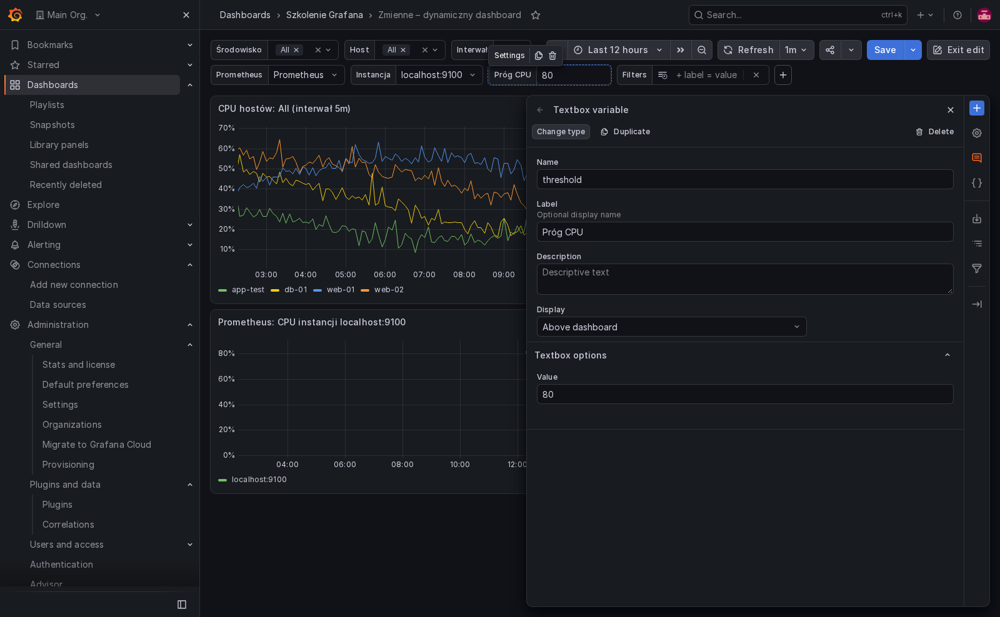
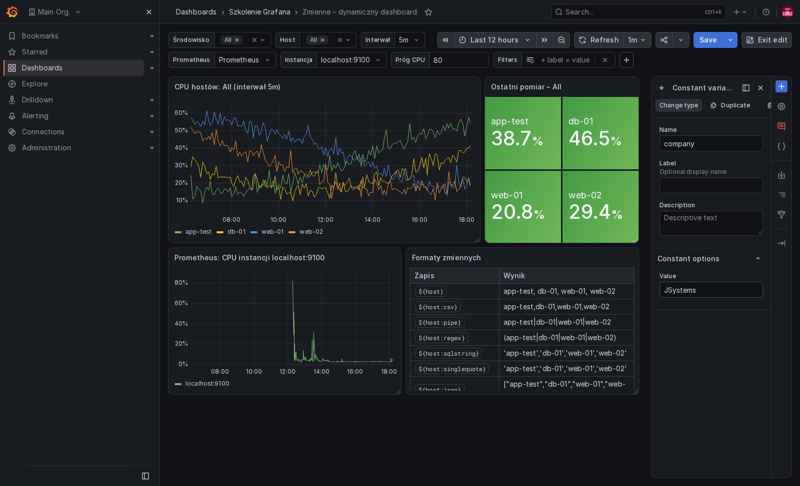
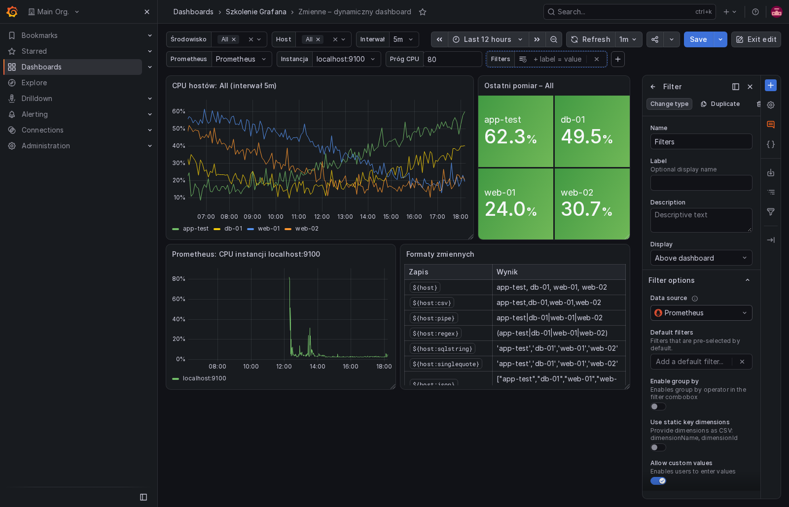

Typ zmiennej wybierasz przy jej tworzeniu (albo później przyciskiem **Change type** w panelu edycji zmiennej). Od typu zależy, skąd biorą się wartości i jakie opcje pokaże pasek boczny. Wszystkie przykłady poniżej są na dashboardzie **Zmienne – dynamiczny dashboard** w labie.

---

## Przegląd typów

| Typ | Skąd wartości | Przykład w labie |
|-----|---------------|------------------|
| **Query** | zapytanie do źródła danych | `host` (PostgreSQL), `instance` (Prometheus) |
| **Custom** | lista wpisana ręcznie | `env`: `prod,test` |
| **Interval** | lista interwałów czasu (+ opcja auto) | `interval`: `1m,5m,15m,1h` |
| **Data source** | lista źródeł danych danego typu | `prom` – źródła typu Prometheus |
| **Text box** | pole tekstowe dla użytkownika | `threshold` = `80` |
| **Constant** | stała, ukryta wartość | `company` = `JSystems` |
| **Filter** (dawniej *Ad hoc filters*) | filtry klucz = wartość dopisywane do zapytań | `Filters` (Prometheus) |
| **Switch** | przełącznik dwóch wartości | – (nowy typ w Grafanie 13, nie ma go w labie) |

---

## Query

Najczęściej używany typ: Grafana wysyła zapytanie do źródła danych i traktuje zwrócone wartości jako listę opcji. Konfigurację zmiennej `host` (PostgreSQL) omówiliśmy w poprzedniej lekcji. Ta sama mechanika działa dla Prometheusa – zmienna `instance`:



Ustawienia zmiennej `instance` w labie:

| Pole | Wartość |
|------|---------|
| Name / Label | `instance` / Instancja |
| Target data source | `${prom}` – czyli źródło wybrane w zmiennej `prom` |
| Query | `label_values(node_uname_info, instance)` |
| Refresh | On dashboard load |
| Multi-value / Include All | wyłączone |

Funkcje zapytań zmiennych dla Prometheusa (w edytorze wybierasz je z listy *Query type* albo wpisujesz w trybie kodu):

| Zapytanie | Wynik |
|-----------|-------|
| `label_names()` | nazwy wszystkich etykiet |
| `label_values(instance)` | wartości etykiety `instance` we wszystkich metrykach |
| `label_values(node_uname_info, instance)` | wartości `instance` tylko dla tej metryki |
| `label_values(up{job="node"}, instance)` | jw. z filtrem etykiet |
| `metrics(node_cpu.*)` | nazwy metryk pasujące do wyrażenia |
| `query_result(topk(5, node_load1))` | wynik dowolnego zapytania PromQL (zwykle z Regex do wycięcia wartości) |

Dla **Zabbixa** (plugin alexanderzobnin-zabbix-app 6.x) edytor zmiennej ma pole *Query type* z pozycjami **Group**, **Host**, **Item tag**, **Item**, **Item values** (oraz **Application** – tylko dla starych Zabbixów). W Zabbix 7.0, którego używamy w labie, aplikacji już nie ma – zastąpiły je **tagi** pozycji (*Item tag*). Typowy łańcuch: zmienna `group` (Query type: Group, filtr `/.*/`) → zmienna `host` (Query type: Host, Group: `$group`).

**Regex** pozwala odfiltrować wyniki, np. `/^web-.*/` zostawi tylko hosty `web-…`. Nazwane grupy `(?<text>…)` i `(?<value>…)` pozwalają rozdzielić tekst widoczny na liście i wartość podstawianą do zapytania.

---

## Custom

Lista wartości wpisana ręcznie, rozdzielona przecinkami. W labie zmienna `env` ma wartości `prod,test` (Multi-value + Include All). Szczegóły i zrzut – w lekcji 3 („Zmienne zależne”).

Można nadać wartościom inne nazwy wyświetlane (format `tekst : wartość`):

```
Produkcja : prod, Testy : test
```

Użytkownik widzi „Produkcja”, a do zapytania trafia `prod`.

---

## Interval

Lista interwałów do grupowania danych w czasie. Zmienna `interval` w labie:



| Pole | Wartość w labie | Znaczenie |
|------|-----------------|-----------|
| **Values** | `1m,5m,15m,1h` | dostępne interwały |
| **Auto option** | zaznaczone | dodaje pozycję `auto` – interwał liczony z zakresu czasu |
| **Step count** | 30 | na ile kroków podzielić zakres czasu przy `auto` |
| **Min interval** | 1m | `auto` nie zejdzie poniżej tej wartości |

Przy zakresie 12 h i Step count 30 `auto` da ok. 20–30 min (12 h / 30, zaokrąglone przez Grafanę do „okrągłej” wartości).

Użycie:

```sql
-- PostgreSQL (panel „CPU hostów”)
$__timeGroupAlias(time, '$interval')
```

```promql
avg_over_time(node_load1[$interval])
```

> Nie myl zmiennej `$interval` (wybiera ją użytkownik) z wbudowaną `$__interval` (liczy ją Grafana). W funkcjach `rate()`/`increase()` Prometheusa zwykle najlepsza jest wbudowana `$__rate_interval`.

---

## Data source

Pozwala przełączać panele między źródłami danych tego samego typu (np. Prometheus produkcyjny i testowy). Zmienna `prom` w labie:



- **Type** – typ źródła (tu *Prometheus*),
- **Name filter** – regex na nazwy źródeł, np. `/^prod/`; puste = wszystkie źródła tego typu,
- **Preview of values** – źródła, które trafią na listę.

Aby panel korzystał ze zmiennej, w edycji panelu wybierz jako źródło danych `${prom}` (lista źródeł pokazuje zmienne obok zwykłych źródeł). W labie panel „Prometheus: CPU instancji” i zmienna `instance` używają `${prom}` – zmiana źródła przeładuje i listę instancji, i wykres.

---

## Text box

Pole, w które użytkownik wpisuje dowolny tekst. Zmienna `threshold` (Label „Próg CPU”) ma wartość domyślną `80`:



Przykładowe użycia:

```sql
-- tylko pomiary powyżej progu wpisanego przez użytkownika
SELECT time, host AS metric, cpu_usage
FROM server_metrics
WHERE $__timeFilter(time) AND cpu_usage > $threshold
```

```sql
-- wyszukiwanie fragmentu tekstu
WHERE host LIKE '%$szukaj%'
```

> Wartość z Text box trafia do zapytania dosłownie – nie używaj tego typu tam, gdzie dowolny tekst mógłby zepsuć lub rozszerzyć zapytanie. Grafana łączy się z bazą użytkownikiem tylko do odczytu (w labie `grafana_user`) właśnie z tego powodu.

---

## Constant

Stała wartość, domyślnie ukryta (Display: *Hidden*). Przydaje się do trzymania w jednym miejscu np. prefiksu metryki, nazwy schematu bazy albo nazwy firmy. W labie to zmienna `company` = `JSystems` – nie widać jej nad dashboardem, ale jest w sekcji **Variables → Hidden** paska bocznego:



Ikony przy nazwie zmiennej (ołówek, kopia, kosz) otwierają edycję, duplikują i usuwają zmienną. Użycie: `$company` w treści panelu Text da „JSystems”.

---

## Filter (ad hoc)

Zmienna typu **Filter** (w starszych wersjach i w JSON-ie: *Ad hoc filters*, `"type": "adhoc"`) nie wymaga zmian w zapytaniach – Grafana sama dopisuje wybrane warunki `klucz = wartość` do **wszystkich zapytań** paneli korzystających z tego samego źródła danych. Działa tylko ze źródłami, które to obsługują (m.in. Prometheus, Loki, Elasticsearch, InfluxDB).



- **Data source** – źródło, do którego zapytań filtr będzie dopisywany (w labie Prometheus),
- **Default filters** – filtry ustawione z góry,
- **Enable group by** – dodatkowo pozwala grupować wyniki (dla Prometheusa i Lokiego),
- **Allow custom values** – można wpisać wartość spoza podpowiedzi.

Nad dashboardem pojawia się pole **Filters** z podpowiedzią `+ label = value`. Wybranie np. `job = node` zawęzi wszystkie zapytania Prometheusa na dashboardzie do tego joba.

---

## Switch

Według dokumentacji Grafany 13 nowy typ: przełącznik włącz/wyłącz, który podstawia jedną z dwóch zdefiniowanych wartości (np. `true`/`false` albo dwa fragmenty zapytania). Nie ma go w labowym dashboardzie – możesz go dodać w ćwiczeniu.

---

## Podsumowanie

| Potrzebujesz… | Użyj typu |
|---------------|-----------|
| listy hostów / instancji z danych | Query |
| stałej listy środowisk | Custom |
| sterowania szczegółowością wykresu | Interval |
| przełączania między źródłami danych | Data source |
| wartości wpisanej przez użytkownika | Text box |
| ukrytej stałej | Constant |
| filtrowania bez zmiany zapytań | Filter (ad hoc) |
| przełącznika dwóch wartości | Switch |

---

## Ćwiczenie w labie

Grafana: http://10.123.2.206:3000 (admin / admin), dashboard **Zmienne – dynamiczny dashboard**.

1. **Interval:** zmień *Interwał* z `5m` na `1h`, a potem na `1m`. Panel „CPU hostów” powinien mieć odpowiednio mniej / więcej punktów, a tytuł pokazywać wybrany interwał.
2. **Filter:** w polu **Filters** dodaj `instance = localhost:9100`. Panel „Prometheus: CPU instancji” dalej pokazuje dane; zmień operator na `!=` – jedyna instancja zostaje odfiltrowana i panel nie pokazuje danych. Usuń filtr (ikona ×).
3. **Text box:** kliknij **Edit**, otwórz panel „CPU hostów” (menu panelu → **Edit**) i dopisz do warunku `AND cpu_usage > $threshold`. Wpisz w polu *Próg CPU* wartość `40`.
4. **Oczekiwany efekt:** na wykresie zostają tylko punkty powyżej 40%; po zmianie progu na `0` wraca pełny wykres.
5. **Constant:** w pasku bocznym (**Variables → Hidden → company**) zmień wartość na nazwę swojej firmy – wiersz `$company` w panelu „Formaty zmiennych” powinien ją pokazać.
6. Wyjdź z edycji przez **Exit edit**, odrzucając zmiany.
