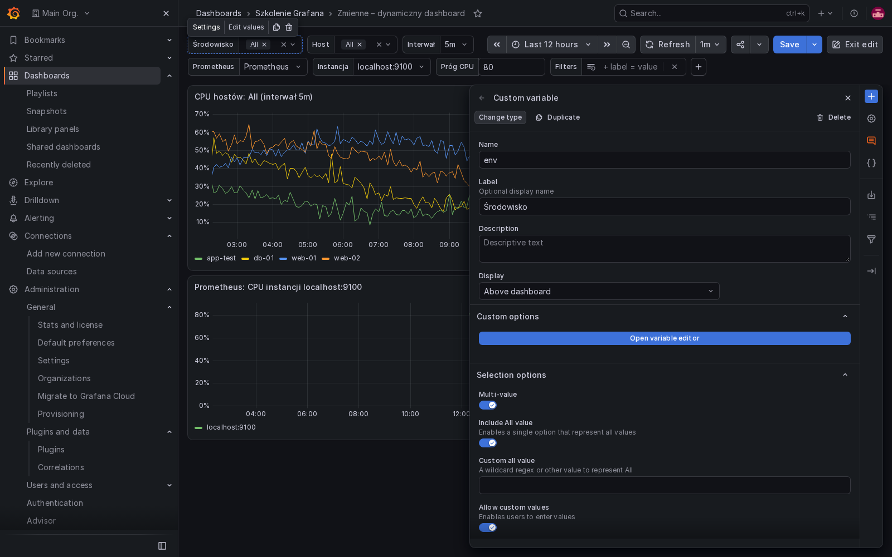
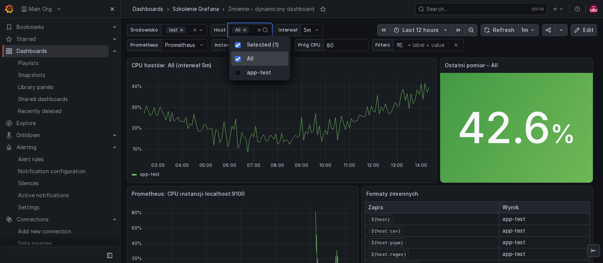
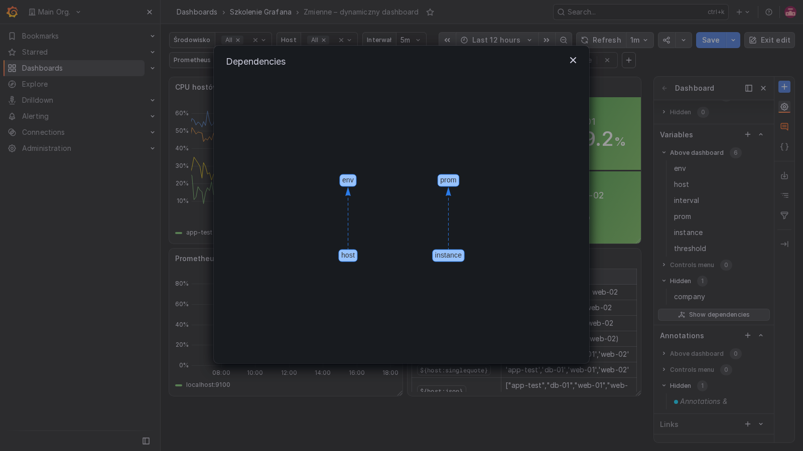
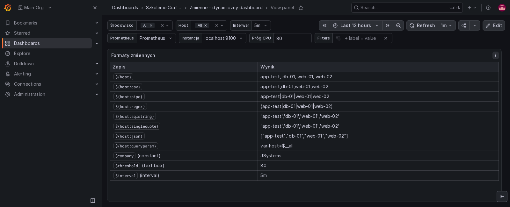

## Zmienne zależne (chained variables)

Zmienna zależna to zmienna, której zapytanie zawiera inną zmienną. Po zmianie wartości zmiennej nadrzędnej Grafana sama odświeża listę zmiennej zależnej. Tak buduje się filtry hierarchiczne: środowisko → host, grupa → host → pozycja, źródło danych → instancja.

---

### Przykład z labu: Środowisko → Host

**Krok 1 – zmienna `env` (Custom)**



| Pole | Wartość |
|------|---------|
| Type | Custom |
| Name / Label | `env` / Środowisko |
| Wartości (*Open variable editor*) | `prod,test` |
| Multi-value | włączone |
| Include All value | włączone |

**Krok 2 – zmienna `host` (Query, PostgreSQL, zależna od `env`)**

| Pole | Wartość |
|------|---------|
| Type | Query |
| Name / Label | `host` / Host |
| Target data source | PostgreSQL |
| Query | `SELECT DISTINCT host FROM server_metrics WHERE env IN ($env) ORDER BY 1` |
| Refresh | On dashboard load |
| Multi-value, Include All value | włączone |

W tabeli `server_metrics` hosty `web-01`, `web-02`, `db-01` mają `env = 'prod'`, a `app-test` – `env = 'test'`. Po wybraniu **Środowisko = test** lista **Host** zawiera już tylko `app-test`:



**Drugi łańcuch w labie: źródło danych → instancja.** Zmienna `instance` ma jako *Target data source* `${prom}`, więc zależy od zmiennej `prom` (Data source). Zmiana źródła przeładuje listę instancji.

### Podgląd zależności

W pasku bocznym (tryb **Edit**, sekcja **Variables**) przycisk **Show dependencies** rysuje graf zależności między zmiennymi:



Grafana wykrywa zależności sama, na podstawie odwołań `$zmienna` w zapytaniach. Mimo to trzymaj zmienne nadrzędne wyżej na liście niż zależne – tak też układają się listy nad dashboardem i łatwiej to czytać. Unikaj cykli (A zależy od B, a B od A).

### Inne przykłady łańcuchów

Prometheus – job → instancja → interfejs sieciowy:

```
job:       label_values(up, job)
instance:  label_values(up{job="$job"}, instance)
device:    label_values(node_network_receive_bytes_total{instance="$instance"}, device)
```

Zabbix (plugin 6.x, Zabbix 7.0) – w edytorze zmiennej wybierasz *Query type*:

```
group:  Query type = Group, Group = /.*/
host:   Query type = Host,  Group = $group, Host = /.*/
tag:    Query type = Item tag, Group = $group, Host = $host
```

(W Zabbix 5.4+ nie ma już aplikacji – zamiast `Application` używa się tagów pozycji.)

> Jeśli zmienna nadrzędna ma **Multi-value**, w zapytaniu zależnym użyj konstrukcji przyjmującej listę: `IN ($env)` w SQL, `=~"$job"` w PromQL.

---

## Składnia zmiennych

| Zapis | Przykład | Uwagi |
|-------|----------|-------|
| `$nazwa` | `$host` | krótki zapis |
| `${nazwa}` | `${host}` | używaj, gdy zmienna sąsiaduje z innym tekstem, np. `${host}_cpu` |
| `${nazwa:format}` | `${host:regex}` | z modyfikatorem formatu (niżej) |
| `[[nazwa]]` | `[[host]]` | przestarzały, zostanie usunięty – nie używaj |

Przykład, gdzie klamry są konieczne:

```promql
node_load1{instance="${host}:9100"}
```

Bez klamer `$host_name` zostałoby odczytane jako zmienna o nazwie `host_name`.

---

## Modyfikatory formatu

Gdy zmienna ma kilka wartości (Multi-value albo wybrane **All**), trzeba ją podstawić w formacie zrozumiałym dla danego źródła. Służą do tego modyfikatory `${nazwa:format}`.

W labie panel **„Formaty zmiennych”** pokazuje realny wynik każdego zapisu dla zmiennej `host` przy wybranym **All** (4 hosty):



| Zapis | Wynik w labie (host = All) | Zastosowanie |
|-------|----------------------------|--------------|
| `${host}` | `app-test, db-01, web-01, web-02` | domyślny – zależy od miejsca użycia (patrz niżej) |
| `${host:csv}` | `app-test,db-01,web-01,web-02` | lista po przecinku |
| `${host:pipe}` | `app-test\|db-01\|web-01\|web-02` | lista rozdzielona `\|` |
| `${host:regex}` | `(app-test\|db-01\|web-01\|web-02)` | PromQL `=~`, regex (znaki specjalne są escape'owane) |
| `${host:sqlstring}` | `'app-test','db-01','web-01','web-02'` | SQL `IN (...)` |
| `${host:singlequote}` | `'app-test','db-01','web-01','web-02'` | wartości w apostrofach |
| `${host:json}` | `["app-test","db-01","web-01","web-02"]` | JSON |
| `${host:queryparam}` | `var-host=$__all` | parametr URL, np. w linku do innego dashboardu |
| `$company` (constant) | `JSystems` | |
| `$threshold` (text box) | `80` | |
| `$interval` (interval) | `5m` | |

Zwróć uwagę na `queryparam`: przy wybranym **All** do linku trafia `var-host=$__all`, czyli informacja „wszystkie”, a nie lista hostów. Przy wybranych dwóch hostach byłoby `var-host=db-01&var-host=web-01`.

Pozostałe modyfikatory (nieużywane w labowym panelu):

| Zapis | Wynik dla `["web-01","web-02"]` | Zastosowanie |
|-------|---------------------------------|--------------|
| `${host:doublequote}` | `"web-01","web-02"` | wartości w cudzysłowach |
| `${host:lucene}` | `("web-01" OR "web-02")` | Elasticsearch / Lucene |
| `${host:glob}` | `{web-01,web-02}` | Graphite |
| `${host:percentencode}` | `web-01%2Cweb-02` | kodowanie URL |
| `${host:raw}` | `web-01,web-02` | bez żadnego formatowania |
| `${host:text}` | `web-01 + web-02` | tekst wyświetlany (np. w tytułach) |

### Domyślny format

Bez modyfikatora Grafana dobiera format do źródła danych:
- **SQL** (PostgreSQL, MySQL) – wartości wielokrotne podaje w apostrofach, dlatego w labie działa `host IN ($host)`,
- **Prometheus** – jako regex, więc zmienna wielowartościowa wymaga `=~`: `instance=~"$instance"`,
- w panelu Text / tytułach – czytelna lista (jak w pierwszym wierszu tabeli).

Jawny modyfikator (`${host:sqlstring}`, `${host:regex}`) jest czytelniejszy i nie zależy od domyślnych zachowań – stosuj go, gdy zapytanie ma działać w różnych miejscach.

---

## Zmienne poza zapytaniami

- **Tytuł panelu**: `Ostatni pomiar – ${host}` (w labie: „Ostatni pomiar – All”),
- **Opis panelu**, **treść panelu Text** (panel „Formaty zmiennych” to zwykły panel Text w trybie HTML),
- **Linki** (data links, linki dashboardu): `/d/zmienne?${host:queryparam}&${env:queryparam}` przenosi wybór do innego dashboardu,
- **Progi i opcje panelu** – tylko gdy zmienna daje liczbę.

---

## Podsumowanie

- Zmienna zależna to zmienna, której zapytanie odwołuje się do innej zmiennej (`WHERE env IN ($env)`); Grafana odświeża ją automatycznie, a graf zależności pokazuje **Show dependencies**.
- Używaj `${nazwa}`, gdy zmienna sąsiaduje z tekstem; `[[nazwa]]` jest przestarzały.
- Przy wielu wartościach dobierz modyfikator: `sqlstring` dla SQL, `regex` dla PromQL, `lucene` dla Elasticsearch, `queryparam` dla linków.

---

## Ćwiczenie w labie

Grafana: http://10.123.2.206:3000 (admin / admin), dashboard **Zmienne – dynamiczny dashboard**.

1. Ustaw **Środowisko = test**. **Oczekiwany efekt:** lista **Host** ma tylko `app-test`, wykres CPU pokazuje jedną serię, a w panelu „Formaty zmiennych” wszystkie formaty zwracają `app-test` (jedna wartość).
2. Ustaw **Środowisko = prod** i z listy **Host** wybierz `web-01` i `web-02`. Porównaj w panelu „Formaty zmiennych” wyniki `:csv`, `:regex`, `:sqlstring` i `:queryparam` (teraz `var-host=web-01&var-host=web-02` zamiast `$__all`).
3. Kliknij **Edit** → w pasku bocznym **Show dependencies**. Sprawdź, że widać strzałki `host → env` i `instance → prom`.
4. Dodaj zmienną zależną: **+** przy **Variables** → typ **Query**, Name `mount`, *Target data source* `${prom}`, zapytanie `label_values(node_filesystem_size_bytes{instance="$instance"}, mountpoint)`.
5. **Oczekiwany efekt:** *Preview of values* pokazuje punkty montowania maszyny labowej (np. `/`, `/boot`), a w **Show dependencies** pojawia się strzałka `mount → instance`.
6. Wyjdź z edycji przez **Exit edit**, odrzucając zmiany.
