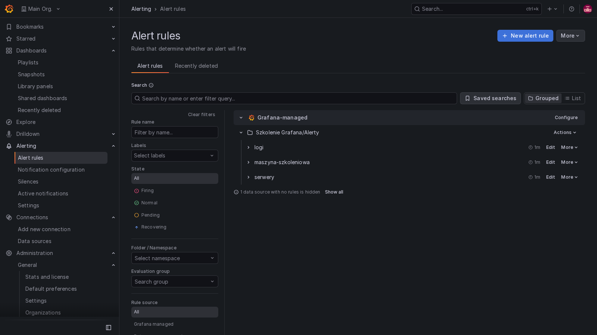
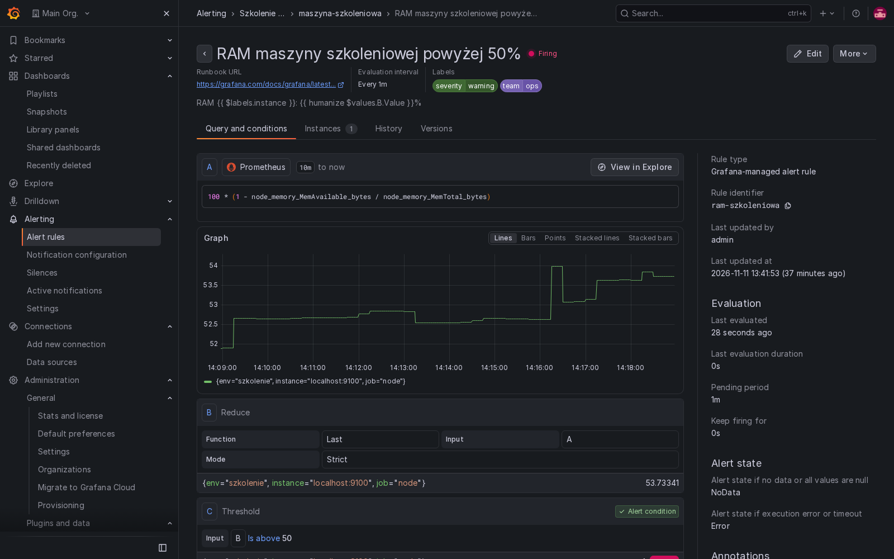
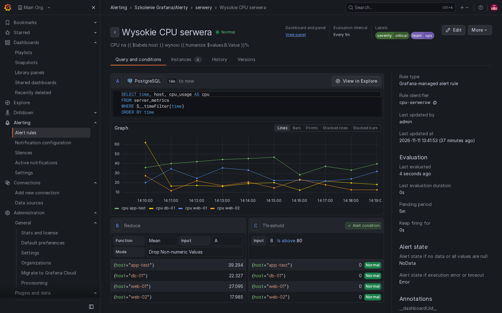
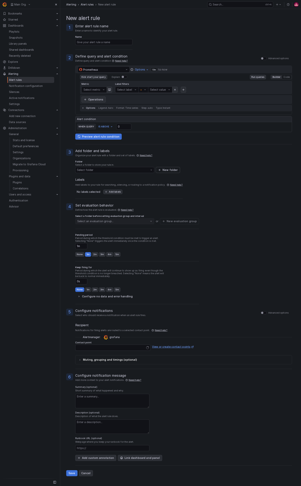
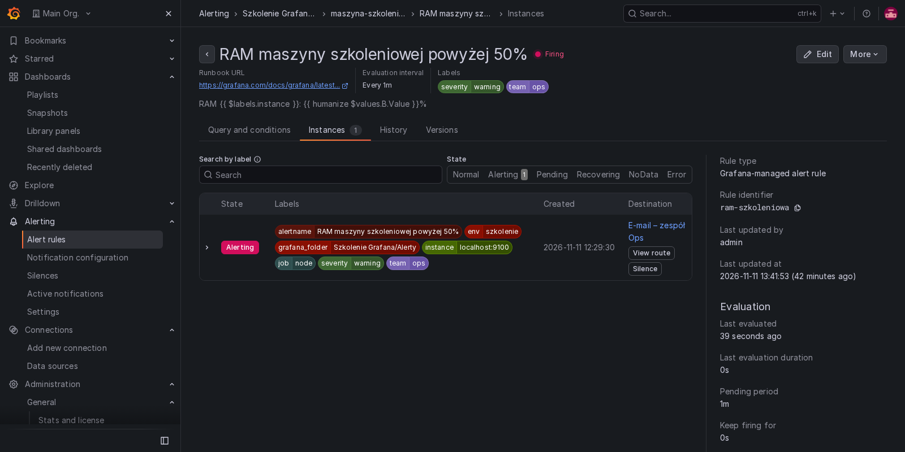
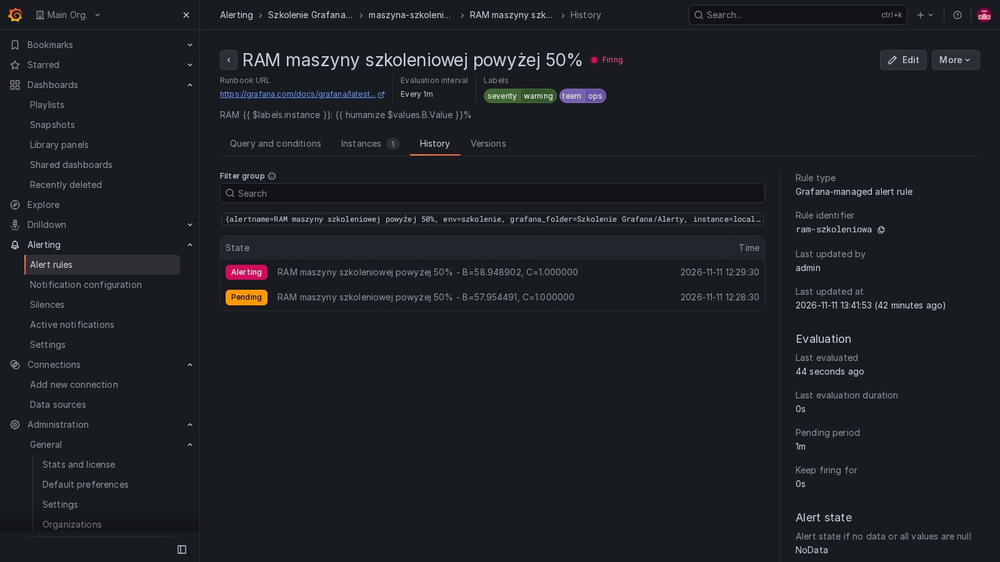

![[Pasted image 20260608075742.png]]
**Reguła alertu** (ang. *alert rule*) to zapytanie + warunek, które Grafana wykonuje cyklicznie. Gdy warunek jest spełniony odpowiednio długo, reguła tworzy **alert** i przekazuje go do wbudowanego Alertmanagera Grafany, a ten – według **polityk powiadomień** – wysyła powiadomienie do **punktu kontaktowego** (contact point).

Cały łańcuch, który zobaczysz w labie:

```
reguła (zapytanie → Reduce → Threshold)
   → instancje alertu z etykietami (np. severity=critical, team=ops)
      → polityka powiadomień (dopasowanie po etykietach)
         → contact point (e-mail przez SMTP)
            → Mailpit (http://10.123.2.206:8025)
```

W tym module opisujemy reguły **zarządzane przez Grafanę** (*Grafana-managed alert rules*) – działają z każdym źródłem danych (PostgreSQL, Prometheus, Elasticsearch…). Istnieją też reguły *Data source-managed* (przechowywane w Prometheusie/Mimirze/Lokim), których tu nie używamy.

---

## Lista reguł

**Alerting → Alert rules**:



- reguły są pogrupowane: **folder** (`Szkolenie Grafana/Alerty`) → **grupa ewaluacji** (`logi`, `maszyna-szkoleniowa`, `serwery`); przy każdej grupie widać interwał ewaluacji (`1m`), przycisk **Edit** (edycja grupy) i **More**,
- przełącznik **Grouped / List** zmienia widok drzewa na płaską listę,
- po lewej filtry: nazwa, etykiety, **State** (Firing, Normal, Pending, Recovering), folder, grupa, źródło reguły,
- **New alert rule** tworzy regułę, **More** daje m.in. import/eksport,
- zakładka **Recently deleted** pozwala przywrócić usuniętą regułę.

### Reguły w labie

| Reguła | Grupa (interwał) | Zapytanie | Warunek | Pending period | Etykiety |
|--------|------------------|-----------|---------|----------------|----------|
| **Wysokie CPU serwera** | `serwery` (1m) | PostgreSQL, `server_metrics`, ostatnie 10 min | Reduce **Mean** → Threshold **> 80** | 5m | `severity=critical`, `team=ops` |
| **RAM maszyny szkoleniowej powyżej 50%** | `maszyna-szkoleniowa` (1m) | Prometheus: `100 * (1 - node_memory_MemAvailable_bytes / node_memory_MemTotal_bytes)` | Reduce **Last** → Threshold **> 50** | 1m | `severity=warning`, `team=ops` |
| **Błędy w logach aplikacji** | `logi` (1m) | Elasticsearch: count `log.level:error`, terms `service.name`, ostatnie 5 min | Reduce **Sum** → Threshold **> 3** | 0s (None) | `severity=warning`, `team=dev` |

Reguła „RAM…” ma celowo niski próg – maszyna labowa zużywa ok. 55–60% RAM, więc reguła jest w stanie **Firing** i w Mailpit jest już mail. Reguła „Błędy w logach…” odpala się okresowo, bo generator danych co jakiś czas dopisuje więcej błędów.

---

## Szczegóły reguły

Kliknięcie nazwy reguły otwiera jej podgląd (adres `/alerting/grafana/<uid>/view`):



- nagłówek: nazwa, stan (**Firing**), **Runbook URL**, **Evaluation interval** (Every 1m), **Labels**, a pod spodem treść adnotacji *summary* (jako szablon – wartości są podstawiane dopiero w alercie),
- zakładki **Query and conditions**, **Instances**, **History**, **Versions** (historia zmian reguły),
- w zakładce *Query and conditions*: zapytanie **A** (Prometheus, zakres `10m to now`, przycisk **View in Explore**), wykres, wyrażenie **B** (Reduce: Function *Last*, Mode *Strict*, wynik `57.97…` dla serii `{env="szkolenie", instance="localhost:9100", job="node"}`) i **C** (Threshold: *Input B Is above 50*, oznaczone jako **Alert condition**),
- po prawej: **Rule type**, **Rule identifier** (uid `ram-szkoleniowa`), kto i kiedy zmienił, sekcja **Evaluation** (ostatnia ewaluacja, czas trwania, **Pending period** 1m, **Keep firing for** 0s) i **Alert state** (co robić przy braku danych – *NoData*, przy błędzie – *Error*).

Ta sama strona dla reguły z PostgreSQL:



Tu w chwili wykonania zrzutu reguła była w stanie **No data** – podgląd zapytania pokazuje *No data*. Przyczyny i obsługę takich stanów omawiamy niżej.

---

## Tworzenie reguły

**Alerting → Alert rules → New alert rule** (albo z edycji panelu: zakładka **Alert** pod podglądem panelu → *New alert rule* – wtedy zapytanie panelu jest kopiowane do reguły). Formularz ma 6 kroków:



### 1. Enter alert rule name
Nazwa reguły. Staje się etykietą `alertname` każdego alertu i pojawia się w temacie maila.

### 2. Define query and alert condition
- wybór źródła danych, zapytanie (dla Prometheusa: Builder / Code) i **zakres czasu** zapytania (domyślnie `10m to now`),
- w trybie prostym (przełącznik **Advanced options** wyłączony) warunek ustawiasz jednym wierszem **Alert condition: WHEN QUERY IS ABOVE 0** – Grafana sama dodaje pod spodem Reduce (*Last*) i Threshold,
- po włączeniu **Advanced options** widzisz osobne wyrażenia (Reduce, Math, Threshold…) – opis w lekcji *Expresje*,
- **Preview alert rule condition** / **Preview** – wylicza warunek na bieżących danych i pokazuje, które serie dałyby alert.

### 3. Add folder and labels
- **Folder** – reguły zawsze należą do folderu (uprawnienia do folderu = uprawnienia do reguł); w labie `Alerty` w folderze *Szkolenie Grafana*,
- **Labels** – etykiety reguły (**Add labels** / **Edit labels**), np. `severity=critical`, `team=ops`. Służą do wyszukiwania, wyciszania i **routingu w politykach powiadomień**. Do alertu trafiają też etykiety z wyniku zapytania (np. `instance`, `job`) oraz automatyczne `alertname` i `grafana_folder`.

### 4. Set evaluation behavior
- **Evaluation group** – grupa reguł w folderze z wspólnym **interwałem ewaluacji** (np. `serwery`, co 1m). Wybierasz istniejącą albo **New evaluation group** (nazwa + interwał). Wszystkie reguły w grupie są liczone razem, co ten sam czas.
- **Pending period** (dawniej pole *For*) – jak długo warunek musi być spełniony, zanim alert przejdzie z *Pending* do *Firing*. *None* = od razu. Chroni przed alarmami z pojedynczych skoków. Musi być wielokrotnością interwału grupy.
- **Keep firing for** – jak długo alert ma pozostać *Firing* po ustaniu warunku (przeciw „migotaniu” alertu).
- **Pause evaluation** – wstrzymanie ewaluacji reguły (np. na czas prac serwisowych); przełącznik widać przy edycji istniejącej reguły.
- **Configure no data and error handling** – co zrobić, gdy zapytanie nie zwróci danych (*Alert state if no data or all values are null*) lub zakończy się błędem / timeoutem (*Alert state if execution error or timeout*). Możliwe wartości: *No Data* / *Error* (osobny stan), *Alerting*, *Normal*, *Keep Last State*.

### 5. Configure notifications
- z wyłączonym **Advanced options** wybierasz od razu **Contact point** – najprostszy sposób, bez polityk,
- z włączonym **Advanced options** alert jest kierowany przez **drzewo polityk powiadomień** (pole *Recipient* pokazuje *Default policy*, link **View policies** i **Preview routing** – podgląd, do którego contact pointu trafi alert na podstawie etykiet). Tak skonfigurowane są wszystkie reguły w labie.

### 6. Configure notification message
Adnotacje – tekst dołączany do powiadomienia:
- **Summary** – krótko, co się stało (np. `RAM {{ $labels.instance }}: {{ humanize $values.B.Value }}%`),
- **Description** – dłuższy opis,
- **Runbook URL** – link do instrukcji postępowania,
- **Add custom annotation** – własne adnotacje,
- **Link dashboard and panel** – powiązanie z panelem (w powiadomieniu pojawia się link do dashboardu/panelu; reguła „Wysokie CPU serwera” jest powiązana z panelem *Time series – CPU serwerów* na dashboardzie *Wizualizacje – wszystkie typy*).

Zapis: **Save** (reguła zaczyna być liczona przy następnym cyklu grupy).

---

## Stany alertów w Grafanie 13

Grafana rozróżnia stan **reguły** i stan każdej **instancji alertu** (jedna reguła może dać wiele instancji – po jednej na serię, np. na host).

**Stany reguły** (filtr *State* na liście reguł):

| Stan | Znaczenie |
|------|-----------|
| **Normal** | żadna instancja nie spełnia warunku |
| **Pending** | warunek spełniony, ale krócej niż *Pending period* |
| **Firing** | co najmniej jedna instancja jest w stanie Alerting |
| **Recovering** | warunek ustał, ale trwa jeszcze *Keep firing for* |

**Stany instancji** (zakładka **Instances**):

| Stan | Znaczenie |
|------|-----------|
| **Normal** | warunek niespełniony |
| **Pending** | warunek spełniony, odliczany jest Pending period |
| **Alerting** | alert aktywny – wysyłane jest powiadomienie |
| **Recovering** | warunek ustał, trwa Keep firing for |
| **NoData** | zapytanie nie zwróciło danych (gdy *no data* ustawiono na *No Data*) |
| **Error** | błąd wykonania zapytania lub wyrażenia (gdy *error* ustawiono na *Error*) |



W wierszu instancji widać pełny zestaw etykiet (z reguły, z zapytania oraz `alertname` i `grafana_folder`), czas utworzenia oraz **Destination** – contact point wyliczony z polityk – z przyciskami **View route** i **Silence**.

Zakładka **History** pokazuje przejścia stanów z wartościami wyrażeń:



Widać działanie *Pending period* = 1m: o 12:28:30 instancja przeszła w **Pending**, minutę później (kolejna ewaluacja z warunkiem nadal spełnionym) w **Alerting**. `C=1` oznacza, że warunek (Threshold) jest prawdziwy.

### NoData i Error jako alerty

Gdy reguła przejdzie w stan **NoData** lub **Error**, Grafana wysyła osobny alert o nazwie (`alertname`) **DatasourceNoData** lub **DatasourceError**, z etykietami reguły. Przy budowie labu takie maile przyszły z pierwszej wersji reguły „Wysokie CPU serwera” – trafiły do zespołu Ops, bo reguła ma etykietę `severity=critical`.

> **Pułapka z labu – SQL i etykiety.** Pierwsza wersja reguły CPU zwracała kolumnę `host AS metric`. W formacie *Time series* kolumna `metric` staje się tylko **nazwą** serii, a nie etykietą, więc reguła dostawała 4 serie bez etykiet i kończyła się błędem `frame cannot uniquely be identified by its labels: has duplicate results with labels {}` (stan **Error** → mail *DatasourceError*). Rozwiązanie: zwracać hosta jako zwykłą kolumnę tekstową – `SELECT time, host, cpu_usage AS cpu ...`. Wtedy każda seria ma etykietę `host=…`, powstaje osobna instancja alertu na każdy host, a w adnotacji używa się `{{ $labels.host }}`. Reguła w labie jest już poprawiona w ten sposób.

Stanów *OK*, *Paused* i *Acknowledged* znanych ze starszych wersji Grafany (tzw. legacy alerting) już nie ma: *OK* to obecnie **Normal**, wstrzymanie reguły to przełącznik **Pause evaluation**, a potwierdzanie (acknowledge) alertów nie występuje – do czasowego zatrzymania powiadomień służą **Silences**.

---

## Zarządzanie regułami

- **Edit** w podglądzie reguły (adres `/alerting/<uid>/edit`) – ten sam formularz co przy tworzeniu,
- **More** – m.in. duplikowanie, eksport (YAML/JSON/HCL do provisioningu), usuwanie,
- **Edit** przy grupie na liście reguł – zmiana nazwy i interwału całej grupy,
- usunięte reguły przez pewien czas można przywrócić z zakładki **Recently deleted**.

---

## Podsumowanie

- Reguła Grafany = zapytanie + wyrażenia (Reduce, Threshold…) + folder i grupa ewaluacji (interwał) + Pending period + etykiety + adnotacje.
- Etykiety decydują o tym, gdzie trafi powiadomienie (polityki) i co można wyciszyć.
- Stany reguły: Normal, Pending, Firing, Recovering; stany instancji dodatkowo Alerting, NoData, Error.
- NoData/Error generują osobne alerty DatasourceNoData/DatasourceError.

---

## Ćwiczenie w labie

Grafana: http://10.123.2.206:3000 (admin / admin), Mailpit: http://10.123.2.206:8025.

1. **Alerting → Alert rules**, rozwiń folder *Szkolenie Grafana/Alerty* i otwórz regułę **RAM maszyny szkoleniowej powyżej 50%**. Odczytaj: interwał ewaluacji, Pending period, etykiety. W zakładce **Instances** sprawdź stan i **Destination**.
2. Otwórz regułę **Wysokie CPU serwera** i sprawdź jej stan w nagłówku i w zakładce **Instances**. Zobacz, że ma osobną instancję dla każdego hosta (etykieta `host`). Dla porównania zmień w kopii reguły zapytanie na `host AS metric` i obejrzyj podgląd – zobaczysz błąd z pułapki „SQL i etykiety”.
3. Utwórz własną regułę: **New alert rule**, nazwa `Load – <Twoje inicjały>`.
   - Źródło **Prometheus**, kod zapytania: `node_load1`.
   - Włącz **Advanced options**: Reduce *Last*, Threshold *Is above* `0` (warunek zawsze spełniony – chodzi o zobaczenie całego cyklu).
   - Folder `Alerty`, etykieta `team=ops`.
   - **New evaluation group**: nazwa `uczestnik-<inicjały>`, interwał `1m`; Pending period `1m`.
   - Notyfikacje: **Advanced options** włączone (Default policy) – kliknij **Preview routing**, powinno być *E-mail – zespół Ops*.
   - Summary: `Load {{ $labels.instance }} = {{ $values.B.Value }}`. **Save**.
4. **Oczekiwany efekt:** po ok. 1 min reguła jest w stanie **Pending**, po kolejnej minucie **Firing**; w zakładce **History** widać przejście Pending → Alerting. Po upływie *group_wait* (30 s) w Mailpit pojawia się mail do `ops@szkolenie.lab` z tematem `[FIRING:1] Load – …`.
5. Zmień próg na `100` i zapisz – po następnej ewaluacji instancja wraca do **Normal**, a po kilku minutach (najpóźniej po *group_interval* = 5 min) do Mailpit przychodzi mail `[RESOLVED] Load – …`. Na koniec usuń swoją regułę (**More → Delete**).
