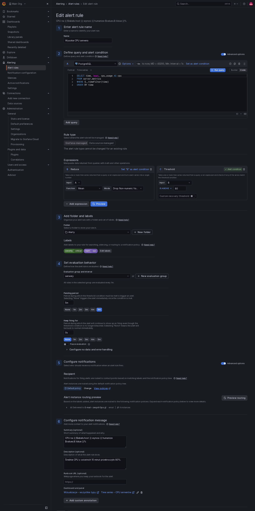

![[Pasted image 20260608075752.png]]


**Wyrażenia** (ang. *expressions*) przetwarzają wyniki zapytań po stronie serwera Grafany, zanim zostanie sprawdzony warunek alertu. Dzięki nim warunek może łączyć dane z różnych źródeł, liczyć średnie, porównywać serie i ustawiać progi. Wyrażenia są dostępne w regułach zarządzanych przez Grafanę po włączeniu przełącznika **Advanced options** w kroku 2 formularza reguły.

Każde zapytanie i wyrażenie ma swój identyfikator (**Ref ID**: `A`, `B`, `C`…). Wyrażenia odwołują się do siebie przez te identyfikatory, a jedno z nich jest oznaczone jako **Alert condition** – jego wynik decyduje o alercie (wartość różna od 0 = warunek spełniony).

---

## Typowy łańcuch: zapytanie → Reduce → Threshold

Tak zbudowane są wszystkie reguły w labie. Edycja reguły „Wysokie CPU serwera” z włączonym **Advanced options**:



| Ref ID | Typ | Ustawienia | Wynik |
|--------|-----|------------|-------|
| **A** | zapytanie PostgreSQL | `server_metrics`, zakres 10 min | szeregi czasowe (po jednym na serię) |
| **B** | **Reduce** | Input `A`, Function **Mean**, Mode **Drop Non-numeric Values** | jedna liczba na serię – średnie CPU z 10 min |
| **C** | **Threshold** | Input `B`, **IS ABOVE** `80` | 1 (alert) lub 0 (brak alertu) dla każdej serii |

Na zrzucie widać też:
- przy zapytaniu: **Options** (m.in. *MD* – max data points, *Min. Interval*), **Set as alert condition**, przyciski kopiowania i usuwania,
- **Rule type**: *Grafana-managed* / *Data source-managed* (dla istniejącej reguły nie da się zmienić),
- w nagłówku wyrażenia **B** link **Set "B" as alert condition** – warunkiem może być dowolne wyrażenie,
- przy Threshold przełącznik **Custom recovery threshold**,
- **Add expression** – lista typów wyrażeń, **Preview** – wylicza wszystko na bieżących danych.

Dlaczego Reduce jest potrzebny? Zapytanie zwraca **szereg czasowy** (wiele punktów), a Threshold porównuje **jedną liczbę**. Reduce zamienia każdy szereg w jedną wartość. Każda seria (np. każdy host) daje osobną **instancję alertu**.

---

## Typy wyrażeń w Grafanie 13

Po kliknięciu **Add expression** dostępne są: **Math**, **Reduce**, **Resample**, **Threshold**, **Classic condition (legacy)** oraz **SQL**. Przykłady poniżej zostały sprawdzone na labie (Grafana 13.3) przez ewaluację wyrażeń na żywych danych.

### Reduce

Zamienia każdy szereg czasowy w jedną liczbę.

- **Function**: *Last*, *Mean*, *Min*, *Max*, *Sum*, *Count*, *Median*,
- **Mode** – co zrobić z wartościami nieliczbowymi (NaN, null):
  - **Strict** – wynik będzie NaN, jeśli w danych jest choć jedna taka wartość,
  - **Drop Non-numeric Values** – pomija je,
  - **Replace Non-numeric Values** – zastępuje podaną liczbą.

W labie: reguła CPU – *Mean* (średnia z 10 min), reguła RAM – *Last* (ostatni pomiar), reguła błędów w logach – *Sum* (suma błędów z 5 min).

### Threshold

Porównuje liczbę z progiem i zwraca 1 (prawda) lub 0 (fałsz). Operatory:

| Operator | Odpowiednik |
|----------|-------------|
| Is above / Is below | `$B > 80` / `$B < 80` |
| Is above or equal to / Is below or equal to | `>=` / `<=` |
| Is equal to / Is not equal to | `==` / `!=` |
| Is within range / Is outside range | `$B > 0 AND $B < 10` / `$B < 0 OR $B > 100` |
| Is within range included / Is outside range included | jw. z `>=`, `<=` |

**Custom recovery threshold** to drugi próg – alert wraca do Normal dopiero po spadku poniżej niego. Przykład: alert przy CPU > 80, powrót dopiero przy CPU < 70. Zapobiega „migotaniu”, gdy wartość krąży wokół progu.

### Math

Działania na wynikach innych zapytań/wyrażeń, odwołania przez `$RefID`:

```
$A * 100                 # przeliczenie ułamka na procenty
$A / $B * 100            # stosunek dwóch zapytań (np. użyte / całkowite)
$B > 50 && $B < 90       # warunek złożony – wynik 1 lub 0
round($B)                # funkcje: abs, ceil, floor, round, log, is_nan, is_null…
```

Przy dwóch zapytaniach z wieloma seriami Math łączy serie o **takich samych etykietach** (np. `{host="web-01"}` z A z `{host="web-01"}` z B). Wyrażenie Math może być warunkiem alertu – wtedy każda wartość różna od 0 oznacza alert, i Threshold nie jest potrzebny.

> Math nie ma operatora warunkowego `?:` ani poziomów krytyczności. Różne poziomy (warning / critical) robi się dwiema regułami z różnymi progami i etykietą `severity`.

### Resample

Przelicza szereg czasowy na nowe, równe odstępy czasu – potrzebne, gdy chcesz w Math porównywać szeregi z różnych źródeł o różnych znacznikach czasu.

- **okno docelowe** – np. `1m`,
- **downsample** – jak łączyć kilka punktów w jednym oknie (*Mean*, *Min*, *Max*, *Sum*, *Last*),
- **upsample** – czym wypełnić okna bez punktów: **pad** (ostatnia znana wartość), **backfilling** (następna znana wartość), **fillna** (NaN).

Wynik Resample to nadal szereg czasowy – trzeba go potem zredukować (Reduce). Zakres czasu musi być dłuższy niż okno, inaczej pojawi się błąd *the series cannot be sampled further*.

### Classic condition (legacy)

Warunek w stylu starego alertingu: `WHEN avg() OF A IS ABOVE 50`, z możliwością łączenia kilku warunków (`AND`/`OR`). Funkcje: *avg, min, max, sum, count, last, median, diff, percent_diff, count_non_null…*

Wada: cała reguła daje **jedną** instancję alertu, niezależnie od liczby serii – nie wiadomo, który host przekroczył próg, a etykiety z zapytania nie trafiają do alertu. Dokumentacja Grafany zaleca Reduce + Threshold; Classic condition zostaw tylko dla reguł przeniesionych ze starej Grafany.

### SQL

Wyrażenie **SQL** (składnia zbliżona do MySQL) operuje na wynikach zapytań jak na tabelach – nazwa tabeli to Ref ID. W Grafanie 13.3 w labie jest dostępne (włączone domyślnie). Przykład dla zapytania **P** (PostgreSQL w formacie *Table*: `SELECT host, avg(cpu_usage) AS cpu FROM server_metrics WHERE $__timeFilter(time) GROUP BY host`):

```sql
SELECT host,
       CASE WHEN cpu > 25 THEN 1 ELSE 0 END AS alert
FROM P
```

Ustawione jako **Alert condition** zwraca tabelę: kolumna tekstowa (`host`) staje się etykietą instancji, liczba – wartością warunku (1 = alert).

Ograniczenie sprawdzone w labie: wynik SQL **nie może być wejściem dla kolejnego wyrażenia** (np. Threshold) – Grafana odrzuca taką regułę komunikatem *sql expressions can not be the input for other expressions*. Wyrażenie SQL musi więc samo być warunkiem albo ostatnim krokiem.

---

## Na co uważać

- **Etykiety serii muszą być unikalne.** Jeśli zapytanie zwraca kilka serii bez etykiet (albo z identycznymi), reguła kończy się błędem *frame cannot uniquely be identified by its labels*. W SQL zwracaj kolumnę tekstową (np. `host`) jako zwykłą kolumnę – nie jako `metric`.
- **Zakres czasu zapytania** (np. `10m to now`) określa, z ilu danych liczy Reduce. Średnia z 10 minut reaguje wolniej niż ostatni pomiar.
- **Brak danych** (np. Reduce w trybie Strict na pustej serii) uruchamia obsługę *no data* – patrz lekcja *Alert rules*.

---

## Podsumowanie

- **Reduce** – szereg → jedna liczba (Last, Mean, Max, Sum…), z trybem obsługi wartości nieliczbowych.
- **Threshold** – liczba → 0/1 według progu; opcjonalny **recovery threshold**.
- **Math** – działania i warunki na `$A`, `$B`; łączy serie po etykietach.
- **Resample** – wyrównanie szeregów do wspólnych odstępów czasu.
- **Classic condition** – tryb zgodności ze starym alertingiem, jedna instancja na regułę.
- **SQL** – zapytanie SQL na wynikach innych zapytań; może być warunkiem, ale nie wejściem dla innych wyrażeń.

---

## Ćwiczenie w labie

Grafana: http://10.123.2.206:3000 (admin / admin).

1. **Alerting → Alert rules**, otwórz regułę **RAM maszyny szkoleniowej powyżej 50%** → **Edit**. Nie zapisuj zmian w tej regule – używaj tylko **Preview**.
2. W kroku 2 (Advanced options włączone) zmień w wyrażeniu **B** funkcję z *Last* na *Max* i kliknij **Preview**. Porównaj wartość B z poprzednią.
3. **Add expression → Math**, wyrażenie `$B > 50 && $B < 55`. Kliknij **Set "D" as alert condition** (lub analogiczny link przy nowym wyrażeniu) i **Preview**.
4. **Oczekiwany efekt:** przy RAM ok. 55–60% wynik Math to `0` (poza przedziałem) – reguła z takim warunkiem nie odpaliłaby się; po zmianie na `$B > 50 && $B < 90` wynik to `1`.
5. Do Threshold **C** włącz **Custom recovery threshold** i zobacz, jakie pole się pojawia.
6. Kliknij **Cancel** (bez zapisu) i sprawdź, że reguła nadal ma Reduce *Last* i warunek C.
