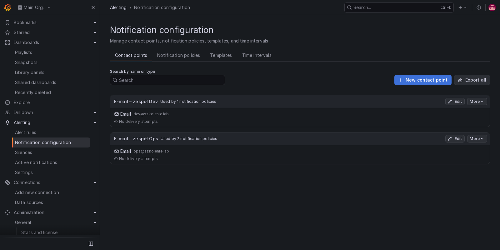
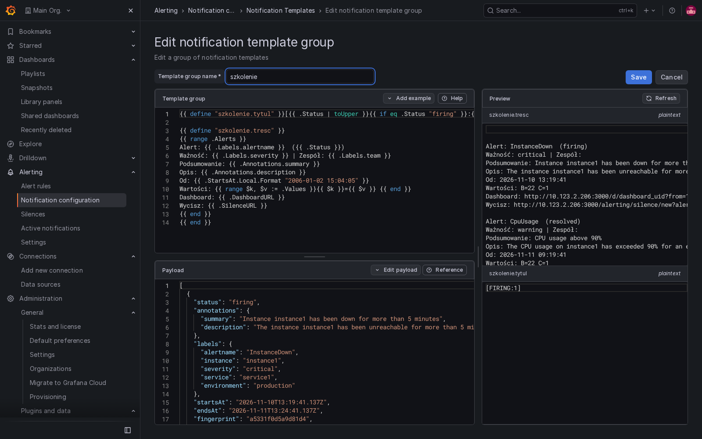

![[Pasted image 20260608075801.png]]

Treść powiadomienia w Grafanie powstaje na dwóch poziomach:

1. **Szablony w regule** – etykiety i adnotacje (*summary*, *description*, *runbook_url*…) wypełniane w momencie ewaluacji reguły. Mają dostęp do wartości zapytań: `$labels`, `$values`.
2. **Szablony powiadomień** (*notification templates*) – określają temat i treść wiadomości wysyłanej przez contact point. Mają dostęp do całej grupy alertów: `.Alerts`, `.Status`, `.CommonLabels`…

Oba używają składni szablonów Go: `{{ ... }}`.

---

## 1. Szablony w regule (adnotacje)

Adnotacje ustawia się w kroku 6 formularza reguły (*Configure notification message*). Przykłady z labu:

| Reguła | Adnotacja `summary` |
|--------|---------------------|
| RAM maszyny szkoleniowej | `RAM {{ $labels.instance }}: {{ humanize $values.B.Value }}%` |
| Wysokie CPU serwera | `CPU na {{ $labels.host }} wynosi {{ humanize $values.B.Value }}%` |
| Błędy w logach aplikacji | `{{ humanize $values.B.Value }} błędów w 5 min (serwis {{ index $labels "service.name" }})` |

Realny wynik pierwszej z nich w mailu: `RAM localhost:9100: 58.95%`.

Dostępne zmienne:

| Zmienna | Znaczenie |
|---------|-----------|
| `$labels` | etykiety serii z zapytania, np. `{{ $labels.instance }}` |
| `$values` | wartości wyrażeń według Ref ID: `{{ $values.B.Value }}`, etykiety: `{{ $values.B.Labels.instance }}` |
| `$value` | tekst ze wszystkimi wartościami – dokumentacja zaleca `$values` |

Najczęstsze funkcje:

| Funkcja | Przykład | Wynik |
|---------|----------|-------|
| `humanize` | `{{ humanize 1234.5 }}` | `1.234k` |
| `humanize1024` | `{{ humanize1024 1048576 }}` | `1Mi` |
| `humanizePercentage` | `{{ humanizePercentage 0.42 }}` | `42%` |
| `humanizeDuration` | `{{ humanizeDuration 90 }}` | `1m 30s` |
| `toUpper`, `toLower`, `title` | `{{ toUpper "ops" }}` | `OPS` |
| `printf` | `{{ printf "%.1f" $values.B.Value }}` | `57.9` |
| `externalURL` | `{{ externalURL }}` | adres Grafany |
| `index` | `{{ index $labels "service.name" }}` | wartość etykiety z kropką w nazwie |

> **Pułapki z labu.**
> - Etykieta z Elasticsearcha nazywa się `service.name` (z kropką), a nie `service`. Pierwsza wersja adnotacji używała `{{ $labels.service }}` i dawała w mailu `[no value]` („4 błędów w 5 min (serwis [no value])”). Dla nazw z kropką trzeba użyć `{{ index $labels "service.name" }}`.
> - W pierwszej wersji reguły CPU kolumna `host AS metric` nie tworzyła etykiety, więc `{{ $labels.metric }}` nic nie zwracało – patrz pułapka „SQL i etykiety” w lekcji *Alert rules*.
> - `$values` zawiera tylko wyniki wyrażeń i zapytań typu *instant*. Dla zapytań zakresowych odwołuj się do Reduce (`$values.B`), nie do zapytania `A`.

---

## 2. Szablony powiadomień

Szablony powiadomień tworzysz w **Alerting → Notification configuration → zakładka Templates**:



Szablon to **grupa szablonów** (*template group*) – jeden obiekt z nazwą, w którym blokami `define` definiujesz jeden lub więcej nazwanych szablonów. W labie grupa **szkolenie** definiuje dwa: `szkolenie.tytul` i `szkolenie.tresc`.



Edytor ma trzy części:
- **Template group** – kod; **Add example** wstawia gotowe przykłady, **Help** otwiera ściągawkę,
- **Payload** – przykładowe dane (JSON z alertami); **Edit payload** pozwala je zmienić, **Reference** opisuje pola,
- **Preview** – wynik każdego zdefiniowanego szablonu dla tych danych (przycisk **Refresh**).

Kod grupy `szkolenie` z labu:

```go
{{ define "szkolenie.tytul" }}[{{ .Status | toUpper }}{{ if eq .Status "firing" }}:{{ .Alerts.Firing | len }}{{ end }}] {{ .CommonLabels.alertname }}{{ end }}

{{ define "szkolenie.tresc" }}
{{ range .Alerts }}
Alert: {{ .Labels.alertname }}  ({{ .Status }})
Ważność: {{ .Labels.severity }} | Zespół: {{ .Labels.team }}
Podsumowanie: {{ .Annotations.summary }}
Opis: {{ .Annotations.description }}
Od: {{ .StartsAt.Local.Format "2006-01-02 15:04:05" }}
Wartości: {{ range $k, $v := .Values }}{{ $k }}={{ $v }} {{ end }}
Dashboard: {{ .DashboardURL }}
Wycisz: {{ .SilenceURL }}
{{ end }}
{{ end }}
```

- `szkolenie.tytul` daje np. `[FIRING:1] RAM maszyny szkoleniowej powyżej 50%` albo `[RESOLVED] …`,
- `szkolenie.tresc` w pętli `range .Alerts` wypisuje każdy alert z grupy.

Szablon sam z siebie nic nie zmienia – trzeba go **wywołać w contact poincie**. W punkcie *E-mail – zespół Ops* (sekcja *Optional Email settings*) ustawiono:

| Pole | Wartość |
|------|---------|
| Subject | `{{ template "szkolenie.tytul" . }}` |
| Message | `{{ template "szkolenie.tresc" . }}` |

Kropka na końcu (`.`) przekazuje do szablonu całe dane powiadomienia.

### Realny mail z labu

Mail z reguły „RAM…”, odebrany w Mailpit (wersja tekstowa, bez ikony folderu i linii oddzielających). Grafana wstawia wynik szablonu `Message` do swojego standardowego układu maila (nagłówek z liczbą alertów, stopka):

```
*1 firing* alert instance

Szkolenie Grafana/Alerty › RAM maszyny szkoleniowej powyżej 50%

Alert: RAM maszyny szkoleniowej powyżej 50% (firing)
Ważność: warning | Zespół: ops
Podsumowanie: RAM localhost:9100: 58.95%
Opis: Próg ćwiczeniowy – alert ma się odpalić na szkoleniu.
Od: 2026-11-11 11:29:30
Wartości: B=58.94890249200632 C=1
Dashboard:
Wycisz: http://10.123.2.206:3000/alerting/silence/new?alertmanager=grafana&matcher=__alert_rule_uid__%3Dram-szkoleniowa&matcher=env%3Dszkolenie&...

© 2026 Grafana Labs. Sent by Grafana v13.3.0
```

Temat: `[FIRING:1] RAM maszyny szkoleniowej powyżej 50%`.

Co z tego wynika:
- **Od: 11:29:30** – serwer labu działa w strefie UTC, a `.Local` oznacza strefę serwera. Czas polski uzyskasz funkcją `tz`: `{{ .StartsAt | tz "Europe/Warsaw" | date "2006-01-02 15:04:05" }}`.
- **Dashboard:** jest pusty, bo reguła RAM nie ma powiązanego dashboardu (*Link dashboard and panel*). `DashboardURL` i `PanelURL` są wypełniane tylko dla reguł powiązanych z panelem.
- **Wartości:** `B` to wynik Reduce, `C=1` – warunek Threshold spełniony. `{{ .ValueString }}` zwraca to samo jako gotowy tekst.
- **Wycisz:** to gotowy link do formularza wyciszenia z wypełnionymi matcherami.

Contact point *E-mail – zespół Dev* nie używa własnego szablonu – dostaje domyślny mail Grafany (zrzut w lekcji *Contact points*).

---

## Dane dostępne w szablonach powiadomień

Lista według dokumentacji Grafany (*Notification template reference*).

**Poziom powiadomienia** (`.`):

| Pole | Znaczenie |
|------|-----------|
| `.Receiver` | nazwa contact pointu |
| `.Status` | `firing` (gdy choć jeden alert aktywny) albo `resolved` |
| `.Alerts` | lista alertów w grupie; `.Alerts.Firing`, `.Alerts.Resolved` – tylko aktywne / rozwiązane |
| `.GroupLabels` | etykiety, po których grupowano (z polityki, np. `grafana_folder`, `alertname`) |
| `.CommonLabels` | etykiety wspólne dla wszystkich alertów w grupie |
| `.CommonAnnotations` | adnotacje wspólne dla wszystkich alertów |
| `.ExternalURL` | adres Grafany |
| `.GroupKey`, `.TruncatedAlerts` | klucz grupy, liczba alertów obciętych z powiadomienia |

**Poziom alertu** (wewnątrz `range .Alerts`):

| Pole | Znaczenie |
|------|-----------|
| `.Status` | `firing` / `resolved` |
| `.Labels` | etykiety alertu, np. `.Labels.severity` |
| `.Annotations` | adnotacje, np. `.Annotations.summary`, `.Annotations.description`, `.Annotations.runbook_url` |
| `.StartsAt`, `.EndsAt` | początek alertu, koniec (dla rozwiązanych) |
| `.GeneratorURL` | link do reguły w Grafanie |
| `.SilenceURL` | link do utworzenia wyciszenia |
| `.DashboardURL`, `.PanelURL` | link do powiązanego dashboardu / panelu |
| `.Values`, `.ValueString` | wartości wyrażeń (mapa / tekst) |
| `.Fingerprint`, `.OrgID` | identyfikator alertu, organizacja |

**Metody etykiet i adnotacji**: `.SortedPairs` (posortowane pary – do pętli), `.Names`, `.Values`, `.Remove` (np. `{{ .Labels.Remove (stringSlice "grafana_folder") }}`).

**Funkcje**: `toUpper`, `toLower`, `title`, `trimSpace`, `match`, `reReplaceAll`, `join`, `safeHtml`, `stringSlice`, `date`, `tz` oraz wbudowane funkcje Go: `len`, `index`, `printf`, `and`, `eq`.

Pól typu `.AlertState`, `.RunbookURL`, `.AlertRules` czy `.Alerts.Labels` **nie ma** – runbook pobierasz przez `.Annotations.runbook_url` wewnątrz pętli po alertach.

### Przykład: wiadomość z podziałem na aktywne i rozwiązane

```go
{{ define "szkolenie.lista" -}}
{{ if .Alerts.Firing -}}
Aktywne alerty ({{ len .Alerts.Firing }}):
{{ range .Alerts.Firing -}}
- {{ .Labels.alertname }} [{{ .Labels.severity }}]: {{ .Annotations.summary }}
  od {{ .StartsAt | tz "Europe/Warsaw" | date "15:04" }}, reguła: {{ .GeneratorURL }}
{{ end }}
{{- end }}
{{ if .Alerts.Resolved -}}
Rozwiązane ({{ len .Alerts.Resolved }}):
{{ range .Alerts.Resolved -}}
- {{ .Labels.alertname }} – zakończony {{ .EndsAt | tz "Europe/Warsaw" | date "15:04" }}
{{ end }}
{{- end }}
{{- end }}
```

`{{-` i `-}}` usuwają białe znaki przed / po tagu – dzięki temu w wiadomości nie ma pustych linii.

---

## Podsumowanie

- Adnotacje w regule: `$labels`, `$values.B.Value`, funkcje `humanize…`; dla etykiet z kropką `index`.
- Szablony powiadomień: grupa szablonów z blokami `define`, wywołanie w contact poincie przez `{{ template "nazwa" . }}`.
- W szablonach powiadomień: `.Status`, `.Alerts` (`.Firing`, `.Resolved`), `.CommonLabels`, a dla każdego alertu `.Labels`, `.Annotations`, `.StartsAt`, `.Values`, `.SilenceURL`, `.DashboardURL`.
- Czas w mailu jest w strefie serwera – użyj `tz "Europe/Warsaw"`.

---

## Ćwiczenie w labie

Grafana: http://10.123.2.206:3000 (admin / admin), Mailpit: http://10.123.2.206:8025.

1. **Alerting → Notification configuration → Templates**, otwórz grupę **szkolenie** (**Edit**).
2. W **Preview** sprawdź wynik `szkolenie.tytul` i `szkolenie.tresc` dla przykładowego payloadu.
3. W szablonie `szkolenie.tresc` zamień linię `Od: …` na:
   `Od: {{ .StartsAt | tz "Europe/Warsaw" | date "2006-01-02 15:04:05" }}`
   i kliknij **Refresh** w Preview – godzina powinna przesunąć się o +1 h względem UTC.
4. Dodaj linię `Runbook: {{ .Annotations.runbook_url }}` i zapisz (**Save**).
5. Wywołaj nowe powiadomienie: **Notification configuration → Contact points → E-mail – zespół Ops → Edit → Test** i potwierdź wysłanie (Grafana wysyła testowy alert przez ten contact point, z bieżącym szablonem).
6. **Oczekiwany efekt:** w Mailpit pojawia się mail do `ops@szkolenie.lab` z tematem z szablonu `szkolenie.tytul` i treścią z polską godziną oraz linią *Runbook* (dla alertu testowego może być pusta – testowy alert nie ma adnotacji `runbook_url`).
7. Otwórz regułę **Błędy w logach aplikacji** i porównaj adnotację *summary* z mailem w Mailpit – nazwa serwisu pojawia się dzięki `{{ index $labels "service.name" }}`. Dla porównania wpisz w kopii reguły `{{ $labels.service }}` i sprawdź, że w mailu będzie `[no value]`.
