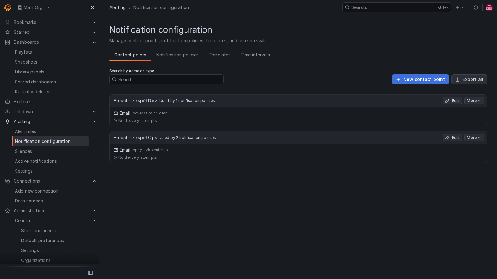
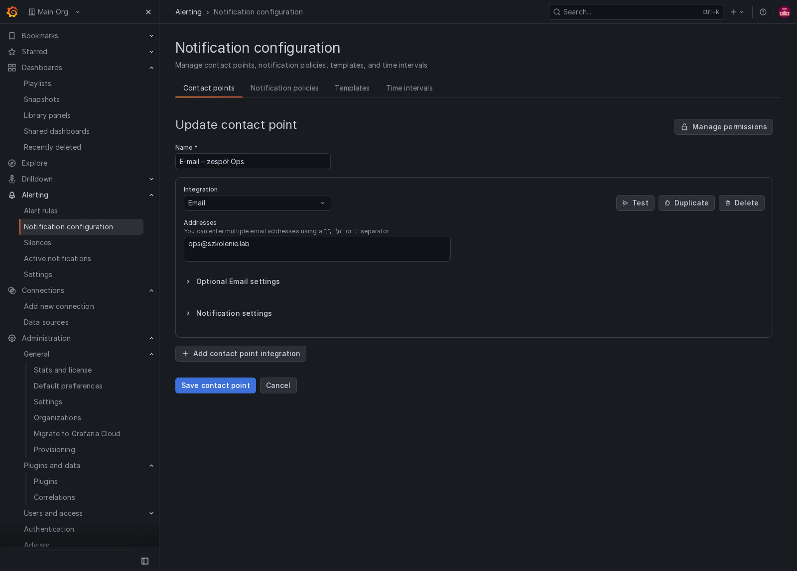

![[Pasted image 20260608075813.png]]

**Punkt kontaktowy** (ang. *contact point*) określa, **dokąd i jak** Grafana wysyła powiadomienie: na jakie adresy e-mail, na który kanał Slacka, pod jaki webhook. Jeden contact point może zawierać kilka **integracji** (np. e-mail + Slack) – powiadomienie trafia wtedy do wszystkich.

Contact point nie decyduje, **które** alerty dostaje – to robią **polityki powiadomień** (następna lekcja) albo, w trybie uproszczonym, bezpośredni wybór contact pointu w regule.

---

## Lista punktów kontaktowych

**Alerting → Notification configuration → zakładka Contact points**:



W labie są dwa punkty:

| Contact point | Integracja | Adres | Szablon | Używany przez |
|---------------|------------|-------|---------|---------------|
| **E-mail – zespół Ops** | Email | `ops@szkolenie.lab` | temat i treść z szablonu `szkolenie` | 2 polityki (domyślna i `severity=critical`) |
| **E-mail – zespół Dev** | Email (*Single email*) | `dev@szkolenie.lab` | domyślny Grafany | 1 polityka (`team=dev`) |

Przy każdym punkcie widać typ integracji, adresy, **Used by N notification policies**, czas ostatniej próby wysyłki (*Last delivery attempt*, *Last delivery took*) lub *No delivery attempts*. Punkt bez integracji Grafana oznacza jako **Unused** / *No integrations configured* (na zrzucie pozycja `empty`). Przyciski: **New contact point**, **Export all** (eksport do provisioningu), przy punkcie **Edit** i **More**.

---

## Konfiguracja punktu e-mail

**Edit** przy *E-mail – zespół Ops*:



- **Name** – nazwa (używana w politykach),
- **Integration** – typ integracji (Email, Slack, Webhook, Microsoft Teams, Discord, Telegram, PagerDuty…),
- **Addresses** – adresy oddzielone `;`, `,` lub nową linią,
- **Optional Email settings** – m.in. **Single email** (jeden mail do wszystkich adresów zamiast osobnych), **Message** i **Subject** (tu wywołania szablonów `{{ template "szkolenie.tresc" . }}` i `{{ template "szkolenie.tytul" . }}`),
- **Notification settings** – m.in. **Disable resolved message** (nie wysyłaj powiadomienia o rozwiązaniu),
- **Test** – wysyła testowe powiadomienie przez tę integrację, **Duplicate**, **Delete**,
- **Add contact point integration** – dodanie kolejnej integracji do tego samego punktu,
- **Manage permissions** – kto może oglądać/edytować punkt.

Zapis: **Save contact point**.

---

## Serwer SMTP – konfiguracja Grafany

Integracja Email nie ma pól serwera SMTP – Grafana wysyła pocztę przez serwer ustawiony w pliku konfiguracyjnym `/etc/grafana/grafana.ini`, sekcja `[smtp]`. W labie poczta trafia do **Mailpit** – testowego serwera SMTP, który niczego nie wysyła dalej, tylko pokazuje maile w przeglądarce:

```ini
[smtp]
enabled = true
host = 127.0.0.1:1025
skip_verify = true
from_address = grafana@vmzabbixsrv16.lab
from_name = Grafana szkolenie
```

Dla prawdziwego serwera pocztowego dochodzą zwykle `user`, `password` i port 587 lub 465, np.:

```ini
[smtp]
enabled = true
host = smtp.firma.pl:587
user = grafana@firma.pl
password = """haslo"""
from_address = grafana@firma.pl
from_name = Grafana
startTLS_policy = MandatoryStartTLS
```

Po zmianie pliku: `sudo systemctl restart grafana-server`. Hasło z `#` lub `;` umieść w potrójnych cudzysłowach. Zamiast edytować plik można ustawić zmienne środowiskowe `GF_SMTP_ENABLED`, `GF_SMTP_HOST` itd.

Bez `enabled = true` test punktu e-mail kończy się błędem *SMTP not configured*.

---

## Mailpit – podgląd wysłanych maili

http://10.123.2.206:8025:

![Mailpit – skrzynka: maile [FIRING:1] DatasourceNoData i [FIRING:1] RAM maszyny szkoleniowej powyżej 50% do ops@szkolenie.lab](/grafiki/lab-VI-4-03-mailpit-skrzynka.png)

Nadawca to *Grafana szkolenie* (`from_name`), adresat `ops@szkolenie.lab`. Tematy są generowane szablonem `szkolenie.tytul`. Mail *DatasourceNoData* pochodzi z reguły CPU, gdy jej zapytanie nie zwracało danych (patrz lekcja *Alert rules*).

Mail dla zespołu Dev – bez własnego szablonu, czyli w **domyślnym** układzie Grafany:

![Mailpit – mail [FIRING:1] Błędy w logach aplikacji do dev@szkolenie.lab w domyślnym szablonie Grafany](/grafiki/lab-VI-4-04-mailpit-wiadomosc.png)

Domyślny mail zawiera: temat `[FIRING:1] <alertname> (<wartości pozostałych wspólnych etykiet>)` – tu `(Szkolenie Grafana/Alerty auth warning dev)`, sekcję **Grouped by**, liczbę aktywnych instancji, dla każdego alertu **Summary**, **Values** (`B=4 C=1`), **Labels** i przycisk **View alert**. Zakładki Mailpit (*HTML*, *HTML Source*, *Text*, *Headers*, *Raw*) pozwalają obejrzeć wersję HTML, tekstową i nagłówki.

---

## Inne integracje (ogólnie)

| Integracja | Co jest potrzebne | Uwagi |
|------------|-------------------|-------|
| **Slack** | *Webhook URL* (Incoming Webhook) albo *Token* aplikacji Slack + nazwa kanału | z tokenem można wysyłać na dowolny kanał, do którego dodano aplikację |
| **Microsoft Teams** | adres webhooka kanału | Microsoft wycofuje stare konektory Office 365 – webhook tworzy się teraz przez aplikację *Workflows* w Teams |
| **Discord** | *Webhook URL* kanału (Ustawienia kanału → Integracje → Webhooki) | opcjonalnie nazwa i avatar bota |
| **Webhook** | URL, metoda HTTP (POST/PUT), opcjonalnie uwierzytelnianie | Grafana wysyła JSON z polami `status`, `alerts`, `groupLabels`, `commonLabels`, `externalURL`… – do integracji z własnymi systemami, n8n, systemami ticketowymi |
| **Telegram**, **PagerDuty**, **Opsgenie**, **Google Chat**, **Alertmanager**… | token / klucz integracji | pełna lista w polu *Integration* |

Wszystkie integracje mają pola do szablonów (tytuł, treść) – te same szablony z grupy `szkolenie` można użyć w Slacku czy Teams.

---

## Podsumowanie

- Contact point = nazwa + jedna lub więcej integracji (Email, Slack, Webhook, Teams, Discord…).
- Dla e-maila serwer SMTP ustawia się w `grafana.ini` (`[smtp]`), nie w contact poincie; w labie to Mailpit na `127.0.0.1:1025`.
- Treść maila zależy od szablonu: bez niego Grafana używa układu domyślnego.
- Przycisk **Test** szybko sprawdza, czy integracja działa.

---

## Ćwiczenie w labie

Grafana: http://10.123.2.206:3000 (admin / admin), Mailpit: http://10.123.2.206:8025.

1. Zaloguj się przez SSH (`ssh szkolenie@10.123.2.206`) i wyświetl konfigurację SMTP: `sudo grep -A6 '^\[smtp\]' /etc/grafana/grafana.ini`. Porównaj z opisem powyżej.
2. **Alerting → Notification configuration → Contact points → New contact point**.
   - Name: `E-mail – <Twoje imię>`, Integration: **Email**, Addresses: `<imie>@szkolenie.lab`.
   - Rozwiń **Optional Email settings** i wpisz w **Subject**: `{{ template "szkolenie.tytul" . }}`.
3. Kliknij **Test** i potwierdź wysłanie.
4. **Oczekiwany efekt:** w Mailpit pojawia się mail do `<imie>@szkolenie.lab` od *Grafana szkolenie*, z tematem w formacie `[FIRING:1] …`.
5. Dodaj drugą integrację (**Add contact point integration**) typu **Webhook** z adresem `http://127.0.0.1:9999/`. Test tej integracji skończy się błędem połączenia (nic nie nasłuchuje na porcie 9999) – tak wygląda nieudana wysyłka.
6. Zapisz punkt (**Save contact point**). Na liście będzie oznaczony jako *Unused* – nie używa go żadna polityka. Podepniesz go w następnej lekcji.
