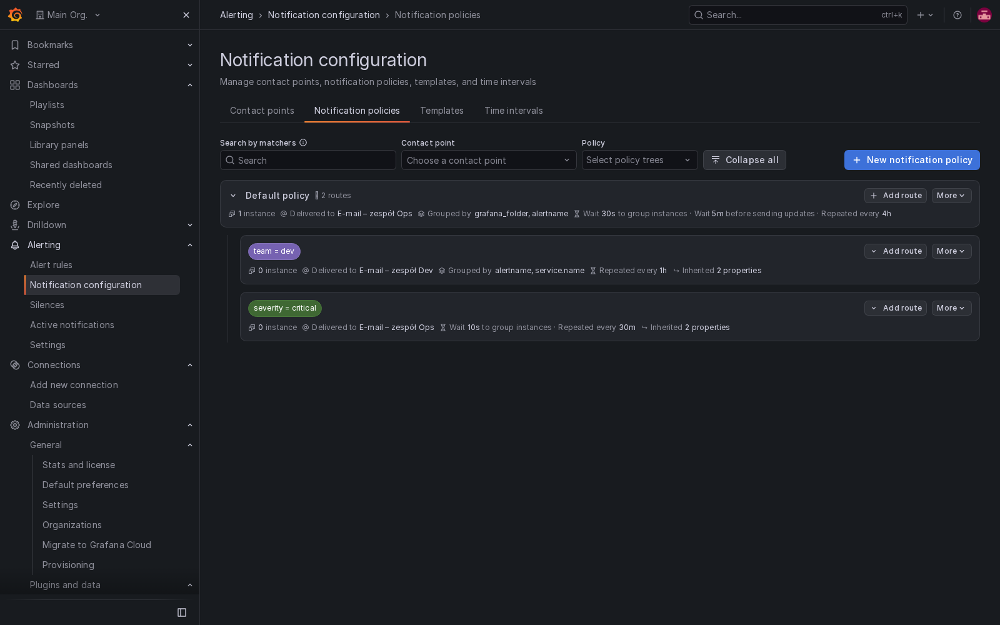

![[Pasted image 20260608075820.png]]

**Polityki powiadomień** (ang. *notification policies*) decydują, **który alert trafia do którego contact pointu** oraz **jak często** wysyłane są powiadomienia. Tworzą drzewo: na górze jest **polityka domyślna** (*Default policy*), pod nią **podpolityki** (*routes*) z warunkami na etykiety alertów (*matchers*).

Reguła nie wskazuje polityki wprost – o trasie decydują **etykiety** alertu (`severity`, `team`, `alertname`, `grafana_folder`…). Dlatego dobre etykiety w regułach są podstawą porządnego routingu.

---

## Drzewo polityk w labie

**Alerting → Notification configuration → zakładka Notification policies**:

| Polityka | Warunek (matcher) | Contact point | Grupowanie | Czasy |
|----------|-------------------|---------------|------------|-------|
| **Default policy** | – (łapie wszystko, czego nie złapały podpolityki) | E-mail – zespół Ops | `grafana_folder, alertname` | group_wait 30s, group_interval 5m, repeat_interval 4h |
| podpolityka 1 | `team = dev` | E-mail – zespół Dev | `alertname, service.name` | repeat_interval 1h, reszta dziedziczona |
| podpolityka 2 | `severity = critical` | E-mail – zespół Ops | dziedziczone | group_wait 10s, repeat_interval 30m |

Na zrzucie przy każdej polityce widać: liczbę instancji alertów, które aktualnie do niej trafiają (*1 instance*, *0 instance*), contact point (*Delivered to*), grupowanie (*Grouped by*), czasy (*Wait 30s to group instances*, *Wait 5m before sending updates*, *Repeated every 4h*) oraz **Inherited 2 properties** – ustawienia przejęte z polityki nadrzędnej. Przyciski: **Add route** (dodaj podpolitykę), **More** (edycja, usuwanie), u góry **New notification policy**, wyszukiwanie po matcherach i po contact poincie.

### Jak reguły z labu trafiają do adresatów

| Alert | Etykiety | Pasująca polityka | Dokąd |
|-------|----------|-------------------|-------|
| RAM maszyny szkoleniowej powyżej 50% | `severity=warning`, `team=ops` | żadna podpolityka → **Default policy** | ops@szkolenie.lab |
| Wysokie CPU serwera (i jego DatasourceNoData / DatasourceError) | `severity=critical`, `team=ops` | **severity = critical** | ops@szkolenie.lab (szybciej: wait 10s, powtórka co 30m) |
| Błędy w logach aplikacji | `severity=warning`, `team=dev` | **team = dev** | dev@szkolenie.lab |

---

## Zasady dopasowania

1. Alert wchodzi do polityki domyślnej i sprawdza jej podpolityki **od góry do dołu**.
2. Pierwsza pasująca podpolityka wygrywa; jeśli ma własne podpolityki, sprawdzanie schodzi niżej.
3. Jeśli żadna podpolityka nie pasuje – obsługuje go polityka nadrzędna (na końcu domyślna).
4. Opcja **Continue matching subsequent sibling nodes** w podpolityce sprawia, że po dopasowaniu sprawdzane są też kolejne podpolityki na tym samym poziomie – alert może wtedy trafić do kilku contact pointów.

Przykład: alert z etykietami `team=dev` **i** `severity=critical` trafi tylko do Dev (podpolityka `team = dev` jest wyżej, a `continue` jest wyłączone). Gdyby włączyć *Continue matching* w podpolityce `team = dev`, dostałby go także Ops.

**Operatory matcherów**: `=` (równe), `!=` (różne), `=~` (pasuje do regex), `!~` (nie pasuje do regex). Przykład: `severity =~ critical|high`.

---

## Grupowanie i czasy

Alertmanager nie wysyła maila osobno dla każdej instancji – łączy alerty w **grupy** i wysyła jedno powiadomienie na grupę.

| Ustawienie | W labie (domyślna) | Znaczenie |
|------------|--------------------|-----------|
| **Group by** | `grafana_folder, alertname` | alerty o tych samych wartościach tych etykiet trafiają do jednego powiadomienia; tu: jedna wiadomość na regułę w folderze |
| **Group wait** | 30s | ile czekać po pojawieniu się **nowej** grupy, zanim wyśle się pierwsze powiadomienie (żeby zebrać więcej alertów) |
| **Group interval** | 5m | najkrótszy odstęp między powiadomieniami o **zmianach** w grupie (nowy alert w grupie, rozwiązanie) |
| **Repeat interval** | 4h | po jakim czasie przypomnieć o grupie, która się **nie zmieniła** i nadal jest aktywna |

Co z tego wynika w labie:
- pierwszy mail o regule RAM przyszedł ok. 30 s po przejściu w *Alerting*,
- dopóki RAM jest powyżej progu, przypomnienie przyjdzie co 4 godziny,
- mail o rozwiązaniu (`[RESOLVED]`) przychodzi po kolejnym cyklu *group_interval*,
- alerty krytyczne (podpolityka `severity = critical`) idą szybciej (10 s) i przypominane są co 30 min.

> **Pułapka z labu:** pierwsza wersja podpolityki zespołu Dev grupowała po `alertname, service`, ale reguła z Elasticsearcha ma etykietę `service.name` (nie `service`). Etykieta `service` nie istnieje, więc wszystkie serwisy lądowały w jednej grupie. W labie jest już poprawne grupowanie: `alertname, service.name`.

Ustawienie **Group by** = `...` (specjalna wartość) wyłącza grupowanie – każda instancja to osobne powiadomienie.

---

## Tworzenie i edycja polityki

- **Add route** przy polityce domyślnej (lub innej) – nowa podpolityka. Podajesz:
  - **Matching labels** – etykieta, operator, wartość (można kilka – wszystkie muszą pasować),
  - **Contact point**,
  - **Continue matching subsequent sibling nodes**,
  - opcjonalnie **Override grouping** (własne *Group by*) i **Override general timings** (własne *Group wait / interval / Repeat*),
  - opcjonalnie **Mute timings / Active timings** – okresy z zakładki *Time intervals*, w których polityka nie wysyła powiadomień (np. noc, weekend) lub wysyła tylko w nich.
- **More → Edit** – edycja; dla polityki domyślnej można zmienić tylko contact point, grupowanie i czasy (nie ma matcherów).
- **More → Delete** – usunięcie podpolityki.

### Polityki a reguła

W formularzu reguły (krok 5 *Configure notifications*, przełącznik **Advanced options**) widać, że alert jest kierowany przez drzewo polityk, a **Preview routing** pokazuje, do której polityki i contact pointu trafi przy obecnych etykietach. Bez *Advanced options* wybiera się contact point bezpośrednio – wtedy polityki nie są używane dla tej reguły.

---

## Podsumowanie

- Drzewo polityk: domyślna + podpolityki z matcherami na etykiety; pierwsza pasująca wygrywa, chyba że włączono *Continue matching*.
- **Group by** łączy alerty w jedno powiadomienie; **group_wait**, **group_interval**, **repeat_interval** sterują tempem wysyłki.
- Podpolityki dziedziczą ustawienia (*Inherited properties*), o ile ich nie nadpiszą.
- W labie: domyślnie → Ops, `team=dev` → Dev, `severity=critical` → Ops szybciej.

---

## Ćwiczenie w labie

Grafana: http://10.123.2.206:3000 (admin / admin), Mailpit: http://10.123.2.206:8025.

1. **Alerting → Notification configuration → Notification policies**. Odczytaj, ile instancji trafia teraz do każdej polityki.
2. W polu **Search by matchers** wpisz `team=dev` – widok zawęzi się do polityki zespołu Dev.
3. Przy **Default policy** kliknij **Add route**:
   - Matching labels: `team` `=` `<Twoje imię>`,
   - Contact point: punkt utworzony w poprzedniej lekcji (`E-mail – <Twoje imię>`),
   - włącz **Override general timings** i ustaw *Group wait* `10s`. Zapisz.
4. Utwórz regułę jak w ćwiczeniu z lekcji *Alert rules* (Prometheus `node_load1`, Threshold *Is above* `0`, Pending period *None*), ale z etykietą `team=<Twoje imię>`. W kroku 5 kliknij **Preview routing**.
5. **Oczekiwany efekt:** Preview routing wskazuje Twój contact point; po 1–2 min w Mailpit pojawia się mail do `<imie>@szkolenie.lab`, a nie do Ops. W drzewie polityk przy Twojej podpolityce widać *1 instance*.
6. Posprzątaj: usuń regułę, podpolitykę (**More → Delete**) i swój contact point.
