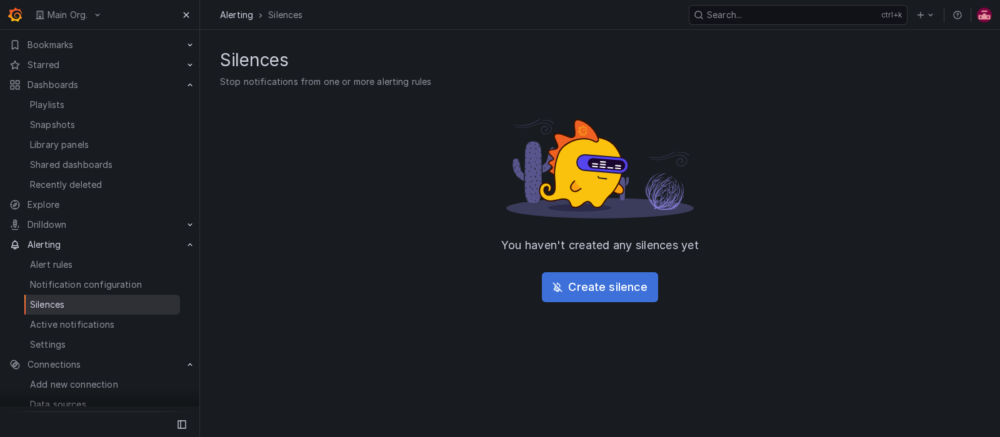
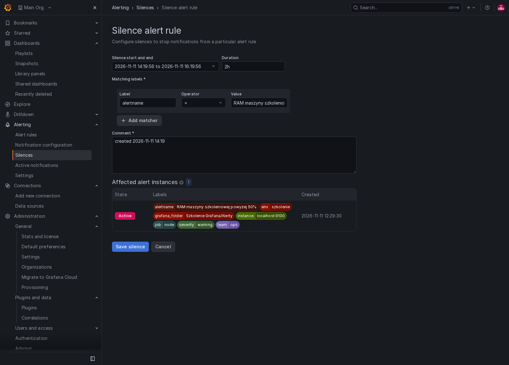

![[Pasted image 20260608075828.png]]

**Wyciszenie** (ang. *silence*) czasowo wstrzymuje **powiadomienia** dla alertów pasujących do podanych etykiet. Reguła dalej jest liczona, alert dalej ma stan *Alerting* i jest widoczny w Grafanie – nie przychodzą tylko maile / wiadomości. Typowe zastosowania: znany problem, nad którym już ktoś pracuje, albo zaplanowane prace serwisowe.

Porównanie z podobnymi mechanizmami:

| Mechanizm | Gdzie | Działanie |
|-----------|-------|-----------|
| **Silence** | Alerting → Silences | jednorazowo, od–do, dla alertów pasujących do matcherów |
| **Mute timing** | Notification configuration → Time intervals + polityka | cyklicznie (np. każda noc, weekendy) dla całej polityki |
| **Pause evaluation** | edycja reguły | reguła w ogóle nie jest liczona – brak stanów i alertów |

---

## Lista wyciszeń

**Alerting → Silences**. W labie nie ma jeszcze żadnego wyciszenia:

Gdy wyciszenia istnieją, lista pokazuje ich stan: **Active** (obowiązuje), **Pending** (zaczyna się w przyszłości), **Expired** (wygasło), matchery, liczbę objętych alertów i czas trwania. Aktywne wyciszenie można zakończyć wcześniej (**Expire**), wygasłe – odtworzyć (**Recreate**).

---

## Tworzenie wyciszenia

Wyciszenie utworzysz na trzy sposoby:
- **Alerting → Silences → Create silence** – pusty formularz,
- przycisk **Silence** przy instancji alertu (zakładka *Instances* reguły) – formularz z wypełnionymi etykietami,
- link **Wycisz** (`.SilenceURL`) w mailu z labu – też z wypełnionymi matcherami.

Formularz dla reguły „RAM maszyny szkoleniowej powyżej 50%”:

| Pole | Znaczenie |
|------|-----------|
| **Silence start and end** | od kiedy do kiedy (domyślnie od teraz) |
| **Duration** | długość wyciszenia, np. `2h`, `30m`, `1d` – zmienia datę końca |
| **Matching labels** | matchery: **Label**, **Operator** (`=`, `!=`, `=~`, `!~`), **Value**; **Add matcher** dodaje kolejny – wszystkie muszą pasować |
| **Comment** (wymagany) | dlaczego wyciszamy – np. numer zgłoszenia, nazwisko |
| **Affected alert instances** | podgląd instancji, które obecnie pasują do matcherów (tu 1 – *Active*, z pełnym zestawem etykiet) |

Zapis: **Save silence**.

Przykłady matcherów:

| Cel | Matchery |
|-----|----------|
| jedna reguła | `alertname = RAM maszyny szkoleniowej powyżej 50%` |
| jedna maszyna, wszystkie reguły | `instance = localhost:9100` |
| wszystkie alerty zespołu Dev | `team = dev` |
| reguły z folderu, ostrzeżenia | `grafana_folder = Szkolenie Grafana/Alerty`, `severity = warning` |
| kilka serwisów | `service.name =~ nginx|api` |

> Zawsze sprawdź **Affected alert instances** przed zapisem. Pusta lista oznacza literówkę w matcherze (wyciszenie nic nie zrobi) – chyba że celowo wyciszasz z wyprzedzeniem alert, który jeszcze nie istnieje. Zbyt szeroki matcher (np. sam `severity = warning`) wyciszy więcej, niż zamierzałeś.

---

## Co się dzieje w trakcie wyciszenia

- reguła jest liczona normalnie, stan instancji to dalej *Alerting*,
- Alertmanager nie wysyła powiadomień o wyciszonych alertach – ani pierwszego, ani przypomnień (*repeat_interval*),
- po zakończeniu wyciszenia (upływ czasu lub **Expire**) alert, który nadal jest aktywny, znów dostaje powiadomienia według polityki.

---

## Podsumowanie

- Silence = wyciszenie powiadomień na określony czas dla alertów pasujących do matcherów; nie zatrzymuje ewaluacji reguły.
- Najwygodniej tworzyć je przyciskiem **Silence** przy instancji albo z linku w mailu.
- Komentarz jest wymagany; **Affected alert instances** pokazuje, co faktycznie zostanie wyciszone.
- Dla cyklicznych okien (noc, weekend) zamiast silences używaj **Time intervals** w politykach.

---

## Ćwiczenie w labie

Grafana: http://10.123.2.206:3000 (admin / admin), Mailpit: http://10.123.2.206:8025.

1. Otwórz regułę **RAM maszyny szkoleniowej powyżej 50%** → zakładka **Instances** → przycisk **Silence** przy instancji.
2. Zostaw jeden matcher `alertname = RAM maszyny szkoleniowej powyżej 50%` (pozostałe usuń), ustaw **Duration** `15m`, w **Comment** wpisz `Ćwiczenie – <Twoje imię>`.
3. **Oczekiwany efekt przed zapisem:** w **Affected alert instances** jest 1 instancja z etykietą `instance = localhost:9100`. Zmień wartość matchera na `RAM` – lista powinna być pusta (operator `=` wymaga pełnej nazwy). Przywróć pełną nazwę albo użyj operatora `=~` z wartością `RAM.*`.
4. **Save silence**. Na liście **Silences** wyciszenie ma stan **Active**, a reguła dalej jest w stanie *Firing* na liście reguł.
5. Sprawdź wyciszenie z regułą, która dopiero ma się odpalić: utwórz wyciszenie z matcherem `alertname =~ Load.*` na 15 min, potem regułę *Load – <inicjały>* z ćwiczenia w lekcji *Alert rules* (Threshold *Is above* `0`).
6. **Oczekiwany efekt:** reguła przechodzi Pending → Firing, ale w Mailpit **nie** pojawia się mail `[FIRING:1] Load – …`. Po kliknięciu **Expire** przy wyciszeniu mail przychodzi w ciągu kilku minut.
7. Posprzątaj: zakończ (**Expire**) swoje wyciszenia i usuń regułę *Load*.
