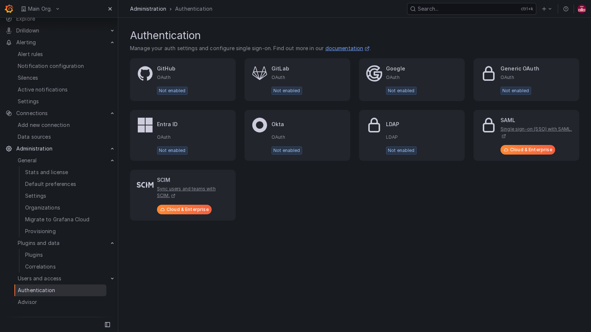

![[Pasted image 20260608080532.png]]

Grafana pozwala logować się na kilka sposobów: kontem lokalnym zapisanym w bazie Grafany, przez katalog LDAP albo przez zewnętrznego dostawcę tożsamości (OAuth 2.0 / OpenID Connect – GitHub, GitLab, Google, Entra ID, Okta lub dowolny dostawca w trybie Generic OAuth). Metody można łączyć – np. konta lokalne dla administratorów i logowanie firmowe (SSO) dla pozostałych użytkowników.

W Grafanie 13 dostawców logowania konfiguruje się na dwa sposoby:

- **w interfejsie** – **Administration → Authentication** (kafelki dostawców),
- **w pliku konfiguracyjnym** – `/etc/grafana/grafana.ini`, sekcje `[auth.*]` (po zmianie wymagany restart usługi `grafana-server`).

Ustawienia zapisane w interfejsie są zapisywane w bazie Grafany i stają się konfiguracją aktywną. Formularz dostawcy w UI jest wstępnie wypełniony wartościami z `grafana.ini`, a przycisk **Reset** w formularzu przywraca ustawienia z pliku (albo domyślne).

---

## Ekran Authentication w Grafanie 13

Przejdź do **Administration → Authentication**. Każdy dostawca ma osobny kafelek ze statusem (np. **Not enabled**).



| Kafelek | Typ | Dostępność | Sekcja w `grafana.ini` |
|---------|-----|------------|------------------------|
| GitHub | OAuth | OSS | `[auth.github]` |
| GitLab | OAuth | OSS | `[auth.gitlab]` |
| Google | OAuth | OSS | `[auth.google]` |
| Generic OAuth | OAuth | OSS | `[auth.generic_oauth]` |
| Entra ID | OAuth | OSS | `[auth.azuread]` |
| Okta | OAuth | OSS | `[auth.okta]` |
| LDAP | LDAP | OSS | `[auth.ldap]` + plik `ldap.toml` |
| SAML | SSO SAML | **Cloud & Enterprise** | – |
| SCIM | synchronizacja użytkowników i zespołów | **Cloud & Enterprise** | – |

> Kafelki **SAML** i **SCIM** mają w OSS oznaczenie **Cloud & Enterprise** – w wersji open source nie da się ich włączyć.

---

## Krok 1: Logowanie lokalne (domyślne)

Domyślnie użytkownicy logują się loginem (albo adresem e-mail) i hasłem zapisanym w bazie Grafany. Tak działa lab szkoleniowy: konto `admin` / `admin` oraz konta ćwiczeniowe `jan.kowalski`, `anna.nowak`, `piotr.zielinski`, `ewa.wisniewska` (hasło `Szkolenie123!`).

Konta lokalne zakłada administrator serwera w **Administration → Users and access → Users → New user** – szczegóły w lekcji **2. Users and Roles**.

Najważniejsze opcje logowania lokalnego w `grafana.ini`:

```ini
[auth]
# ukrycie formularza login/hasło (np. gdy wszyscy logują się przez SSO)
;disable_login_form = false

[auth.basic]
# uwierzytelnianie Basic Auth w API (curl -u login:hasło)
;enabled = true

[users]
# czy użytkownicy mogą sami zakładać konta
;allow_sign_up = true
# czy użytkownicy mogą tworzyć własne organizacje
;allow_org_create = true
# automatyczne przypisanie nowych użytkowników do organizacji i roli
;auto_assign_org = true
;auto_assign_org_id = 1
;auto_assign_org_role = Viewer
```

Linie zaczynające się od `;` są zakomentowane – pokazują wartości domyślne. Aby zmienić ustawienie, usuń `;`, wpisz wartość i zrestartuj Grafanę:

```bash
sudo systemctl restart grafana-server
```

---

## Krok 2: Logowanie przez LDAP

LDAP pozwala logować się kontami z katalogu firmowego (OpenLDAP, Active Directory). Konfiguracja składa się z dwóch plików:

1. `grafana.ini` – włączenie LDAP i wskazanie pliku konfiguracyjnego:

```ini
[auth.ldap]
enabled = true
config_file = /etc/grafana/ldap.toml
# czy zakładać konto Grafany przy pierwszym logowaniu użytkownika z LDAP
allow_sign_up = true
# true = role w Grafanie nie są nadpisywane na podstawie grup LDAP
skip_org_role_sync = false
```

2. `/etc/grafana/ldap.toml` – adres serwera, konto do wyszukiwania, atrybuty i mapowanie grup na role. Plik z przykładową konfiguracją jest instalowany razem z pakietem (w labie: `/etc/grafana/ldap.toml`):

```toml
[[servers]]
host = "ldap.firma.local"
port = 389
use_ssl = false
start_tls = false
ssl_skip_verify = false
bind_dn = "cn=admin,dc=firma,dc=local"
bind_password = 'haslo'
search_filter = "(cn=%s)"
search_base_dns = ["dc=firma,dc=local"]

[servers.attributes]
name = "givenName"
surname = "sn"
username = "cn"
member_of = "memberOf"
email = "email"

[[servers.group_mappings]]
group_dn = "cn=admins,ou=groups,dc=firma,dc=local"
org_role = "Admin"

[[servers.group_mappings]]
group_dn = "cn=editors,ou=groups,dc=firma,dc=local"
org_role = "Editor"

[[servers.group_mappings]]
group_dn = "*"
org_role = "Viewer"
```

3. Zrestartuj Grafanę: `sudo systemctl restart grafana-server`.

Sekcje `[[servers.group_mappings]]` przypisują rolę organizacyjną na podstawie grupy LDAP – pierwsza pasująca grupa wygrywa, `*` oznacza „wszyscy pozostali”.

LDAP można też skonfigurować w UI: **Administration → Authentication → LDAP**.

> Rozszerzone funkcje LDAP (m.in. cykliczna synchronizacja w tle – `sync_cron`, `active_sync_enabled` – oraz synchronizacja grup LDAP z zespołami) są dostępne tylko w Grafana Enterprise i Grafana Cloud. W OSS dane użytkownika i role są aktualizowane przy logowaniu.

---

## Krok 3: Logowanie przez GitHub

1. W GitHubie: **Settings → Developer settings → OAuth Apps → New OAuth App**.
2. Jako **Authorization callback URL** podaj adres Grafany z końcówką `/login/github`, np. `http://10.123.2.206:3000/login/github`.
3. Zapisz **Client ID** i wygeneruj **Client secret**.
4. Skonfiguruj Grafanę – w UI (**Administration → Authentication → GitHub**) albo w `grafana.ini`:

```ini
[auth.github]
enabled = true
allow_sign_up = true
client_id = <client-id>
client_secret = <client-secret>
scopes = user:email,read:org
auth_url = https://github.com/login/oauth/authorize
token_url = https://github.com/login/oauth/access_token
api_url = https://api.github.com/user
# wpuszczaj tylko członków wskazanych organizacji GitHub
allowed_organizations = moja-firma
# opcjonalnie: mapowanie na role Grafany (wyrażenie JMESPath)
;role_attribute_path =
```

5. Zrestartuj Grafanę. Na ekranie logowania pojawi się przycisk **Sign in with GitHub**.

---

## Krok 4: Logowanie przez Google

1. W Google Cloud Console: **APIs & Services → Credentials → Create credentials → OAuth client ID** (typ *Web application*).
2. Jako **Authorized redirect URI** podaj `http://<adres-grafany>:3000/login/google`.
3. Skonfiguruj Grafanę (**Administration → Authentication → Google** albo `grafana.ini`):

```ini
[auth.google]
enabled = true
allow_sign_up = true
client_id = <client-id>.apps.googleusercontent.com
client_secret = <client-secret>
scopes = openid email profile
auth_url = https://accounts.google.com/o/oauth2/v2/auth
token_url = https://oauth2.googleapis.com/token
api_url = https://openidconnect.googleapis.com/v1/userinfo
# tylko konta z domeny firmowej (lista rozdzielona spacjami lub przecinkami)
allowed_domains = firma.pl
hosted_domain = firma.pl
```

4. Zrestartuj Grafanę.

---

## Krok 5: Generic OAuth (Keycloak, Auth0, Authentik i inni)

Dla dostawców bez dedykowanego kafelka używa się **Generic OAuth** (sekcja `[auth.generic_oauth]` – stara nazwa `[auth.oauth]` nie istnieje).

```ini
[auth.generic_oauth]
enabled = true
name = Keycloak
allow_sign_up = true
client_id = grafana
client_secret = <client-secret>
scopes = openid profile email
auth_url = https://sso.firma.pl/realms/firma/protocol/openid-connect/auth
token_url = https://sso.firma.pl/realms/firma/protocol/openid-connect/token
api_url = https://sso.firma.pl/realms/firma/protocol/openid-connect/userinfo
# mapowanie grup dostawcy na role Grafany
role_attribute_path = contains(groups[*], 'admin') && 'Admin' || contains(groups[*], 'editor') && 'Editor' || 'Viewer'
```

- Adres zwrotny (redirect URI), który trzeba wpisać u dostawcy: `http://<adres-grafany>:3000/login/generic_oauth`.
- Grafana wymaga adresu e-mail użytkownika – zakres `email` musi być w `scopes` (albo e-mail musi być zmapowany atrybutem).
- Jeśli Grafana stoi za reverse proxy, ustaw poprawny `root_url` w sekcji `[server]` – inaczej adres zwrotny będzie błędny.

---

## Logowanie w UI zamiast w pliku

Ten sam efekt uzyskasz bez edycji `grafana.ini`:

1. **Administration → Authentication** → kliknij kafelek dostawcy (np. **Generic OAuth**).
2. Uzupełnij **Client ID**, **Client secret**, adresy endpointów i zakresy.
3. Zapisz i włącz dostawcę – Grafana stosuje nową konfigurację bez restartu.

Konfiguracja w pliku jest wygodniejsza przy automatyzacji (Ansible, obrazy kontenerów), konfiguracja w UI – przy szybkich testach.

---

## Podsumowanie

| Metoda | Gdzie konfigurować | Edycja |
|--------|--------------------|--------|
| Konta lokalne | Administration → Users and access → Users | OSS |
| LDAP | `[auth.ldap]` + `ldap.toml` lub kafelek LDAP | OSS (synchronizacja w tle – Enterprise) |
| GitHub / GitLab / Google / Entra ID / Okta | `[auth.<dostawca>]` lub kafelek | OSS |
| Generic OAuth (OIDC) | `[auth.generic_oauth]` lub kafelek | OSS |
| SAML, SCIM | – | Enterprise / Cloud |

Wybór metody zależy od tego, gdzie firma trzyma tożsamości użytkowników. Niezależnie od metody uprawnienia w Grafanie wynikają z ról organizacyjnych, zespołów i uprawnień do folderów – o tym w kolejnych lekcjach.

---

## Ćwiczenie w labie

Lab: http://10.123.2.206:3000, konto `admin` / `admin`.

1. Otwórz **Administration → Authentication** i sprawdź, którzy dostawcy są dostępni w OSS, a które kafelki mają oznaczenie **Cloud & Enterprise**.
2. Kliknij kafelek **Generic OAuth** i przejrzyj pola formularza – porównaj je z kluczami sekcji `[auth.generic_oauth]` powyżej. Nie zapisuj zmian.
3. Zaloguj się przez SSH (`ssh szkolenie@10.123.2.206`) i podejrzyj domyślne sekcje logowania:
   ```bash
   sudo grep -n -A6 "^\[auth.github\]" /etc/grafana/grafana.ini
   sudo grep -n -A5 "^\[auth.ldap\]" /etc/grafana/grafana.ini
   sudo grep -vE "^\s*#|^\s*$" /etc/grafana/ldap.toml | head -30
   ```
4. Wyloguj się i zaloguj jako `jan.kowalski` / `Szkolenie123!` – to konto lokalne z rolą Viewer. Porównaj menu boczne z menu konta `admin` (np. czy widać sekcję **Administration** i przycisk **Edit** na dashboardach).
5. Pytanie kontrolne: gdzie zostanie zapisana konfiguracja dostawcy, jeśli zapiszesz ją w UI, i jak wrócić do ustawień z `grafana.ini`?
