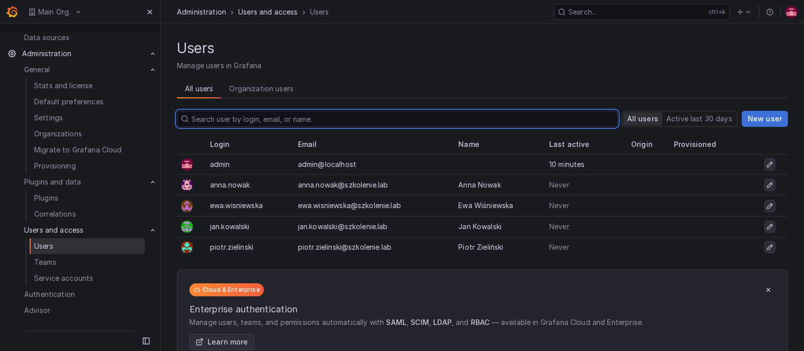
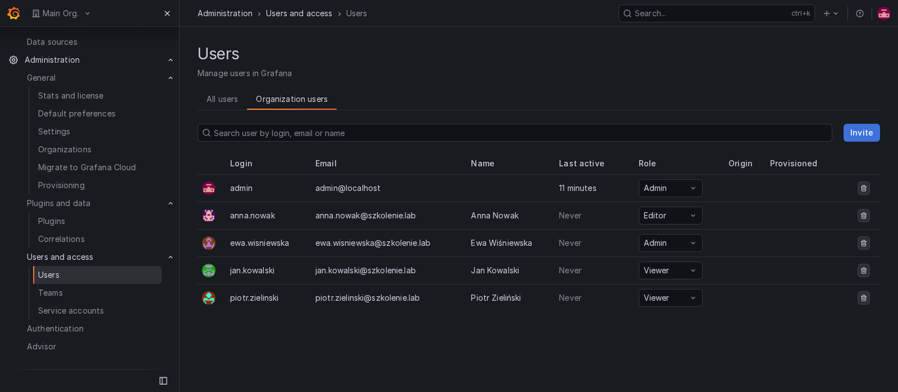
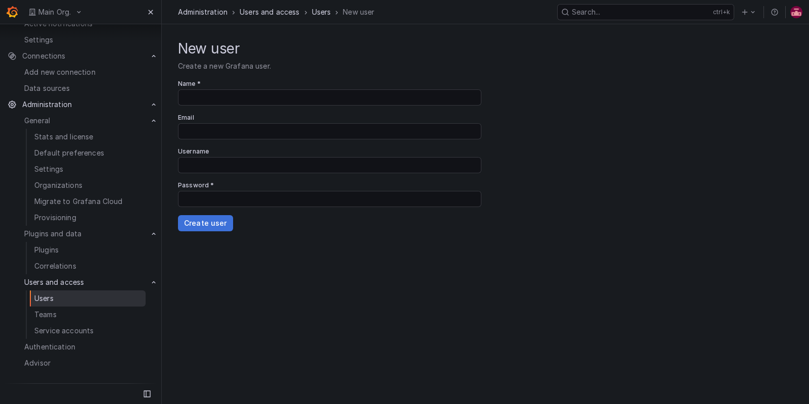
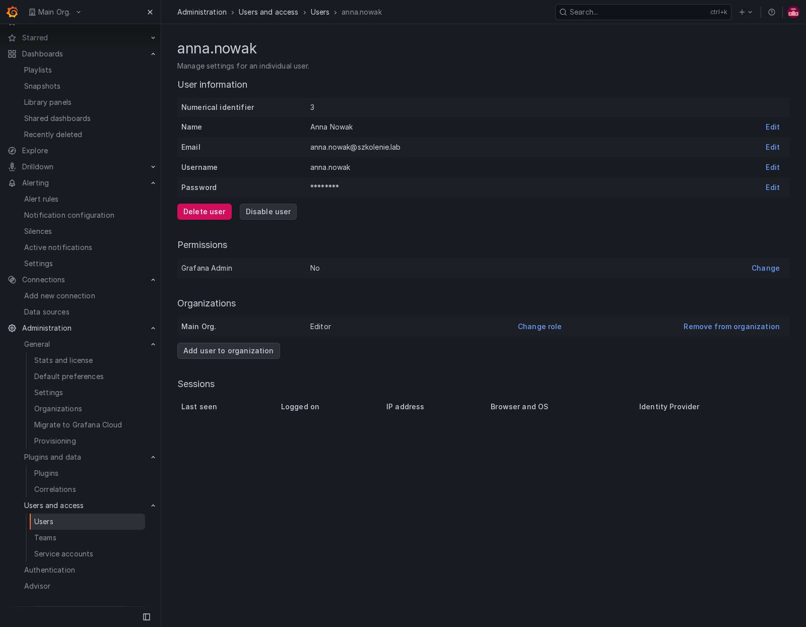

![[Pasted image 20260608080538.png]]

Uprawnienia w Grafanie OSS opierają się na trzech warstwach:

1. **Grafana Admin** (administrator serwera) – flaga na koncie użytkownika, daje dostęp do ustawień całej instancji: wszystkich użytkowników, wszystkich organizacji, ustawień serwera.
2. **Rola organizacyjna** (basic role) – **Viewer**, **Editor**, **Admin** albo **No basic role**, nadawana osobno w każdej organizacji, do której użytkownik należy.
3. **Uprawnienia do folderów i dashboardów** – **View**, **Edit**, **Admin** przypisywane rolom, zespołom lub pojedynczym użytkownikom.

Użytkownikami zarządza się w **Administration → Users and access → Users**. W tej samej sekcji są **Teams** (lekcja 3) i **Service accounts** (konta techniczne dla API i automatyzacji).

---

## Role organizacyjne a Grafana Admin

| Rola | Zakres | Co może |
|------|--------|---------|
| **Viewer** | organizacja | przeglądać dashboardy, używać Explore (domyślnie), nie może zapisywać zmian |
| **Editor** | organizacja | tworzyć i edytować dashboardy, foldery, reguły alertów; nie zarządza użytkownikami ani źródłami danych |
| **Admin** | organizacja | wszystko w organizacji: źródła danych, użytkownicy organizacji, zespoły, pluginy App, ustawienia organizacji |
| **No basic role** | organizacja | brak uprawnień domyślnych – użytkownik widzi tylko to, do czego dostał uprawnienia wprost (folder, dashboard) |
| **Grafana Admin** | cały serwer | zarządzanie wszystkimi użytkownikami i organizacjami, ustawienia serwera, statystyki |

Ważne rozróżnienie:

- **Admin organizacji** (np. `ewa.wisniewska` w labie) zarządza tylko „swoją” organizacją.
- **Grafana Admin** (w labie tylko konto `admin`) widzi wszystkich użytkowników serwera i wszystkie organizacje. Konto `admin` jest jednocześnie Grafana Admin i Adminem w Main Org.

---

## Lista użytkowników

Przejdź do **Administration → Users and access → Users**. Strona ma dwie zakładki:

- **All users** – wszyscy użytkownicy serwera (widoczne dla Grafana Admin),
- **Organization users** – użytkownicy bieżącej organizacji i ich role.



W labie są założeni:

| Login | Imię i nazwisko | Rola w Main Org. | Inne organizacje |
|-------|-----------------|------------------|------------------|
| `admin` | – | Admin + **Grafana Admin** | Klient B (Admin) |
| `jan.kowalski` | Jan Kowalski | Viewer | Klient B (Viewer) |
| `anna.nowak` | Anna Nowak | Editor | – |
| `piotr.zielinski` | Piotr Zieliński | Viewer | – |
| `ewa.wisniewska` | Ewa Wiśniewska | Admin | Klient B (Admin) |

Hasło kont ćwiczeniowych: `Szkolenie123!`.

Zakładka **Organization users** pokazuje tylko członków bieżącej organizacji, a rolę można zmienić od razu z listy rozwijanej w kolumnie **Role**:



> Baner **Enterprise authentication** pod listą informuje, że SAML, SCIM, synchronizacja LDAP i RBAC są dostępne w Grafana Cloud i Enterprise.

---

## Krok 1: Dodawanie użytkownika

1. **Administration → Users and access → Users** → przycisk **New user**.
2. Wypełnij formularz **New user**:
   - **Name** (wymagane) – imię i nazwisko,
   - **Email**,
   - **Username** – login,
   - **Password** (wymagane).
3. Kliknij **Create user**.



Formularz nie zawiera pola roli. Nowy użytkownik trafia do organizacji domyślnej z rolą z ustawienia `auto_assign_org_role` w `grafana.ini` (domyślnie **Viewer**). Rolę zmienia się na stronie użytkownika (krok 2).

---

## Krok 2: Zmiana roli i uprawnień użytkownika

Kliknij użytkownika na liście (lub ikonę ołówka po prawej). Strona użytkownika ma sekcje:

- **User information** – identyfikator, **Name**, **Email**, **Username**, **Password** (każde pole z linkiem **Edit**) oraz przyciski **Delete user** i **Disable user**,
- **Permissions** – flaga **Grafana Admin** (link **Change**),
- **Organizations** – lista organizacji użytkownika z rolą, linkami **Change role** i **Remove from organization** oraz przyciskiem **Add user to organization**,
- **Sessions** – aktywne sesje (ostatnia aktywność, adres IP, przeglądarka, dostawca tożsamości).



**Zmiana roli organizacyjnej:**

1. W sekcji **Organizations** przy organizacji kliknij **Change role**.
2. Wybierz **Viewer**, **Editor**, **Admin** lub **No basic role** i zatwierdź.

**Nadanie uprawnień administratora serwera:**

1. W sekcji **Permissions** kliknij **Change** przy **Grafana Admin**.
2. Ustaw **Yes** i zatwierdź.

> Grafana Admin to bardzo szerokie uprawnienie (cała instancja). Do codziennej pracy wystarcza rola **Admin** w organizacji.

Rolę można też zmienić z poziomu organizacji: zakładka **Organization users** albo **Administration → General → Organizations** → organizacja → lista rozwijana w kolumnie **Role** (lekcja 4).

---

## Krok 3: Niestandardowe role (RBAC) – tylko Enterprise / Cloud

Grafana ma mechanizm kontroli dostępu opartej na rolach (**RBAC**). W wersji OSS działa on „pod spodem” – wbudowane role **Viewer / Editor / Admin / No basic role** i **Grafana Admin** są realizowane przez RBAC – ale:

- **tworzenie własnych ról** (custom roles) z wybranymi uprawnieniami, np. „może tylko wyciszać alerty”,
- **przypisywanie ról stałych** (fixed roles, np. `fixed:datasources:writer`) użytkownikom i zespołom,
- uprawnienia do pojedynczych źródeł danych (zakładka **Permissions** na stronie źródła danych),

są dostępne **wyłącznie w Grafana Enterprise i Grafana Cloud**. W Grafanie OSS nie da się zdefiniować nowej roli ani w `grafana.ini`, ani w UI.

W Enterprise role niestandardowe definiuje się przez HTTP API (`/api/access-control/roles`) lub pliki provisioningu w `/etc/grafana/provisioning/access-control/`, np.:

```yaml
# TYLKO Grafana Enterprise / Cloud – w OSS ten plik nie zadziała
apiVersion: 2
roles:
  - name: custom:alerting:silencer
    description: Może przeglądać alerty i tworzyć wyciszenia
    permissions:
      - action: alert.instances:read
      - action: alert.silences:create
```

**Jak to obejść w OSS?** Łącząc rolę organizacyjną z uprawnieniami do folderów. Przykład z labu: `piotr.zielinski` ma rolę **Viewer**, ale jako członek **Zespół Dev** ma uprawnienie **Admin** do folderu **Development** – może tam tworzyć i edytować dashboardy, a w folderze **Produkcja** tylko je przegląda.

---

## Krok 4: Uprawnienia do folderów

Uprawnienia ustawia się najczęściej na folderach – dashboardy w folderze (i podfolderach) je dziedziczą.

1. **Dashboards** → otwórz folder (np. **Produkcja**).
2. **Folder actions → Manage permissions**.
3. **Add a permission** → wybierz, komu nadajesz uprawnienie (rola, zespół, użytkownik), i poziom: **View**, **Edit** lub **Admin**.

Stan w labie:

| Folder | Rola Viewer | Rola Editor | Zespół Ops | Zespół Dev |
|--------|-------------|-------------|------------|------------|
| **Produkcja** | View | View | Edit | View |
| **Development** | View | Edit | – | Admin |

Rola **Admin** organizacji ma zawsze uprawnienie **Admin** do wszystkich folderów (wpis zablokowany).

Skutki w praktyce:

- `anna.nowak` (Editor, Zespół Ops) – w **Produkcji** może edytować (dzięki zespołowi), choć rola Editor dostała tam tylko View,
- `jan.kowalski` (Viewer, Zespół Ops) – w **Produkcji** może edytować dzięki zespołowi,
- `piotr.zielinski` (Viewer, Zespół Dev) – **Produkcja**: tylko podgląd, **Development**: pełna kontrola.

Uprawnienia się sumują – liczy się najwyższe uprawnienie wynikające z roli, zespołu i wpisu indywidualnego.

---

## Krok 5: Uprawnienia do pojedynczego dashboardu

1. Otwórz dashboard i przejdź w tryb **Edit**.
2. **Settings** (w pasku bocznym **Options** → **View all settings**) → zakładka **Permissions**.
3. **Add a permission** → rola / zespół / użytkownik + poziom **View**, **Edit** lub **Admin** → **Save**.

Uprawnienia ustawione na dashboardzie dodają się do tych odziedziczonych z folderu – nie da się nimi odebrać uprawnienia nadanego na folderze. Dlatego dashboardy o różnym poziomie poufności trzymaj w osobnych folderach.

---

## Service accounts

**Administration → Users and access → Service accounts** – konta techniczne dla skryptów, Terraform, provisioningu i integracji. Konto serwisowe dostaje rolę organizacyjną (np. Viewer) i tokeny API. Używaj ich zamiast loginu i hasła prawdziwego użytkownika w automatyzacji.

---

## Podsumowanie

- **Grafana Admin** = administrator serwera (wszystkie organizacje), **Admin/Editor/Viewer/No basic role** = rola w konkretnej organizacji.
- Użytkownika tworzy się w **Administration → Users and access → Users → New user**, a rolę zmienia na jego stronie (**Change role**).
- Niestandardowe role RBAC to funkcja **Enterprise/Cloud** – w OSS precyzyjny dostęp buduje się z ról, zespołów i uprawnień do folderów.

---

## Ćwiczenie w labie

Lab: http://10.123.2.206:3000, konto `admin` / `admin`.

1. **Administration → Users and access → Users** – porównaj zakładki **All users** i **Organization users**. Który użytkownik jest Grafana Admin?
2. Utwórz użytkownika: **Name** `Twoje Imię Nazwisko`, **Username** `imie.nazwisko`, **Password** `Szkolenie123!`. Sprawdź, jaką rolę dostał w **Main Org.**
3. Zmień jego rolę na **Editor** (**Change role**).
4. W folderze **Produkcja** (**Folder actions → Manage permissions**) sprawdź, jakie uprawnienie ma rola Editor. Zaloguj się w trybie incognito jako nowy użytkownik i spróbuj edytować dashboard **Serwer Linux – przegląd**.
5. Zaloguj się jako `piotr.zielinski` / `Szkolenie123!` i sprawdź, w którym folderze może tworzyć dashboardy, a w którym tylko je przegląda. Wyjaśnij dlaczego.
6. Sprzątanie: jako `admin` usuń utworzonego użytkownika (**Delete user**).
