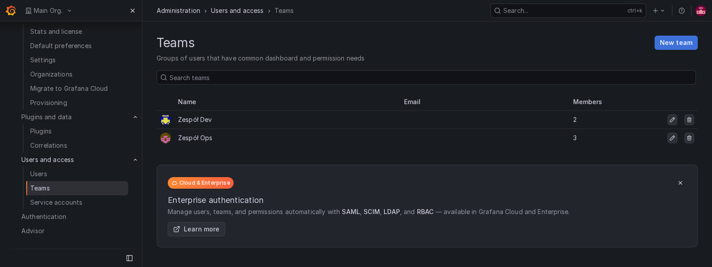
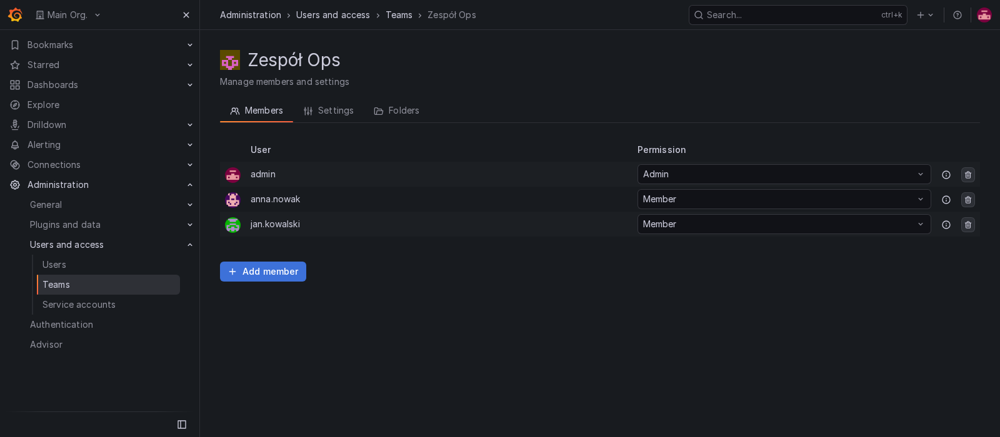
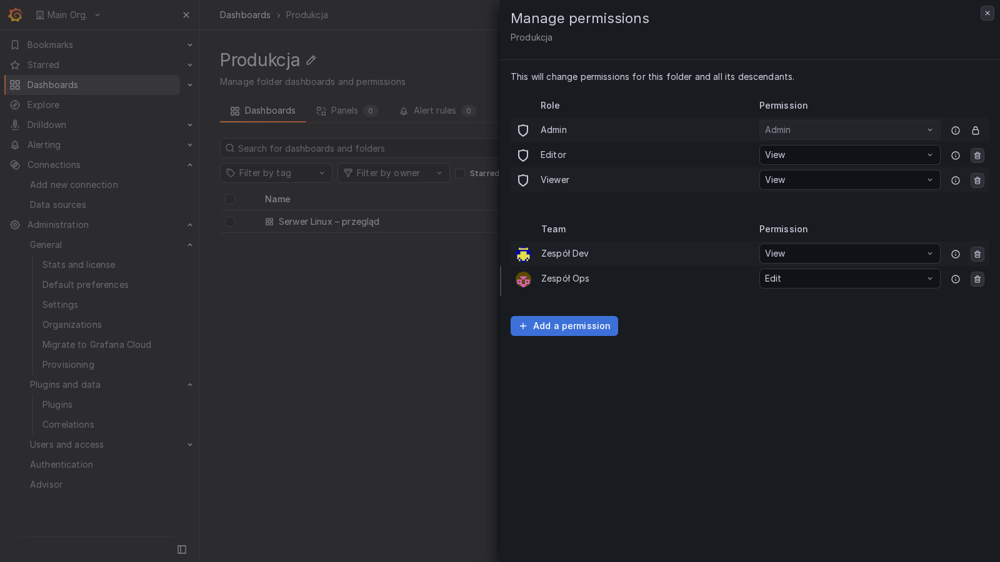
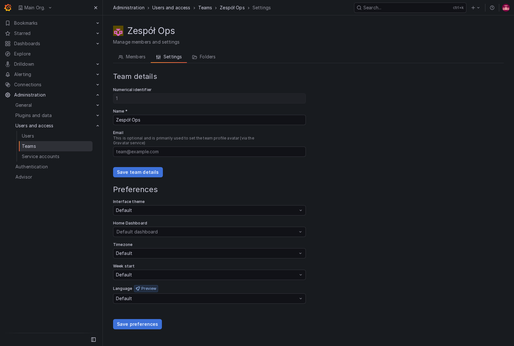

![[Pasted image 20260608080549.png]]

Zespoły (ang. **Teams**) grupują użytkowników jednej organizacji. Zamiast nadawać uprawnienia każdej osobie osobno, nadajesz je zespołowi – wszyscy członkowie automatycznie je dostają, a nowa osoba w dziale potrzebuje tylko dopisania do zespołu.

Zespołami zarządza się w **Administration → Users and access → Teams**. Zespół należy zawsze do jednej organizacji.

## Zastosowania

- Uprawnienia do folderów z dashboardami danego działu (np. Ops edytuje **Produkcję**, Dev ją tylko przegląda).
- Wspólne preferencje: home dashboard, motyw, strefa czasowa dla całego zespołu.
- Uprawnienia do innych zasobów, którym można nadać uprawnienia (np. dashboardy, foldery z regułami alertów).

---

## Zespoły w labie

| Zespół | Członkowie | Uprawnienia do folderów |
|--------|------------|-------------------------|
| **Zespół Ops** | `admin` (Admin), `anna.nowak`, `jan.kowalski` | Produkcja – **Edit** |
| **Zespół Dev** | `admin` (Admin), `piotr.zielinski` | Produkcja – **View**, Development – **Admin** |

Konto `admin` jest członkiem obu zespołów z uprawnieniem **Admin**, bo to ono je utworzyło – twórca zespołu zostaje automatycznie jego administratorem. Dlatego lista pokazuje 3 i 2 członków.

---

## Krok 1: Tworzenie zespołu

1. **Administration → Users and access → Teams** → przycisk **New team**.
2. Podaj **Name** (np. `Zespół DBA`) i opcjonalnie **Email** (służy głównie do wyświetlenia awatara zespołu z serwisu Gravatar).
3. Zatwierdź utworzenie zespołu.

Po utworzeniu otwiera się strona zespołu z zakładkami **Members**, **Settings** i **Folders**.

---

## Krok 2: Dodawanie członków

1. Otwórz zespół (klik w nazwę albo ikonę ołówka na liście).
2. Zakładka **Members** → **Add member**.
3. Wybierz użytkownika i jego uprawnienie w zespole:
   - **Member** – zwykły członek, dziedziczy uprawnienia zespołu,
   - **Admin** – może dodatkowo zarządzać zespołem (dodawać i usuwać członków, zmieniać ustawienia).
4. Zatwierdź dodanie.

Uprawnienie członka zmienisz listą rozwijaną w kolumnie **Permission**, a usuniesz go ikoną kosza w jego wierszu.

---

## Krok 3: Uprawnienia zespołu do folderów

1. **Dashboards** → otwórz folder (np. **Produkcja**).
2. **Folder actions → Manage permissions**.
3. **Add a permission** → wybierz zespół i poziom:
   - **View** – przeglądanie,
   - **Edit** – tworzenie i edycja dashboardów w folderze,
   - **Admin** – edycja oraz zarządzanie uprawnieniami folderu.
4. Zapisz.

Komunikat na górze okna przypomina, że zmiana dotyczy folderu i wszystkich jego elementów podrzędnych (podfoldery, dashboardy). Wpis **Admin** dla roli Admin jest zablokowany (ikona kłódki).

---

## Krok 4: Ustawienia i preferencje zespołu

Zakładka **Settings** ma dwie części:

- **Team details** – **Numerical identifier** (ID zespołu, przydatne w API), **Name**, **Email** i przycisk **Save team details**,
- **Preferences** – **Interface theme**, **Home Dashboard**, **Timezone**, **Week start**, **Language**; zapis przyciskiem pod sekcją.

**Home dashboard dla zespołu:** w polu **Home Dashboard** wybierz dashboard (np. **Serwer Linux – przegląd** dla Ops) i zapisz preferencje. Członkowie zespołu zobaczą go po zalogowaniu jako stronę główną.

Kolejność ważności preferencji (od najważniejszej): **użytkownik** (Profile → Preferences) → **zespół** → **organizacja** (Administration → General → Default preferences) → ustawienia serwera.

---

## Krok 5: Usunięcie zespołu

Na liście zespołów kliknij ikonę kosza w wierszu zespołu i potwierdź.

> Usunięcie zespołu nie usuwa użytkowników, ale znikają wszystkie uprawnienia nadane zespołowi (np. do folderów). Członkowie zachowują tylko swoją rolę organizacyjną i uprawnienia nadane im indywidualnie.

---

## Zespoły a role organizacyjne

Obie warstwy działają jednocześnie i się sumują:

| Warstwa | Zakres |
|---------|--------|
| Rola organizacyjna (Admin / Editor / Viewer / No basic role) | ogólne uprawnienia w całej organizacji |
| Uprawnienia zespołu do folderów i dashboardów | dostęp do konkretnych zasobów |

Przykład z labu: `jan.kowalski` ma rolę **Viewer**, ale jako członek **Zespołu Ops** ma **Edit** w folderze **Produkcja** – może tam edytować dashboardy. Poza tym folderem pozostaje Viewerem.

> W Grafana Enterprise/Cloud członkostwo w zespołach może być synchronizowane z grupami LDAP / OAuth / SAML (team sync). W OSS członków dodaje się ręcznie (lub przez API).

---

## Podsumowanie

Zespoły upraszczają zarządzanie dostępem: tworzysz zespół (np. `Zespół Ops`), nadajesz mu uprawnienia do folderów i ustawiasz preferencje, a potem tylko dopisujesz lub usuwasz ludzi.

---

## Ćwiczenie w labie

Lab: http://10.123.2.206:3000, konto `admin` / `admin`.

1. Otwórz **Zespół Ops** i **Zespół Dev** – sprawdź członków i ich uprawnienia (**Member** / **Admin**).
2. Utwórz zespół `Monitoring` i dodaj do niego `piotr.zielinski` (Member) oraz `anna.nowak` (Admin).
3. W zakładce **Settings** zespołu `Monitoring` ustaw **Home Dashboard** na **Serwer Linux – przegląd** i zapisz.
4. W folderze **Development** nadaj zespołowi `Monitoring` uprawnienie **View**.
5. Zaloguj się (okno incognito) jako `piotr.zielinski` / `Szkolenie123!` – czy strona główna się zmieniła? Uwaga: preferencja zespołu nie zadziała, jeśli użytkownik ma ustawiony własny home dashboard.
6. Sprzątanie: usuń zespół `Monitoring` i sprawdź w **Manage permissions** folderu **Development**, co stało się z jego wpisem.
