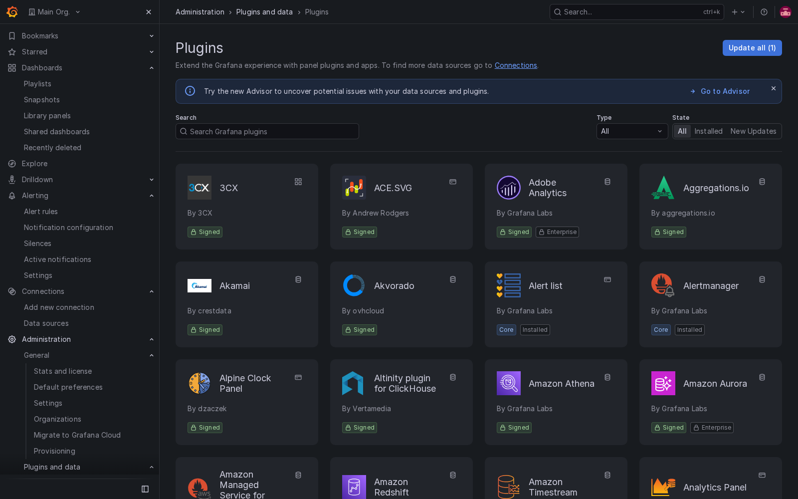

![[Pasted image 20260608080837.png]]
Pluginy w Grafanie to rozszerzenia, które dodają nowe możliwości do platformy: nowe źródła danych, typy wizualizacji lub kompletne aplikacje. Dzięki pluginom Grafana współpracuje z setkami systemów – katalog na grafana.com zawiera kilkaset pozycji (w labie `grafana cli plugins list-remote` zwraca ok. 390 pluginów).

## Architektura pluginów

Każdy zainstalowany plugin to osobny katalog w `/var/lib/grafana/plugins/` (ścieżka z opcji `cfg:default.paths.plugins` w usłudze `grafana-server`) zawierający:

- plik manifestu `plugin.json` z metadanymi (ID, typ, wersja, zależności),
- plik `MANIFEST.txt` z podpisem cyfrowym,
- kod frontendu (TypeScript/React, zbudowany do `module.js`) i opcjonalnie backendu (binarka w Go, np. `gpx_zabbix-datasource_linux_amd64`),
- dokumentację i grafiki.

Pluginy mogą pochodzić z:

- **katalogu Grafany** (grafana.com/grafana/plugins) – pluginy Grafana Labs, partnerów i społeczności,
- **prywatnych repozytoriów** – wewnętrzne pluginy organizacji (instalacja z pliku ZIP),
- **własnego kodu** – narzędzie `npx @grafana/create-plugin` generuje szkielet pluginu.

> W Grafanie 12/13 część „wbudowanych” źródeł danych (Prometheus, InfluxDB, Elasticsearch, Loki, Tempo, PostgreSQL, MSSQL…) jest dostarczana jako osobne pluginy aktualizowane niezależnie od Grafany. Przy pierwszym starcie Grafana sama je doinstalowuje w tle (w logach `plugin.backgroundinstaller`), dlatego widać je w `/var/lib/grafana/plugins/` i w wyniku `grafana cli plugins ls`.

---

## Typy pluginów

### 1. Data source (źródło danych)

Łączy Grafanę z systemem przechowującym dane i dostarcza edytor zapytań.

**Charakterystyka:**
- implementuje komunikację ze źródłem (często po stronie backendu w Go – wtedy działa też alerting),
- dostarcza ekran konfiguracji połączenia i edytor zapytań,
- nowe źródło dodaje się w **Connections → Add new connection**.

**Przykłady (ID pluginu sprawdzone w labie):**

| Plugin ID | System | Uwagi |
|-----------|--------|-------|
| `prometheus` | Prometheus | dostarczany z Grafaną |
| `influxdb` | InfluxDB (InfluxQL, Flux, SQL) | dostarczany z Grafaną |
| `elasticsearch` | Elasticsearch | dostarczany z Grafaną |
| `grafana-postgresql-datasource` | PostgreSQL | dostarczany z Grafaną |
| `mysql` | MySQL / MariaDB | wbudowany |
| `grafana-testdata-datasource` | TestData (dane testowe) | wbudowany |
| `alexanderzobnin-zabbix-datasource` | Zabbix | część aplikacji `alexanderzobnin-zabbix-app` |
| `yesoreyeram-infinity-datasource` | JSON, CSV, XML, GraphQL, HTML, REST API | instalowany, Grafana Labs |
| `grafana-azure-monitor-datasource` | Azure Monitor | wbudowany |

### 2. Panel (wizualizacja)

Dodaje nowy typ wizualizacji wybierany w edytorze panelu (**Visualization picker**).

**Charakterystyka:**
- działa tylko w przeglądarce (frontend),
- większość potrzebnych wizualizacji jest wbudowana (Time series, Bar chart, Stat, Gauge, Table, Heatmap, State timeline, Geomap, Canvas…),
- pluginy dodają wizualizacje specjalistyczne.

**Przykłady:**

| Plugin ID | Opis |
|-----------|------|
| `grafana-clock-panel` | zegar / odliczanie (zainstalowany w labie) |
| `marcusolsson-gantt-panel` | wykres Gantta |
| `nline-plotlyjs-panel` | wykresy Plotly.js (3D, scatter, bąbelkowe) |

### 3. App (aplikacja)

Pakiet łączący źródła danych, panele, gotowe dashboardy i własne strony w UI.

**Charakterystyka:**
- może dodawać własne pozycje w menu (np. **Drilldown**),
- często zawiera w sobie plugin data source i/lub panel,
- po instalacji wymaga **włączenia** (**Enable**) na stronie pluginu – dopiero wtedy jego składniki są dostępne.

**Przykłady (wszystkie zainstalowane w labie):**

| Plugin ID | Opis |
|-----------|------|
| `alexanderzobnin-zabbix-app` | Zabbix – źródło danych, panel problemów, dashboardy |
| `grafana-metricsdrilldown-app` | menu **Drilldown** – przeglądanie metryk Prometheusa bez pisania zapytań |
| `grafana-lokiexplore-app` | menu **Drilldown** – przeglądanie logów z Loki |
| `grafana-exploretraces-app` | menu **Drilldown** – przeglądanie śladów z Tempo |
| `grafana-advisor-app` | **Administration → Advisor** – kontrola konfiguracji źródeł danych i pluginów |

> Dawniej w tej grupie wymieniano **Grafana OnCall** – wersja OSS jest wycofana (repozytorium zarchiwizowane 24.03.2026), następcą jest **Grafana Cloud IRM**. Szczegóły w lekcji 3.

---

## Katalog pluginów w Grafanie

Katalog jest wbudowany w Grafanę: **Administration → Plugins and data → Plugins**.



Na stronie katalogu:

- **Search** – wyszukiwanie po nazwie,
- **Type** – filtr: wszystkie, data source, panel, app,
- **State** – **All** / **Installed** / **New Updates**,
- prawy górny róg – informacja o aktualizacjach (np. **No updates available**),
- na kafelku: nazwa, autor (**By Grafana Labs**, **By 3CX**…) i odznaki: **Signed**, **Core** (część Grafany), **Enterprise** (wymaga licencji Enterprise), **Installed**.

Źródła danych można też przeglądać i dodawać w **Connections → Add new connection** – link **Connections** jest w opisie strony.

---

## Pluginy wbudowane a instalowane

| Cecha | Core (wbudowane) | Instalowane z katalogu |
|-------|------------------|------------------------|
| Instalacja | nie wymagana | `grafana cli plugins install` lub przycisk **Install** w UI |
| Odznaka w katalogu | **Core** | **Signed** (+ typ podpisu na stronie pluginu) |
| Wsparcie | Grafana Labs | Grafana Labs, partner lub autor społecznościowy |
| Aktualizacje | razem z Grafaną | niezależnie: UI lub `grafana cli plugins update` |
| Usunięcie | niemożliwe | **Uninstall** w UI lub `grafana cli plugins remove` |

---

## Podpisy pluginów

Grafana sprawdza podpis cyfrowy każdego pluginu (plik `MANIFEST.txt`). Na stronie pluginu, w panelu po prawej, pole **Signature** pokazuje typ podpisu (np. **grafana**).

| Typ podpisu | Kto podpisuje | Przykład |
|-------------|---------------|----------|
| **grafana** | Grafana Labs | `grafana-clock-panel`, `alexanderzobnin-zabbix-app`, `yesoreyeram-infinity-datasource` |
| **commercial** | partner komercyjny (plugin zweryfikowany przez Grafana Labs) | pluginy firm trzecich |
| **community** | autor społecznościowy (plugin zweryfikowany przez Grafana Labs) | wiele pluginów z katalogu |
| **private** | podpis prywatny – plugin działa tylko pod wskazanymi adresami `root_url` | pluginy wewnętrzne firmy |
| brak (**unsigned**) | – | plugin w trakcie tworzenia, plugin bez podpisu |

Grafana domyślnie **nie ładuje** pluginów niepodpisanych. Wyjątek dodaje się w `/etc/grafana/grafana.ini`:

```ini
[plugins]
# lista ID rozdzielona przecinkami
allow_loading_unsigned_plugins = moja-firma-panel,moja-firma-datasource
```

i restartuje usługę: `sudo systemctl restart grafana-server`.

> Pluginów ze **zmodyfikowanym** podpisem (pliki zmienione po podpisaniu) Grafana nie załaduje nigdy – nawet z `allow_loading_unsigned_plugins`.

---

## Podsumowanie

Grafana obsługuje trzy typy pluginów: **Data source** (źródła danych), **Panel** (wizualizacje) i **App** (aplikacje). Popularne źródła danych są dostarczane razem z Grafaną, a resztę instaluje się z katalogu (**Administration → Plugins and data → Plugins**) albo przez `grafana cli`. Pluginy App trzeba po instalacji włączyć, a niepodpisane pluginy wymagają wpisu `allow_loading_unsigned_plugins`.

---

## Ćwiczenie w labie

Lab: http://10.123.2.206:3000, konto `admin` / `admin`.

1. Otwórz **Administration → Plugins and data → Plugins**. Ustaw filtr **Type** kolejno na data source, panel i app – ile jest pluginów każdego typu?
2. Ustaw **State → Installed**. Znajdź pluginy, które nie mają odznaki **Core** – to pluginy instalowane.
3. Otwórz stronę pluginu **Clock** i **Zabbix** – odczytaj **Installed Version**, **Dependencies** i **Signature**.
4. Przez SSH sprawdź, które pluginy leżą na dysku:
   ```bash
   ssh szkolenie@10.123.2.206
   sudo ls /var/lib/grafana/plugins/
   sudo cat /var/lib/grafana/plugins/grafana-clock-panel/plugin.json | head -20
   ```
5. Pytanie kontrolne: do jakiego typu należy plugin `alexanderzobnin-zabbix-app` i dlaczego w **Connections → Data sources** widzisz źródło typu Zabbix?
