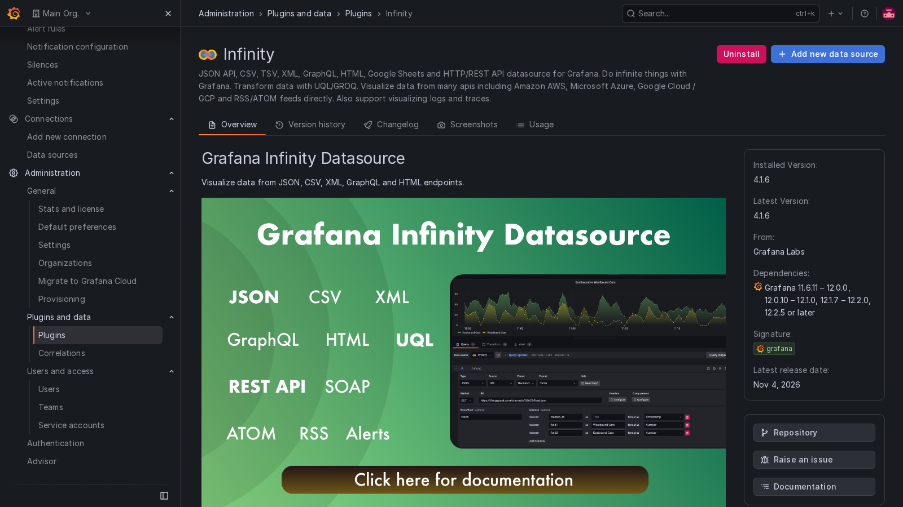
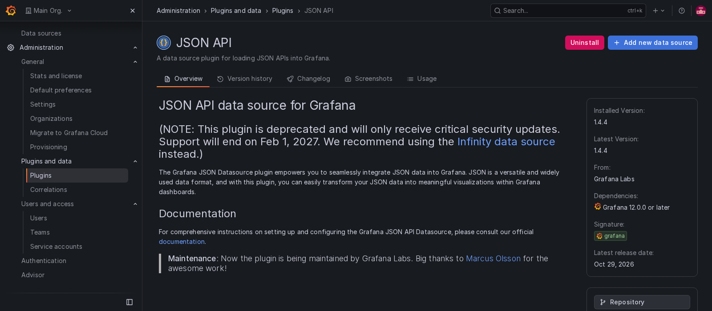

![[Pasted image 20260608080853.png]]

Zestawienie często używanych pluginów Grafany, zaktualizowane pod Grafanę 13 (stan na listopad 2026). Część pluginów polecanych w starszych materiałach jest dziś **wycofana** – na końcu lekcji jest tabela z ich następcami.

Wszystkie pluginy wyszukasz w **Administration → Plugins and data → Plugins** lub na grafana.com/grafana/plugins.

---

## Źródła danych (Data source)

### Zabbix

- **Plugin ID:** `alexanderzobnin-zabbix-app` (aplikacja zawierająca źródło `alexanderzobnin-zabbix-datasource` i panel **Zabbix Problems**)
- **Typ:** App
- **Podpis:** grafana (plugin rozwijany przez Grafana Labs)
- **Opis:** metryki, historia, trendy, problemy i zdarzenia z Zabbixa; funkcje przetwarzania danych, adnotacje, alerting.
- **W labie:** wersja 6.10.3, włączony, źródło `Zabbix` łączy się z Zabbix 7.0 przez **API token**.
- **Instalacja:**
  ```bash
  sudo grafana cli plugins install alexanderzobnin-zabbix-app
  sudo systemctl restart grafana-server
  ```
  następnie **Enable** na stronie pluginu.

### Infinity

- **Plugin ID:** `yesoreyeram-infinity-datasource`
- **Typ:** Data source
- **Podpis:** grafana (Grafana Labs)
- **Opis:** uniwersalne źródło danych z JSON, CSV, TSV, XML, GraphQL, HTML i dowolnych API REST (także RSS/ATOM); dane można przekształcać językami UQL/GROQ. **Następca** pluginów JSON API i CSV.
- **W labie:** zainstalowany (wersja 4.1.6).
- **Instalacja:**
  ```bash
  sudo grafana cli plugins install yesoreyeram-infinity-datasource
  ```



### Google Sheets

- **Plugin ID:** `grafana-googlesheets-datasource`
- **Typ:** Data source
- **Opis:** arkusze Google jako źródło danych – przydatne do dashboardów z ręcznie aktualizowanymi danymi biznesowymi.

### Azure Monitor, CloudWatch, Google Cloud Monitoring

- **Plugin ID:** `grafana-azure-monitor-datasource`, `cloudwatch`, `stackdriver`
- **Typ:** Data source (dostarczane z Grafaną)
- **Opis:** metryki i logi z chmur Azure, AWS i GCP – nie wymagają instalacji, wystarczy dodać źródło w **Connections**.

---

## Wizualizacje (Panel)

### Clock

- **Plugin ID:** `grafana-clock-panel`
- **Typ:** Panel
- **Podpis:** grafana
- **Opis:** aktualny czas w wybranej strefie lub odliczanie do zdarzenia (np. okna serwisowego). Popularny na ekranach NOC.
- **W labie:** zainstalowany (wersja 3.2.5).
- **Instalacja:**
  ```bash
  sudo grafana cli plugins install grafana-clock-panel
  ```

### Alpine Clock Panel

- **Plugin ID:** `dzaczek-alpineclock-panel`
- **Typ:** Panel (społecznościowy, podpisany)
- **Opis:** alternatywny zegar – dobry kandydat do ćwiczenia instalacji i usuwania pluginu z UI.

### Plotly

- **Plugin ID:** `nline-plotlyjs-panel`
- **Typ:** Panel
- **Opis:** wykresy biblioteki Plotly.js (3D, scatter, bąbelkowe) konfigurowane w JavaScript – dla nietypowych wizualizacji, których nie ma wśród paneli wbudowanych.

> Zanim zainstalujesz plugin panelu, sprawdź, czy wbudowane wizualizacje tego nie potrafią. Grafana 13 ma m.in. **State timeline**, **Status history**, **Geomap**, **Canvas**, **XY chart**, **Candlestick**, **Trend**, **Flame graph** i **Node graph**.

---

## Aplikacje (App)

### Zabbix

Opisany wyżej – najpopularniejsza aplikacja społeczności monitoringu.

### Drilldown (Metrics, Logs, Traces, Profiles)

- **Plugin ID:** `grafana-metricsdrilldown-app`, `grafana-lokiexplore-app`, `grafana-exploretraces-app`, `grafana-pyroscope-app`
- **Typ:** App (instalowane automatycznie z Grafaną 13)
- **Opis:** przeglądanie metryk Prometheusa, logów Loki, śladów Tempo i profili Pyroscope bez pisania zapytań – menu **Drilldown**.

### Advisor

- **Plugin ID:** `grafana-advisor-app`
- **Typ:** App (instalowany automatycznie)
- **Opis:** **Administration → Advisor** – sprawdza konfigurację źródeł danych i pluginów (np. nieaktualne lub wycofane pluginy). Na stronie katalogu pluginów widać baner *„Try the new Advisor…”*.

### Grafana OnCall – wycofany

- **Plugin ID:** `grafana-oncall-app`
- **Status:** **Grafana OnCall OSS** przeszedł w tryb utrzymania 11.03.2025, a 24.03.2026 repozytorium zostało zarchiwizowane (tylko do odczytu). Tego dnia przestała działać integracja z Grafana Cloud (powiadomienia SMS, telefoniczne i push) – istniejące instalacje działają dalej, ale bez rozwoju. Plugin nie występuje już w katalogu (`grafana cli plugins list-remote` go nie zwraca).
- **Następca:** **Grafana Cloud IRM** (dyżury, eskalacje i incydenty – usługa w Grafana Cloud, nie plugin do Grafany OSS).
- **W Grafanie OSS:** do powiadamiania wystarcza wbudowany Alerting (contact points: e-mail, Slack, Microsoft Teams, Discord, webhook…).

---

## JSON API i CSV – wycofane, użyj Infinity

Plugin **JSON API** (`marcusolsson-json-datasource`) jest zainstalowany w labie, żeby pokazać, jak wygląda plugin wycofany. Na jego stronie widnieje komunikat: *„This plugin is deprecated and will only receive critical security updates. Support will end on Feb 1, 2027. We recommend using the Infinity data source instead.”*



Ten sam status (tylko poprawki bezpieczeństwa, koniec wsparcia 1.02.2027, rekomendacja Infinity) ma plugin **CSV** (`marcusolsson-csv-datasource`).

Co to oznacza w praktyce:

- **nowe** źródła danych z API REST / JSON / CSV twórz na pluginie **Infinity**,
- istniejące dashboardy na JSON API zaplanuj do migracji przed 1.02.2027,
- nie usuwaj pluginu, dopóki korzystają z niego dashboardy.

---

## Pluginy przestarzałe i ich zamienniki

| Stary plugin | Status | Zamiennik |
|--------------|--------|-----------|
| `grafana-worldmap-panel` (Worldmap Panel) | wycofany, nierozwijany; napisany w AngularJS, którego Grafana 12+ już nie obsługuje | wbudowany **Geomap** (lekcja IV.13) |
| `natel-discrete-panel` (Discrete) | nierozwijany, AngularJS – nie działa w Grafanie 12+ | wbudowany **State timeline** (lekcja IV.8) / **Status history** |
| `marcusolsson-json-datasource` (JSON API) | wycofany, wsparcie do 1.02.2027 | **Infinity** |
| `marcusolsson-csv-datasource` (CSV) | wycofany, wsparcie do 1.02.2027 | **Infinity** |
| `marcusolsson-gantt-panel` (Gantt) | autor nie rozwija go od 2022 r. | wbudowany **State timeline** |
| `grafana-oncall-app` (OnCall OSS) | zarchiwizowany 24.03.2026 | **Grafana Cloud IRM** lub wbudowany Alerting |

Pluginów Worldmap i Discrete nie znajdziesz już w wyniku `grafana cli plugins list-remote`.

---

## Pluginy wbudowane (bez instalacji)

| Typ | Przykłady |
|-----|-----------|
| Data source | Prometheus, InfluxDB, MySQL, PostgreSQL, Microsoft SQL Server, Elasticsearch, Loki, Tempo, Jaeger, Zipkin, Graphite, OpenTSDB, CloudWatch, Azure Monitor, Google Cloud Monitoring, TestData |
| Panel | Time series, Bar chart, Stat, Gauge, Bar gauge, Table, Pie chart, State timeline, Status history, Heatmap, Histogram, Geomap, Canvas, Text, Logs, Traces, Node graph, Flame graph, Candlestick, XY chart, Trend, Alert list, Dashboard list, Annotations list |

---

## Jak wybrać plugin?

Przed instalacją sprawdź na stronie pluginu:

1. **Komunikat o wycofaniu** (*deprecated*) w opisie – jeśli jest, wybierz zamiennik.
2. **Latest release date** i zakładkę **Changelog** – czy plugin jest rozwijany.
3. **Dependencies** – czy obsługuje Twoją wersję Grafany (lab: 13.3.0).
4. **Signature** – `grafana` (Grafana Labs), `commercial`, `community`; pluginy niepodpisane tylko świadomie.
5. **Administration → Advisor** – po instalacji pokaże problemy z pluginami.

---

## Podsumowanie

W Grafanie 13 najważniejsze zewnętrzne pluginy w typowym monitoringu to **Zabbix** i **Infinity** (zamiast wycofanych JSON API i CSV), a z paneli – **Clock**. Worldmap i Discrete zastąpiły wbudowane wizualizacje **Geomap** i **State timeline**, a Grafana OnCall OSS – **Grafana Cloud IRM** lub wbudowany Alerting.

---

## Ćwiczenie w labie

Lab: http://10.123.2.206:3000, konto `admin` / `admin`.

1. **Administration → Plugins and data → Plugins** → otwórz **JSON API** i **Infinity**. Porównaj opis, **Signature** i **Latest release date**.
2. Dodaj źródło danych **Infinity** (przycisk **Add new data source** na stronie pluginu), nazwij je `Infinity – test` i zapisz (**Save & test**).
3. Na nowym dashboardzie dodaj panel **Table** ze źródłem `Infinity – test`: **Type** `JSON`, **Source** `URL`, URL `http://localhost:3000/api/health` – w tabeli zobaczysz wersję Grafany i stan bazy. Jeśli źródło zgłosi brak dozwolonego hosta, dopisz `http://localhost:3000` w ustawieniach źródła (**Allowed hosts**).
4. Otwórz **Administration → Advisor** i sprawdź, czy raportuje coś na temat pluginu JSON API.
5. Na dashboardzie **Wizualizacje – wszystkie typy** obejrzyj panel **Geomap** – to wbudowany zamiennik Worldmap Panel.
6. Sprzątanie: usuń dashboard testowy i źródło `Infinity – test`.
